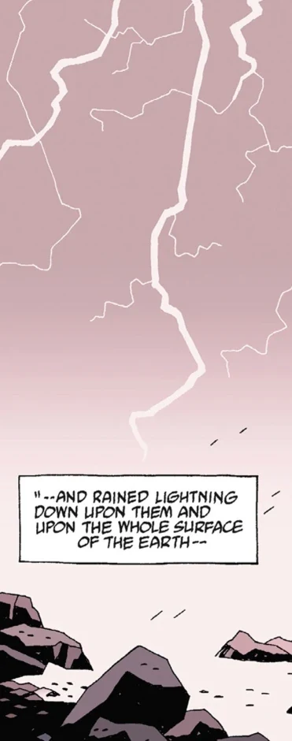
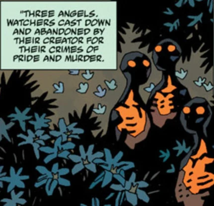

 **守望者（Watchers）**，又称大灵（Greater Spirits），是[上帝](/entry/God)创造的一个种族。

## 历史

太初，[上帝](/entry/God)创造了一类称为守望者的灵体。其中许多大灵被送往初生的地球，看护并守护它。然而，这些灵体中的一个——守望者 [Anum](/entry/Anum)——探手入天空，偷走了上帝的力量。这力量名为 *Flamma Reconditus*，即"秘火"，或称 [Vril](/entry/Vril)。借助 Vril，Anum 用泥与火创造了[奥古·桀哈](/entry/Ogdru_Jahad)。其他守望者在它上面盖上自己的印，让这东西获得生命。然而它直到夜幕降临、黑暗充满其身时才活转。奥古·桀哈就此诞生，它们的第一个行动是孕育自己的 369 个孩子——[奥格德鲁·赫姆](/entry/Ogdru_Hem)，它们成了地球最早的生命形态。

守望者们被这些怪物吓坏了，向奥格德鲁·赫姆开战。奥格德鲁·赫姆最终全被处置，其中许多仅以某种方式勉强维系着存在；奥古·桀哈则被它们的创造者封进一座水晶牢笼，置于深渊的中心。守望者们不再信任 Anum，他被自己的同胞杀死。这起谋杀激怒了上帝，他因守望者们搞砸任务而施以惩罚：一些被扔进[深渊深坑](/entry/Hell)，另一些被放逐到地球上繁衍怪物。此后，世间的小灵被允许赋有形体，最终成为人类的第一个种族——[海波伯利安人](/entry/Hyperboreans)。

 其中三个守望者最终来到海波伯利安人的花园，把天国的秘密传给海波伯利安国王 [Thoth](/entry/Thoth)。他们被赫卡特杀死，血被赫卡特吸干饮尽，以此推翻国王的权威。

在地狱深坑中，以守望者 [Pluto](/entry/Pluto) 为首的初代天使发动战争，要与[Satan（撒旦）](/entry/Satan)率领的大军和第一批堕落天使争夺地狱本身的统治权，经过一千年的战争后落败。初代天使大多战败被杀，其中一个被罚为奴，建造撒旦的都城、他的权力宝座[万魔殿（Pandemonium）](/entry/Pandemonium)。其余存活的天使被用作都城的结构支撑，一直留存到地狱男爵杀死撒旦、万魔殿被毁之后。剩余的守望者被[瓦尔瓦拉](/entry/Varvara)召唤，与一只降临地球的奥古·桀哈作战，作为赎罪，但他们全部战败被灭。

## 已知守望者

## 已知守望者

- [Anum](/entry/Anum)——奥古·桀哈的创造者（已故）。
- [Pluto](/entry/Pluto)——罗马神话中的冥界之神，被投入深坑的守望者首领。

[pt-br:Guardiões](/entry/pt-br%3AGuardi%C3%B5es)
