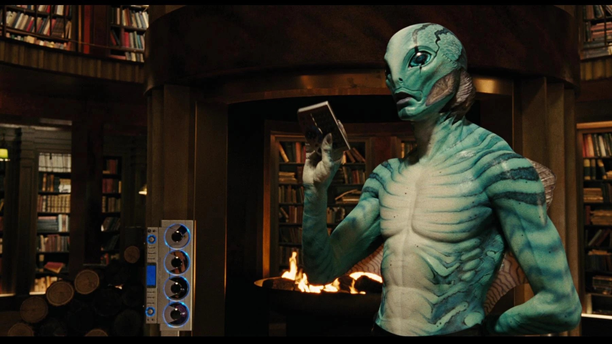
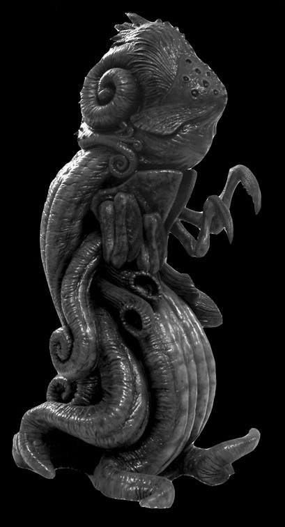
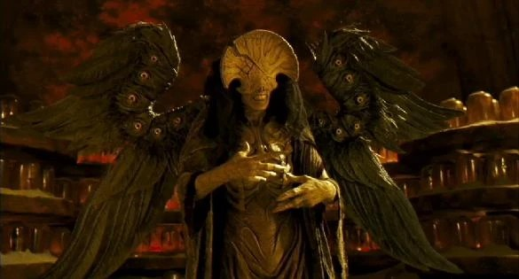

**Wayne Douglas Barlowe**（1958 年 1 月 6 日出生）是一位美国科幻与奇幻作家、画家，曾在[《地狱男爵》](/entry/Hellboy_(2004_film))和[《地狱男爵 2：黄金军团》](/entry/Hellboy_II__The_Golden_Army)两部电影中担任视觉设计师。他尤其负责设计了影片中的大部分生物，例如[亚伯·塞皮恩](/entry/Abraham_Sapien)、[奥古·桀哈](/entry/Ogdru_Jahad)、[萨麦尔（Sammael）](/entry/Sammael)以及[死亡天使](/entry/Angel_of_Death)。

## 地狱男爵相关作品

Barlowe 设计的亚伯·塞皮恩

Barlowe 设计的奥古·桀哈

萨麦尔

死亡天使

## 其他作品

- *《银河追缉令》（Galaxy Quest）*
- *《刀锋战士 2》（Blade II）*
- *《哈利·波特与阿兹卡班的囚徒》*
- *《哈利·波特与火焰杯》*
- *《地球停转之日》（The Day the Earth Stood Still）*
- *《阿凡达》（Avatar）*
- *《异星战场》（John Carter）*
- *《环太平洋》（Pacific Rim）*
- *《彼得的龙》（Pete's Dragon）*
- *《海王》（Aquaman）*
- *《夜行者》（Nightflyers）*
- *《黑镜：潘达斯奈基》（Black Mirror: Bandersnatch）*

## 画廊

|Barlowe's Abe Sapien

|Barlowe's Ogdru Jahad

|The Angel of Death
