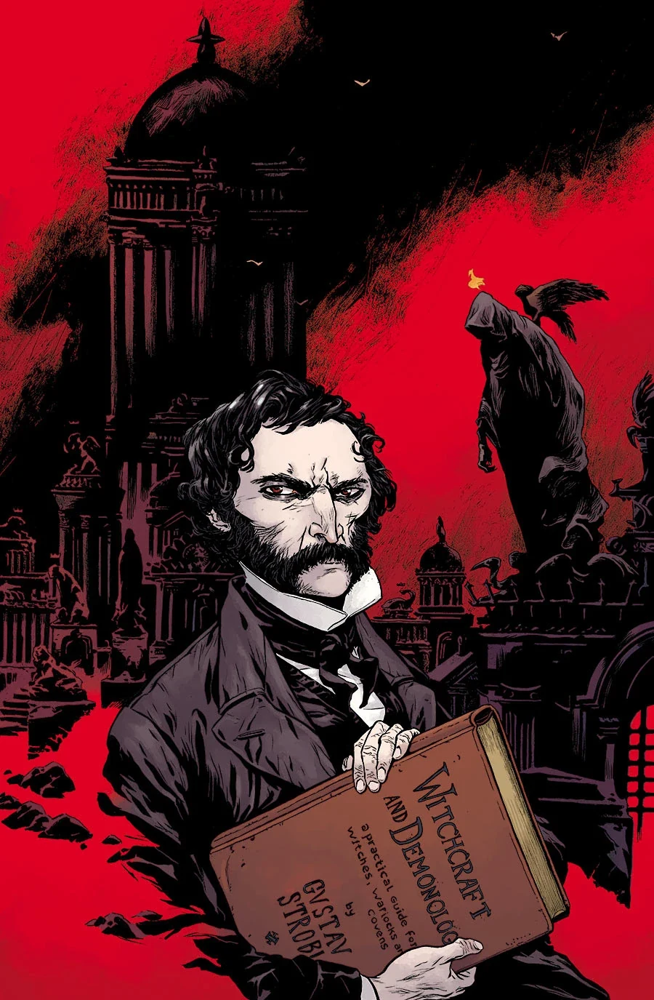

《**Witchcraft & Demonology**》是一则关于[古斯塔夫·施特罗布尔](/entry/Gustav_Strobl)（Gustav Strobl）的回忆故事。

## 剧情梗概

画廊艺术家 [Santiago Caruso](/entry/Santiago_Caruso) 借一位十九世纪死灵法师的生平，铺陈出西方秘术史：此人曾下地狱又活着归来，心中只有一个目标——确保自己在世界终结之时，能与魔鬼本人并肩而立。

## 画廊

