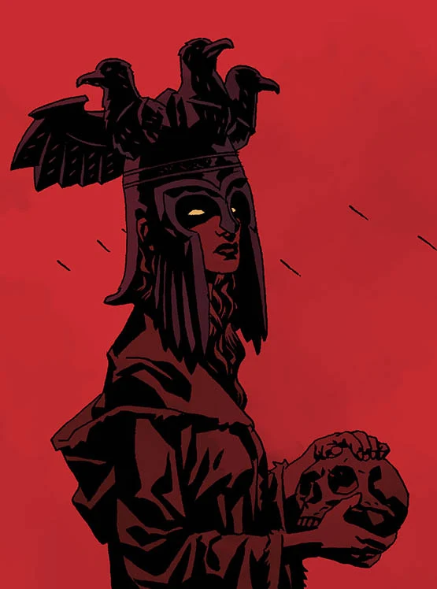

*本条目仍是一个小作品（stub）。你可以帮助地狱男爵维基扩充它。*

**女巫（witches）**，或称**男巫（wizard）**，是学会了使用[魔法](/entry/Magic)的人类。有些人的力量来自恶魔，另一些人似乎天生就拥有魔力，并与[仙灵](/entry/Fairies)有亲缘关系。后一类女巫似乎崇奉赫卡特，她们的力量在近代已然衰退，正如仙灵的力量（与生育力）一样。也有可能，有些女巫的力量纯粹源自渊博的知识。

## 知名女巫与男巫

- [赫卡特](/entry/Hecate)/[迦梨](/entry/Kali)/埃列什基伽勒（Ereshkigal）——魔法神祇，女巫女王
- [莎拉·休斯](/entry/Sarah_Hughes)——英格兰女巫
- [雅加婆婆](/entry/Baba_Yaga_(character))——俄罗斯女巫
- [妮缪](/entry/Nimue)——英格兰女巫，女巫女王
- [摩根勒菲](/entry/Morgan_Le_Fay)——英格兰女巫
- [梅林](/entry/Merlin)——英格兰男巫
- [由美子·达米奥](/entry/Yumiko_Daimio)（Yumiko Daimio）——日本女巫
- [艾菲·科尔布](/entry/Effie_Kolb_(character))——美国女巫
- [Bog Roosh](/entry/Bog_Roosh)——非洲海巫
- 梅姆南·萨（Memnan Saa）——英格兰男巫
- [埃尔热贝特·翁德鲁什科](/entry/Erzsebet_Ondrushko)（Erzsebet Ondrushko）——匈牙利男巫
- [巨魔女巫](/entry/Troll_Witch)——挪威女巫
- 厄里克托（Erichtho）——女巫女王
- 希罗底（Herodias）——女巫女王
- 喀耳刻（Circe）——女巫女王
- 美狄亚（Medea）——女巫女王
