本条目介绍的是 [迈克·米格诺拉](/entry/Mike_Mignola) 于 2012 年创作的一组十二张变体封面系列。

## 构思

在 [*《地狱男爵：狂怒》（The Fury）*](/entry/The_Fury) 完结后，官方宣布迈克·米格诺拉将以画师身份回归，在 [《地狱男爵在地狱》（Hellboy in Hell）](/entry/Hellboy_in_Hell_%28series%29) 中继续创作连载的《地狱男爵》故事。然而，这一工作量意味着他无法再像过去那样绘制那么多封面。除了《地狱男爵在地狱》或其他《地狱男爵》漫画的封面外，迈克·米格诺拉将不再为任何单刊绘制封面。

作为对封面创作的告别，"怪兽之年"（Year of Monsters）变体封面应运而生，在 2012 年的每个月发行一张。这些变体封面上，米格诺拉创造的角色与某种著名怪兽对阵。这些封面与期刊内刊载的故事没有任何关联。

次年，即 2013 年，[米格诺拉的漫展速写本](/entry/Sketchbooks) *[《怪兽之年》（A Year of Monsters）](/entry/A_Year_of_Monsters)* 重点展示了他为这组变体封面创作的未上色原稿。

## 画廊

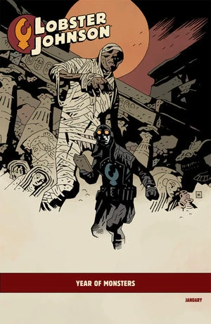

 期刊：
[*《龙虾约翰逊：燃烧之手》（Lobster Johnson: The Burning Hand）* #1](/entry/The_Burning_Hand)

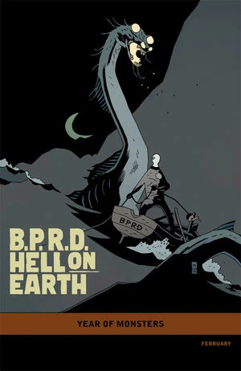

 期刊：
[*《B.P.R.D.：人间地狱——漫长的死亡》（B.P.R.D.: Hell on Earth—The Long Death）* #1](/entry/The_Long_Death)

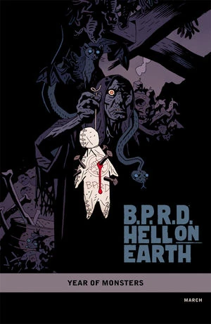

[*《B.P.R.D.：人间地狱——皮肯斯县惊魂》（B.P.R.D.: Hell on Earth—The Pickens County Horror）* #1](/entry/The_Pickens_County_Horror)

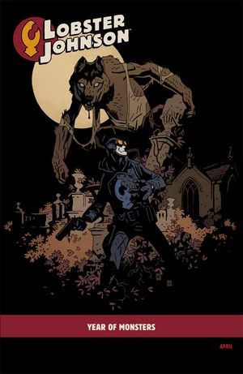

 期刊：
[*《龙虾约翰逊：燃烧之手》* #4](/entry/The_Burning_Hand)

 期刊：
[*《B.P.R.D.：人间地狱——J.H. 奥唐奈的蜕变》（B.P.R.D.: Hell on Earth—The Transformation of J.H. O'Donnell）*](/entry/The_Transformation_of_J.H._O%27Donnell)

 -
*《巴尔的摩：莱斯科瓦尔医生的解药》（Baltimore: Doctor Leskovar's Remedy）* #1
（不属于地狱男爵宇宙的作品）

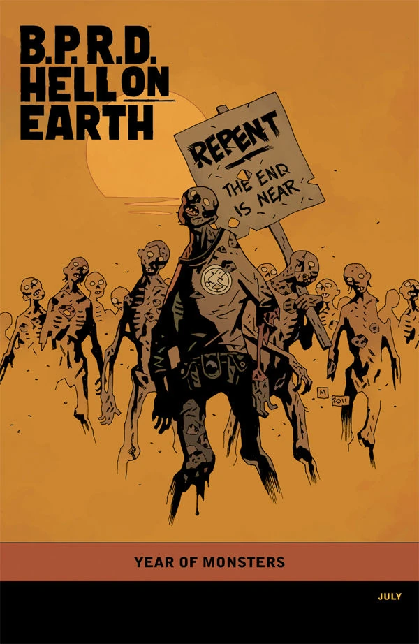

 期刊：
[*《B.P.R.D.：人间地狱——恶魔的引擎》（B.P.R.D.: Hell on Earth—The Devil's Engine）* #3](/entry/The_Devil%27s_Engine)

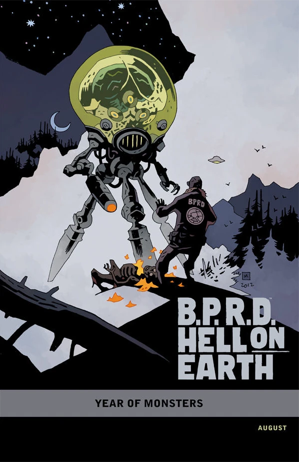

 期刊：
[*《B.P.R.D.：人间地狱——主人归来》（B.P.R.D.: Hell on Earth—The Return of the Master）* #1](/entry/The_Return_of_the_Master)

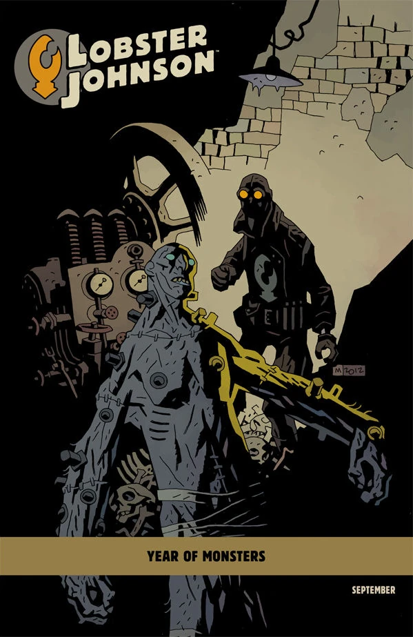

[*《龙虾约翰逊：Caput Mortuum》*](/entry/Caput_Mortuum)

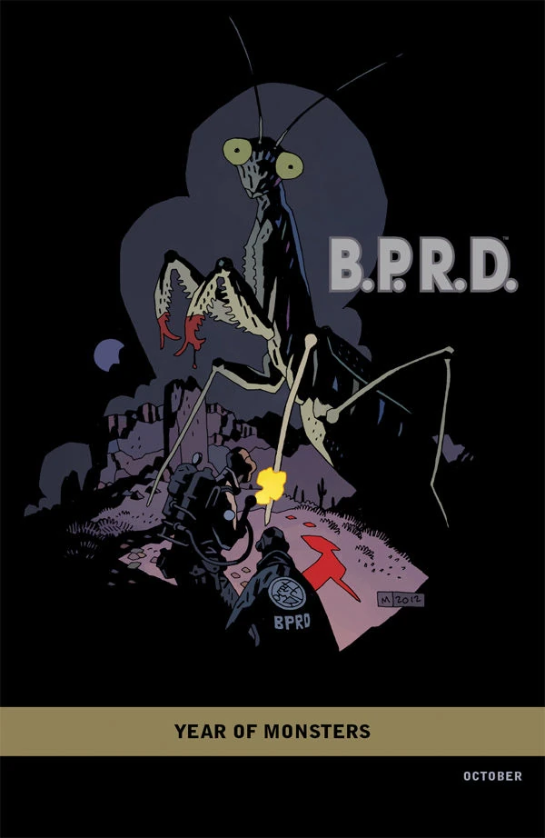

[*《B.P.R.D.：1948》* #1](/entry/1948)

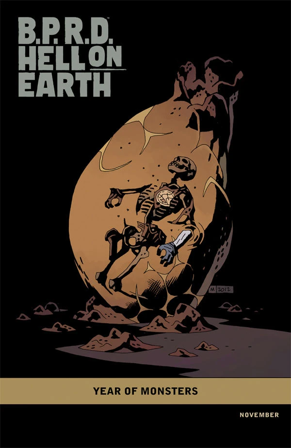

 期刊：
[*《B.P.R.D.：人间地狱——主人归来 #4》*](/entry/The_Return_of_the_Master)

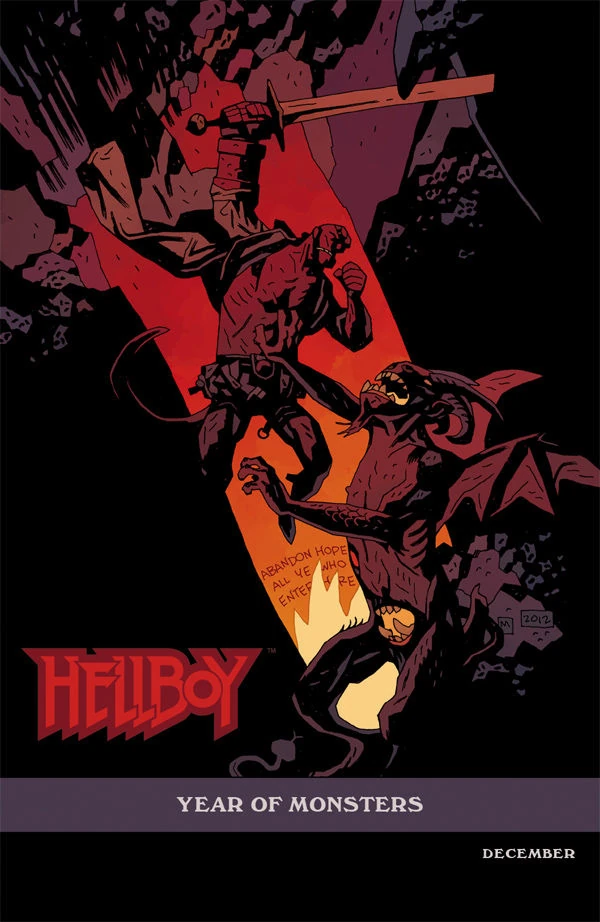

 期刊：
[*《地狱男爵在地狱》* #1](/entry/Hellboy_in_Hell_%28first_story_arc%29)

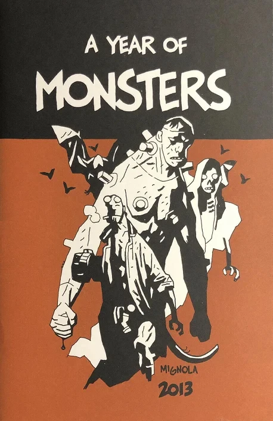

[《怪兽之年》（A Year of Monsters）](/entry/A_Year_of_Monsters)
