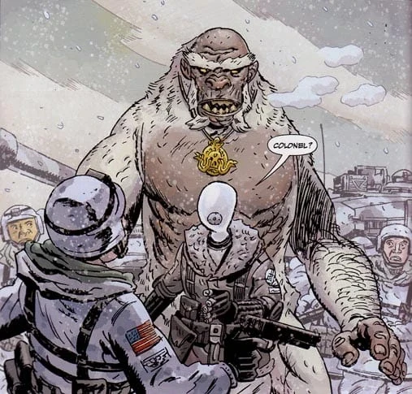

**雪人（Yeti，又译耶提）**是一个生活在世界北部地区的种族。

## 背景

雪人实际上是[海伯利亚人](/entry/Hyperboreans)的一座伟大城市——撒德雷提斯（Thadrethes）——居民的后裔。从他们的文化来看，他们似乎信奉[赫卡特](/entry/Hecate)。海伯利亚覆灭、随之而来的冰河期摧毁了他们的城市之后，他们变成了一个能够变形为巨大白毛人形生物的种族。他们曾周游世界，向新兴的人类种族传授知识，但数千年来数量已日渐稀少。

18 世纪，在自己的创造者死后，Frankenstein's Monster 在北极圈流亡期间遇到了一名雪人。那只雪人杀死了一头被他视为朋友的北极熊幼崽，Frankenstein's Monster 遂向它发起攻击。结果他被打得失去知觉，又被这头怪物拖走。后来他醒来时，遇到了一位照料他恢复健康的老人阿罗巴斯（Arobas）。然而他很快意识到，这位老人正是他袭击过的那个雪人。尽管这个血肉傀儡因幼崽之死想要向阿罗巴斯复仇，但他还是勉强收回了手，因为老人本有机会杀死他。阿罗巴斯把 Frankenstein's Monster 带到自己的村庄，与他探讨了他对自身人性的看法，并告诉他附近有一座金色尖塔的伟大城市，他这一族便起源于那里。第二天，Frankenstein's Monster 醒来时，在与阿罗巴斯共住的小屋里只见到阿罗巴斯的一具骸骨，而他曾见过的村庄也无影无踪，这让他怀疑自己的经历是否真实。

已有数名雪人被证明是[马丁·吉尔弗里德](/entry/Martin_Gilfryd)（Martin Gilfryd）的忠实追随者；吉尔弗里德派他们外出，为自己统治世界、唤回人类黄金时代的图谋奔走。

## 已知的雪人

- 阿罗巴斯
