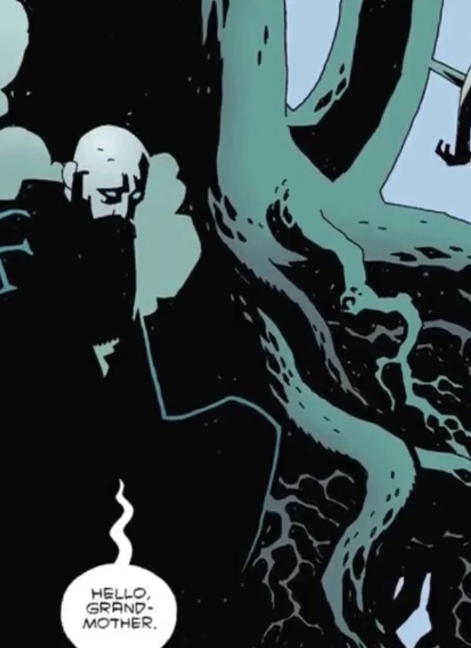

**世界树**（World Tree），又称**尤克特拉希尔**（Yggdrasil），在世界各大宗教中代表着支撑诸天、根系深入[冥界](/entry/Hell)的结构。

在[《地狱男爵》](/entry/Hellboy_(series))中，世界树是一处真实存在的结构，日渐衰微的精灵常在此出没。达格达之王、爱德华·格雷爵士等人往往从这个有利位置观看地狱男爵的种种行动。[雅加婆婆](/entry/Baba_Yaga_(character))借它保存[拉斯普廷](/entry/Grigori_Rasputin)的灵魂，并藏匿[科西切](/entry/Koshchei_(character))的魂魄。

## 画廊

世界树下的拉斯普廷。

|Rasputin at the World Tree.
## 趣闻

- 在诸神黄昏（Ragnarök，即北欧神话版本的末日）之时，世界树终将随世界的毁灭而倒下，但新世界将从它的灰烬中升起。这也是地狱男爵故事线中反复出现的主题：相信这个邪恶的世界必须被摧毁，才能由一个更美好的世界取而代之。
