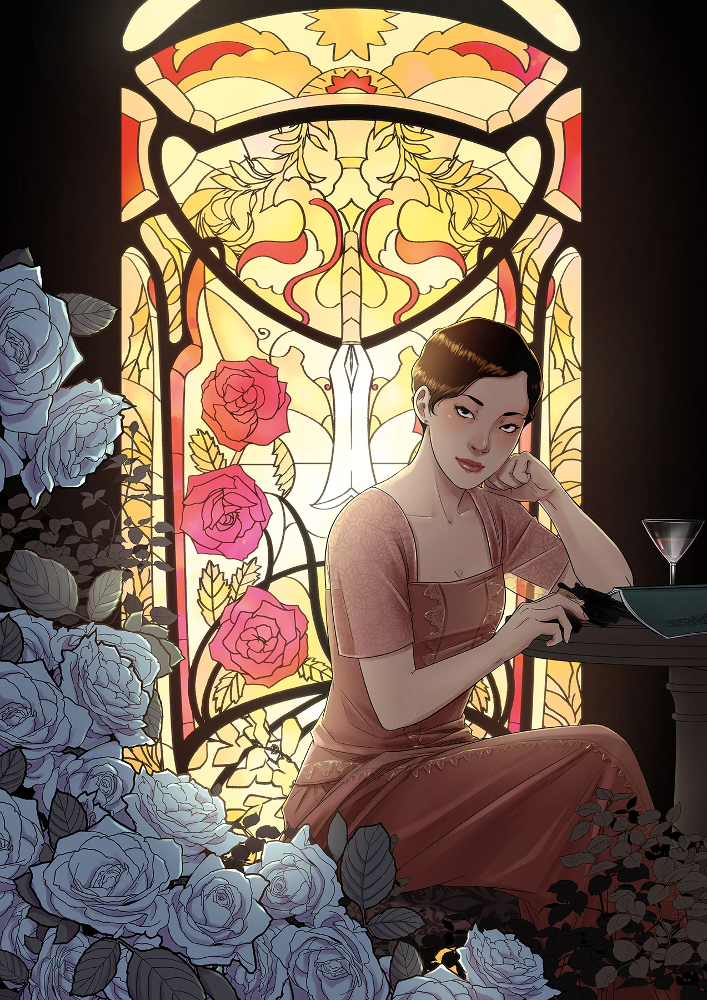

**Yishan Li** 是一名漫画画师。2018 年 11 月，她作为三位画师之一首次参与地狱男爵宇宙（Hellboy Universe），创作 *[《地狱男爵与 B.P.R.D.：1956》（Hellboy and the B.P.R.D.: 1956）](/entry/1956)*。

## 内页作画

- *[《地狱男爵与 B.P.R.D.：1956》（Hellboy and the B.P.R.D.: 1956）](/entry/1956)*（与 [Mike Norton](/entry/Mike_Norton) 和 [Michael Avon Oeming](/entry/Michael_Avon_Oeming) 合作）

## 封面画作

|[《亥伯龙之剑》（The Sword of Hyperborea）](/entry/The_Sword_of_Hyperborea_%28story%29) #2（变体封面）

## 外部链接

- [**Comic Book DB：Yishan Li**](http://comicbookdb.com/creator.php?ID=32142)
- [**网站：Yishan Li**](http://www.liyishan.com/)
