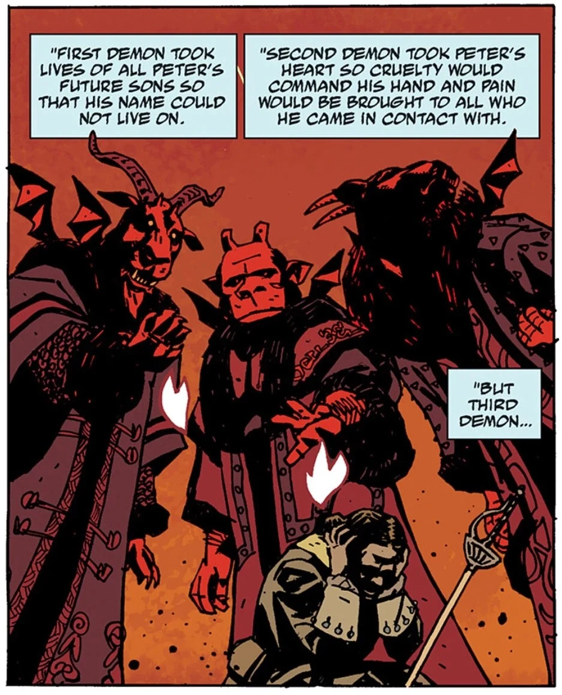
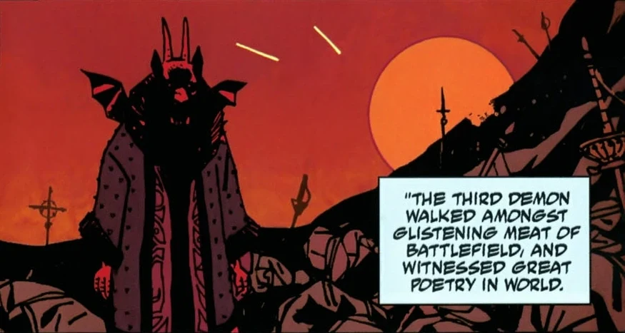

**约姆雅尔（Yomyael）**（又称**瓦尔瓦拉**）是苍蝇骑士团大十字勋章获得者、撒旦麾下第七尊，统率六千个恶魔军团。他曾被召唤到人间，帮助彼得大帝在大北方战争中取胜。约姆雅尔决定放弃返回地狱，留在了人间，并附身过许多宿主，最近的一位是[瓦尔瓦拉](/entry/Varvara)。以瓦尔瓦拉的形象出现时，她曾任[特殊科学局](/entry/Special_Sciences_Service)局长。

## 历史

约姆雅尔属于一个恶魔三位一体（另外两位是[贝雷斯（Beleth）](/entry/Beleth)和[西特利（Sytry）](/entry/Sytry)），“自从人类开始信仰群星背后的黑暗起”，他们便在战场上协助亚细亚人。这个三位一体被彼得大帝的顾问们发现并召唤，以帮助他在大北方战争中扭转对瑞典人的战局。恶魔们满足了彼得的愿望，但代价高昂：第一个恶魔将取走彼得未来所有儿子的性命，使他的名字无法流传；第二个恶魔将取走他的心，使他内心充满残暴，给他接触到的每个人只带来痛苦；第三个恶魔——约姆雅尔——将取走他的灵魂。当前两个恶魔取走彼得欠下的代价时，约姆雅尔走过战场，被人类身上激发出来的残暴深深吸引，于是决定留在凡世，放弃了彼得的灵魂——而那灵魂本也是他返回故乡的凭证。

约姆雅尔在人间游荡了数百年，附身于不同的宿主，并逐渐对人类有了理解。1913 年，这个恶魔在发现[瓦尔瓦拉](/entry/Varvara)孤身与母亲的尸体待在一起后附了她的身。约姆雅尔接管了她的身份，最终与苏联结盟，成为俄罗斯特殊科学局的负责人。

### 与特雷佛·布鲁姆结盟

1946 年，瓦尔瓦拉驻扎在苏联占领下的柏林，收集神秘学物品，并秘密关押与纳粹超自然实验有关的囚犯进行审讯。正是在那时，瓦尔瓦拉第一次遇到特雷佛·布鲁姆教授，后者正在搜寻与“[地狱男爵](/entry/Hellboy_(character))事件”有关的一切情报。瓦尔瓦拉早已知道那个恶魔（地狱男爵）正由教授照料。然而，瓦尔瓦拉拒绝透露任何信息，直到她和她的组织与布鲁姆达成一项停战协议——该协议与他们围绕[吸血鬼风暴计划（Project Vampir Sturm）](/entry/Project_Vampir_Sturm)的共同目标有关。他们的联盟成功挫败了赫尔曼·冯·卡朗普特向美国发射一枚满载吸血鬼的火箭的企图。事后，瓦尔瓦拉对布鲁姆十分欣赏，从此将他视为自己最喜欢的人类。

1947 年，瓦尔瓦拉出现在超自然调查防御署当时驻扎的新墨西哥空军基地，与布鲁姆教授讨论近来多名前纳粹分子被杀的案件——他们都知道那是柯尼希男爵（Baron Konig）所为。

1952 年，瓦尔瓦拉找到[马尔科姆·弗罗斯特（Malcolm Frost）](/entry/Malcolm_Frost)——后者正计划杀死布鲁姆教授，以便进而除掉地狱男爵——她用自燃之术杀死了弗罗斯特的手下[罗伯特·阿姆塞尔（Robert Amsel）](/entry/Robert_Amsel)，并威胁他永远不得伤害布鲁姆。

### 被囚禁

瓦尔瓦拉就欧洲的吸血鬼活动与布鲁姆教授多次会面之后，特殊科学局的大多数成员开始策划一场针对她的政变。厌倦了始终在她暴躁的脾气和凶残的行事方式下担惊受怕地工作，特殊科学局的密谋者们精心策划了一场能够制服瓦尔瓦拉的仪式。

1956 年，经过数月筹划，他们把一名灵媒带到一座无线电台前哨站，让她在距瓦尔瓦拉数百英里之外录下一段经过仔细研究的咒语，然后向她播放，使她虚弱无力，[马拉基姆神父（Father Malakim）](/entry/Father_Malakim)得以诵念一段东正教祷文，将瓦尔瓦拉囚禁在一个玻璃柜中。此后半个世纪，瓦尔瓦拉一直被封存着，安置在特殊科学局新任局长[约瑟夫·尼恰伊科（Iosif Nichayko）](/entry/Iosif_Nichayko)的办公室里。

到[*《人间地狱》*](/entry/Hell_on_Earth_(story_cycle))的故事发生时，瓦尔瓦拉试图与一群逃出地狱的下级恶魔做交易，但到目前为止，他们解救她的尝试均未成功。

### *《B.P.R.D.：人间地狱》*

在[农-桀哈（Nunn-Jahad）](/entry/Nunn-Jahad)降临、局势看似无望之后，约瑟夫不情愿地释放了瓦尔瓦拉，希望这个恶魔把注意力转向巨龙，代价则是他自己的性命。

然而瓦尔瓦拉却邀请约瑟夫一同前往地狱。在那里，她带他来到废弃的万魔殿城，[撒旦](/entry/Satan)的尸体就躺在那里。瓦尔瓦拉拿起那把杀死了前任地狱之王的匕首，解开了封印，释放了被囚禁、支撑着地狱大城的[守望者们](/entry/Watchers)。

回到人间后，她和约瑟夫惊愕地看着数名守望者从地底喷发而出，与奥古·桀哈交战。约瑟夫一度抱有希望，觉得这些堕落天使或许能击败怪物，但瓦尔瓦拉告诉他，守望者们可能已不再拥有被囚禁前的力量，而且无论谁获胜，对世界都不是好兆头。她把注意力转向从前囚禁她的人，刺中了这个不死的俄罗斯人，把他的灵魂击成碎片，使他比鬼魂更不如，却又无法死去。

守望者们被巨龙击败后，她饶有兴致地观看[约翰·克劳斯](/entry/Johann_Kraus)与怪物搏斗的努力。令她大为意外的是，这位获得[维利](/entry/Vril)之力的灵媒摧毁了奥古·桀哈，终结了它对地球的威胁。

瓦尔瓦拉在《人间地狱》中的最后一次出现，是在康涅狄格州超自然调查防御署的旧总部。她暗自思忖：自己拖延末日的努力全是徒劳，而在她失败之时，一个小小的鬼魂却扭转了战局。她哀叹自己想念特雷佛·布鲁姆教授，说他永远是她最喜欢的人类，并不知道如今还有谁能供她取乐。

### *《B.P.R.D.：魔鬼旧相识》*

随着大多数恶魔领主死去，又取得了地狱公爵[阿姆杜西亚斯（Amdusias）](/entry/Amdusias)的戒指，约姆雅尔决定在纽约重建[万魔殿](/entry/Pandemonium_(location))。这个恶魔招募了最后两位恶魔领主[巴拉姆（Balam）](/entry/Balam)和[比弗隆斯（Bifrons）](/entry/Bifrons)，并设法重新奴役了下级恶魔们。

这个恶魔还与[卡尔·鲁普雷希特·克焰人](/entry/Karl_Ruprect_Kroenen)和[赫尔曼·冯·卡朗普特](/entry/Herman_von_Klempt)合作，不过克焰人因质疑计划而被约姆雅尔杀死。

[超自然调查防御署](/entry/Bureau_for_Paranormal_Research_and_Defense)的部队进攻了地狱的残余势力，其间约姆雅尔杀死了[德文探员](/entry/Andrew_Devon)。[巴拉姆](/entry/Balam)和[比弗隆斯](/entry/Bifrons)都被[地狱男爵](/entry/Hellboy_(character))和丽兹·舍曼所杀。[阿什利·斯托德](/entry/Ashley_Strode)用一场驱魔仪式将约姆雅尔逐出瓦尔瓦拉的身体；尽管她起初被这个恶魔震慑，地狱男爵还是出手攻击，迫使他跪倒在地。约姆雅尔声称自己一直在设法约束瓦尔瓦拉，但话未说完就被斯托德斩首。

## 画廊

约姆雅尔，与贝雷斯和西特利在一起

|Yomyael, alongside Beleth and Sytry

|
