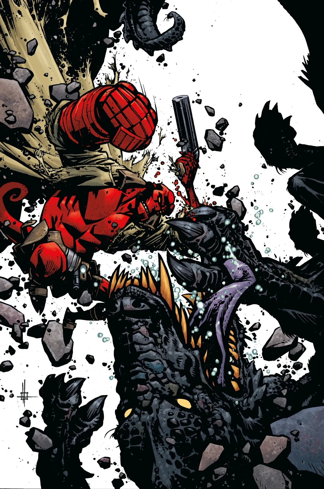

*本条目是一篇小作品（stub），你可以帮助扩充地狱男爵维基。*

**Zach Howard** 是一名漫画插画师。

## 内页作画

- *[《迦槃陀》（The Kabandha）](/entry/The_Kabandha)*（非正史）
- *[《地狱男爵与超自然调查防御署：艾菲·科尔布归来》（Hellboy and the B.P.R.D.: The Return of Effie Kolb）](/entry/The_Return_of_Effie_Kolb)*

## 内页与封面作画

[*《地狱男爵与超自然调查防御署：艾菲·科尔布归来》 \#1*](/entry/The_Return_of_Effie_Kolb)

*《地狱男爵与超自然调查防御署：艾菲·科尔布归来》* \#2

## 画廊

![Hellboy and the B.P.R.D.: The Return of Effie Kolb #1]]](/content/images/Return%20of%20Effie%20Kolb%201.webp)

|Hellboy and the B.P.R.D.: The Return of Effie Kolb #1]]

|Hellboy and the B.P.R.D.: The Return of Effie Kolb #2
