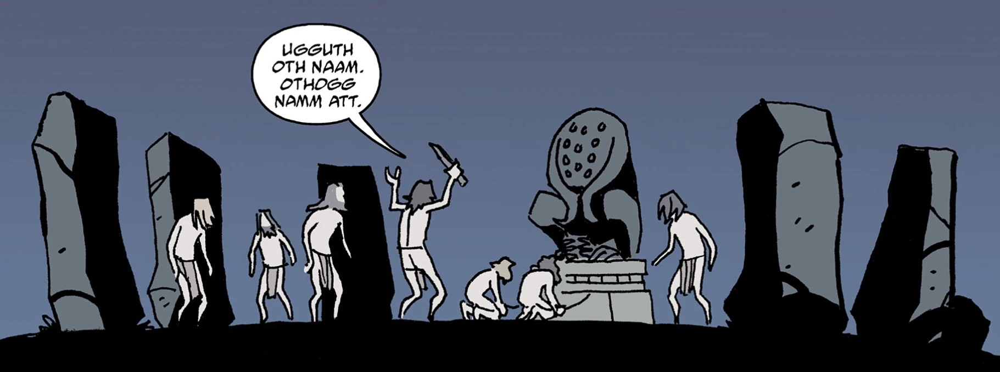

**扎拉-赫姆（Zara-Hem）**是[奥格德鲁·赫姆](/entry/Ogdru_Hem)之一，[奥古·桀哈](/entry/Ogdru_Jahad)的子嗣。

## 背景

在远古时代，即欧洲人来到北美洲的数千年之前，扎拉-赫姆曾在亚利桑那州受到崇拜。

一群原始人类试图以一对男女为祭品召唤扎拉-赫姆。当时驻扎在地球上的[访客](/entry/The_Visitor)用棱镜放逐了扎拉-赫姆，并使它的信徒失去了行动能力。随后他放走了那对男女，便离开了该地区。

在[《当心猿猴》（Beware the Ape）](/entry/Beware_the_Ape)的事件发生之前，一尊扎拉-赫姆的雕像被一名猿猴邪教徒偷走。

在 (/entry/1952) 中，一尊一直以要塞中的痛苦为食的葡萄牙扎拉-赫姆雕像接触到了[赫尔曼·冯·卡朗普特](/entry/Herman_von_Klempt)制造的一具僵尸。那具僵尸（可能被扎拉-赫姆附了身）发生变异并不断长大，在地面上袭击了冯·卡朗普特和地狱男爵。这具躯体最终在一场瓦斯爆炸中被消灭，扎拉-赫姆再次失去了肉身。

1978 年，访客在 O.H.M. 研究所遭遇了另一个由安娜·米雷娅·菲耶罗（Ana Mireya Fierro）领导、企图再次召唤扎拉-赫姆的宗教邪教。他独自阻止了仪式，但痛心于灵能反噬导致许多邪教徒死亡。不过，这些人的死亡被外界归因于该邪教的集体自杀。

## 画廊

|
