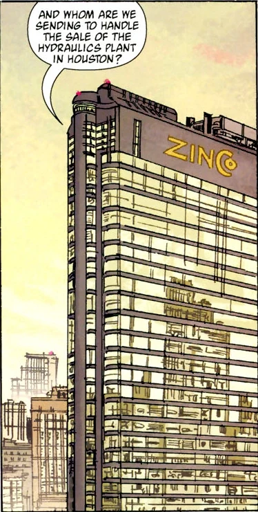

**金科公司（Zinco Corporation）**是一个庞大的全球性组织，在世界各地都拥有资源、设备、资金和政治人脉。

## 历史

金科公司早在上世纪 30 年代或更早就已存在，当时名为津科-戴维斯（Zinco-Davis）。至迟从 30 年代起，该公司就卷入了种种与超自然有关的离奇事件——当时他们的一名研究员把脑力强化到能用意念移物杀人的程度。[1]

最近一任执掌公司的津科家族成员[罗德里克·津科](/entry/Roderick_Zinco)，主动向刚刚苏醒的[利奥波德·克茨](/entry/Leopold_Kurtz)、[克焰人](/entry/Karl_Ruprect_Kroenen)和[伊尔莎·豪普斯坦](/entry/Ilsa_Haupstein)效力——那是在[格里高利·拉斯普廷](/entry/Grigori_Rasputin)于[卡文迪什庄园](/entry/Cavendish_Hall)失败之后。[B.P.R.D.](/entry/B.P.R.D.)在处理[朱雷斯库](/entry/Vladimir_Giurescu)事件期间频繁使用金科公司的产品，而其中大部分都在关键时刻失灵。津科本人曾见到拉斯普廷显灵，向他昭示了这个凡人的使命。然而，在取回[赫尔曼·冯·卡朗普特](/entry/Herman_von_Klempt)的头颅后，克焰人杀死了克茨；拉斯普廷勃然大怒，弄瞎了罗德里克作为惩罚。罗德里克因此失足，恰好撞上了"自毁"按钮，整座城堡连同里面的人一起化为灰烬——不过卡朗普特的头颅不知怎的幸存下来，在后来的[亨特城堡](/entry/Hunte_Castle)事件中再度浮出水面。

### 新任首席执行官

金科公司在新任首席执行官[兰迪斯·波普](/entry/Landis_Pope)的管理下卷土重来，他看起来和前任一样腐败。事实上，朱雷斯库事件发生时波普就是津科的副手，这意味着波普从一开始就深度卷入了拉斯普廷和[奥古·桀哈](/entry/Ogdru_Jahad)的阴谋。他的办公室里摆满了纳粹纪念品，其中许多看上去曾属于拉斯普廷的[拉格纳洛克计划](/entry/Project_Ragna_Rok)。波普命令研发部门研究[蛙怪](/entry/frog_monster)，研究之深使他既能与蛙怪对话、又能控制它们。出于安全考虑，波普与蛙怪打交道时身穿一套加固的黑色铠甲，而这身装束还有第二个用途：把他化身成[黑焰](/entry/The_Black_Flame_%28character%29)。据推测是在某部古籍的指引下，波普与蛙怪举行了一场秘术仪式，从一个蛙人身上抽干生命力，让波普骷髅般的头盔笼罩在一团黑曜石火焰的火炬中。身披铠甲、被施咒化为黑焰后，波普希望驾驭[卡塔-赫姆](/entry/Katha-Hem)的力量为己谋利。他发现真相时已为时太晚：黑焰的宿命不过是为卡塔-赫姆降临世间"照亮道路"，他是被蛙怪操纵、为它们的目的效劳的。波普最后被人看到时，正被一群蛙人拖进一道深裂谷。

### 金科：建设更美好的世界

兰迪斯·波普失踪后，他的助手兼金科研发部门主管 [Isaiah Marsten](/entry/Isiah_Marsten)接任公司主管。这一次，在[奥格德鲁·赫姆](/entry/Ogdru_Hem)降临之后，金科走到台前，扮演起影响世界的领军角色。

金科最近利用[奥安尼斯学会](/entry/Oannes_Society)制造的最后一具超人类躯体复活了黑焰。B.P.R.D. 曾联系金科，希望利用金科的新技术完善这具躯体，好让[约翰·克劳斯](/entry/Johann_Kraus)探员附身其中。然而，金科向调查防御署隐瞒了真实意图，把奥安尼斯躯体用于自己的目的。前拉格纳洛克计划成员克焰人和利奥波德·克茨成功让这具躯体完全复苏，条件是它将成为他们的主人格里高利·拉斯普廷重生的容器。然而，金科现任首席执行官马斯顿也欺骗了他们，谎称自己在奥古·桀哈的牢笼中找到了拉斯普廷的灵魂。他真正的计划是召来兰迪斯·波普的灵魂，用奥安尼斯躯体让他复活。实验成功了，但复活的既不是拉斯普廷也不是波普，而是黑焰。这一版黑焰似乎毫无人性，可能是迄今为止出现过的最危险的黑焰。

## 员工

- [罗德里克·津科](/entry/Roderick_Zinco)——前首席执行官（已故）
- [兰迪斯·波普](/entry/Landis_Pope)——前首席执行官，黑焰的宿主（已故）
- [Isaiah Marsten](/entry/Isiah_Marsten)——前首席执行官，前研发主管（已故）
- [Evelyn McDonald](/entry/Evelyn_McDonald)——马斯顿的前助手，金科残余部分的首席执行官（已故）
- [克焰人](/entry/Karl_Ruprect_Kroenen)——金科科学家，拉格纳洛克计划成员
- [利奥波德·克茨](/entry/Leopold_Kurtz)——金科科学家，拉格纳洛克计划成员

## 参考

<references />

[1] [《我头颅中的杀手》](/entry/The_Killer_in_My_Skull)
