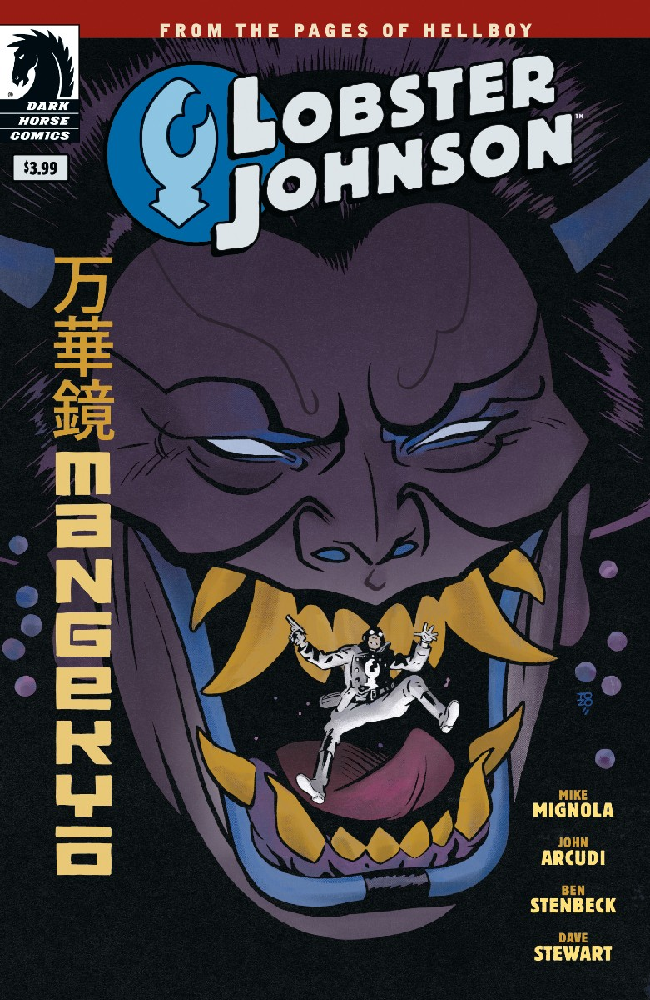

《**万华镜**》（Mangekyō）是一部单期（one-shot）*[Lobster Johnson](/entry/Lobster_Johnson_%28series%29)*故事，由 John Arcudi 和 Mike Mignola 编剧，Ben Stenbeck 作画。它发生在20世纪30年代[龙虾人](/entry/The_Lobster)作为打击犯罪者职业生涯的中期。

## 剧情简介

龙虾人挫败了一起越狱企图，但他必须应对幕后主使——刺客、女巫、长期宿敌"绯红莲花"（the Crimson Lotus），地狱男爵世界中最神秘莫测的反派之一。

## 画廊

