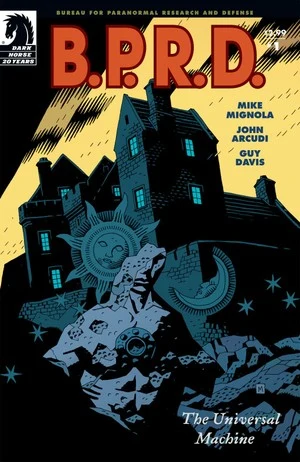
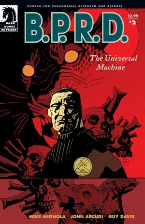
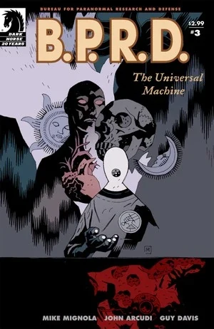
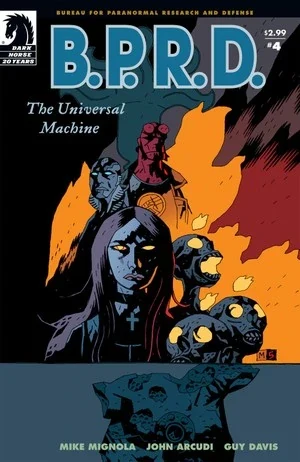
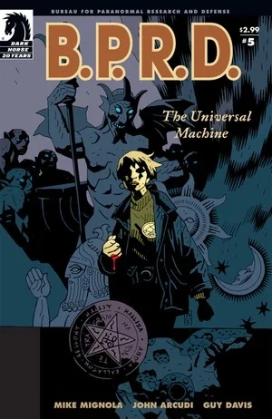

在《**万能机械**》（The Universal Machine）中，[凯特·考瑞根博士](/entry/%E5%87%AF%E7%89%B9%C2%B7%E8%80%83%E7%91%9E%E6%A0%B9))前往法国乡间，寻找一部可能令[罗杰](/entry/Roger)起死回生的古籍。与此同时，在 [B.P.R.D. 总部](/entry/Bureau_for_Paranormal_Research_and_Defense)，[达米奥](/entry/Benjamin_Daimio)上尉讲述自己死亡的经过，[约翰·克劳斯](/entry/Johann_Kraus)坦白了一场因他的一次降神会而起的离奇三角恋，[亚伯](/entry/Abraham_Sapien)回忆起自己初入 B.P.R.D. 时与[地狱男爵](/entry/Hellboy_%28character%29)共同执行的一次任务，[丽兹](/entry/Elizabeth_Sherman)则讲述了她发现自身纵火者之力时害死家人的怪异往事。

## 出版历史

这部五期迷你系列于 2006 年 4 月至 8 月出版。故事于 2007 年 1 月收录进平装合订本《[B.P.R.D.: The Universal Machine](/entry/Trade_Collections)》。第 5 期的最后几页由 Mike Mignola 亲笔绘制。

## 剧情梗概

### 第一部分

亚伯·塞皮恩和达米奥上尉在《[黑焰使徒](/entry/The_Black_Flame_%28story%29)》故事中的内布拉斯加州卡塔-赫姆灾场监督爆破。尽管这场袭击造成 1700 人死亡，达米奥心里惦记的却只有在袭击中丧生的罗杰。

凯特秘密与[安德鲁·德文](/entry/Andrew_Devon)会面。德文向她提供了关于《Flama Reconditus》（[维利](/entry/Vril)，即「秘火」）的情报：他认为唯有这本书载有让[何蒙库鲁兹](/entry/homunculus)组织再生的配方，从而使罗杰起死回生。两人前往法国的 Ableben，与一位收藏家会面并商议此书的交易。1491 年，镇上的村民曾捣毁[法布尔侯爵](/entry/Adoet_de_Fabre)的城堡，因为他把村民的孩子喂给他的「怪物」。

两人见到了收藏家蒂埃里（Thierry）。他的店里收藏颇丰，他一边考问凯特，一边坚持让德文去用店外的电话亭。两人搜寻那本书时，凯特对店内越来越古怪的藏品起了戒心，意识到自己身处险境。德文正给 B.P.R.D. 总部打电话时，看见橱窗里挂出「关门」的牌子，便破门冲回店里，却发现店铺已空无一物，只剩一幅城堡的画作。

在 B.P.R.D. 总部，达米奥、约翰和丽兹·舍曼围绕罗杰展开讨论，最终达米奥同意道出自己死亡的真相。

### 第二部分

达米奥上尉向 B.P.R.D. 讲述自己死于玻利维亚丛林的经历。与此同时，凯特·考瑞根博士在法国乡间搜寻那部藏有让罗杰复活之秘的隐秘典籍，却发现自己成了一座古怪店铺里的客人——店铺所在之处，五十多年前曾矗立着一座被毁的城堡。

### 第三部分

凯特·考瑞根博士在搜寻那部可能藏有复活罗杰之秘的神秘典籍时，被困在一座诡秘的法国村庄里；那里一位神秘器物收藏家，正对 B.P.R.D. 最宝贵的资产之一打着可怕的算盘。

### 第四部分

地狱男爵与亚伯·塞皮恩在一段闪回故事中担纲主角，故事发生在亚伯初入超自然调查防御署的日子；丽兹·舍曼则讲述了她发现自身纵火者之力时害死家人的怪异往事。而在欧洲，凯特·考瑞根博士为了死去的朋友罗杰的命运，与一个古老的邪恶存在讨价还价。

### 第五部分

凯特在法国闹鬼村庄的恶魔般历险迎来结局，罗杰的命运在一场异世界的对决中尘埃落定；超自然调查防御署的每位成员也都直面了自己死亡的真相——这些真相，他们此前都只能独自面对。

## 内容

### 角色

#### [B.P.R.D.](/entry/Bureau_for_Paranormal_Research_and_Defense)

- [亚伯拉罕·塞皮恩](/entry/Abraham_Sapien)
- [本雅明·达米奥](/entry/Benjamin_Daimio)
- [凯瑟琳·考瑞根](/entry/%E5%87%AF%E7%89%B9%C2%B7%E8%80%83%E7%91%9E%E6%A0%B9))
- [伊丽莎白·舍曼](/entry/Elizabeth_Sherman)
- [约翰·克劳斯](/entry/Johann_Kraus)
- [安德鲁·德文](/entry/Andrew_Devon)
- [罗杰](/entry/Roger)
- [汤姆·曼宁](/entry/Thomas_Manning)
- 其他探员与工作人员

#### Ableben 线

- [阿杜埃·德·法布尔](/entry/Adoet_de_Fabre)
- Ableben 居民（被变成狼）
- [吸血鬼](/entry/Vampire_%28creature%29)
  - Boden
- Lagerk（[何蒙库鲁兹](/entry/Homunculus)）
- [埃德尔·米施拉塞](/entry/Edel_Mischrasse)（闪回）
- [罗杰的兄长](/entry/Roger%27s_brother)（仅被提及）
- 奥安尼斯（Oannes，插画）
- [恶魔](/entry/Demon)
  - [玛科西亚斯](/entry/Marchosias)
  - [伊布利菲卡](/entry/Iblifika)

#### 总部故事

- 达米奥的故事（闪回）
  - 士兵
    - Bennett
    - Carillo
    - Manuel Antonio Chaves
    - Harmon
    - Landham
    - Ramirez
  - 美洲豹教团成员
  - 美洲巨兽
  - [能剧猴](/entry/Noh_monkey)
  - 美洲豹神（梦境）
- 约翰的故事（闪回）
  - Pavao Delic
  - Eva（约翰的助手）
  - Senka Delic
- 丽兹的故事（闪回）
  - Jenny（保姆）
  - Will（梦境）
  - Bruno（狗）（梦境）
  - 舍曼夫人（梦境）
  - 舍曼先生（梦境）
- 亚伯的闪回
  - [奥安尼斯学会](/entry/Oannes_Society)成员
  - Edith Howard
  - [水灵](/entry/Water_Spirit)
- 亚伯的故事（闪回）
  - [地狱男爵](/entry/Hellboy_%28character%29)
  - 警探
  - [达里尔·泰南](/entry/Daryl_Tynon)（[温迪戈](/entry/Wendigo)）
  - Tynon 一家（照片）

### 地点

- 美国
  - 内布拉斯加州 Lincoln
  - [B.P.R.D.](/entry/Bureau_for_Paranormal_Research_and_Defense) 总部（科罗拉多州）
  - 舍曼宅邸（堪萨斯州堪萨斯城）（梦境）
  - 旧 [B.P.R.D.](/entry/Bureau_for_Paranormal_Research_and_Defense) 总部（康涅狄格州 Farfield）（闪回）
  - St. Trinian 医院（华盛顿特区）（闪回）
    - [奥安尼斯学会](/entry/Oannes_Society)集会地（闪回）
  - Caul 宅邸（罗德岛州 Littleport）（闪回）
- 法国
  - Ableben（旧称「法布尔公国」）
- 玻利维亚丛林（闪回）
- 罗马尼亚（闪回）
  - Czege 城堡下[埃德尔·米施拉塞](/entry/Edel_Mischrasse)的工坊（Fălticeni）（闪回）
- 德国（闪回）
  - 克劳斯宅邸（慕尼黑）（闪回）
- 大西洋（闪回）
  - Num-Yabisc 洞窟（闪回）
- 加拿大（闪回）
  - Anonta（安大略省）（闪回）

### 重要器物

- [秘火](/entry/The_Secret_Fire)
- 多具[何蒙库鲁兹](/entry/Homunculus)尸体
- 所罗门九戒之一
- [克洛阿喀娜](/entry/Cloacina)雕像（罗杰的梦）

## 花絮

- 吸血鬼与侯爵最初由 [Guy Davis](/entry/Guy_Davis)设计为身着 17 世纪服饰，后来改为 18 世纪的造型，因为 [Mike Mignola](/entry/Mike_Mignola)想向自己最喜爱的电影之一《[The Fearless Vampire Killers](https://en.wikipedia.org/wiki/The_Fearless_Vampire_Killers)》致敬。

## 画廊

 \#1

 \#2

 \#3

 \#4

 \#5
