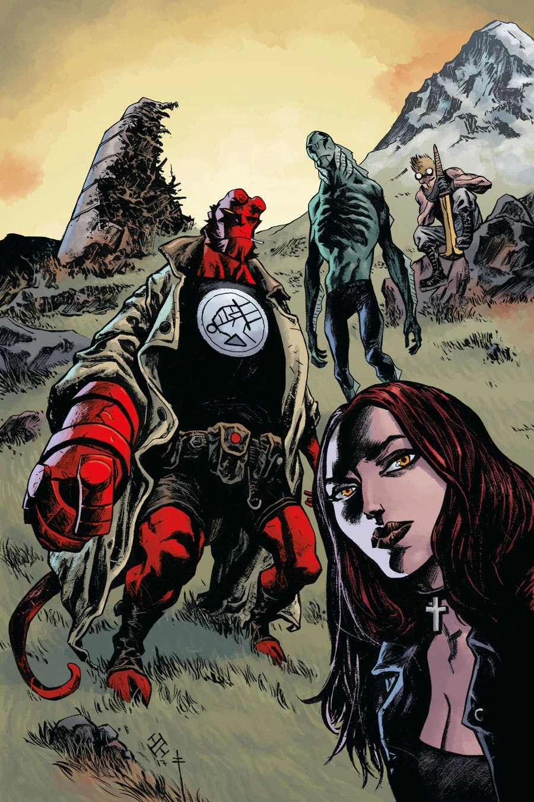
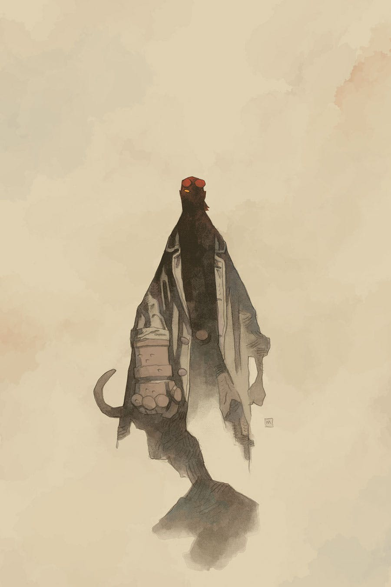
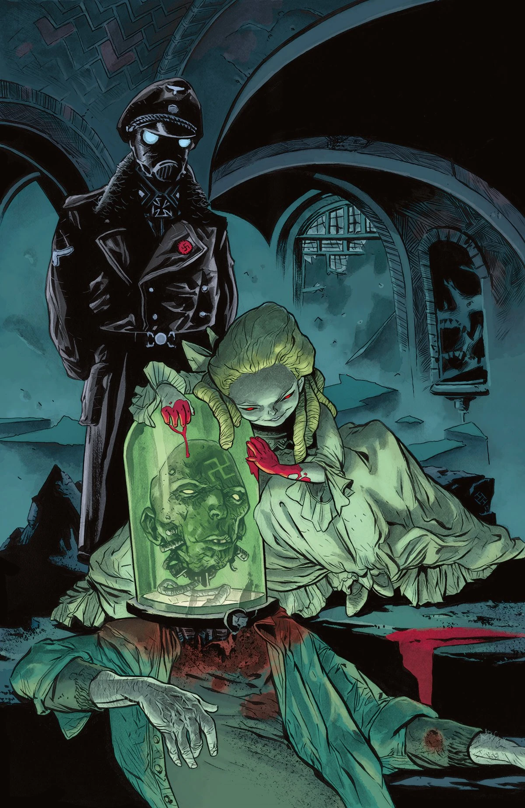
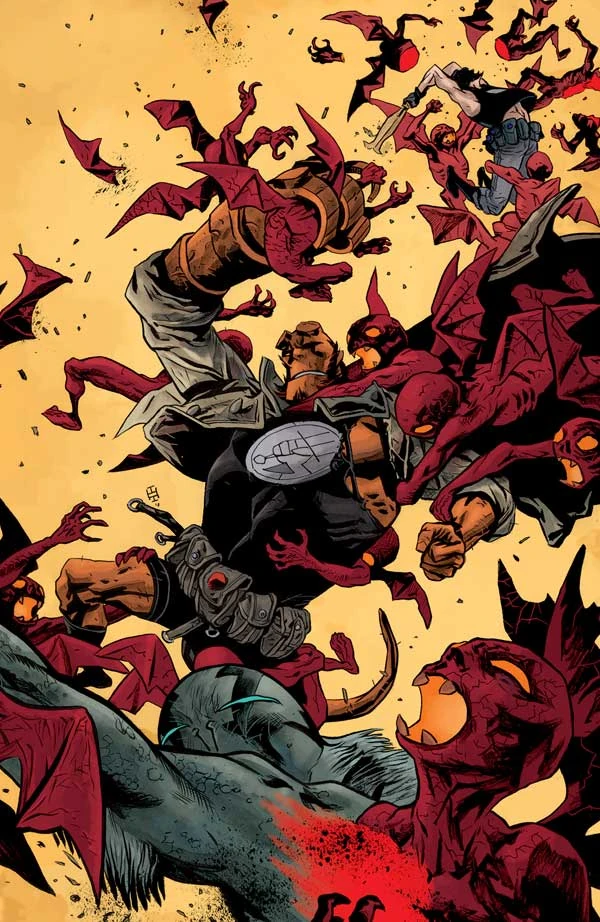
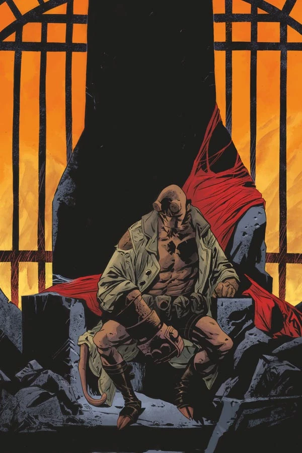

《**万魔殿**》（Pandemonium）是[《魔鬼旧相识》故事环](/entry/The_Devil_You_Know_%28story_cycle%29)的第二个篇章。

## 出版历史

在《[弥赛亚](/entry/Messiah)》（Messiah）篇章的最后一期之后，Dark Horse 暂缓推出《[魔鬼旧相识](/entry/The_Devil_You_Know_%28story_cycle%29)》的下一期，直到[《弥赛亚》平装合订本](/entry/Trade_Paperback_Collections)出版之后才恢复连载。

[地狱男爵](/entry/Hellboy_%28character%29)与[亚伯·塞皮恩](/entry/Abraham_Sapien)重聚；与此同时，众魔云集纽约，企图奴役人类仅存的一切。

## 剧情简介

### 第一部

地狱男爵重返人间，[B.P.R.D.](/entry/Bureau_for_Paranormal_Research_and_Defense)却难以理解他为何不愿去猎杀那个威胁要把整个世界变成一座名副其实的[地狱](/entry/Hell)的恶魔。

### 第二部

地狱男爵与亚伯·塞皮恩重聚；与此同时，众魔云集纽约，企图奴役人类仅存的一切。

本期是探员卡斯珀·莫罗（Casper Morrow）在漫画中的首次登场。他此前曾出现在散文短篇《[应许的微笑](/entry/Hellboy__An_Assortment_of_Horrors)》（*The Promised Smile*）中。

### 第三部

一名探员的坦白让 B.P.R.D. 离那个在全国各地诱骗、奴役信徒的邪教头目更近了一步；与此同时，[瓦尔瓦拉](/entry/Varvara)阵营内部的分歧，也让她建立一座新[万魔殿](/entry/Pandemonium_%28location%29)（Pandemonium）的计划出现了裂痕。

### 第四部

B.P.R.D. 抵达纽约，随即遭到由邪教徒转化而成的僵尸以及熟悉的恶魔的袭击。

### 第五部

在遭受毁灭性打击之后，B.P.R.D. 力图重整旗鼓；与此同时，瓦尔瓦拉密谋从机构内部发动进攻。

## 画廊

除特别注明外，封面均由 [Max](/entry/Max_Fiumara) 与 [Sebastián Fiumara](/entry/Sebasti%C3%A1n_Fiumara) 绘制。

 \#1

 \#1 variant
by [Mike Mignola](/entry/Mike_Mignola)

 \#2

 \#3

 \#4

 \#5
