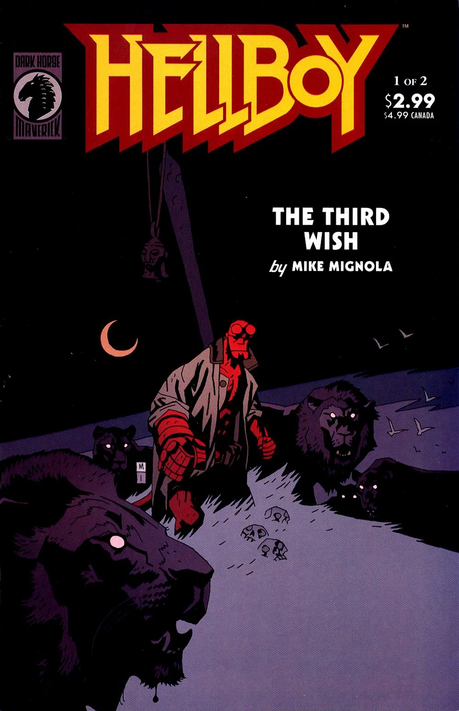

《**三个愿望**》（The Third Wish）是一部两期的迷你系列，在故事中[地狱男爵](/entry/Hellboy_%28character%29)前往非洲，却最终被[博格·鲁什](/entry/Bog_Roosh)困在海底。

## 出版历史

《三个愿望》最初于2002年7月至8月作为两期迷你系列出版。该故事于2006年8月与《[岛屿](/entry/The_Island)》一起重印收录于[《地狱男爵——第6卷：奇异之地》](/entry/Trade_Collections)。

## 剧情简介

### 第一部

三个人鱼姐妹请求海底女巫[博格·鲁什](/entry/Bog_Roosh)赐予她们三个恩惠。作为回报，她要求她们把一根特制的钉子钉进她"敌人"的头里。

[地狱男爵](/entry/Hellboy_%28character%29)在《[征服者蠕虫](/entry/Conqueror_Worm_%28story%29)》之后前往非洲，在[莫赫洛米](/entry/Mohlomi)——一位早已去世的"伟大巫医"——的炉火旁与他相聚。莫赫洛米解释说，夸库·[阿南西](/entry/Ananse)、蜘蛛和蝙蝠告诉他地狱男爵会来，地狱男爵则解释了自己为什么迟到了三天。在莫赫洛米的引导下，地狱男爵沉沉睡去并做起了梦……

地狱男爵站在一群狮子中间，它们念着他的名字。狮子告诉他，这是他在非洲度过的最后一夜，他将永远不能再回来。一阵铃声把他惊醒。

地狱男爵在海岸边醒来，莫赫洛米带他去听大海呼唤他的名字。老人把自己手杖上的铃铛给了地狱男爵。地狱男爵把头凑近水面去听自己的名字。一道巨浪涌起，把地狱男爵卷入海中。

三个人鱼抓住了他，尽管他奋力反抗，她们还是设法把钉子钉进了他一只被锉过的角里。他昏了过去。

地狱男爵在一座海底废墟中醒来，身上锁着铁链。博格·鲁什告诉他，只要钉子和铁链还在，他就永远无法逃脱。她解释说，这些铁链是用一个曾被地狱男爵追杀的人的骨头打造的。那人对地狱男爵强烈的仇恨赋予了铁链压制他的力量。

任务完成后，姐妹们来找博格·鲁什索取她们的恩惠。大姐请求让她失去的爱人回来。她早已死去的爱人回来杀死了她，这样他们便在死亡中永远结合。二姐爱上了一个来自陆地的男人，想要变成人类以便和他在一起。她变成了人类，却溺死在海底。三妹说她的父亲很久以前去世了，人们以他的名义修建了一座神龛。他的长矛曾安放在那里，但长矛已经遗失。她请求让长矛归来。长矛从海洋深处升起，她拿起它游走了，最后回头望了一眼被缚的地狱男爵。

博格·鲁什此刻把注意力转回地狱男爵身上。她计划杀死他并将他肢解。他问为什么，她回答说"无非是为了拯救世界"。

### 第二部

最年轻的人鱼回到她父亲的神龛，告诉她死去的父亲，他的其他女儿都"死于自己的欲望"。她告诉他，他遗失已久的 blade（利刃）已经归来。她父亲的鬼魂出现了。他说攻击地狱男爵是错误的，因为地狱男爵从未伤害过她。他说一个死者的荣耀不在于"破碎的器具和老旧的骨头"，而在于"我们子女的所作所为"。她的行为已注定他要在地狱中焚烧。

博格·鲁什再次告诉地狱男爵，他必须死，世界才能活。地狱男爵反驳说，五十年来他一直在与怪物战斗，这使他是个好人。她回答说，一个未来的幻象一直困扰着她。她看到地狱男爵死去，他的右手被砍下。她看到那只手被用来释放巨龙[奥格德鲁·贾哈德](/entry/Ogdru_Jahad)，世界被毁灭。

博格·鲁什计划把地狱男爵切成碎块，把碎块送给那些曾被他伤害的女巫，把他的左眼送给[芭芭·雅加](/entry/Baba_Yaga_%28character%29)，把他空瘪的皮囊送给[赫卡忒](/entry/Hecate)。她将吃他的心、喝他的血，把他的右手喂给某条鲸鱼——地球上最古老的生物；等鲸鱼死去，它将坠入乌尔深渊，永远消失。

地狱男爵的影像一动不动地停留在一个浅池中，周围环绕着仙灵。国王[达格达](/entry/Dagda)说地狱男爵已被牢牢困住，他无法解救他。[格鲁阿加赫](/entry/Gruagach)——上一次出现是在《[尸体](/entry/The_Corpse)》中——问究竟为什么要拯救地狱男爵。另一个仙灵回答说，这个世界覆灭之后，一个新世界将会升起。格鲁阿加赫反驳说，这个世界终结时仙灵也会终结，但如果地狱男爵不在了，仙灵也许能重新夺回世界。一个仙灵询问[爱德华爵士](/entry/Sir_Edward_Grey)的看法。爱德华爵士回答说，地狱男爵的故事尚未写就，如果说它本是写定的，他也正在改写它。他指责格鲁阿加赫是出于个人恩怨才这样说。格鲁阿加赫讲述了自己所受的冤屈（在《[尸体](/entry/The_Corpse)》中），并说他一定要复仇。格鲁阿加赫击打地狱男爵静止的影像。

海底之下，地狱男爵仿佛被击中一样向后飞退，他不明白发生了什么，只是叫博格·鲁什干脆杀了他。人鱼悄悄游到地狱男爵身边，用她父亲的利刃斩断了锁住地狱男爵的铁链。博格·鲁什回来，诅咒地狱男爵和人鱼。人鱼恳求地狱男爵逃走，他把她留给了女巫。女巫派那两个死去的姐妹去攻击活着的人鱼。她父亲的鬼魂告诉地狱男爵，他有能力离开，而他的女儿正在承受她应得的惩罚。地狱男爵拒绝相信这种说法，用利刃摧毁了死去的姐妹。

地狱男爵和人鱼进入一个摆满罐子的房间，罐盖上刻着人脸。人鱼解释说，这些是博格·鲁什力量的来源——被困住的溺水水手的灵魂。他试图释放那些灵魂，但她告诉他，只要博格·鲁什活着，它们就无法脱身。博格·鲁什朝地狱男爵扑来，自己撞上了他手中的利刃。人鱼解释说，她无法忍受活在自己幻象中的那个世界里。死去水手的灵魂化作飞鸟离去。

人鱼成为了新的博格·鲁什，这是老博格·鲁什最后的报复。她被永远束缚在洞穴中。她从地狱男爵头上拔出钉子，释放了他。她的力量已经消失，将独自坐在那里等待终结之日——届时奥格德鲁·贾哈德会释放她。她父亲回应说，她永远不会孤单，他会陪着她，"直到时间的尽头"。

地狱男爵在海洋中继续漂浮前行。

## 故事年表

这个故事的确切日期不详。它发生在2000年《[地狱男爵：征服者蠕虫](/entry/Conqueror_Worm_%28story%29)》之后的某个时候。

按时间顺序，地狱男爵在本故事之后的下一次登场是在《[地狱男爵：岛屿](/entry/The_Island)》中。据说那是在《三个愿望》两年多以后，但同样没有给出确切日期。

再之后是《[黑暗召唤](/entry/Darkness_Calls)》，发生在2006年的某个时候。

因此《三个愿望》发生在2000年至2004年之间的某个时候。在《征服者蠕虫》中地狱男爵说非洲将是他去的第一个地方，所以更早的日期可能性较大。

## 内容

### 角色

#### 一般

- [地狱男爵](/entry/Hellboy_%28character%29)
- [莫赫洛米](/entry/Mohlomi)
- 埃米尔·贝特朗（闪回）
- [奥格德鲁·贾哈德](/entry/Ogdru_Jahad)（幻象）
- [爱德华·格雷](/entry/Edward_Grey)

#### [人鱼](/entry/Merfolk)

- [博格·鲁什](/entry/Bog_Roosh)
- 三姐妹
- 大姐的爱人
- 父亲/海之王

#### [非洲民间传说](/entry/%3ACategory%3AAfrican_Myth)

- [阿南西](/entry/Ananse)
- 蟒蛇、豹子、仙灵与大黄蜂（闪回）
- 蝙蝠
-  Kimyamkela（闪回）
- 会说话的狮子（梦境）

#### [女巫](/entry/Witches)

- [芭芭·雅加](/entry/Baba_Yaga_%28character%29)（幻象）
- [赫卡忒](/entry/Hecate)（幻象）

#### [达因·西迪](/entry/Daoine_Sidhe)

- [达格达](/entry/Dagda)
- [格鲁阿加赫](/entry/Gruagach)

### 地点

- [博格·鲁什](/entry/Bog_Roosh)的巢穴
- 非洲（两个未指明的地点）
- [世界树](/entry/Yggdrasil)

### 值得注意的物品

- [莫赫洛米](/entry/Mohlomi)的铃铛
- [博格·鲁什](/entry/Bog_Roosh)的钉子
- [人鱼](/entry/Merfolk)父亲的长矛
- [末日右手](/entry/Right_Hand_of_Doom)（与地狱男爵分离）（幻象）

## 画廊

封面由[迈克·米格诺拉](/entry/Mike_Mignola)绘制。

\#1

\#2
