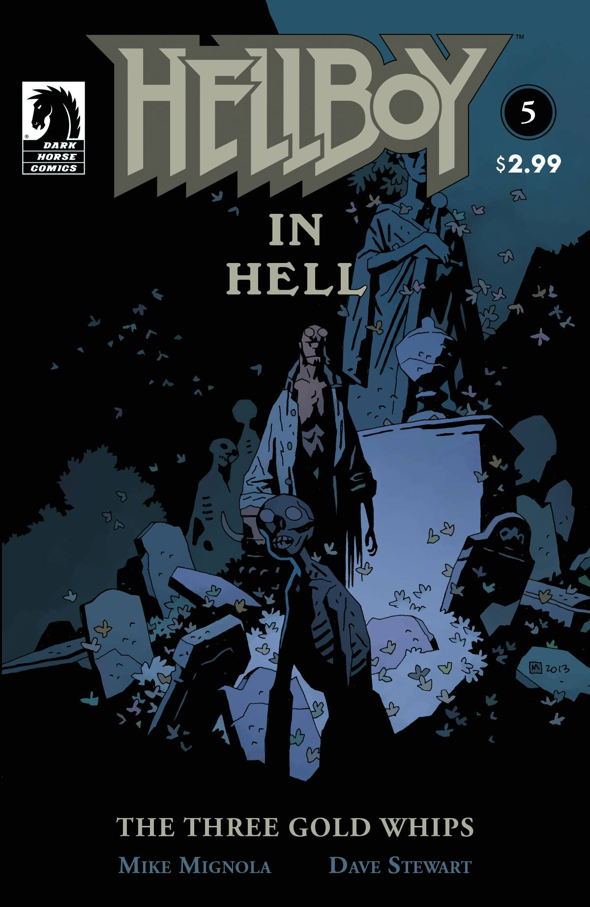
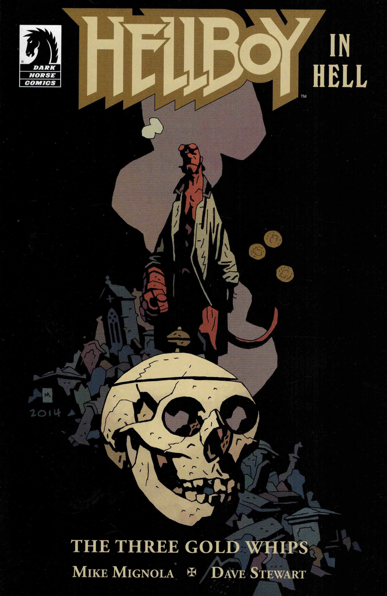

《**三条金鞭**》（The Three Gold Whips）是一部单篇完结（one-shot）故事，也是[《*Hellboy in Hell*》系列](/entry/Hellboy_in_Hell_%28series%29)的第二个故事弧。

## 出版历史

故事于 2013 年 12 月出版，取材自格林童话《魔鬼和他的祖母》（The Devil and His Grandmother）。

## 剧情简介

地狱男爵帮助一个困惑的男人——此人为了一根魔法鞭子出卖了自己的灵魂。这则故事的灵感来自格林童话中较为离奇的一篇。

## 画廊

全部封面由 [Mike Mignola](/entry/Mike_Mignola) 创作

 \#5：*The Three Gold Whips*

