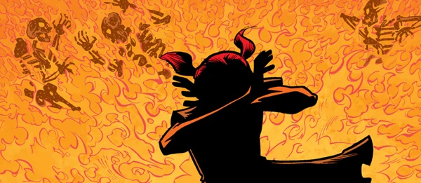
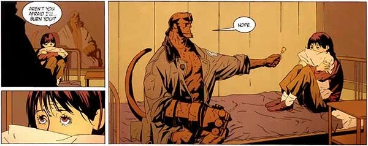
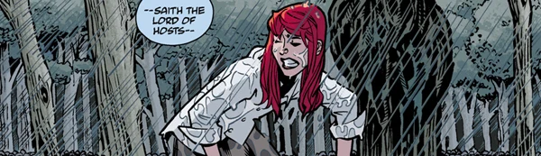
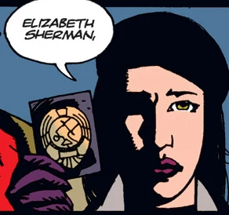
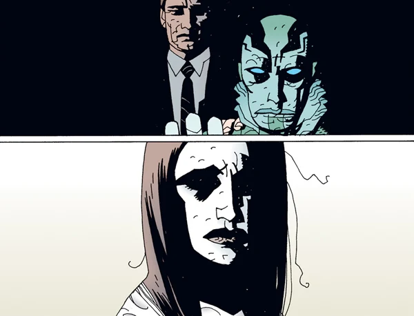
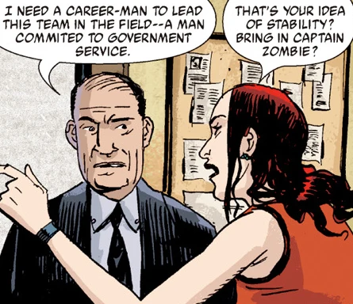
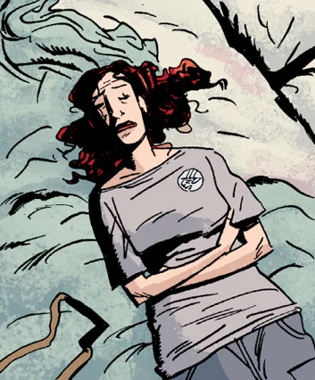
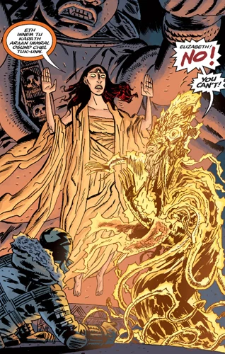
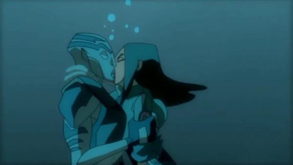

**丽兹·舍曼（Elizabeth "Liz" Sherman）**是一名拥有控火能力的人类女性，也是[超自然调查防御署（B.P.R.D.）](/entry/Bureau_for_Paranormal_Research_and_Defense)的外勤探员。十一岁那年，她摧毁了整整一个街区，造成三十二人死亡——其中包括她的父母和弟弟。从那以后，她便由防御署监护，与邪恶势力战斗，并学习与自己的能力共存。

## 历史

### 早年

丽兹于 1962 年 4 月 15 日出生在堪萨斯州堪萨斯城，在十岁那年控火能力开始显现之前，她度过了一个正常的童年。丽兹在天主教信仰中长大，她认为这些火焰是自己罪孽的结果，一度靠祈祷和纯粹的意志力短暂地把火势控制住。她的父母偶尔会发现起火的痕迹，但似乎不确定该如何处理，或者不相信那是控火术。

1973 年 7 月，丽兹以为问题已经消失。但在邻居家的一场生日聚会上，一个男孩用力拽她的马尾辫，让这个小女孩受了惊。在随之而来的大火中，整整一个街区被摧毁。三十二人葬身火海，丽兹的全家和她的家都未能幸免。消防员发现丽兹奇迹般地毫发无伤，站在阴燃的瓦砾和尸体之间。

B.P.R.D. 被叫到现场，想立即接管丽兹的监护权，但这一请求被她的家人拒绝，他们不肯相信她就是起火的原因。随着小规模火灾开始在她控制之外不断燃起，他们很快就明白了真相。在接下来的十个月里，丽兹在亲戚之间被转来转去，情绪日益低落；她的大家族对她毁灭性的力量心生恐惧也在情理之中，最终于 1974 年 5 月把监护权交给了防御署。

在 B.P.R.D. 总部，丽兹被安置在一间防火房间里，防御署的科学家们研究她的能力。没有真正的安慰，也没有身体接触——只有穿着笨重防火服的医生和科学家被允许进入房间——丽兹在抑郁中越陷越深，甚至认为自己对那些穿防火服的人也是个威胁。

打破她孤独的是[地狱男爵](/entry/Hellboy_%28character%29)，他拿着一根棒棒糖走进房间，以此打破僵局。这个红色的大块头恶魔最终成了她一生最亲密的朋友和兄长般的人物。地狱男爵帮助丽兹走出壳，适应防御署的生活。在接下来的六年里，丽兹和地狱男爵关系极为亲密；他经常出差执行任务，但一定会定期查看她的情况。丽兹在 B.P.R.D. 接受训练，对自己能力的脆弱掌控也在缓慢增长。这段时间里，她的天主教信仰受到了动摇，有一阵她不再认为自己属于这个信仰。

 1976 年，地狱男爵鼓励自己的导师[特雷佛·布鲁姆](/entry/Trevor_Bruttenholm)多让丽兹到防御署外面去。布鲁姆虽然不太放心，还是带她一起去马萨诸塞州调查一桩轻微的闹鬼事件：一个因被控施行巫术而被处死的女人的鬼魂在作祟。丽兹不相信那女人曾是女巫，试图在当地男孩 Teddy 的帮助下安抚她。但真相揭开：那女人确实是个女巫，她试图附身丽兹以完成复仇。布鲁姆和当地一位神父成功驱走了恶灵，救下了丽兹和 Teddy。通过这次事件，丽兹第一次尝到超自然世界的滋味，也明白了成为防御署一员意味着什么。她重新戴上十字架，似乎在这次事件中找回了一些信仰，并在返回防御署前亲吻了 Teddy 作别。

1978 年，[亚伯·塞皮恩](/entry/Abe_Sapien)被带到防御署。和丽兹一样，亚伯也被隔离起来供研究，直到地狱男爵说服众人他并非威胁。亚伯和丽兹很快成了朋友，彼此同是"怪胎"、同受防御署监护的处境让他们紧紧相连。

尽管丽兹仍会做那场吞噬家人的大火的噩梦，但她逐渐开始放下过去。虽然她离完全掌控力量还很远，意外起火的次数开始减少。

1980 年丽兹达到法定成年年龄时，她决定留在防御署，成为一名正式外勤探员。但在外勤中，丽兹在控火能力上苦苦挣扎，有时在紧张情境下会失控。因此，她常被分配到较平静的案子。对自己的失控感到沮丧、又认为防御署对她不够有信心的丽兹，开始了辞职又回归防御署的漫长传统；在 1980 年到 1994 年间，丽兹一共辞职了十二次。但她总会回来；无论她多想离开，她都不相信自己能正常地生活在普通社会里。

### 卡文迪什庄园事件

 1994 年 5 月，亚伯、丽兹和地狱男爵前往纽约州北部的卡文迪什庄园，调查布鲁姆主任被[蛙状怪物](/entry/frog_monster)杀害的案件。调查期间，疯狂的俄罗斯僧侣[格里高利·拉斯普廷](/entry/Rasputin)夺取了丽兹能力的控制权，把她的火焰通过怪物[萨杜-赫姆](/entry/Sadu-Hem)导入"虚空"，希望以此将[奥古·桀哈](/entry/Ogdru_Jahad)从它们古老的牢笼中解放出来。若不是亚伯用鱼叉刺穿拉斯普廷的胸膛杀死了他，他可能已经得逞。拉斯普廷之死让丽兹从恍惚状态中惊醒，却无法控制那名僧侣放出的火焰。在随后的爆炸中，她把萨杜-赫姆和卡文迪什庄园一同摧毁。

被拉斯普廷利用的侵犯感和自身的失控都让丽兹悲痛欲绝，1994 年 6 月她第十三次退出 B.P.R.D.。但她发现自己在外部世界里比以往更加缺乏信心，便在次年二月回归。

#### 朱雷斯库事件

1997 年，丽兹与探员[巴德·沃勒](/entry/Bud_Waller)、[西德尼·利奇](/entry/Sidney_Leach)一起搜寻吸血鬼[弗拉基米尔·朱雷斯库](/entry/Vladimir_Giurescu)的尸体。搜寻过程中，一行人在罗马尼亚的一座城堡里发现了[一个真人大小的何蒙克鲁斯](/entry/Roger)看似毫无生气的躯体。丽兹被这个何蒙克鲁斯吸引，她感觉到一个摆脱自己火焰的办法，便把手指放进它胸部一个金属开口里。她的火焰瞬间被抽进那生物体内，使它活了过来。Waller 情急之下开枪打中丽兹的手臂，想打断这种连接，结果那何蒙克鲁斯扭断了他的脖子后逃走。

这场交换的代价比丽兹预想的要沉重得多：她的火焰是她生命不可或缺的一部分，失去火焰后，尽管有医疗救治，她还是开始日渐衰弱。亚伯守在她身边不肯离开，地狱男爵则去寻找那个何蒙克鲁斯，劝它把火焰还回来。当地狱男爵带着刚刚得名"罗杰"的它回来时，丽兹已经断气好几分钟了。但当罗杰把她的火焰送回她的身体，丽兹醒来时健康状况完美如初。丽兹回去工作了，但死亡在她身上留下了印记。颇具讽刺意味的是，接下来的几年里丽兹和罗杰形成了一种特殊的纽带，他成了她最亲密的朋友之一。

2000 年 2 月，她再次离开防御署，这一次她前往乌拉尔山脉的一座 Argathan 修道院，希望在那里获得某种平衡，与自己的力量和平共处。因此，当地狱男爵也离开防御署时她并不在场，没人知道他们是否曾道别。

### 蛙疫

尽管丽兹从未谈起自己在修道院经历的细节，但到 2002 年年中，她终于获得了她所寻求的平衡——随之而来的，是对自身能力的完全掌控。不幸的是，2002 年 9 月，修道院遭到一个一直生活在地球深处的海波伯利安人（Hyperboreans）[奴隶种族](/entry/Servants_of_the_Left_Hand)后裔的袭击。所有僧侣都在袭击中遇害，丽兹的灵魂被从身体里偷走，囚禁在一台海波伯利安装置中，为古代战争机器提供动力，以图占领地表。丽兹的灵魂出现在亚伯·塞皮恩面前，亚伯随即组织了一次营救行动。

丽兹获救了，她的灵魂也被送回身体。虽被这次经历震撼，丽兹仍保持住了她新获得的平衡，全职回到防御署，与亚伯、罗杰和新探员[约翰·克劳斯](/entry/Johann_Kraus)一起执行其他任务。

其中一项任务涉及 B.P.R.D. 从卡文迪什庄园回收的一枚孢子。那枚孢子已经长成萨杜-赫姆在人间的化身并逃出实验室；之后它被[Humbert T Jones](/entry/Humbert_T_Jones)带到密歇根州克拉布角，在那里把全镇的人都变成了蛙怪。调查期间，丽兹成功控制住自己的火焰，用它再次摧毁了萨杜-赫姆和大部分蛙怪。亚伯·塞皮恩一度看似死亡让她短暂陷入恐慌，而不到一小时后他复活时，她又是最感宽慰的人之一。

防御署对蛙怪展开全面攻势，迁到科罗拉多州一座更大的总部，并请来前海军陆战队员[本·达米奥上尉](/entry/Benjamin_Daimio)协助。丽兹倔强的性格和本军人式的刻板让两人冲突了好几个月；丽兹搞不懂为什么需要他，还认为他会轻易受影响的罗杰带坏。但他们很快学会了合作，并发现新总部里有一名德国科学家正试图把天使召唤到凡人世界。在本的指挥下，他们击败了那名科学家和他召来的畸形怪物。

### 姆姆南·萨

接下来的几年里，丽兹和队友们辗转全国各地，试图根除蛙怪，而且看起来正在取得成功。B.P.R.D. 在蒙大拿摧毁一个巢穴后，一个老妇人走近丽兹，递给她一朵莲花；丽兹碰到花的那一刻便陷入短暂昏迷。昏迷中，丽兹梦见一个神秘男人警告她说，事态比她以为的还要糟糕。丽兹很快醒来，咳出一张揉成团的纸，上面警告着一个新的威胁：[卡塔-赫姆](/entry/Katha-Hem)。

一种奇异的危机感袭来，丽兹要求知道罗杰在哪里。但已经太晚了：就在丽兹醒来的同时，罗杰被蛙怪新近的领袖[黑焰](/entry/The_Black_Flame_%28character%29)杀害。丽兹崩溃了，她搬进罗杰的房间消化自己的悲痛。接下来的几周里，她梦中的那个男人反复造访，警告她更糟糕的事件即将到来，她必须弄清楚自己能信任谁。她睡得越来越少，仅有的睡眠也被这位来访者打扰。

丽兹自然不相信这个陌生人，对他的警告置之不理。但看起来她确实有理由为队友担心。约翰在获得新身体后变得疏远，基本无视自己的职责。达米奥处理着自己的内心问题，脾气越来越暴躁。丽兹还为自己和亚伯之间日益加深的隔阂所困扰；他只把自己作为[Langdon Caul](/entry/Langdon_Everett_Caul)的前世告诉了凯特，行为变得古怪，对丽兹几乎不作解释。不过，她与防御署新的监护对象——古木乃伊潘雅——相处得很好，潘雅似乎对丽兹的幻象有所洞见。

此外，她对达米奥的不信任被证明是有道理的：达米奥变成了一头豹状怪物，杀死数人，并企图连她一起杀掉。在怪物肆虐期间丽兹陷入震惊；神秘男人关于信任的所有警告似乎都应验了。达米奥从总部撤退后，约翰被大螯虾强生的幽灵附身，幽灵朝丽兹的身体开枪，不知怎地逼退了那名来访者对丽兹精神的控制。几乎是立刻，丽兹恢复了健康与行动能力，表示要去追猎那个折磨她的人，"狠狠揍他一顿"。

在与潘雅举行降神会、并调查了大螯虾强生与此人——现已确认是[姆姆南·萨](/entry/Memnan_Saa)——的渊源之后，丽兹率领一支小队前往一座偏远的丛林神庙。但丽兹刚一走进去，时间仿佛凝固。姆姆南·萨出现在她面前，她在小队眼前消失了。

防御署追踪姆姆南·萨来到古老的海波伯利安城市 Thadrethes，昏迷的丽兹在某种恍惚状态中悬浮在空中。姆姆南·萨利用她的火焰召唤火龙，击退蛙怪与曾绑架丽兹灵魂的地下种族组成的联盟。亚伯试图强迫姆姆南·萨放了她；姆姆南·萨粗暴地拒绝。他对她朋友们的举动似乎把丽兹从那种状态中拉了回来，她开始用一种奇怪的语言说话，同时从内到外把姆姆南·萨活活烧死。片刻之后，丽兹从恍惚中醒来，对被绑架以来发生的事毫无记忆。

### 未来幻象

姆姆南·萨被击败让丽兹受到鼓舞，但她也担心：黑焰领导下的蛙怪如今已与地下种族结盟，力量日益壮大。于是丽兹牵头组建了一支特遣队，直接与他们对抗。

但当他们深入她曾学习控制能力的那座修道院的地下时，丽兹仿佛走出了洞穴，进入了另一个完全不同的领域……一个 B.P.R.D. 已经失败的世界。姆姆南·萨的鬼魂出现在她面前，说她看到的是她亲手参与造就的世界。丽兹反驳他，认为这不过是又一个把戏，赶走他之后，她查看了一架坠毁的防御署飞机残骸。

在残骸里，她发现了几张老照片，呈现的似乎是某个可能的未来：年长版本的凯特和德文、能自由活动的潘雅、变得更像怪物的亚伯，甚至还有回归的地狱男爵。她看到地狱男爵与赫卡特的幻象，两个身影恳求道："动手吧。"一个无名萨满恳求丽兹放下她的火焰，丽兹照做了，烈焰吞没了一英里又一英里的土地。

回到洞穴中，小队与黑焰对峙，在丽兹的火焰波及他们之前的一刹那被萨满救走，黑焰和他最后的军队被烧死。尽管亚伯和他的小队后来被寻回，丽兹却再次从 B.P.R.D. 消失。防御署不知道的是，她在曼谷重新现身。她向两个法国人借火点烟，暗示自己已经失去了力量。

一段时间后丽兹回到美国，她发现自己的火焰不仅烧死了蛙怪军队，还在整个星球上释放了毁灭，婆罗洲和苏拉威西两座岛屿被彻底摧毁，于是她躲藏起来。她住进一个拖车公园，试图避开防御署的视线。但她的梦境仍不安宁，她面对布鲁姆教授和父亲的幻象，对他们说自己已经做完了，因为她相信地狱男爵将要回来。她很快发现居民中酝酿着一个邪教，他们企图杀死丽兹，她只得再次逃走。

### 重返 B.P.R.D.

经历邪教事件后，丽兹找回了一些自信。她最终重新加入 B.P.R.D.，开始随队出外勤。在纽约的一次任务中，她再次面对黑焰并对他使用了自己的力量，展现出前所未见的掌控力与威力。这些事件之后，她继续为 B.P.R.D. 执行任务，用她新获得的能力与各种怪物战斗并将其消灭，她的力量似乎是对抗奥格德鲁·赫姆唯一有效的武器。

## 能力

### 能力

**控火术：**舍曼能够施展控火术（用意念控制火焰）。她可以凭意念生火，从双手喷出烈焰，或让火焰包裹全身形成保护性的茧。她偶尔还能借火焰悬浮，但这种情况相当罕见。

她的力量极不稳定，破坏半径和破坏规模都极大；童年能力初次觉醒时，她毫不费力就杀死了十几个人。

舍曼的控火术似乎超出了"典型"控火术的范畴；不止一次有线索暗示，她的力量源于栖居在她体内的某种实体或存在，这种存在未必以火为基础，而是泛指的能量。

在《地狱男爵：毁灭之芽》（Hellboy: Seed of Destruction）中，拉斯普廷把舍曼的力量称为一种活物，暗示它可能在某种意义上独立于她。若果真如此，那么赋予舍曼控火术的"实体"似乎与她是共生关系；事实证明，夺走她的力量会对她造成极大伤害，甚至致命。

她的力量也可能源自她灵魂的一部分，而非一个独立的存在；在《B.P.R.D.：空心地球》（B.P.R.D.: Hollow Earth）中，她的能量被盗走，身体只剩一具空壳。而她被囚禁的力量在外形和行为上都与她一模一样，暗示它们实际上就是她本人。

无论哪种情况，控火术显然都是舍曼生命中至关重要的一部分，是维持她存活所必需的。有数个角色成功地把舍曼的力量当作燃料或能量来源使用，尤其是拉斯普廷和[恐惧之王](/entry/King_of_Fear_%28character%29)，前者用她为奥格德鲁·赫姆灌注力量，后者则用她重启古代机械。这进一步支持了她的力量不仅仅基于简单火焰的推测。

姆姆南·萨相信她完整地体现了[Vril](/entry/Vril)的力量与希望——那是塑造世界、曾由古代[海波伯利安人](/entry/Hyperboreans)掌握的古老能量。《恐惧之王》（King of Fear）事件之后，她看起来失去了火焰能力。

后来她重新开始使用自己的力量，借助与僧侣相处时学到的冥想技巧控制它们。此后她展现出强大的力量，似乎能够化身为火焰、飞行，并从身体射出强烈的烈焰和火球。

### 技能

她还是一名专业的徒手格斗高手；她从十一岁起就受 B.P.R.D. 监护，很可能在很小的时候就开始了探员体能训练。剧中曾展示她一脚就能放倒一个成年男人。

## 盟友与敌人

### 盟友

- **[地狱男爵](/entry/Hellboy_%28character%29)**：红色皮肤的恶魔，右手是一只石手。他是丽兹的兄长般人物和职业导师，在帮助她接受自己的超自然身份方面起了关键作用，也激励她成为一名防御署探员。
- **[亚伯·塞皮恩](/entry/Abraham_Sapien)**：出身神秘的两栖类人形生物，这位同僚探员靠一副鳃能在水下呼吸，能高速游泳，是丽兹在 B.P.R.D. 中最亲密、交往最久的朋友之一。
- **[汤姆·曼宁](/entry/Thomas_Manning)**：B.P.R.D. 的负责人，也就是丽兹的上司。汤姆似乎并不总是对丽兹控制力量的能力有信心，丽兹在修道院期间他还让防御署监视她。丽兹反过来也似乎不太喜欢他，并认为除了凯特·考瑞根之外，他对女性探员要么心存畏惧要么居高临下。
- **[罗杰](/entry/Roger)**：真人大小的何蒙克鲁斯。尽管两人的初识并不愉快，丽兹和罗杰之间却有着少有人能理解的纽带。丽兹对他格外护短，他的死让她崩溃。
- **[凯特·考瑞根](/entry/Kate_Corrigan)**：特殊人才小队的外勤主管。凯特和丽兹是好朋友，凯特对这个年轻女人多少扮演着母亲般的角色。
- **[约翰·克劳斯](/entry/Johann_Kraus)**：脱离肉身的德国灵媒。两人保持着相当职业化的关系，但除了队友身份之外似乎没有太多私交。
- [潘雅](/entry/Panya_%28character%29)：从 Oannes 社团手中救出的埃及木乃伊。丽兹新近的朋友，帮助她应对姆姆南·萨，而且似乎很喜欢她。

### 敌人

- **[格里高利·拉斯普廷](/entry/Grigori_Rasputin)**：丽兹第一次遇到术士格里高利·拉斯普廷是在卡文迪什庄园一案中，当时他企图利用她的力量唤醒奥古·桀哈。
- **[姆姆南·萨](/entry/Memnan_Saa)**：原名 Gilfryd，他一再试图劝说丽兹为他的事业效力，通过侵入她的梦境让她无法入睡，向她警告人类即将到来的末日。当她拒绝相信他时，他绑架了她，未经她同意就用她的火焰与蛙怪作战。讽刺的是，也正是这火焰最终导致了他的死亡。在《B.P.R.D.：恐惧之王》中，他的阴魂再次出现在丽兹面前，声称她杀死他就等于将人类推入了万劫不复之地。

## 其他媒体

### 真人电影

在《[地狱男爵](/entry/Hellboy_%282004_film%29)》（2004）中，丽兹·舍曼是一个安静、害羞、内向的人，因自己失控的力量而深怀负罪感、缺乏自尊。她在童年好友[地狱男爵](/entry/Hellboy_%282004%E2%80%932008_film_character%29)身上找到慰藉，后者对她怀有强烈的爱慕之情。在电影里，她对自己的力量远没有那么自信，在[拉斯普廷](/entry/Grigori_Rasputin)操纵她毁掉一家精神病院之前，她一直避居在那里。之后她被那名僧侣绑架，对方企图拿她要挟地狱男爵，后来她被救出。两人在影片结尾开始了一段恋情。

[Guillermo del Toro](/entry/Guillermo_del_Toro)撰写的人物小传曾收录在映前宣传材料中。尽管其中一些元素在成片中显而易见，但目前并不清楚这段文字有多少被算作正传电影的设定。

*GDT 的电影人物小传：丽兹*[1]

**丽兹**
**丽兹·舍曼**
29 岁，身高 5 英尺 5 英寸，体重 100 磅。头发：乌黑。

喜好：福楼拜的《情感教育》。George Tooker 的画作。Thomas Cole 的一些风景画。披头士的白色专辑。冰凉、崭新的床单，一个大枕头，杏仁、松子和开心果，什锦干果，洗手，泡澡，漫长的热水淋浴，干净头发的气味，法兰绒衬衫，古董首饰。火。没错——不幸的是她确实爱火。宽大的毛衣。默片。尤其是卓别林，尤其是《城市之光》，孩子，看他们玩耍。长时间凝望月亮。闭着眼睛独处。教堂和猫——关于它们的一切，除了"礼拜那回事"。落雪、雾。泡得特别软的冷麦片。她那双男孩子气的大皮靴，湿路面的味道，煎饼和糖浆的香气，雨后天空的明朗与澄澈。走路时盯着路面（她总能捡到几枚硬币），手插在口袋里，脑袋藏在兜帽下。她喜欢把圣餐饼含化在嘴里，觉得这样能让自己更纯净——而且味道真的很好。

厌恶：人群、派对、被人认出来、突然到访、礼物（无论送人还是收礼）、夜幕降临、失眠的夜晚。Enya、Michael Bolton、Kenny G。空气清新剂的气味、熏香的气味。被陌生人直视眼睛。

Guillermo del Toro 撰写的小传：关于丽兹，有几件事你应该知道：她紧张时会变得非常安静，可以盯着天花板看几个小时也不觉得无聊。她扔雪球的水平堪比大联盟最棒的投手。每次尝到香草冰淇淋她都会哭上几个小时。就这样，没什么特别的理由。而她喜欢这样。为什么？因为哭泣感觉像是正常人会做的事。而她身上正常的东西少得可怜。

Robert Sherman 和 Diane Sherman 在排队看《教父》时相识，三年后结婚。他是效率专家，她是厨师。丽兹出生时，影院正在上映《教父2》。丽兹直到四岁都没说过一个字。妈妈带她去看了好几位专家，他们一致认为：她的智力一切正常。一天晚上在外面吃饭时，妈妈打电话回家问保姆。被告知丽兹正在说话。"她在说什么？"妈妈问。"什么都说。"回答很简洁。她确实如此。丽兹·舍曼在一个晚上之内从完全沉默变成了口齿伶俐。

他们经常搬家。搬得很频繁。她父亲为 Lear、Lockheed 这样的大公司优化流程（不管那是什么意思）。堪萨斯城、芝加哥、华盛顿特区……丽兹很难交到朋友。她太激烈、太聪明、太敏感。这一切都与悠闲的 70 年代末格格不入。然后，火灾发生了。

7 岁那年，丽兹的床和她的一只玩具熊上出现了奇怪的焦痕。圆圆的、边界分明的区域被烧得焦脆，仅此而已。有人检查她的房间是否有短路。没有找到原因。然而丽兹主动说出一个小细节：那天晚上她梦见了火。这种情况又发生了几次，总是在她睡梦中，总局限在小范围内。她的父母开始担心。她学校的校长也是。

一天早上体育课后，几个排球莫名其妙地爆炸了。附近只有丽兹一个人。天主教会也帮不上太多忙，Jones 神父给了丽兹一个小十字架挂在脖子上。它没能护她多久。放学后两个女孩追她时，她的双手突然起火。吓坏了的丽兹把手插进一桶水里，但火仍在燃烧。一个店主叫了急救人员和消防队，可等他们赶到时，只发现一个小女孩在街上哭。此后搬家派上了用场。新学校要花一段时间才能调来档案——大多数时候，一家人很快就又搬走了。

一路走来，丽兹的爸妈不再相爱，几乎每天都大吵大闹。起初他们还小心翼翼，尽量不让她难过，但——这种事通常如此——他们最终连假装一切安好都懒得做了。他们分了居，值得称道的是，他们从未责怪过丽兹。但她知道。每次妈妈把电视开到最大声、独自在客厅哭泣时，她都感到愧疚。10 岁那年的圣诞节，爸爸送了她一台小型 Instamatic 相机，她开始拍摄身边的一切。"照片里的东西是静止的，"她想，"现实生活里不是。"从那以后，她的私人相册里贴满了平凡的影像，这些影像一旦被定格、装裱起来就变得美丽。她拍照拍得相当好，甚至在学校获了奖。妈妈为她骄傲，她自己也是。

但接着，整个世界燃起了大火。

不公平的是，记忆对我们最悲惨的时刻只留下零星的细节。丽兹不记得那天自己穿了什么。每次梦到，裙子都不一样。她甚至无法确定自己在院子里的确切位置。法医调查人员能确定，但她不能。那是改变一切的一天。那天她烧死了满院子的人，烧毁了方圆四分之一英里内的财物。那天底特律郊区大多数汽车报警器都响了。事实和猜测都记录在公开档案里，但真正的原因、最隐秘的悲痛，藏在唯一幸存者的心中：丽兹·舍曼。

当你母亲的死是你的行为直接造成的时，无数个"如果"和"如果没有"会翻上十倍。再想象这一切发生在 11 岁。丽兹从一个机构转到另一个机构，甚至有几次成功逃走，在外流浪好几年。流落街头，让她学会了独处的价值和自力更生的严酷法则。即便如此，她内心仍有一种基本的需求，一个被中断的童年烧出的可悲空洞，日后几乎无法填补。

布鲁姆教授在丽兹 17 岁时于波特兰一家过渡教养所见到了她。他们的会面很简短。不到 30 分钟，她就同意加入 BPRD。后来看得出，她当时把他的提议当成了彻头彻尾的鬼话，她唯一的兴趣是出门、跑回街上去。所以当防火卡车出现、被 FBI 探员围住时，场面相当有说服力。BPRD 向她揭示，还有其他人——即便不全和她一样——同样与正常世界格格不入。她的控火能力似乎与超自然领域所需的各种共感能力相吻合。各方评价都显示，丽兹很快成了防御署的明星。然而每天晚上，一旦独自待在防火住所里，她都不可避免地感到自己只是在推迟人生中真正的任务：投入"广阔的外面世界"。

于是，她辞职了十几次，又被劝回来同样多次。你懂的？无论她走到哪里，联邦政府都得盯着她。她被列为国家安全威胁，是唯一一个带着 11 岁女孩受伤自尊的、会走路的大规模杀伤性武器。

这些年里，丽兹在地狱男爵身上找到了慰藉。他们爱看同样的默片、同样古怪的动画片，可以在完全的静默中一连几个小时看着屏幕闪烁。多少个夜晚，丽兹就直接在地狱男爵的沙发边睡着，头靠在他厚实的胸膛上。外勤中他总是护着她。而当一堵 6 英尺 9 英寸高的红色肌肉墙走在你身边时，你很难觉得不安全。地狱男爵愿意为她去死，她知道这一点。事实上，有很多次他都差点真的死了。但有一个首要障碍，一道无法逾越的阻隔，使她无法把对他的感情表达为友谊之外的任何东西。爱意味着交出自我，而她远没有准备好为任何人这样做。不为自己，不为他。不为任何人。

然而，要不是"匹兹堡事件"，也许一切本来都会有个还算不错的结局……

2002 年，宾夕法尼亚州，布拉多克镇。
匹兹堡郊外一座废弃的钢铁城镇。六名 BPRD 探员走进一座铸造厂的空壳。地下室里的恶魔实体附了几名探员的身。他们奋起反击。丽兹也是，但她体内有什么东西被触发了，无法遏制。尽管她发出警告，周围所有人反应迅速，一场一英里宽的爆炸还是发生了。只有两名幸存者：丽兹和地狱男爵。公开层面，丽兹被列为纵火嫌疑人。掩护奏效，调查很快被压下。尽管如此，丽兹觉得是时候离开了。这一次更加艰难。对她和地狱男爵都是如此。这一次，她心里惦记着他。

#### 《地狱男爵2：黄金军团》

在续集中，丽兹和地狱男爵的感情开始出现问题，主要源于她火爆的能力和他邋遢、没规矩的做派。影片进行中，亚伯·塞皮恩发现她怀孕了。当地狱男爵被一块矛形碎片刺穿胸膛受伤后，小队前往北爱尔兰的 Bethmora，既要阻止[黄金军团](/entry/the_Golden_Army)苏醒，也要向[死亡天使](/entry/Angel_of_Death)求助。死亡天使警告丽兹，如果地狱男爵活下来，他将给人类带来毁灭，而她会承受巨大的痛苦。丽兹接受了这一后果，死亡天使取出碎片，并告诉丽兹要给地狱男爵一个活下去的理由。她照做了，向地狱男爵透露他即将成为父亲。

击败[弩阿达 王子](/entry/Prince_Nuada)后，丽兹熔化了控制黄金军团的王冠。随后她与地狱男爵、亚伯和约翰·克劳斯一起退出了 B.P.R.D.。当地狱男爵围绕孩子畅想美国梦时，丽兹纠正他说，她其实怀的是双胞胎。

#### 动画电影

丽兹·舍曼还出现在两部《[地狱男爵动画版](/entry/Hellboy_Animated)》电影中：《[地狱男爵动画版：风暴之剑](/entry/Hellboy_Animated%3A_Sword_of_Storms)》和《[地狱男爵动画版：血与铁](/entry/Hellboy_Animated%3A_Blood_%26_Iron)》。与真人电影一样，舍曼由 Selma Blair 配音。

尽管比漫画对应人物年轻，但她在其他方面比真人电影角色更接近漫画本源。

[1] ["GDT 的电影人物小传：丽兹"](https://web.archive.org/web/20040917233907/http://www.sonypictures.com/movies/hellboy/site/movie_bios/movie_bio_liz_main.html)。*Sony Pictures（索尼影业）*。2004。（存档链接）
