**亚伯拉罕·“亚伯”·塞皮恩**（Abraham "Abe" Sapien，本名 **Langdon Everett Caul**）是[超自然调查防御署（B.P.R.D.）](/entry/B.P.R.D.)的成员。亚伯是一个两栖类人男子，1978 年 11 月在华盛顿特区的一间地下室中被发现。此后他一直留在防御署，努力探寻自己身份的真相。他首次登场于 *[《毁灭之芽》](/entry/Seed_of_Destruction)*，是与[地狱男爵](/entry/Hellboy)和[丽兹·舍曼](/entry/Liz_Sherman)并列、连载时间最长的主角之一，并拥有若干部以自己名字命名的衍生漫画。

## 历史

### 发现与早年

1978 年，人们在圣特里尼安医院地下一间失传已久的密室里，发现一个昏迷的两栖男子身处一个充满水的容器中。发现者是一群水管工，超自然调查防御署很快接管了这个生物，并根据他容器上一张碎纸片上写的日期——1865 年 4 月 14 日，即亚伯拉罕·林肯总统遇刺之日——给他取了“亚伯拉罕·塞皮恩”的绰号。

他连续数周毫无反应，直到 B.P.R.D. 的科学家尝试电击疗法，他才苏醒。不过，亚伯似乎至少对周围发生的事有一定感知，因为他记得自己曾听到一名科学家在争论是否该放弃复苏尝试、直接进入解剖环节。

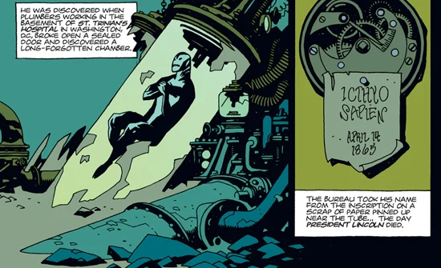
“鱼人塞皮恩（Icthyo Sapien）”

亚伯在防御署的经历是“可怕的”，他至今有时还会做关于那段经历的噩梦。科学家们不确定容器里的生物是什么，对他严加审视、反复研究。然而，[地狱男爵](/entry/Hellboy_%28character%29)对他心生同情，让医生们停止实验，因为“这种事只要没人喊‘够了’，就永远不会停”。亚伯从水箱里出来时虽然有些茫然，但状态健康，并很快对人类的接触做出了反应。尽管对前世毫无记忆，他很快就能说流利的英语——与其说是学来的，不如说是记起来的。

地狱男爵以及[丽兹·舍曼](/entry/Liz_Sherman)等防御署特工都格外喜欢亚伯，三人结下了长久的友谊。地狱男爵很快说服 B.P.R.D. 主管[特雷佛·布鲁姆](/entry/Trevor_Bruttenholm)，允许亚伯参加一些小型外勤行动，好让这个鱼人了解防御署之外的世界。1979 年 4 月至 6 月间，亚伯一直是地狱男爵形影不离的同伴。

尽管亚伯的存在从未被正式列为最高机密，但他在地下室被发现一事从未对外公开，他也没有像地狱男爵那样成为公众人物。由于对自己的外表感到不安，亚伯坚持在离开防御署时进行伪装：风衣、帽子、手套，有时还戴墨镜和假胡子。但到 2001 年地狱男爵离开时，亚伯似乎已建立起足够的自信，再也不用伪装了。

1979 年 6 月，地狱男爵因与考古学家 [阿纳斯塔西娅·布兰斯菲尔德](/entry/Anastasia_Bransfield) 的一段恋情而分心，把亚伯大半时间独自留在总部。丽兹和亚伯同属 B.P.R.D. 监护下的“怪胎”，两人在此基础上发展出姐弟般的关系。但 1980 年丽兹成为正式外勤特工，接受的出差任务越来越多，又一次留下亚伯孤身一人。亚伯嫉妒丽兹的自由——她能够以亚伯觉得自己永远做不到的方式融入这个世界。

1981 年，尽管还不是正式特工，亚伯加入一支小型特工小队，执行了地狱男爵离开后的第一次、也是他自 1979 年以来首次没有地狱男爵同行的任务。这个看似简单的任务是调查西班牙海岸外的一起沉船事件，但考察酿成灾难，在亚伯击退从船中现身的邪灵之前，已有三名特工和许多平民丧生。但亚伯在布鲁姆眼中证明了自己，同年 3 月被任命为正式外勤特工。（*[《亚伯·塞皮恩：溺水》](/entry/The_Drowning)*）

### 卡文迪什庄园事件

1994 年 5 月，亚伯·塞皮恩陪同地狱男爵和丽兹·舍曼前往闹鬼的古老宅邸卡文迪什庄园，调查地狱男爵的导师特雷佛·布鲁姆教授被一种奇异蛙状生物神秘杀害的事件。他们与卡文迪什夫人交谈，而他和同伴们不知道，她正被不死修士[格里高利·拉斯普廷](/entry/Grigori_Rasputin)当作棋子，用来引诱地狱男爵履行他作为末日先驱的本来使命。

审讯卡文迪什夫人没有太多收获，亚伯决定调查周边区域——由于庄园所在的土地数百年来不断下沉，那里如今已没入水下。亚伯从客房的窗户潜出，扎进浑浊肮脏的湖水中。探索了一段时间后，亚伯撞见两名变异的卡文迪什家儿子带着他们死去的母亲消失在水中。

他警惕地向后退去——尽管他对这些生物感到一种奇异的亲缘感——无意间闯进了一个旧房间，里面停放着庄园已故多年的老族长 Elihu Cavendish 的遗体。突然，亚伯被死者的灵魂附身，死者操控他的行动，以便向造成他家破人亡的拉斯普廷复仇。

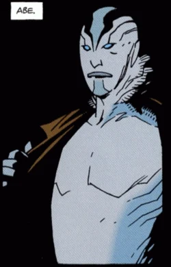
[《毁灭之芽》](/entry/Seed_of_Destruction)中的亚伯拉罕·塞皮恩。

被附身的亚伯及时赶到，阻止拉斯普廷召唤混沌七神、唤醒怪物般的恶魔实体萨杜-赫姆，他用鱼叉刺穿拉斯普廷的胸膛，又腾空跃起，夺下失控的丽兹——她已开始用无法控制的火焰力量彻底摧毁古老的废墟。恢复自主意识后，亚伯扶着丽兹帮她逃出废墟，地狱男爵则亲自对付拉斯普廷。

事后，亚伯和丽兹交流了地狱男爵与拉斯普及魔法变形后的卡文迪什子女搏斗期间各自的奇异经历。当众人逃出爆炸的废墟前，亚伯问地狱男爵他与垂死的拉斯普廷短暂相处时发生了什么，地狱男爵沉默不语，眼中闪过一丝严峻不安的神色。

### 朱雷斯库事件

卡文迪什庄园任务之后某时，亚伯与特工地狱男爵、丽兹·舍曼、[巴德·沃勒](/entry/Bud_Waller)、[西德尼·利奇](/entry/Sidney_Leach) 和凯特·考瑞根一同被召去参加 B.P.R.D. 会议。主管汤姆·曼宁说明了最新任务：调查三处不同地点，其中一处可能是 [弗拉基米尔·朱雷斯库](/entry/Vladimir_Giurescu) 的城堡——他是与纳粹有联系的吸血鬼，遗体最近被追随者盗走，将于次夜满月之时复活。亚伯被分配到第一小队，与特工 [Clark](/entry/Clark) 一起调查 2 号地点。

在飞往目的地的 B.P.R.D. 飞机上，亚伯注意到曼宁提起纳粹关联时地狱男爵神色不安，便走到他身边。他试图安慰朋友，但地狱男爵坚称自己没事，很快就背着一个（出了故障的）火箭背包从货舱门被空投到 1 号地点。

降落在 Szentes 城堡后，Clark 和亚伯都目睹远处朱雷斯库城堡方向传来巨大的爆炸声。亚伯只是干巴巴地应了一句：“地狱男爵又在炸东西了……”确认自己这边的地点一无所获后，亚伯和 Clark 动身前往附近的一座罗马尼亚小镇寻找地狱男爵——他的追踪腰带信号出现在那一带。两人循着腰带信号来到一座破败的教堂，走进这座神圣建筑时，他们看见一位牧师僵直地站在面前，手里拿着地狱男爵被盗的腰带。等意识到这是圈套时已经太迟，Clark 和亚伯一同坠穿坍塌的地板，落进布满巨型尖桩的陷阱：Clark 被尖桩刺穿身亡，亚伯则堪堪躲过致命的尖刺。

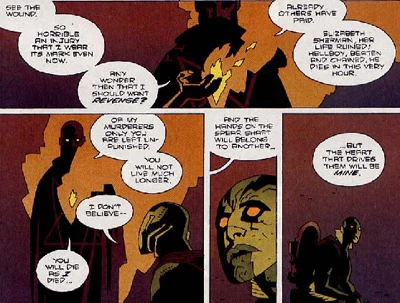
亚伯与拉斯普廷复仇的鬼魂对峙。

在教堂下方的地下室里，亚伯遭遇了拉斯普廷的鬼魂。鬼魂告诉他，他将为杀害拉斯普廷付出代价，将和拉斯普廷一样死去，并断言：“握住矛杆的将是另一双手——但驱动它们的心，将属于我。”片刻之后，一颗当地神父被砍下的头颅对亚伯说：“沉没的钟声为你而鸣。从 Num-Yabisc 黑暗、恐怖、深邃的洞穴中，大海正在召唤她的孩子们回家。”

亚伯虽然不理解这番话，它却令他心中充满末日将临的感觉。

### 人造人罗杰

被 B.P.R.D. 小队救出后，亚伯得知自己的担忧并非空穴来风。丽兹在罗马尼亚任务中遇到了一个人造人，被夺走火焰念动力后奄奄一息。亚伯守在罗马尼亚一家医院的丽兹身边，拒绝离开，直到她死亡的一刻——对亚伯来说，这比几年前布鲁姆之死的打击要沉重得多。幸运的是，地狱男爵追踪到了人造人，迫使他把盗走的火焰还给丽兹。这个被地狱男爵取名为[罗杰](/entry/Roger)的生物成功归还了丽兹的力量，丽兹当场起死回生，而代价是他自己的生命。

几个月后回到总部，科学家 Cobb 和 Reed 准备像当年解剖亚伯那样解剖如今毫无生气的人造人。亚伯偷听到了他们的谈话，想起了自己在防御署与实验有关的记忆。趁科学家们离开房间，亚伯把大楼的电力导入罗杰体内，给总部造成严重损坏，却把罗杰电击复活，最终为 B.P.R.D. 团队添了又一名重要成员。随着丽兹恢复健康、罗杰加入防御署，亚伯心中的末日感开始消散。

### 地狱男爵离去

1999 年 5 月，亚伯和地狱男爵前往苏格兰洛克马本，调查一只曾属于圣邓斯坦的盒子和一把火钳被盗的案件。亚伯被一只黑猩猩（前身是 Guarino 伯爵）开枪击中并施以酷刑。他后来完全康复，但随着事态愈发阴暗、挚友地狱男爵开始受身份问题困扰，他的恐惧感又开始回归。但他以丽兹为榜样，强作镇定，继续全心投入职责。

亚伯的恐惧在 2000 年被证明并非多余：丽兹再次离开防御署，这次是去乌拉尔山脉的一座修道院学习，试图控制自己的力量。

仅仅一年后的 2001 年，情况急转直下，地狱男爵也退出了防御署；他对防御署在罗杰体内植入炸弹、以及自己在末日中扮演的角色深感痛苦，决定远行，并请凯特·考瑞根代他向亚伯道别。尽管亚伯继续担任外勤特工，他却越来越感到孤独，他和罗杰都考虑过离开，只是谁也想不出能去哪里。

（注：从这里开始，亚伯不再出现在地狱男爵主线漫画中；此后他所有的登场都在 B.P.R.D. 衍生漫画中）

### 空洞的地球

2002 年 9 月，丽兹的灵魂出现在亚伯面前，恳求他帮助自己。亚伯与新特工约翰·克劳斯、罗杰以及外勤主管[凯特·考瑞根](/entry/Kate_Corrigan)一同前往那座修道院，在数十名被害僧侣中间发现了丽兹毫无生气的躯体。小队深入地底时，亚伯（有些不情愿地）挺身而出担任领队，从一个原始种族手中救回了丽兹的灵魂——他们俘获她的灵魂来为机器供能。此后丽兹回到防御署，团队中形成了新的协作精神，其基础正是亚伯与丽兹的姐弟情谊。接下来的两年里，他们在全球各地的调查中并肩作战。

### 蛙疫

2004 年 7 月的一个夜晚，亚伯梦见尸体纷纷坠入大海。梦境的背景中，他再次听到死去神父的声音，告诉他沉没的钟声正为他而鸣，大海正在“召唤她的孩子们回家”。

与此同时，曾在卡文迪什庄园废墟中发现的那种萨杜-赫姆生物的奇异真菌形态，从新泽西的一间 B.P.R.D. 实验室逃脱。亚伯和小队循真菌追踪到密歇根州 Crab Point，一个名叫 Humbert T Jones、又名“西弗吉尼亚奇迹男孩”的人正利用它把镇民转化成蛙状生物，与十年前遭遇的那些相似。在 Jones 家中，亚伯发现了一座供奉拉斯普廷的神龛。亚伯意识到正在发生什么，却来不及阻止；Jones 一矛刺穿亚伯，应验了拉斯普廷的预言。约翰赶到现场为他止血，但似乎无力阻止亚伯死亡，亚伯说出了看似是遗言的话：“太累了……你听到了吗？沉没的钟声……它们在为我而鸣。”

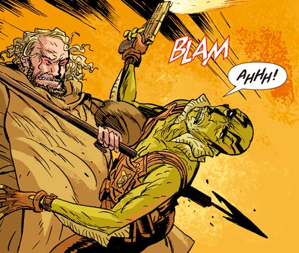
“握住矛杆的将是另一双手——但驱动它们的心，将属于我。”

在死亡的一刻，亚伯的灵魂穿越时间，回到一座古老而美丽的海底神庙，在那里他看到一只神秘的外星海洋生物。亚伯看着数个世纪流逝，神庙沦为废墟，那生物蜷缩起来，变成类似蛋的形态。随后一个穿潜水服的人取走蛋，把它带上一艘潜艇。如同在梦中，亚伯发现自己走在华盛顿圣特里尼安医院的走廊里——时间是 1865 年。外面天上下着蛙雨，亚伯走进大楼地下室中秘密的奥安尼斯学会实验室。

室内，兰登·埃弗里特·考尔和其他学会成员用这枚蛋举行仪式，蛋随即便在考尔手中碎成齑粉。除了考尔之外所有人都看不见亚伯，考尔开始惊慌，以为自己因“所做之事”被邪灵造访。亚伯的灵魂被吸入考尔的身体，考尔倒地，双眼翻白。亚伯目睹了考尔最后的时刻，听见学会成员们随着时间推移观察考尔变形时关切的话语，以及他们在亚伯拉罕·林肯遇刺（他们似乎卷入其中）后将他抛弃。他们封死房间，说等安全了会回来接他。

尽管亚伯失了大量血、被约翰宣告死亡，他却突然活了过来。虽然被矛刺穿胸膛，接下来几周里亚伯以惊人的速度康复。

这场时间之旅没有带回任何记忆，却给了亚伯一个名字：兰登·埃弗里特·考尔。

### 兰登·埃弗里特·考尔

亚伯知道自己的濒死体验绝不只是失血产生的迷梦，在查明自己人生核心谜团的冲动驱使下，他在凯特·考瑞根的帮助下开始调查考尔。线索把他引向罗得岛州 Littleport，考尔曾与妻子 [Edith Howard](/entry/Edith_Howard) 住在那里。Edith 的精神状态本就时好时坏，考尔的失踪给了她沉重打击；一个月后，她投海自尽。亚伯被这一信息困扰，独自前往探访他曾经居住过、如今破败空荡的房子。

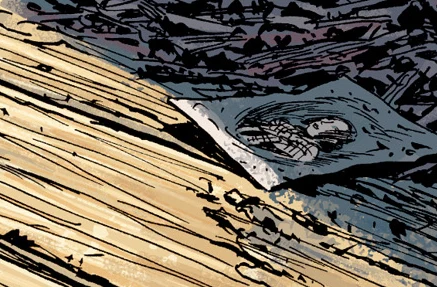
“Edith Howard。Edith 考尔。我的妻子。”

在那里，Edith 的鬼魂出现在亚伯面前，用幻术重现他们昔日的生活——她还活着，亚伯则再次成为考尔——试图说服他留下。亚伯动了心——他从未梦想过做一个普通人、拥有妻子，这对他是意义深远的体验——但他最终认定，自己不能活在梦里，无论那梦多么诱人。他告诉 Edith 他们必须接受已经发生的事，帮助她的灵魂直面自己的死亡，将她从悲痛中解脱。

### 黑焰

亚伯回到位于科罗拉多州的 B.P.R.D. 新总部，内心比以往任何时候都更受纠缠、也更疏远；只有凯特知道他身为考尔的过往，即便如此亚伯也没有向她透露与 Edith 相处经历的任何细节。他的行为变得古怪：他疏远朋友和同事——包括新任队长本·达米奥——还做出种种奇怪的举动，想让自己更像曾经的那个男人；他试图在自己极不寻常的身体外套上更常规的衣物，说话方式也发生变化，无论是有意还是潜意识，都想让自己听起来更像一个百年前的人——一个他仍然想不起来、只能靠调查碎片了解的人。

亚伯被自己的过去占据，在防御署面临严峻的新威胁时退出了外勤：数量不断增长的蛙怪蔓延到美国北部。凯特鼓励亚伯去找心理咨询师求助，但他置之不理。

随后团队遭受沉重打击：罗杰在行动中被 [兰迪斯·波普](/entry/Landis_Pope) 杀害，这位 Zinco 公司的首席执行官正披着黑焰的外衣领导蛙怪。亚伯将罗杰之死归咎于自己和自己对外勤工作的退缩，为了补偿，他贸然冲入战场，险些搭上性命。

蛙怪最终退回地下——这对团队只是冷冰冰的安慰，接下来几个月他们试图找到复活罗杰的方法，却一无所获。亚伯继续与自己过去的幽灵搏斗，试图弄清自己究竟该成为什么样的人。

### 奥安尼斯学会

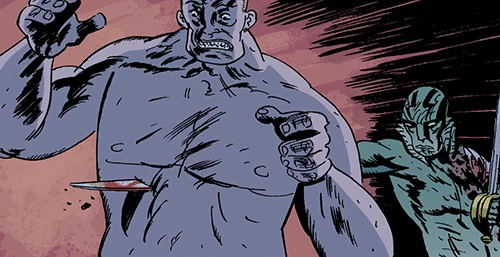
昔日的朋友，如今的敌人。

2006 年 8 月，亚伯收到一个旧雪茄盒，上面刻着姓名首字母“L. E. C.”，盒中有一张指向印度尼西亚的地图。在达米奥队长的陪同下——他向达米奥吐露了自己前世身份的秘密——他被埃及木乃伊[潘雅](/entry/Panya_%28character%29)引向一座秘密岛屿，在那里遇到了奥安尼斯学会的几名昔日同僚。学会计划杀死数百万人，再把他们的灵魂安置在受他们控制的人造躯体中，以此“拯救”他们，声称既然无法拯救全人类，至少要保住人类的“本质”。在与他们相处期间，亚伯了解到更多失落的过去，并意识到自己曾经的那个男人与如今的自己几乎毫无共同之处。在潘雅和达米奥队长的帮助下，亚伯挫败了他们的计划，带着潘雅、一具学会正在制造的躯体……以及些许内心的平静回到防御署。

### 失去达米奥队长，寻获姆姆南·萨

[温迪戈达里尔](/entry/Daryl_Tynon) 被转移到 B.P.R.D. 总部，因为这里的收容设施更坚固。此后不久，达米奥队长在多年努力控制变形之后，化身为一头美洲豹般的怪物；变形后的队长杀死五人，包括约翰·克劳斯的新身体，并放走达里尔，随后逃入科罗拉多荒野。自从本加入防御署以来，亚伯和他已成了好友，正是亚伯率队试图找到他——至于究竟是为了把他带回来，还是为了终结他的威胁，则难以断定。

值得注意的是，他没有带约翰同行，似乎认为约翰自身的图谋可能危及任务。猜疑的裂痕开始在两名特工之间形成。

亚伯和特工们花了数周搜寻本，关于他下落的线索寥寥无几，随后被防御署召回。

新证据锁定了一个名叫姆姆南·萨的男人的位置，此人在防御署对抗蛙怪和黑焰的战争中时而骚扰、时而协助他们。但当小队前往一座丛林神庙找他时，丽兹·舍曼在他们眼前凭空消失，他们的一架飞机在没有任何飞行员的情况下飞走了。姆姆南·萨出现在亚伯面前，警告他自己本可以把他们全部杀死却选择没有这么做，随后强行将他们逐出该地区。后来他们追踪失踪飞机，发现它坠毁在德国慕尼黑。在那里，小队发现曾经绑架丽兹的同一支地下种族如今与蛙怪勾结，正在制造巨型机器。机器被发现后开始摧毁慕尼黑，亚伯和小队基本上无能为力，只能眼看着城市化为废墟。

他们把力量转向地下，亚伯和约翰带着一小队人马去摧毁怪物为机器人供能的动力源。他们成功了，但慕尼黑大半已经失守。亚伯意识到飞机是被姆姆南·萨故意坠毁在慕尼黑的，为的是引导他们找到证据，证明他对丽兹说的不是谎言。亚伯被这一消息困扰，又仍无丽兹安危的新消息，不久后姆姆南·萨在酒店房间向他显形，警告他所谓不可避免的未来，令亚伯勃然大怒。

随着大螯虾强生留下的笔记被发现，线索指向姆姆南·萨的所在地——古城 Thadrethes，B.P.R.D. 与武装部队合作，直接找上姆姆南·萨的门。尽管对方全副武装而来，萨仍迎接亚伯、凯特和德文进入 Thadrethes，他们在那里找到了丽兹：她毫无反应但平安无事，她的火焰正被用来摧毁城外入侵的蛙怪大军。亚伯试图强迫姆姆南·萨交出她，得到的回应是被猛摔到一根柱子上。但姆姆南·萨最终丧命——丽兹将他活活烧死，所有人都安全返回防御署。

### 新人类种族

解决姆姆南·萨、丽兹归队后，团队全力转向阻止黑焰。亚伯率领丽兹、德文和数名武装特工，从《空洞的地球》中的阿加森修道院深处发起进攻。他们找到了黑焰，结果却出人意料：丽兹外出前方侦察时凭空消失。

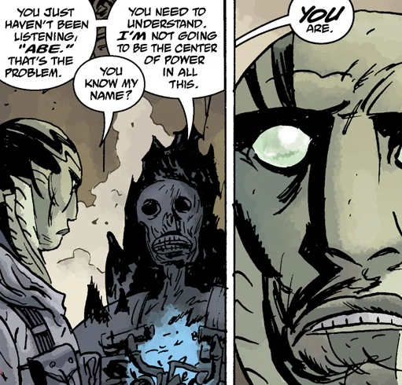黑焰还抛出一个惊人的断言：亚伯是新人类种族的第一人，在人类灭绝后缔造下一个世界的进程中，他将占据一个核心的权位。亚伯愤怒地拒绝相信，威胁要用刀剖开一个正在孵化的蛙卵。但当黑焰向他展示一个奥格德鲁·赫姆时，亚伯仿佛被催眠般迈步上前，睁大眼睛凝视着对方。

与此同时，丽兹经历了一段关于未来的幻象：B.P.R.D. 拯救人类的努力失败了。在他们一架飞机的残骸中，她找到数张团队成员的照片：年长的德文、行动自如的潘雅，甚至还有地狱男爵。在这些照片中，她发现一张照片上的亚伯看起来更加变异、更像野兽，人性的痕迹几乎消失殆尽。

黑焰其余的阴谋被终结：丽兹用火焰摧毁了洞穴中的一切，她幻象中一个神秘的萨满身影在火焰吞没地下世界之前将亚伯和团队传送离开。目前人们相信黑焰及其残余势力已全部被消灭。

小队在奥地利的群山中被发现，受了轻微冻伤，此外安然无恙。凯特·考瑞根和汤姆·曼宁为防御署争取到联合国资金后，凯特前来看望他们。就在那时，德文悄悄请求把自己调得离亚伯越远越好；黑焰的断言已在他们之间筑起一道隔阂，而这道隔阂日后将被证明意义重大。

防御署的工作似乎恢复如常。有了联合国资金，防御署如今必须分摊工作量，让所有人连最琐碎的案子都忙个不停。但尽管工作繁忙，亚伯仍不断研究找到本·达米奥和达里尔的可能性，最终将二人的位置锁定在不列颠哥伦比亚省的荒野中。与此同时，他还要应对德文因黑焰之言产生的不安；亚伯坚决否认那些说法，而德文则认为其中或许有些被团队忽视的真相。

亚伯休假去寻找本，找到他时却正卷入一场冲突：一座城镇神秘地空无一人，他和本发现一对奥格德鲁·赫姆是罪魁祸首，二人杀死了它们，也杀死了保护它们的人类女人。本透露，这些幼年奥格德鲁·赫姆是通过一个人类女人的身体来到世上的，那女人相信它们是自己的孩子。

本表示他相信临界点已经到来，直到如今这些恐怖之物才得以溜进他们的世界。亚伯请求朋友回到防御署，但本拒绝了，并警告亚伯，最大的危险是对人心与思想的入侵；这比任何怪物——比如从索尔顿湖升起的那只——都更危险。不过他请亚伯从总部取回一些东西，亚伯后来带着达里尔的全家福和一些给本的补给回来。本祝他安好，两人友好地分别。

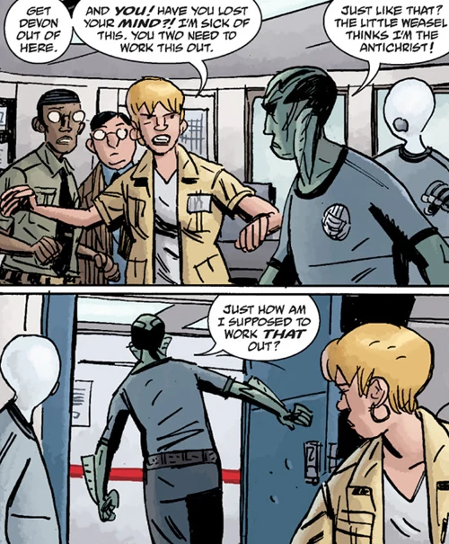回到 B.P.R.D. 总部后，亚伯与德文特工、约翰和凯特·考瑞根一同听取任务汇报；亚伯撒谎说自己是凭直觉找到现场的，只字未提本或达里尔。德文对亚伯充满敌意，质问他当初为何要去不列颠哥伦比亚省。亚伯为自己的行为辩护，怒气冲冲地正要离开，一名技术助理进来报告说亚伯的笔记本电脑被植入了间谍软件。愤怒的亚伯指责德文监视自己，德文则辩称自己毫不知情。凯特试图缓和局面，却无济于事。

但实际上，给亚伯电脑装窃听器的是约翰；约翰认定自己第二具身体之死全是本的过错，执迷于找到这位前队长复仇。约翰知道亚伯和本是好友，便继续监视亚伯，以获取更多实现复仇的信息，这让这对同志之间产生了隔阂。

### 蜕变

德文与亚伯之间的问题持续了数月。凯特试图让他们更坦诚地谈论彼此对黑焰之言的恐惧。德文反复提起达米奥被附身的事，以此证明亚伯可能具有潜在危险，而亚伯当时的反应也丝毫未能驳倒那个反派的断言。

亚伯反驳说自己的反应是出于恐惧。他指出，没人真正知道他是什么，所以当黑焰点出他与蛙怪多么相似时，那“勾起了一种我十五年来一直努力不让自己产生的恐惧”。德文承认这有几分道理，但并未被完全说服，会议不欢而散。

团队被派往得克萨斯州寻找新线索：一个名叫[菲尼克斯](/entry/Fenix)的少女，她似乎有难以置信的好运，总能在怪物袭击和当地的环境灾害中幸存。亚伯带领包括德文在内的小队调查，发现了菲尼克斯，也发现了新的巨型怪物正袭击追随她的人群。亚伯把她从被吃掉的边缘救下，试图安抚她，自报姓名。

菲尼克斯回答：“我*知道*你是谁”，随即朝他的胸口和颈部连开数枪。

德文目睹了整个袭击过程，惊恐地呆立许久，医护人员才赶来施救。但当他打电话给凯特报告经过、凯特问是谁开枪打了亚伯时，他短暂停顿后回答说自己没看清是谁。菲尼克斯从现场消失，亚伯被紧急送回总部。

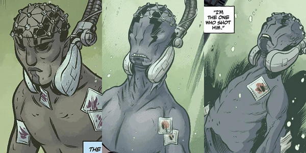
亚伯的身体分别在 *Gods*、*Russia* 和 *The Return of the Master* 中发生的变化。

亚伯被置于全天候监护下疗伤，中弹后这位鱼人一直昏迷。他的康复起初看似顺利，直到病情突然恶化。医生让他的心脏重新跳动并接上生命维持系统，但损伤已经造成：亚伯大面积脑损伤，看上去几乎与死人无异。

凯特向防御署力争，至少在一段时间内继续为亚伯维持生命，但她私下向约翰坦言不确定他有多少希望。被问及观察到什么时，约翰说他仍能感知到亚伯体内困着一个灵魂，但那灵魂感觉“很绝望”，他认为是时候放手让亚伯走了。

就在凯特结束在俄罗斯的会议时，她接到电话。医生报告说亚伯的心脏重新自主跳动，脑电波趋于稳定，全体医护都对原因困惑不解。但与此同时，亚伯的身体开始变化，变得比以往任何时候都更不像人类。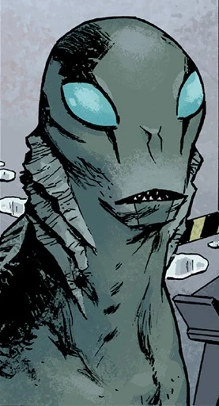

### 擅离职守

亚伯昏迷了 4 个月，在此期间从以前的外形进化为如今的模样。不幸的是，他醒来时正赶上[黑焰](/entry/The_Black_Flame_%28character%29)在全球唤醒数十个奥格德鲁·赫姆，令末日局势恶化。他复苏后第一个、也是唯一一个见到的人是潘雅，潘雅让他自己想清楚在末日中所处的位置。出于对自身安危的担忧，也因为相信自己与奥格德鲁·赫姆的出现有关，亚伯偷了一辆卡车逃离总部，去寻找自己的答案。B.P.R.D. 特工立刻展开追捕，领队的是并不情愿的 [沃恩特工](/entry/Agent_Vaughn)。

亚伯开始徒步穿越美国西南部，遇到一个个在危机中挣扎求生的城镇，许多地方陷入歇斯底里和疯狂，滋生出邪教和狂暴的乱民。他不幸目睹沃恩死于一个变种人之手，随后辗转来到索尔顿湖。

在那里他发现奥格德鲁·赫姆已经离开，沿途产下了卵，而另一些人开始聚集到他身边。亚伯本以为来此可以证明自己与这些肆虐的生物没有关联，结果狂热的游牧民把他视为末日的象征人物，一个新邪教由此兴起。

亚伯继续前行，遇到更多流动的幸存者和城镇，却在他试图帮助的人中间找不到任何缓解焦虑的机会。当 BPRD 追上他时，他们默默放他离开，对他寻找自我的目标抱有同情。即使与一些幸存者同行、寻找避难所时，亚伯也无法护他们周全；厌倦之下，他重新独自上路。这次他的目标是回到罗得岛——考尔的旧居——寻找答案。

抵达北卡罗来纳州后，亚伯被引到一个神秘的 12 岁女孩 Maggie 面前，她说着一种只有她母亲能听懂的古老语言，通晓预言和秘传知识。她确认了亚伯与即将到来的新人类种族之间的联系，并心情沉重地说，他的未来与人类的未来并不重合。亚伯注定是神圣的 Vril 力量的承载者，将其从人类时代传递给他的后裔——即将继承地球的新人类种族。甚至 Edith 考尔的灵魂也向他显形，劝他不要去罗得岛，于是他离开众人，转而前往纽约布鲁姆教授的旧居。

在布鲁姆的公寓里，亚伯发现了一些秘密催眠疗程记录，揭示布鲁姆早就知道 Langdon 考尔，以及他们谈话中收集到的信息如何影响他在 1993 年决定加入那场命运攸关的卡文迪什考察。没等他了解更多，术士 [古斯塔夫·施特罗布尔](/entry/Gustav_Strobl) 终于追上了亚伯，他利用死去的沃恩作为傀儡协助束缚亚伯。施特罗布尔在旧日恶魔主子倒台后急于寻找新的显赫位置，企图控制亚伯，好让自己登上新的权位。亚伯挣脱后逃入大海，但施特罗布尔偷听到布鲁姆的录音带，前往圣塞巴斯蒂安进一步实现自己的目标。

亚伯游到考尔当初取回蛋的沉没废墟，却发现那里栖息着 [雄钦](/entry/Shonchin)——史前时代掌控 Vril 的萨满，曾在空洞的地球中将亚伯及其同伴从黑焰面前神秘带走。雄钦解释了改变他的神秘水之天使的来历。雄钦让亚伯看到，那位天使曾是他的朋友、同为萨满，因拒绝背弃信仰而遭黑色女神追随者折磨。在被处决之前，他被 Vril 的力量转化为考尔和亚伯所见过的水母状存在，将他周围的城市沉入大海。雄钦让亚伯明白，他是由崇高的力量为崇高的目的所造，并敦促他直面自己的命运。

离开沉没废墟后，亚伯最终抵达英格兰的海岸——英格兰数月前已从地球表面消失。在那里他遇到了[爱丽丝·莫纳汉](/entry/Alice_Monaghan)，她向亚伯解释说地狱男爵确实已经死去，那片曾被称为英格兰的翠绿乐园正是由他的牺牲所创造，让旧世界的这一部分得以延续到下一个世界。亚伯告诉她自己想留下，但爱丽丝告诉他不能，因为他的使命属于即将到来的新世界。和此前的雄钦一样，她告诉亚伯不要害怕，即使在这里，他也无法逃避或躲开自己的命运。

亚伯终于回到美国海岸，却再次遭到施特罗布尔袭击。施特罗布尔前往圣塞巴斯蒂安，杀死了藏在教堂中的水之天使，把自己变成了和亚伯一样的鱼形类人生物。他给亚伯机会，与他一同迎来人类最终种族、做他们的引导者和导师，但亚伯拒绝让他得逞并杀死了他。亚伯在战斗中因伤势昏倒，此时 B.P.R.D. 特工恰好赶到将他接走。

### 魔鬼旧相识

亚伯乘坐的卡车在返程途中遇袭受阻，丽兹、泰德·霍华德和其他几名特工被迫展开营救。丽兹发现亚伯仍在卡车后厢里，车身开始形成一个有机茧以帮助他愈合。他们把他带回新的飞行总部，他在那里安全康复，与丽兹和其他人重聚，并补知了自己逃离后发生的一切。

## 能力

亚伯是极具天赋的游泳者，对水有着天生的亲和力。他既能呼吸空气也能在水中呼吸，但离水只能维持约一周；旅行时他睡在酒店的浴缸里，以免皮肤干裂。他对自己所游水域的状况十分敏感。在威尼斯游泳时，水污染严重到他事后不得不在水箱里待了很长时间才能恢复。

他是出色的神射手，也是 B.P.R.D. 中（除地狱男爵和丽兹外）技能最精湛的特工之一，拥有数十年的经验。

他似乎还拥有大幅强化的力量和愈合能力。他挺过的部分（绝非全部）伤势包括：被矛刺穿胸膛（严重到最初被宣告死亡）、多次中弹后又遭一只类人猿折磨、被抛到巨型尖刺上、面部和胸部中弹（同样一度被宣告死亡）。他的身体究竟能不能死都尚有争议，因为两次被宣告死亡他都活了过来。

他也可能不会衰老，或者衰老速度远慢于常人——考虑到他在医院地下的容器中完成转化的时间长达 113 年。这可能是他作为兰登·埃弗里特·考尔的前世所遗传的特征：考尔成为亚伯时年约七十，看起来却相当年轻。

他可能拥有某种有限的触物感知能力，不过那些触物感知的实例实际上可能是与之接触的物体本身的属性，而非他具备的能力。

## 盟友与敌人

#### 盟友：

- [地狱男爵](/entry/Hellboy)：红皮肤的恶魔，右手为石头所造。他幼年时被召唤到人间，本应成为临近末日的催化剂，却被美国士兵救出并抚养长大，成为一支向善的力量。地狱男爵把亚伯从防御署的实验中救出，并负责他此后的训练；因此亚伯和地狱男爵一直是好友，地狱男爵离开后亚伯非常想念他。
- [丽兹·舍曼](/entry/Elizabeth_Sherman)：一名念火者，这位忧郁沉静的女子拥有创造和操控火焰的精神能力。丽兹和亚伯因同为“怪胎”而结下深厚纽带，长期以来无论是否在执行任务都互相支持。
- [人造人罗杰](/entry/Roger)：一个由血、草药与马粪一同在罐中混合创造出的人造人。亚伯把这生物从不道德的 B.P.R.D. 实验中解救出来——正如地狱男爵当初救了亚伯自己——并帮助训练他成为外勤特工。罗杰被害时亚伯悲痛欲绝，自责当时不在场。
- [特雷佛·布鲁姆](/entry/Trevor_Bruttenholm)：
- [汤姆·曼宁](/entry/Tom_Manning)：B.P.R.D. 特别项目主管，亚伯的上司。除工作关系外，两人没有太多互动，不过 Tom 似乎确实承认，雇用亚伯有助于防御署获得经费，也知道亚伯清楚自己在做什么。
- [凯特·考瑞根](/entry/Kate_Corrigan)：特殊人才小队的外勤主管，亚伯的多年好友。亚伯足够信任她，让她帮助自己查明兰登·埃弗里特·考尔的真相，并把她尊为同事。
- [约翰·克劳斯](/entry/Johann_Kraus)：Kraus 是一名德国灵媒，肉体被毁，但灵质形态留存下来。亚伯和约翰曾关系随和，直到本杀死约翰的第二具身体。从那以后，他们的关系即便算不上公然敌对，也一直紧张，不过亚伯并不知道约翰一直在监视他、试图定位本。
- [潘雅](/entry/Panya_%28character%29)：
- [本·达米奥](/entry/Ben_Daimio)：特殊人才小队（如今的前任）队长。亚伯和本因共同的行事准则而结下情谊，本逃离防御署后，正是亚伯坚持搜寻并最终找到了他。尽管本可能对公众和他自身构成风险，亚伯仍为保护他而向防御署撒谎。
- [安德鲁·德文](/entry/Andrew_Devon)：防御署的新成员，曾是学者。两人虽曾关系友好，但在《恐惧之王》事件后关系急转直下。亚伯指责他相信自己是反基督，而德文则隐瞒了菲尼克斯枪击亚伯的行为。

#### 敌人：

- [格里高利·拉斯普廷](/entry/Grigori_Rasputin)：一名不死神秘学者，自称是可怕宇宙实体奥古·桀哈的正式使者，不择手段、全心致力于带来世界末日。卡文迪什任务期间，亚伯·塞皮恩被 Elihu Cavendish 的复仇之灵附身，在鬼魂影响下用鱼叉刺中拉斯普廷，杀死了他的肉身。拉斯普廷的鬼魂后来声称亚伯将为此受罚，会以与拉斯普廷相似的方式死去，而这确实应验了。
- [黑焰](/entry/The_Black_Flame_%28character%29)：Zinco 公司前任首席执行官，企图控制蛙怪，对亚伯的朋友罗杰之死负有责任。他声称亚伯是新人类种族的第一人，将在人类末日的降临中扮演关键角色。丽兹消灭他和最后一批蛙怪后，据信他已经死亡。

## 其他媒体中的登场

作为深受粉丝喜爱的角色，亚伯·塞皮恩被改编进各种媒体，其中最主要的是电影和动画。

### *《地狱男爵》*（2004–2008 电影系列）

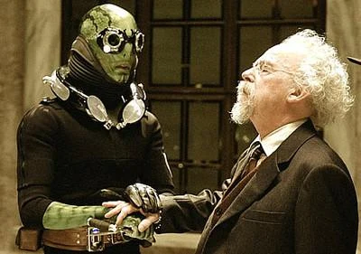
电影系列中的亚伯·塞皮恩，与[特雷佛·布鲁姆](/entry/Trevor_Bruttenholm)在一起。

在 Guillermo del Toro 改编的地狱男爵电影中，亚伯·塞皮恩是重要角色，其造型后来被用于漫画版《B.R.P.D.：人间地狱》之后的形象。2004 年电影《地狱男爵》中，他由 Doug Jones 在厚重化妆和 CGI 增强下扮演，配音则由未署名的 David Hyde Pierce 完成。

电影里亚伯·塞皮恩拥有独特的精神能力，长时间离水时需要佩戴水下呼吸装置。他被刻画为性格相当被动，与地狱男爵更直接、“先打服再说，再问问题”的哲学形成兄妹般的互补关系。他还喜欢吃皮蛋。

塞皮恩登场于 2008 年续集《地狱男爵 2：黄金军团》，这部续集中他较少佩戴呼吸器，并在片中展示了自己的神射技艺。在牙仙袭击时他出于本能保护丽兹，也正是他发现了丽兹怀孕的事。他爱上了精灵公主弩阿拉，为了她的安全，他把魔法王冠碎片（用于控制黄金军团）交给弩阿达王子，等于帮助了后者。

电影也触及了亚伯更具喜剧色彩的一面。他不记得前世，意味着他在爱情和亲密关系上毫无经验，在弩阿拉身边手足无措。然而在影片结尾弩阿拉死在他怀中时，他终于通过心灵感应向她道出了自己的感情。

### *《地狱男爵动画版》*

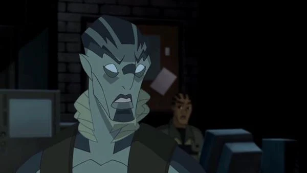 其次，亚伯以更接近漫画原版设计的外形，与地狱男爵和丽兹·舍曼一起，作为主角登场于构成 *Hellboy: Animated* 故事线的动画长片电影中。迄今已有两部由他出演的电影上映，他与 Doug Jones 同属配音阵容：

- *[《地狱男爵动画版：风暴之剑》](/entry/Sword_of_Storms)*，片中他和丽兹·舍曼遭遇坠机。两人坠入下方的大海，亚伯把空气吹进丽兹肺中救了她一命。他们在一场超自然飓风中被困在一座岩石岛上，并与一条“龙”搏斗。
- *[《地狱男爵动画版：钢铁与鲜血》](/entry/Blood_and_Iron)*，亚伯在片中获得了戏份重得多、动作场面密集的角色。

亚伯还登场于图像小说系列丛书《地狱男爵动画版：黑色婚礼》和《地狱男爵动画版：审判之钟》。

## 趣闻

- 最初，地狱男爵本应是米格诺拉构思的一支超级英雄团队的成员。在这支计划中团队的概念图上，可以看到一个更像怪物、更高大的地狱男爵，而亚伯·塞皮恩就在队友之列。
- 电影导演 Guillermo del Toro 是公认的米格诺拉作品的铁杆粉丝，他本人称亚伯是他最喜欢的“地狱男爵”角色。
- 电影里亚伯把自己的身体形容为“一座神殿”，远离“不洁之物”，但在《地狱男爵 2》中地狱男爵“硬逼”他陪酒，他还是喝醉了。不过在漫画里，常能看到他抽雪茄，有时也喝酒。
- 书中提到亚伯喜欢国际象棋，有时拉凯特陪他下棋，还说她输不起。

## 资料来源

- [维基百科词条](http://en.wikipedia.org/wiki/Abe_Sapien)
- [地狱男爵官方网站](http://www.hellboy.com/)
- [2012 漫展座谈会](http://www.comicbookresources.com/?page=article&id=41329)
