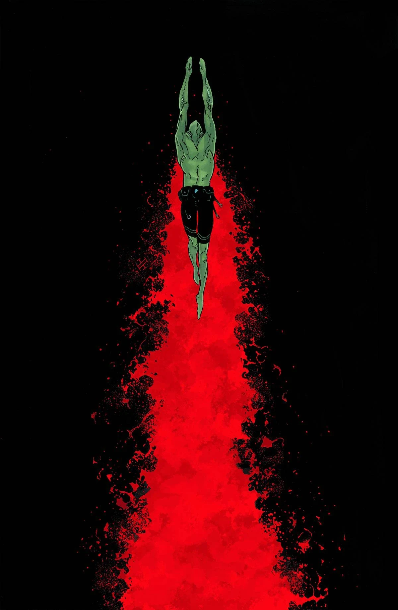
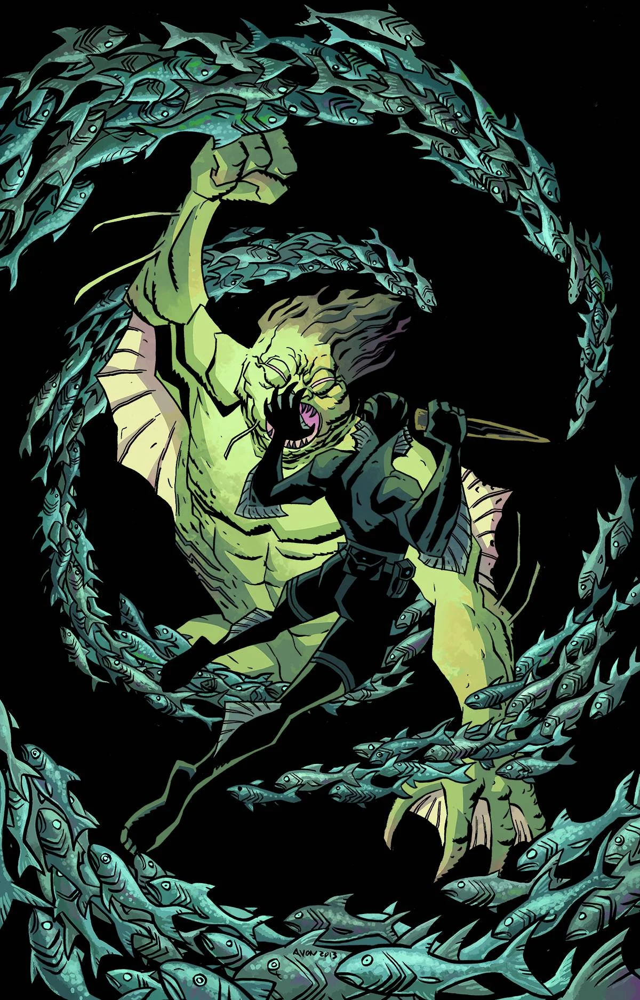

《**亡者之地**》（The Land of the Dead）是一部单篇完结的故事弧，于 2013 年 12 月出版，画师为 Michael Avon Oeming。

## 出版历史

这是一则闪回故事，与[上一个故事弧](/entry/The_Shape_of_Things_to_Come)有着玛雅方面的关联，并与《*[地狱男爵在墨西哥](/entry/Hellboy_in_Mexico_%28story%29)*》相联系。

### 早期预告

故事的惊鸿一瞥曾作为 [Multiversity Comics 的「31 Days of Abe」](http://multiversitycomics.com/special/31-days-of-abe-day-11-michael-avon-oeming/)美术作品的一部分放出。当时并未透露这其实是一则故事的设计稿。五个月后，该故事才在 [Comic Book Resources](http://www.comicbookresources.com/?page=article&id=47435) 上正式公布。

## 剧情简介

1983 年，亚伯·塞皮恩进入墨西哥坎佩切州的一处洞穴，一支考古发掘队在那里遭遇了一只怪物。亚伯深入洞穴，遇到一名探险队成员和数具尸体。随后他发现了一间摆满棺材的墓室，棺材里全是吸血鬼，极可能来自 Madelyn Rose 号船——这艘船最早在[《皮肯斯县恐怖事件》](/entry/The_Pickens_County_Horror)中被提及。房间里还有一只巨大的白色两栖生物，它曾是那些吸血鬼中的一员。亚伯随即将吸血鬼们尽数杀死。众人逃出洞穴后，那间发生过这一切的房间却再也无处可寻。

## 画廊

 \#8
Max Fiumara 绘

 \#8 变体封面
Michael Avon Oeming 绘
