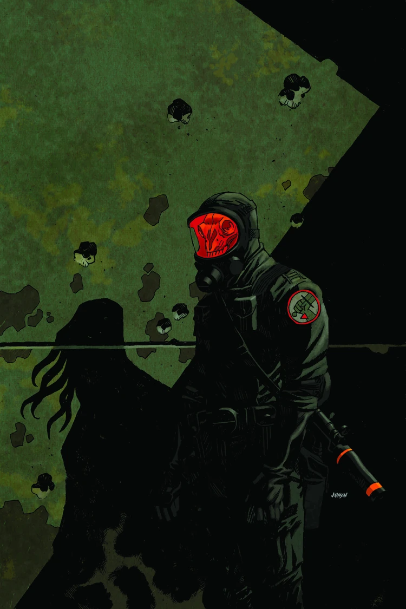
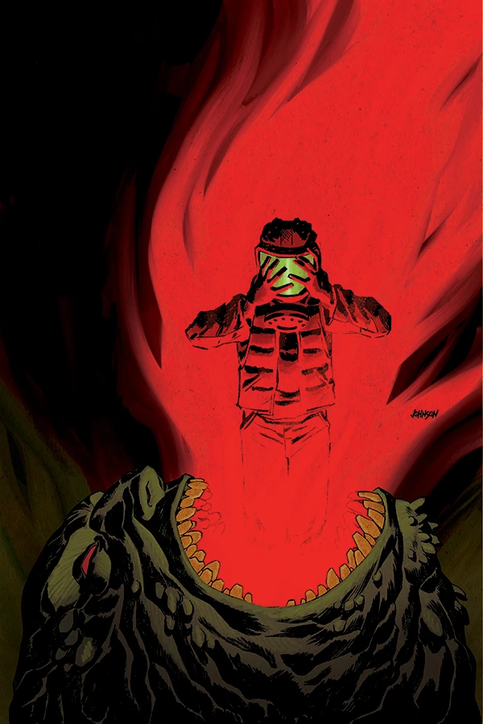
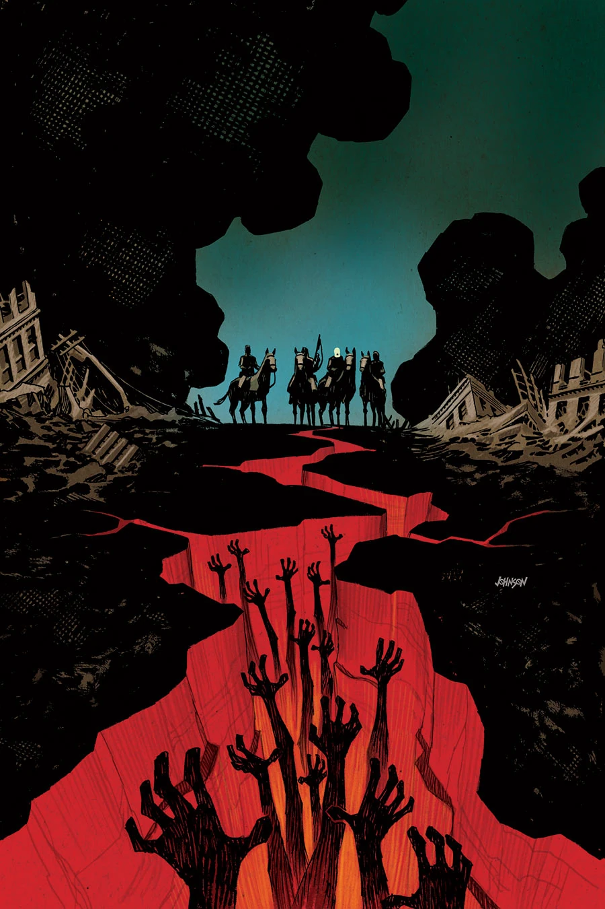

《**人人自危的荒原**》（Wasteland）是 2013 年出版的三期限定迷你系列，封面由 [Dave Johnson](/entry/Dave_Johnson) 绘制。

## 剧情梗概

### 第一部分

一支 B.P.R.D. 小队在芝加哥执行搜救任务，试图寻找在《[B.P.R.D. 人间地狱：时间深渊](/entry/The_Abyss_of_Time)》（B.P.R.D. Hell on Earth: The Abyss of Time）中失踪的一组探员。他们找到的却是一座满目疮痍的城市：遍地是巨大的奥格德鲁·赫姆（Ogdru Hem），还有大批化作怪物的人类如潮水般涌来。

### 第二部分

芝加哥荒原上蔓延的疫病将这座「风城」的居民变成凶残的怪物。这些怪物，连同那些长着蝙蝠面孔的巨型怪物，能否阻止 B.P.R.D. 救出他们失踪的同伴？

### 第三部分

探员们向芝加哥废墟深处挺进，找到了《[时间深渊](/entry/The_Abyss_of_Time)》中失踪的 B.P.R.D. 探员们的最终安息之地。等待他们的是一处诡异的超自然犯罪现场，以及一支由变异人类组成的大军，挡住了他们返回总部的去路。

## 画廊

