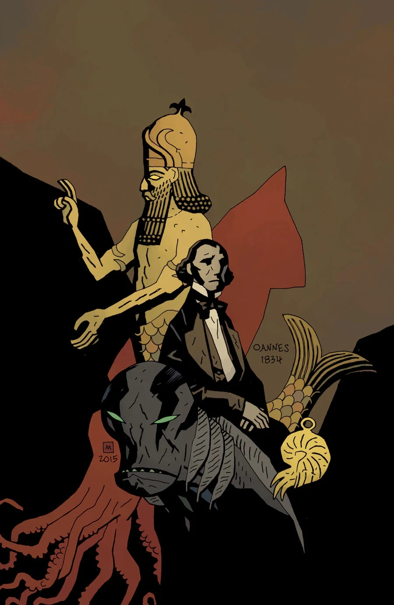

《**人鱼族**》（Icthyo Sapien）是一则以 1834 年为背景的闪回故事，主角为[兰登·考尔](/entry/Abraham_Sapien)。该故事在《*Abe Sapien: The Drowning and Other Stories*》[合集版](/entry/Omnibus_Editions)中得到扩写，并由此与《*[B.P.R.D.：魔鬼旧相识——潘德摩宁](/entry/Pandemonium_%28story_arc%29)*》衔接起来。

## 剧情简介

[亚伯](/entry/Abraham_Sapien)对自己十九世纪凡人生活的记忆浮出水面；与此同时，各个秘密社团正为一件器物争斗不休——这件器物或许能够证明人类真正的起源！

## 画廊

