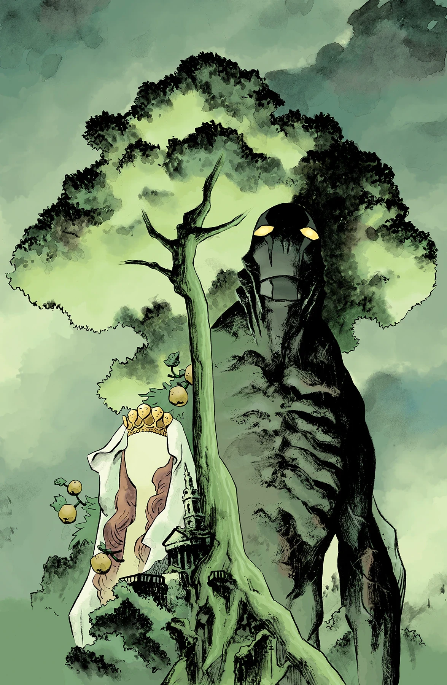

《**伊甸园（III）**》（The Garden (III)）是一篇单期故事，由 Max Fiumara 作画。

## 剧情简介

死灵法师[古斯塔夫·施特罗布尔](/entry/Gustav_Strobl)在[亚伯·塞皮恩](/entry/Abraham_Sapien)抵达英格兰之际展示了他新获得的力量——这是《[黑暗与可怖](/entry/Dark_and_Terrible_%28story_cycle%29)》风暴来临前最后的平静。

## 画廊

