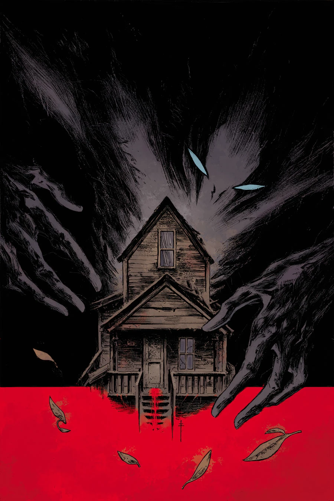

《**伊甸园（I）**》（The Garden (I)）是 2014 年 5 月的一篇单期故事，由 Max Fiumara 作画。

## 出版历史

这篇故事最初以《The Garden》为题发表于《Abe Sapien》#12，但收入平装合订本时改题为《The Garden (I)》。后来揭示它是一个由三部分组成的主题三部曲的第一篇。

## 剧情简介

亚伯的旅程迎来新的转折：在这篇乡村恐怖故事中，他遇到了一对扭曲的夫妇，一段家庭关系走向了极其可怕的歧途。

## 画廊

