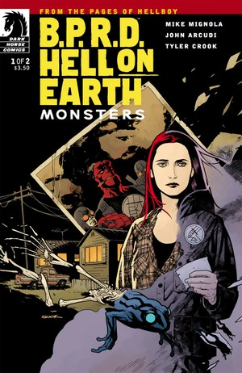
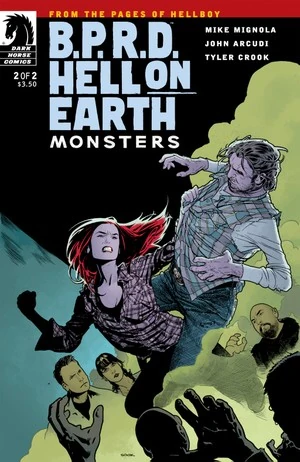

《**众兽**》（Monsters）是一部两期迷你系列，于 2011 年 7 月至 8 月出版。

## 出版历史

这是[《人间地狱》故事环](/entry/BPRD%3A%E4%BA%BA%E9%97%B4%E5%9C%B0%E7%8B%B1)的第三个故事弧，上接《[众神](/entry/Gods)》。各期出版时的封面均由 [Ryan Sook](/entry/Ryan_Sook) 绘制。这也是 Tyler Crook 首次作为 *B.P.R.D.* 的常驻画师参与的迷你系列。

该故事与《[众神](/entry/Gods)》一同收录于《*[B.P.R.D.: Hell on Earth—Gods and Monsters](/entry/Trade_Collections)*》平装合订本中。

## 剧情简介

### 第一部分

当[调查局](/entry/Bureau_for_Paranormal_Research_and_Defense)在得克萨斯州与巨型蝙蝠耳怪兽作战时，[丽兹·舍曼](/entry/Liz_Sherman)正住在一个拖车公园。

### 第二部分

丽兹·舍曼被困在一个诡异的拖车公园，里面满是乡巴佬邪教狂徒；她必须杀出一条血路，击败那位垃圾大祭司，才能逃出生天。

## 画廊

 \#1

 \#1（[Francesco Francavilla](/entry/Francesco_Francavilla) 变体封面）

 \#2
