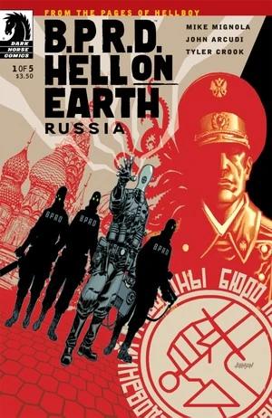
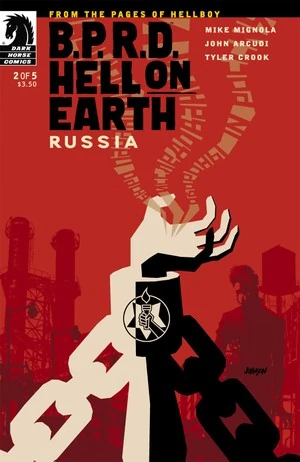
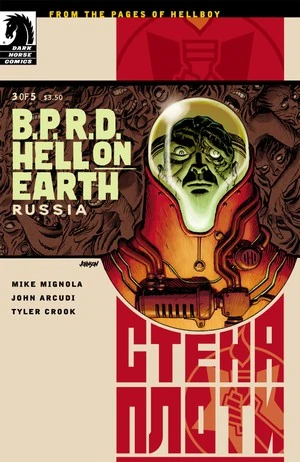

《**俄罗斯**》（Russia）是一部五期限定迷你系列，出版时间为 2011 年 9 月至 2012 年 1 月。

## 出版史

这是[「人间地狱」故事环](/entry/BPRD%3F%E4%BA%BA%E9%97%B4%E5%9C%B0%E7%8B%B1)的第四个故事弧，上接《[怪兽](/entry/Monsters)》（Monsters）。各期封面均由 [Dave Johnson](/entry/Dave_Johnson) 绘制。本故事收录于《[B.P.R.D.：人间地狱——俄罗斯](/entry/Trade_Collections)》（B.P.R.D.: Hell on Earth—Russia）。

## 剧情梗概

### 第一部分

俄罗斯一座矿井深处掘出了一片变异怪物的坟场。此时丽兹仍然下落不明，亚伯·塞皮恩则缠绵病榻、奄奄一息。已经走向国际化的 B.P.R.D. 派出凯特与约翰，去与苏方对口机构接洽——读者最早在《[B.P.R.D.：1946](/entry/1946)》中见过该机构——他们要在克里姆林宫面对一只会爆炸的真菌怪物，以及一场不断扩散的疫病。

### 第二部分

在俄罗斯秘术局总部的保险库里，关押着一个被铁链锁住、受到严密监视的男人。凯特和约翰被请来协助时，该局那具僵尸局长故意让他们去对付那个被附身的囚犯！

### 第三部分

约翰与俄罗斯特殊科学局一名被附身囚犯的灵魂陷入灵体缠斗，与此同时，凯特了解到了被遗弃的兰帕耶季克（Rampayedik）镇，以及镇上神秘的僵尸劫掠者。

### 第四部分

约翰直面奥格德鲁·赫姆（Ogdru Hem）的邪灵，凯特则与僵尸搏斗。

### 第五部分

在无产阶级僵尸的猛攻之后，B.P.R.D. 与俄罗斯机构必须结成同盟，才能从一座致命的矿井中救出约翰。

## 画廊

 \#1

 \#2

 \#3

 \#4

 \#5
