**克焰人**（Karl Rupert Kroenen）是德国纳粹科学家、党卫军军官。在一次实验事故中受伤后，人们再见到他时，他总是戴着防护防毒面具、穿着紧身防护服。克焰人痴迷于用尸体做实验、制造超级士兵，甚至试图欺瞒死亡——这些黑暗兴趣与他的纳粹科学家朋友[赫尔曼·冯·卡朗普特](/entry/Herman_von_Klempt)相同。他最初效忠于[格里高利·拉斯普廷](/entry/Grigori_Rasputin)，协助其实现毁灭世界的计划。在未能让主人复活之后，他转而与[瓦尔瓦拉](/entry/Varvara)结盟，最终死于她之手。

这个角色的背景与造型被[吉尔莫·德尔·托罗（Guillermo del Toro）](/entry/Guillermo_del_Toro)在 2004 年改编电影[《地狱男爵》](/entry/Hellboy_%282004_film%29)中大幅扩展，把克焰人重新塑造成一个不死的超自然刺客。

## 历史

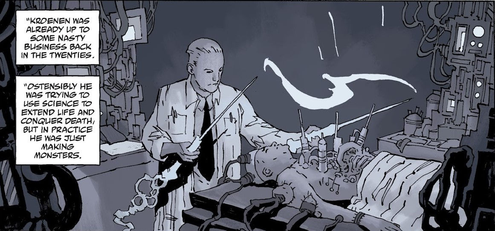 克焰人博士是一位试图延长寿命、征服死亡的德国科学家，早在 1920 年代就已活跃。他为纳粹工作，是图勒协会的成员，据信参与了 1930 年一次试图驾驭"shakti"能量的行动。行动中的一场事故使克焰人受伤，而保住他性命的多次手术让他变得与自己制造的怪物相似，从此只能生活在防护服中。他后来的研究使他数次与 [A·N·桑杜](/entry/A.N._Sandhu) 发生冲突。

克焰人最终成为[诸神黄昏计划](/entry/Project_Ragna_Rok)的首席科学家之一，成为[格里高利·拉斯普廷](/entry/Grigori_Rasputin)的亲信弟子，与他同伙的还有 [伊尔莎·豪普斯坦](/entry/Ilsa_Haupstein) 和[利奥波德·克茨](/entry/Leopold_Kurtz)。效命拉斯普廷成了他的主要目标，但他也被允许沉溺于自己的项目——为第三帝国打造一支不可阻挡的军队。

### [《拉斯普廷：巨龙之声》（Rasputin: The Voice of the Dragon）](/entry/Rasputin%3A_The_Voice_of_the_Dragon)

1941 年，在"幽灵行动"的名义下，他与克茨召唤了 [Albert Mayhew](/entry/Albert_Mayhew) 的灵魂，并将其缚入一名德国士兵的身体，好让拉斯普廷找到他、进而进入 [Eugene Remy](/entry/Eugene_Remy) 的陵墓。在巴黎寻找陵墓期间，克焰人建起一间实验室继续他的私人项目，在那里被桑杜和年轻的[特雷佛·布鲁姆](/entry/Trevor_Bruttenholm)发现。克焰人起初占据上风，直到被桑杜打瞎双眼、乱枪打倒，弃之等死。不久后克焰人恢复了足够的体力，在地下墓穴中找到拉斯普廷，发现拉斯普廷已亲手杀死了桑杜。他目睹 Mayhew 打开 Remy 的石棺，以及拉斯普廷在 Remy 的报应降临时取得了他追寻的古老碑板。后来，克焰人还与拉斯普廷一起出现在苏格兰那场把[地狱男爵](/entry/Hellboy_%28character%29)带到人间的秘密仪式上。

此后某个时候，克焰人、豪普斯坦和克茨在一座秘密纳粹基地中被冷冻起来，直到 1994 年被实业家 [罗德里克·津科](/entry/Roderick_Zinco) 遵照拉斯普廷的命令复苏。克焰人重启了昔日的数个项目，包括把尸体与机械结合、制造一支"末日军团"。他还说服津科从南美洲取回他的同事[赫尔曼·冯·卡朗普特](/entry/Herman_von_Klempt)的头颅。尽管拉斯普廷认为冯·卡朗普特不适合诸神黄昏计划而弃用了他，克焰人对这位同事仍怀有情谊。冯·卡朗普特的头颅被重新激活后，试图劝说克焰人放弃拉斯普廷唤醒奥古·桀哈的计划，转而利用那支军队取回他在南美洲的研究。克茨偷听到后勃然大怒，扑向冯·卡朗普特的头颅尖叫："拉斯普廷才是主人！"慌乱中，克焰人抓起一把刀刺死了克茨。当他们的计划失败后，盛怒的拉斯普廷将津科击瞎。津科四处乱走，意外按下了基地的自毁按钮，基地被彻底摧毁，克焰人似乎也一同葬身其中。

克焰人在爆炸中幸存，多年后与利奥波德·克茨一同出现在 [Zinco 公司](/entry/Zinco_Corporation)的会议室里。在 [Isiah Marsten](/entry/Isiah_Marsten) 的指挥下，克焰人开始准备一具躯体以召回拉斯普廷的灵魂，他以为那灵魂与奥古·桀哈锁在一起。克焰人和克茨从超自然调查防御署（B.P.R.D.）取得一具合适的躯体后成功完成仪式，随后才发现自己被 Marsten 利用，带回来的其实是[黑焰](/entry/the_Black_Flame)。

### [《混沌魔都》（Pandemonium）](/entry/Pandemonium_%28story_arc%29)

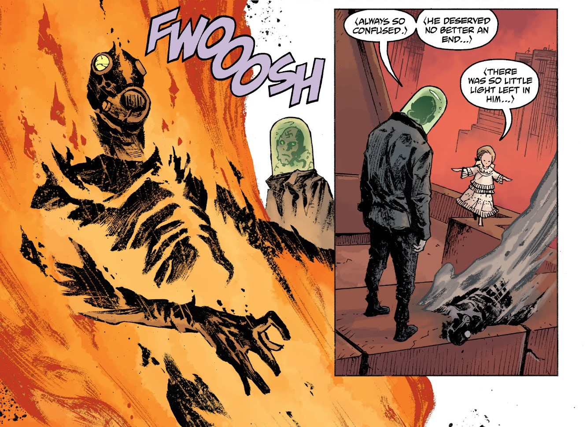 当 Marsten 推进自己的计划、摧毁津科收藏的纳粹遗物时，心灰意冷的克焰人救下冯·卡朗普特的头颅逃走了。一段时间之后，[瓦尔瓦拉](/entry/Varvara)/[Yomyael](/entry/Yomyael) 找到了他，她重新唤醒了冯·卡朗普特，并邀请两人加入她（以及恶魔 [巴拉姆](/entry/Balam) 和 [Bifrons](/entry/Bifrons)）在地球上重建混沌魔都（Pandemonium）的事业。克焰人对自己的选择越来越怀疑，在瓦尔瓦拉似乎故意把地狱男爵引到他们那里后，他向冯·卡朗普特说出了自己的担忧。他正在解释她有所隐瞒时，被瓦尔瓦拉放火烧死，骨灰随风撒散。

## 其他媒体

### 2004–2008 电影系列

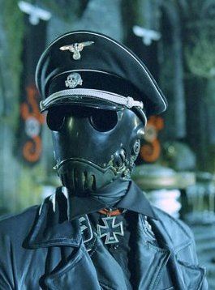
《地狱男爵》（2004）中的克焰人

在 2004 年电影[《地狱男爵》](/entry/Hellboy_%282004_film%29)中，克焰人被大幅重塑；编剧兼导演[吉尔莫·德尔·托罗](/entry/Guillermo_del_Toro)以漫画角色那副标志性的面具为出发点，创造出一个风格鲜明的刺客。他中间名的拼写也改成了"Ruprecht"（而非漫画中的 Ruprect）。该角色由演员兼编舞 Ladislav Beran 饰演。

在影片中，克焰人被刻画为一名刺客，使用造型独特的警棍剑[1]和手刺。他戴面具是自我实验的结果——一种"外科手术瘾"导致他切除了自己的眼皮、嘴唇等等；克焰人的机械手艺使他为自己造出一具发条身体，让他得以欺瞒死亡。德尔·托罗为这个角色提供了一份扩充传记，以一系列漫画分镜的形式收录在《Hellboy: The Art of the Movie》一书中，也收录在影片 DVD 的特别收录里。

[thumb|left|"DVD 漫画"传记](/entry/FIle%3AKroenen_story_by_kroenen4millennium.jpg) 克焰人于 1897 年出生在德国慕尼黑，是个面容天使般、金发的音乐神童，曾巡演欧洲各国首都演唱歌剧，直到青春期变声。克焰人在击剑和发条机械方面也表现出极高天赋。他很小就表现出受虐狂症状，每天用一根新鲜的橡树枝鞭打自己。到了少年时期，因深感自卑，克焰人的受虐倾向发展成一种极端的躯体变形障碍（影片中称为"外科手术瘾"）。在对身体纯净与完美的痴迷中，克焰人在自己身上进行残酷的实验，包括通过手术切除自己的眼皮、嘴唇以及手脚指甲。他还设计了一副紧贴面部的防毒面具用以过滤病菌，几乎时刻佩戴。克焰人对机械装置相当精通，相信把机械构造与活体融合有助于创造完美。他早期的发明之一是一只发条夜莺，能完美演唱一首莫扎特咏叹调。

1930 年，克焰人第一次见到复活的拉斯普廷，很快成为他最忠诚的弟子。随后他加入纳粹党，军衔迅速攀升，1933 年加入党卫军，官至 Obersturmbannführer（中校）。他还成为[希特勒](/entry/Adolf_Hitler)的头号刺客，受命清除纳粹党内外的麻烦人物。他因对第三帝国的贡献获颁铁十字勋章，其中包括出任奥斯维辛集中营指挥官的一段服役经历；在那里，他用发条机械装置在囚犯的活肉上进行可怖而怪诞的实验，以追求"纯净"。当克焰人成为[图勒协会](/entry/Thule_Society)——一群痴迷神秘学的德国贵族——的头目后，他利用协会的资源与知识主持诸神黄昏计划，担任首席工程师，设计并建造了拉斯普廷使用的"毁灭之右手"替代护手，以及 1944 年 10 月召唤猩红之兽——地狱男爵——的传送门发生器。

#### 《地狱男爵》（2004）

当盟军猛攻诸神黄昏计划所在的苏格兰近海岛屿时，克焰人在基地被攻破前杀死了数名美军士兵，随后年轻的[特雷佛·布鲁姆](/entry/Trevor_Bruttenholm)教授把一枚手榴弹扔到传送装置下面。克焰人试图捡回手榴弹，但爆炸炸断了他的左手，把他向后抛到一根石柱上，一截钢筋贯穿了他的胸膛。尽管脊椎被切断，克焰人还是在战斗结束后莫名消失了。十二年后，人们在罗马尼亚发现一座无名坟墓，通过牙科记录确认里面的尸体是克焰人。

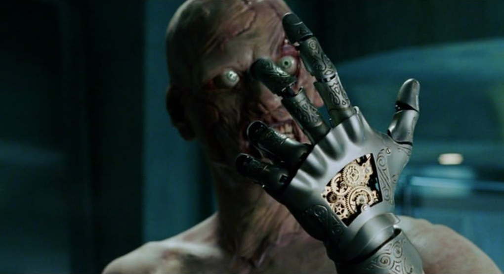 然而，克焰人在 2004 年再次出现。借助科学与黑魔法那不可思议的力量，克焰人"修复"了自己：一只机械义手、一根替换断裂脊椎的钢棒，以及由植入胸腔的发条钥匙驱动的机械心脏。转动钥匙，他就能提升自己的速度和反应。漫长数十年过去，他血管里的血液彻底干涸，只剩尘土，使他几乎刀枪不入、不惧枪伤。他还可以转动钥匙"关闭"自己的身体（字面上的），进入休眠状态、看似死亡，直到被重新激活。他利用这种骗人的伎俩潜入了 BPRD 总部。他重伤 BPRD 探员 [克莱](/entry/Clay) 后伪装死亡，躺在克莱身旁，两人都被送进总部。一进去，克焰人便把拉斯普廷引来，并亲手杀死了已年迈的布鲁姆教授，随后与拉斯普廷一同消失。

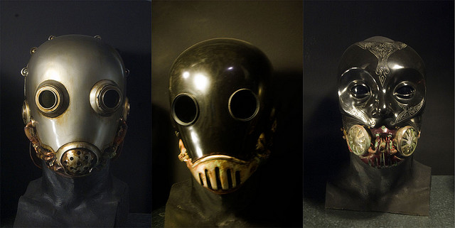 BPRD 追踪拉斯普廷到莫斯科地下他自己的陵墓。[地狱男爵](/entry/Hellboy_%282004%E2%80%932008_film_character%29)把克焰人扔进活板门下隐藏的尖刺坑，似乎为布鲁姆报了仇。克焰人被尖桩刺穿，只能无助地看着地狱男爵把一个巨型齿轮砸到他身上。

#### 《地狱男爵 2：黄金军团》（2008）

在第一部电影的事件后，克焰人被推定死亡，没有以实体出现在续集中。他那副残破的防毒面具与一副形似 [萨麦尔](/entry/Sammael) 头颅的黄金面具一起，在陈列柜中出现了数次。

##### 津科尾声

影片 DVD 中收录了一段动态漫画，为一部未能投拍的第三部电影埋下剧情伏笔（借鉴了漫画[《唤醒恶魔》（Wake the Devil）](/entry/Wake_the_Devil)开篇的内容）。在这部短片中，克焰人由 Adam Fulton 配音。

漫画描绘了 [罗德里克·津科](/entry/Roderick_Zinco) 前往北极——诸神黄昏计划基地的一处残余设施就位于那里。津科把克焰人的头颅放进一个圆顶机器。被机器完全复苏后，克焰人阴险地大笑，告诉他的"主人"这正是他承诺过的：他面前是复活的拉斯普廷，后者告诉津科和克焰人，他们一直效劳得很好，而他还有最后一项任务交给他们。[2]

#### 画廊

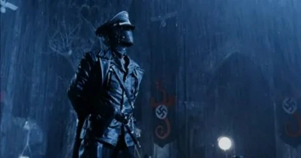

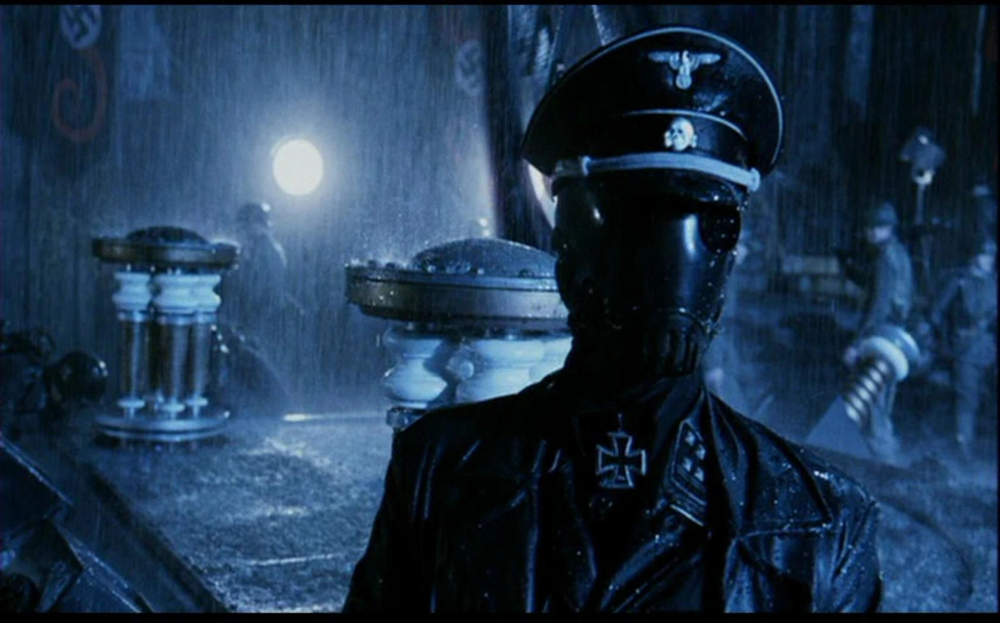

|

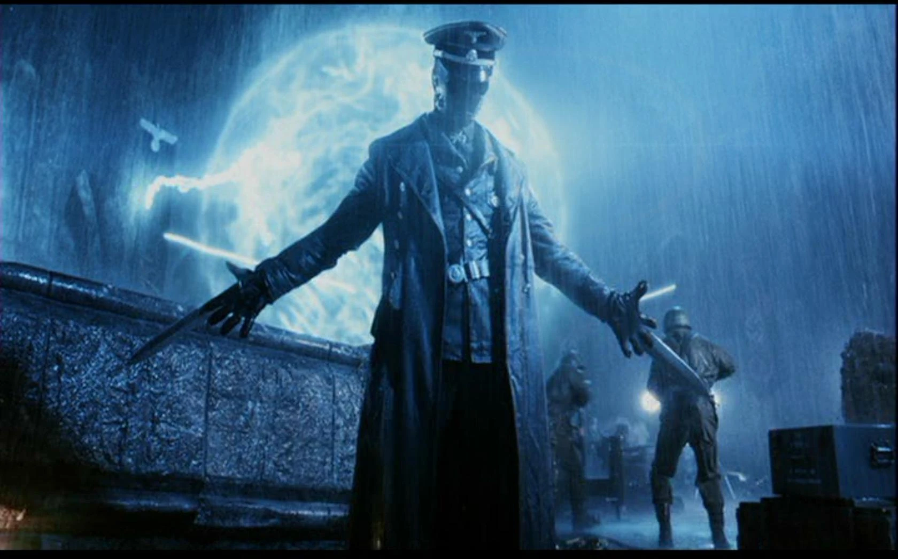

|

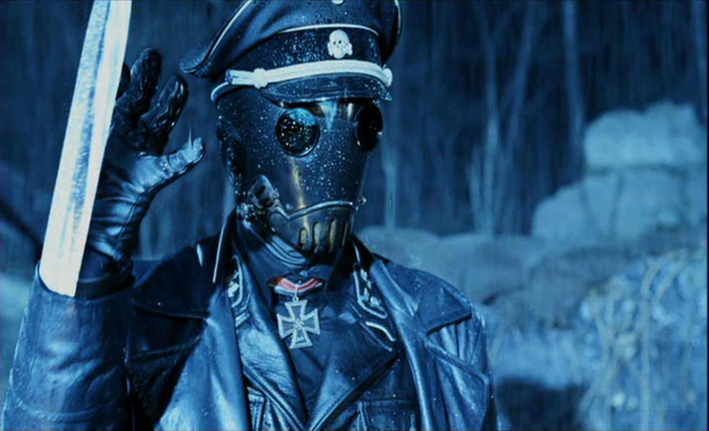

|

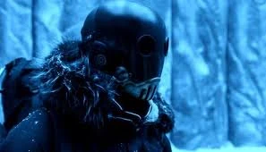

|

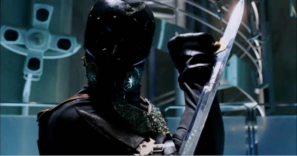

|

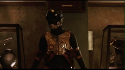

|

#### 趣闻

- 德尔·托罗的电影造型得到了另外几位艺术家的协助：[TyRuben Ellingson](/entry/TyRuben_Ellingson) 设计了克焰人背心的外观，DDT 特效公司的 Sergio Sandoval 则设计并制作了那些面具。
- 在《地狱男爵》的原始剧本中，年轻的布鲁姆教授把克焰人描述为"第三帝国的顶尖科学家之一、图勒神秘学协会的头目"。在公映版影片中，这句台词被重新配音，前半句换成了"希特勒的头号刺客"。
- 影片中的这一形象与漫画截然不同。漫画里的克焰人本是个怯懦的角色，德尔·托罗形容他是那种会喊"啊！别弄坏机器！"的人；而在电影里，他被塑造成一个嗜杀的军人，对拉斯普廷怀着非人的忠诚。

### 《地狱男爵》（2019）

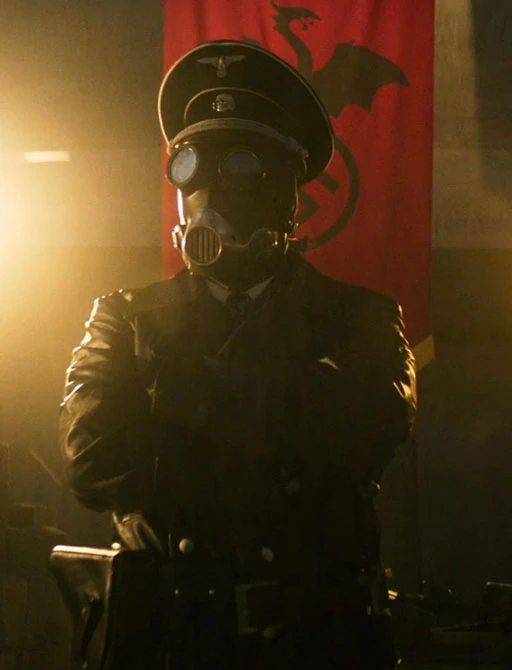 克焰人也出现在 2019 年电影[《地狱男爵：血皇后崛起》](/entry/Hellboy_(2019_film)))中，戏份少得多，更接近漫画中的形象。克焰人教授博士由 Ilko Iliev 饰演。

在诸神黄昏计划的一段闪回中可以看到他，在场的还有拉斯普廷、克茨、豪普斯坦、冯·克虏普特以及正在拍摄这一活动的 Leni Riefenstahl。当[大螯虾](/entry/the_Lobster)和他的士兵赶来阻止他们时，克焰人朝大螯虾开了两枪便逃走了，是在场唯一逃脱抓捕的纳粹分子。他之后的命运不得而知。

## 参考资料

[1] ["Kroenen Baton Sword from Hellboy"](https://www.iloveswords.com/MOV_Hellboy.html)

[2] YouTube 上的["津科 Epilogue - Animated Comic"](https://www.youtube.com/watch?v=Tilh0_WusTQ)
