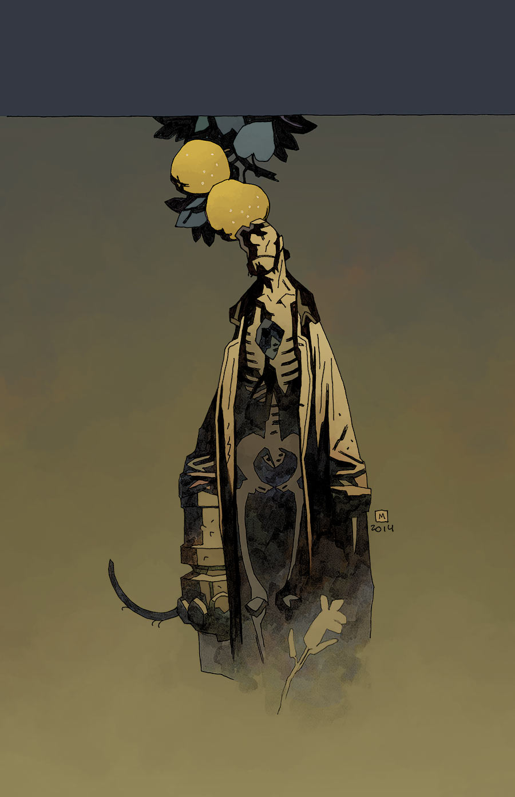
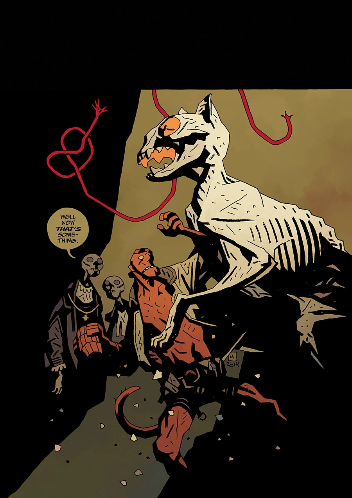

《**冥王之犬**》（The Hounds of Pluto）于 2015 年 8 月至 9 月间出版。这个故事被集结成册时，第一部分被重新命名为 *The Trials of Dr. Hoffmann*（霍夫曼医生的审判）。

## 剧情梗概

### 第一部分：*The Trials of Dr. Hoffmann*

一种疾病正在侵蚀[地狱男爵](/entry/Hellboy_%28character%29)。尽管他已经死了，却仍面临迷失自我、变成游荡在[地狱](/entry/Hell)中的空洞幻影之一的风险。一队医生承诺能治愈他，但他们首先需要从他身上取得某样东西……

### 第二部分：*The Hounds of Pluto*

一具猫木乃伊、一场地狱中的审判，以及一场可怕的家庭团聚，横亘在地狱男爵寻找治愈方法的道路上。

## 画廊

 \#7：*The Hounds of Pluto (Part 1)*

 \#8：*The Hounds of Pluto (Part 2)*
