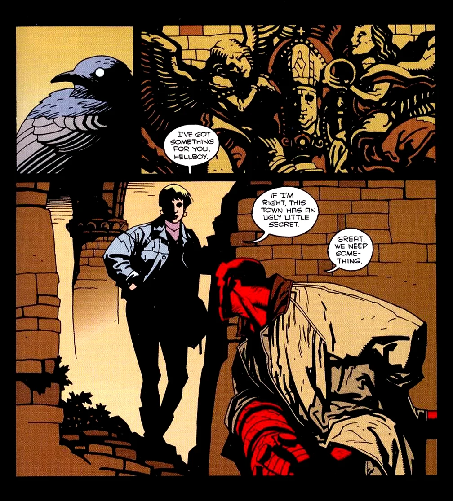
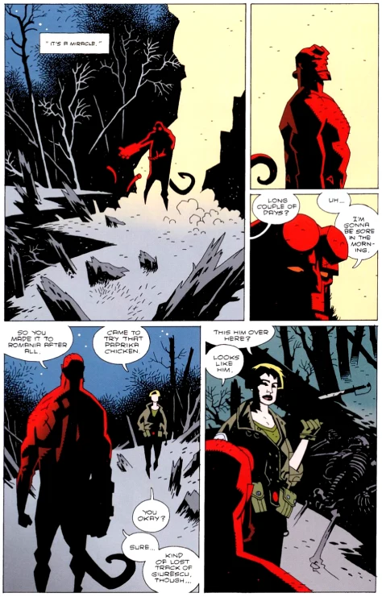
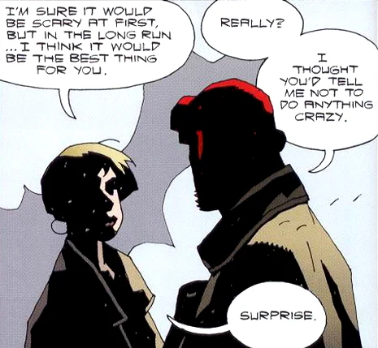
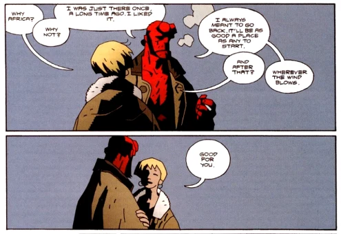
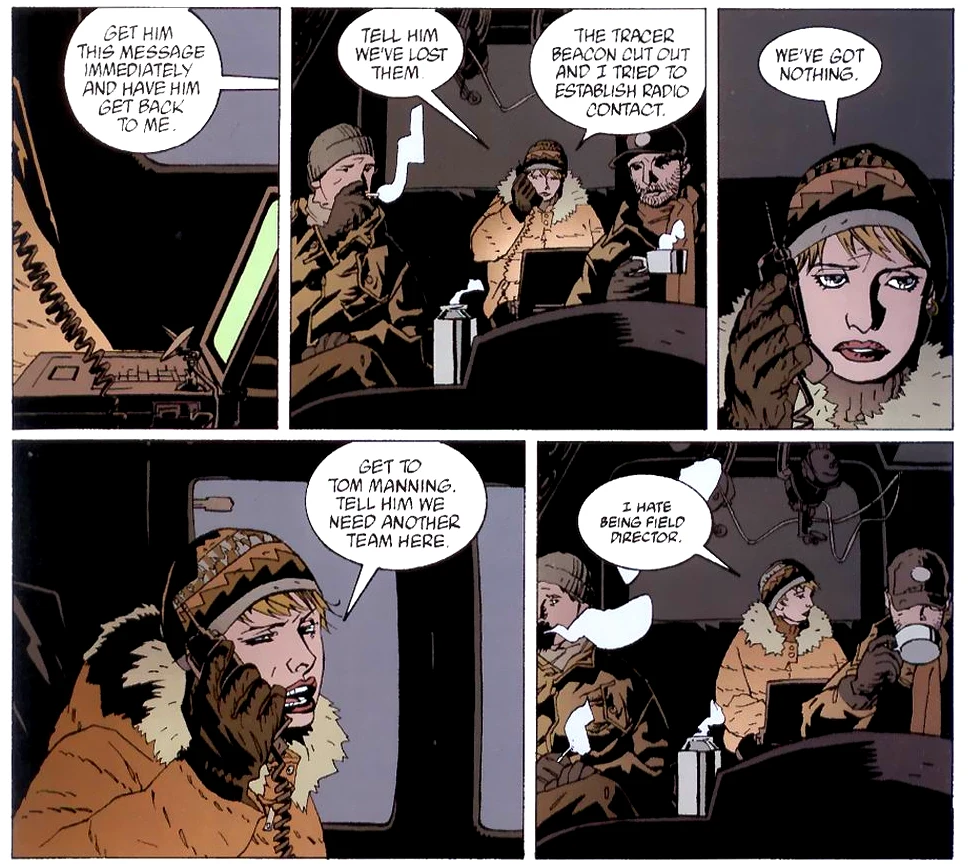
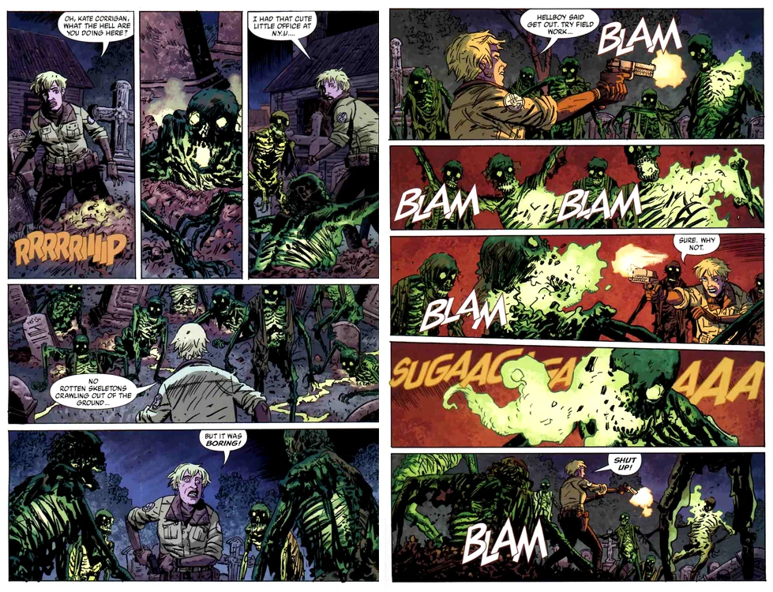
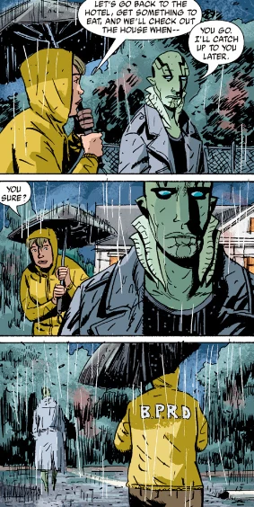
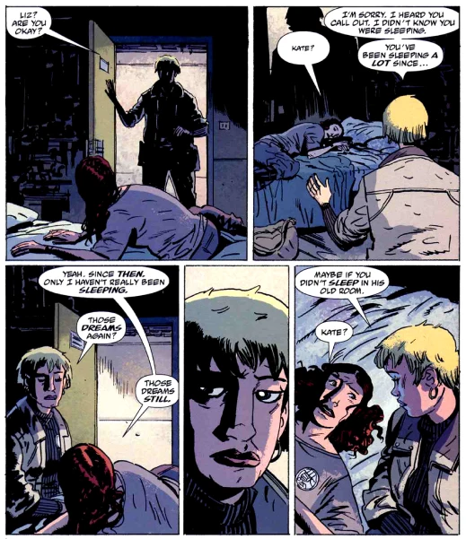
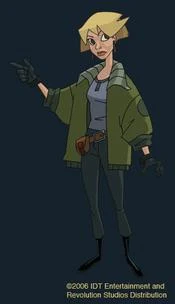

**凯特·考瑞根（Katherine "Kate" Corrigan）博士**是现任[超自然调查防御署（B.P.R.D.）](/entry/Bureau_for_Paranormal_Research_and_Defense)超能力探员联络官。凯特是 B.P.R.D. 的一名普通人类成员，最初因在民俗学与秘术方面的学术专长而被聘用。在整个系列中，她逐渐几乎全身心投入到调查防御署运转的各项实务之中。凯特首次登场于[《圣奥古斯丁之狼》](/entry/The_Wolves_of_Saint_August)，曾出现在早期多部[《地狱男爵》](/entry/Hellboy_%28series%29)漫画中，并在[《B.P.R.D.》](/entry/B.P.R.D._%28series%29)中担任主要角色。

## 历史

### 加入 B.P.R.D. 之前

考瑞根博士 1958 年出生于加利福尼亚州奥克兰。她于 1980 年在加州大学伯克利分校以优异成绩获得文学学士学位，又在布加勒斯特大学取得博士学位。攻读博士学位期间，她游历欧洲各地，记录所访村庄的口述传统，后来将这些资料汇编成秘术研究领域公认的基础性著作之一。1983 年，她开始在纽约大学担任历史学教授（专攻民俗学）。此后她撰写了十六部高度专业化的民俗学与秘术史学术著作，其中包括 Isobel Gowdie 的忏悔录。[1]

同样在 1983 年，她在[超自然调查防御署（B.P.R.D.）](/entry/Bureau_for_Paranormal_Research_and_Defense)开启了自己漫长的职业生涯，最初担任独立顾问。通过顾问工作，她于 1984 年结识了[地狱男爵](/entry/Hellboy_%28character%29)。出于写书的打算，两人从 1985 年开始了一系列访谈。那本书最终未能出版，但他们却结下了极为亲密、持久的友谊。多年来，凯特成了地狱男爵唯一足够信任、愿意倾诉内心忧虑的人。

### Griart 大屠杀

 被地狱男爵怂恿了将近十年之后，凯特终于在 1994 年 5 月执行了她人生中第一次外勤任务。她和地狱男爵前往巴尔干小村庄 Griart 调查大规模谋杀案。凯特从一部冷门的中世纪文献中认出了这个村庄，推断出这里必定是受诅咒的圣奥古斯丁村，因此这些杀戮是狼人所为。发现真相之际，最后一只幸存的狼人追上了他们。地狱男爵解决了他，凯特也第一次亲眼看到这位相交十年的朋友战斗的样子。整段经历显然让这位学者深受冲击，但在地狱男爵体贴的宽慰下，她认定自己已准备好迎接更多任务。

### 罗马尼亚的人造人

*主条目：[《唤醒恶魔》](/entry/Wake_the_Devil)、[《近乎巨人》](/entry/Almost_Colossus)*

 [地狱男爵](/entry/Hellboy_%28character%29)、[亚伯·塞皮恩](/entry/Abe_Sapien)、[丽兹·舍曼](/entry/Elizabeth_Sherman)、[西德尼·利奇](/entry/Sidney_Leach)、[巴德·沃勒](/entry/Bud_Waller)和[克拉克](/entry/Clark)动身前往罗马尼亚寻找[弗拉基米尔·朱雷斯库](/entry/Vladimir_Giurescu)。出发前凯特向全队做了简报，并表达了亲自前往的愿望，但被回绝，理由是"这次只派*真正的*调查防御署外勤探员"——据推测指的是[《圣奥古斯丁之狼》](/entry/The_Wolves_of_Saint_August)那次事件。地狱男爵本人也试图劝她同行，但队伍飞往罗马尼亚时，她还是留在了总部。

任务迅速恶化：丽兹·舍曼失去行动能力、朱雷斯库城堡被毁、与地狱男爵失去联系、BPRD 的运输机被毁；凯特随即离开费尔菲尔德，前往罗马尼亚当地协助。她及时抵达，见到了刚从宏大宿命的边缘挣扎回来的地狱男爵。

就在地狱男爵遭遇朱雷斯库的同时，丽兹·舍曼第一次遇到了后来被称为[罗杰](/entry/Roger)的人造人。丽兹被这个人造人吸引，感觉到这是摆脱自身火焰的办法，便把手指伸进它胸口一个金属开口。她的火焰瞬间被抽进这个生物体内，使它活了过来。人造人逃走了，留下丽兹萎靡不振——那火焰与她的生命力以某种方式相连，失去它后她正慢慢走向死亡。为了抓住人造人、挽回丽兹的生命力，凯特和地狱男爵出发穿越罗马尼亚乡野。

他们最终抵达 Capatineni 修道院，发现了两个人造人和一座由熔化的人体脂肪堆成的巨塔。在那里，凯特被[年长者造人](/entry/Roger%27s_brother)擒获，它打算把她的身体作为最后一种材料，用人体脂肪造出一具巨型躯体。幸运的是，人造人（地狱男爵给他起名叫罗杰）及时救出了她。巨人造人崛起之际，地狱男爵赶到与他们会合，三人一起从塔上跳下。罗杰战胜了自己的兄弟，三人回到丽兹身边，成功把她从死亡边缘救了回来。

1998 年 6 月，考瑞根辞去学术职位，从 B.P.R.D. 顾问转为调查防御署的全职探员。[2]

### Bromhead/Guarino 事件

 遭遇[伊戈尔·布罗姆黑德](/entry/Igor_Bromhead)和[乌拉刻](/entry/Ualac)之后，地狱男爵独自一人游荡到英格兰威尔特郡的埃夫伯里石阵。凯特在那里找到了他，他向她倾诉了自己对那份一直试图无视和逃避的宏大命运的恐惧。她鼓励他直面即将到来的一切，而不是一味躲闪。尽管如此，他还是决定"再当一次缩头乌龟"，回到调查防御署又待了两年。

这些事件发生几周后，即 1999 年 6 月，凯特被提升为 B.P.R.D. 外勤行动助理主管。[3]

### 征服者蠕虫

 [《近乎巨人》](/entry/Almost_Colossus)的事件之后，罗杰后来被 BPRD 的科学家们复活。然而作为一项保险措施，外勤主管[汤姆·曼宁](/entry/Thomas_Manning)在罗杰胸口植入了一枚小型炸弹。出于对这种背叛信任之举的愤慨，地狱男爵退出了 BPRD。他直截了当地告诉曼宁自己辞职，再无多言。不过离开之前，他最后一次向凯特吐露心事。他承认，除了罗杰的事之外，也是时候遵从她早在 1999 年给他的忠告了。凯特答应会替他照看好调查防御署，并恳求他保重。说罢，他便踏上新的冒险，很可能再也不会与她相见。

### 外勤行动主管

在[《征服者蠕虫》](/entry/Conqueror_Worm_%28story%29)中地狱男爵离开一年后，即 2002 年 3 月，曼宁升任调查防御署主管、职位空缺，凯特被提升为外勤行动主管。[4] 在此职位上，她负责组织任务，常需乘直升机或飞机陪同探员前往任务地点，或留守总部办公室统筹。

### 空洞的地球

凯特迎接了新探员[约翰·克劳斯](/entry/Johann_Kraus)的到来；与此同时，她与其余留下的探员[罗杰](/entry/Roger)和[亚伯·塞皮恩](/entry/Abe_Sapien)之间则弥漫着一种隐隐的不安（[丽兹·舍曼](/entry/Liz_Sherman)已在画面之外的某个时候离开）。地狱男爵走后，亚伯和罗杰认真考虑过离开，亚伯还直接向凯特表达了这一意愿。这折射出凯特担任外勤协调员期间反复出现的矛盾：她在 B.P.R.D. 官僚体系中的位置，限制了探员们对她的信任。

 然而，亚伯还没来得及离开，丽兹·舍曼就出现在他面前，恳求他帮助自己。由此引出了前往 Agartha 神殿营救丽兹的任务；凯特在行动中担任外勤协调员，途中向罗杰和亚伯做简报，并等待他们最终归来。这是读者第一次看到凯特在任务中的视角：值得注意的是，她为探员们忧心忡忡，竭尽所能，却似乎大部分时间都在紧张地等待坏消息。她最终在苏格兰接回了队伍。

### 蛙疫

 新泽西任务（调查从[Cavendish 庄园](/entry/Cavendish_Hall)收集的真菌培养物被盗一案）及随后前往密歇根州 Crab Point 的追击任务中，凯特都担任外勤协调员。接近目的地时，B.P.R.D. 的直升机被强行撞毁，凯特被甩出机舱。她很快恢复过来，是唯一返回残骸并试图与 B.P.R.D. 总部取得联系的探员。与此同时，亚伯·塞皮恩、丽兹·舍曼、约翰·克劳斯和其余探员被擒，关押在一座教堂里。在那里，Humbert T Jones，即"西弗吉尼亚奇迹男孩"，展示了 Cavendish 真菌的产物——一具巨型的蘑菇/类人生物[萨杜-赫姆](/entry/Sadu-Hem)，并显露了自己把人类变成蛙怪的能力。凯特被困在教堂外，遭到被 Jones 的行为复活的死尸袭击。她用手枪抵挡，不由重新审视自己至此的人生；直到丽兹回到她身边，用火焰击退了死尸。她们与约翰一起救出亚伯，用飞机把他运走接受治疗。众人基本完好无损地逃脱，但仍有许多蛙怪活下来继续感染人类。

### 死者与黑焰

 队伍其余成员把 B.P.R.D. 总部迁往科罗拉多州时，凯特和亚伯顺路去了罗德岛州的 Littleport。在那里，他们调查[Langdon Everett Caul](/entry/Langdon_Everett_Caul)——亚伯曾经作为人时的身份。两人一同查阅了镇上档案中能找到的资料。查完之后，亚伯独自离开，去面对自己妻子[Edith Caul](/entry/Edith_Caul)的鬼魂，没有让凯特同行。凯特只能留下等待那场据推测由这次相遇引发的风暴平息，却无法联系上亚伯。

与亡妻相遇后心神不宁、意志消沉的亚伯回到凯特身边担任外勤协调员。她忧心忡忡，催促他重返外勤、去找心理辅导师求助，但他仍然拒绝。罗杰因效仿军人气质的[本·达米奥](/entry/Ben_Daimio)而在外勤中更加活跃，却在一次任务中悲剧性地被炸身亡。凯特试图安慰丽兹，后者因失去罗杰而悲痛欲绝。

 丽兹表达了对亚伯的担忧后，凯特回到任务室，发现一场突如其来的蛙怪入侵正朝亚伯及其队伍直扑而来。然而警告来得太迟，随着蛙怪大军挺进、Kathu-Hem 崛起，通讯中断了。亚伯和组员只能为活命而战，凯特和丽兹只能忧心忡忡，无力相助。但凯特的职业职责——这一次是保护普通民众——再一次被排在营救亚伯之前。两个女人为此发生冲突，而约翰提出了一个解决办法。

在约翰的催促下，凯特旁观他试图触发丽兹与神秘的[姆姆南·萨](/entry/Memnan_Saa)之间的联系，希望找到答案。这次连接让丽兹灵光一闪，想起了罗杰保存的一件物品。凯特留守调查防御署期间，丽兹和现场的其他探员成功摧毁了 Kathu-Hem。

他们回来后，约翰带凯特去看罗杰的遗骸。在那里，他们发现遗骸正被 B.P.R.D. 的人肢解，约翰强行制止了这一行为并责怪凯特，尽管她其实和他一样愤怒，也一样被蒙在鼓里。

### 宇宙机器

在凯特迄今最危险的一次任务中，她被一个不老的侯爵阿杜埃·德·法布尔擒获，侯爵想用她交换罗杰的尸体。她用刀削断侯爵的手指、毁掉他的一枚戒指，得以逃脱。那枚戒指属于所罗门王，震慑着恶魔玛科西亚斯；于是这头怪物饶了凯特一命，同时摧毁了侯爵的宝藏，把他掳去了[地狱](/entry/Hell)。

## 其他媒体

Hellboy Animated 动画系列中的凯特·考瑞根。

- 凯特是直接发行 DVD 的动画电影[《Hellboy: Sword of Storms》](/entry/Hellboy__Sword_of_Storms)的主要角色之一，并在[《Hellboy: Blood and Iron》](/entry/Hellboy__Blood_and_Iron)中担任配角。两部作品中她均由[Peri Gilpin](/entry/wikipedia%3APeri_Gilpin)配音。

## 外部链接

- 维基百科上的凯特·考瑞根条目

## 参考资料

[1]

[2] *[《Hellboy: The Companion》](/entry/Hellboy__The_Companion)*

[3]

[4]
