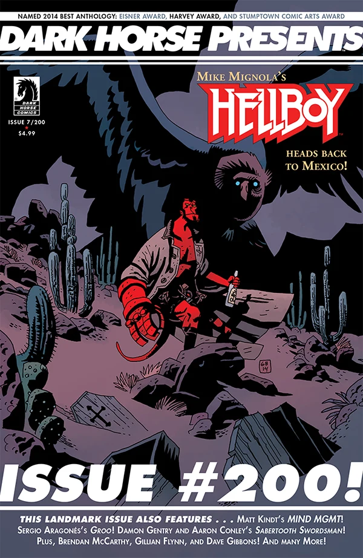

**Gabriel Bá** 是巴西漫画编剧兼画师。他于 2009 年 7 月以 [《B.P.R.D.：1947》（B.P.R.D.: 1947）](/entry/1947)首次在地狱男爵宇宙中亮相。他是 [Fábio Moon](/entry/F%C3%A1bio_Moon) 的孪生兄弟。

## 编剧

Gabriel Bá 与 Fábio Moon、Mike Mignola 共同编写了[《B.P.R.D.：吸血鬼》故事系列（B.P.R.D.: Vampire story cycle）](/entry/Vampire_%28story_cycle%29)。

- *[《B.P.R.D.：吸血鬼》（B.P.R.D.: Vampire）](/entry/Vampire_%28story%29)*（与 Mike Mignola、Fábio Moon 合作）
- *[《B.P.R.D.：迷失者》（B.P.R.D.: Lost Ones）](/entry/Lost_Ones)*（与 Fábio Moon 合作）

## 内页美术

- [《B.P.R.D.：1947》（B.P.R.D.: 1947）](/entry/1947)（与 Fábio Moon 合作）
- [《B.P.R.D.：吸血鬼》（B.P.R.D.: Vampire）](/entry/Vampire)（与 Fábio Moon 合作）
- [《地狱男爵：棺材人 2——再战》（Hellboy: The Coffin Man 2—The Rematch）](/entry/The_Coffin_Man_2__The_Rematch)
- *[《B.P.R.D.：迷失者》（B.P.R.D.: Lost Ones）](/entry/Lost_Ones)*（与 Fábio Moon 合作）

## 封面美术

|《地狱男爵：棺材人 2——再战》（Hellboy: The Coffin Man 2 – The Rematch）（*Dark Horse Presents* \#200/#

## 外部链接

- [**Wikipedia：** Gabriel Bá](http://en.wikipedia.org/wiki/Gabriel_B%C3%A1)
- [**Comic Book DB：** Gabriel Bá](http://www.comicbookdb.com/creator.php?ID=4007)
- [Fábio Moon 与 Gabriel Bá 的博客](http://www.fabioandgabriel.blogspot.com.au/)
