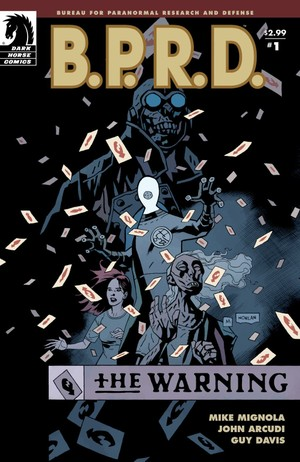
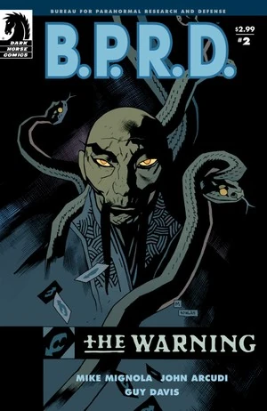
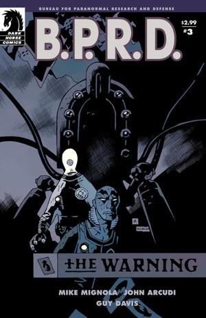
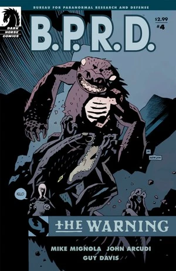
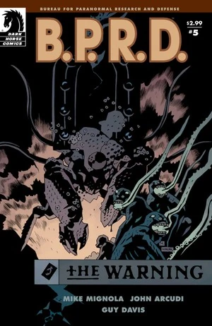

《**厄运之兆**》（The Warning）是一部五期迷你系列，也是[《焦土》三部曲](/entry/Scorched_Earth_Trilogy)的第一部。故事跟随[亚伯·塞皮恩](/entry/Abe_Sapien)、[丽兹·舍曼](/entry/Liz_Sherman)、[凯特·考瑞根](/entry/Kate_Corrigan)博士、[约翰·克劳斯](/entry/Johann_Kraus)和[潘雅](/entry/Panya_%28character%29)，讲述他们试图查清不断出现在丽兹梦中的神秘男子究竟是何身份。

## 出版历史

这部五期迷你系列于 2008 年 7 月至 11 月出版。2009 年 4 月，故事与《[遥不可及](/entry/Out_of_Reach)》一同收录于平装合订本《*[B.P.R.D.: The Warning](/entry/Trade_Collections)*》中。

## 剧情简介

### 第一部分

第一期初登场，紧接着《[杀戮地带](/entry/Killing_Ground)》的余波：潘雅、约翰·克劳斯、凯特·考瑞根和丽兹·舍曼参加了一场由约翰·克劳斯主持的降神会，试图与 [Lobster Johnson](/entry/Lobster_Johnson) 取得联系。这给他们留下了一条线索——墙上 Lobster Johnson 的卡片上写着“GILFRYD”。

随后潘雅运用她的通灵能力进入神秘男子的意识，确认他就是[马丁·吉尔弗瑞德](/entry/Martin_Gilfryd)，同时透露自己已经找到了他巢穴的位置。

### 第二部分

当丽兹那位神秘绅士展现出远超 B.P.R.D. 预料的力量、而众人又一步步落入他的圈套时，亚伯被迫放弃了对达米奥的搜寻。

### 第三部分

亚伯、凯特和约翰身陷困境、失去了一名队友，却发现局势远比他们想象的更为严峻——又一个老敌人重新浮出水面。

### 第四部分

丽兹仍然下落不明，调查局的其余成员则在慕尼黑街头与巨型机器人正面交锋。

### 第五部分

亚伯、约翰和凯特发现，他们的老敌人们已经联手，其威胁足以撼动世界的根基。

## 内容

注：关于平装合订本及合集版所收录序幕的内容，见[遥不可及](/entry/Out_of_Reach)。

### 角色

#### [B.P.R.D.](/entry/Bureau_for_Paranormal_Research_and_Defense)

- [亚伯·塞皮恩](/entry/Abraham_Sapien)
- [丽兹·舍曼](/entry/Elizabeth_Sherman)
- [凯特·考瑞根](/entry/%E5%87%AF%E7%89%B9%C2%B7%E8%80%83%E7%91%9E%E6%A0%B9)
- [安德鲁·德文](/entry/Andrew_Devon)
- [约翰·克劳斯](/entry/Johann_Kraus)
- [潘雅](/entry/Panya_%28character%29)
  - 奥利（Olly）
  - 变异动物
- 多丽丝（潘雅的看护人）
- [本·达米奥](/entry/Benjamin_Daimio)（被提及）
- 其他探员及工作人员

#### 其他

- 德国老妇人
- [左手仆从](/entry/Servants_of_the_Left_Hand)
- [姆姆南·萨／马丁·吉尔弗瑞德](/entry/Martin_Gilfryd)
- [拉神赫利奥皮斯兄弟会](/entry/Heliopic_Brotherhood_of_Ra)成员（闪回）
- [布鲁诺·卡尔胡](/entry/Bruno_Karhu)
- [青蛙怪物](/entry/Frog_monster)
- [兰迪斯·波普](/entry/Landis_Pope)（[黑焰](/entry/The_Black_Flame_%28character%29)）（壁画中）
- [大螯虾](/entry/The_Lobster)（被提及）
- [恐惧之王](/entry/King_of_Fear_%28character%29)（梦境/幻象）
- 伊迪丝·霍华德（照片中）
- [地狱男爵](/entry/Hellboy_%28character%29)（照片中）

### 地点

- 美国
  - 科罗拉多荒野
  - [B.P.R.D.](/entry/Bureau_for_Paranormal_Research_and_Defense)总部（科罗拉多）
  - 考尔宅邸（罗德岛州利特尔波特）（梦境/幻象）
- 英国（闪回）
  - 英国历史学会（闪回）
  - 伦敦街头（闪回）
- [姆姆南·萨](/entry/Memnan_Saa)的神庙
- 德国
  - 慕尼黑街头
  - 慕尼黑地铁/中空地球

### 值得注意的物品

- [大螯虾](/entry/The_Lobster)的标记名片
- [极北族人](/entry/Hyperboreans)战争机器

## 画廊

 \#1

 \#2

 \#3

 \#4

 \#5
