《地狱男爵》（*Hellboy*）系列及其[衍生漫画](/entry/The_Hellboy_Universe_Comics)已被收录进九十多本平装合订本（trade paperbacks）中。它们通常包含大量特别内容，例如追加的故事素材、前言、后记、画廊和速写本。从 2021 年末开始，若干部新系列也被收录进篇幅相近的精装合订本中。

## 正典内合订本（In Continuity Collections）

这些平装本收录的是地狱男爵宇宙（Hellboy Universe）的正典故事。以下按出版产品线划分。

### *[地狱男爵（Hellboy）](/entry/Hellboy_%28series%29)*

*《地狱男爵》（Hellboy）*平装合订本偶尔会收录此前未曾发表过的故事素材；有时是一篇全新的短篇故事、一段新尾声，或是某个故事中的几页新内容。平装本中总会包含追加画作，形式为画廊或速写本。通常每个故事在收录时都会配有一段简短的文字引言，介绍其创作背景。

这些故事也曾被收录进 omnibus（大全集）版本中，并在其中按时间顺序重新排列。完整梳理请参见[大全集版本（Omnibus Editions）](/entry/Omnibus_Editions)页面。

#
书名
出版日期
收录内容
附加内容
封面
图书馆版（Library Edition）

<tbody>

1
<em>毁灭之种（Seed of Destruction）</em>
October 1, 1994
<ul>
<li><em>[毁灭之种（Seed of Destruction）](/entry/Seed_of_Destruction)</em> #1–4</li>
<li>[世界上最伟大的超自然调查员（SDCC 版）（World's Greatest Paranormal Investigator (SDCC)）](/entry/World%26)</li>
<li>[世界上最伟大的超自然调查员（CBG 版）（World's Greatest Paranormal Investigator (CBG)）](/entry/World%26)</li>
</ul>
<ul>
<li>Robert Bloch 作引言</li>
<li>早期地狱男爵速写</li>
<li>画廊，画作作者包括 Simon Bisley、[Mike Allred](/entry/Mike_Allred)、Art Adams、Frank Miller、Fred Blanchard 与 Gary Gianni（7 页）</li>
</ul>
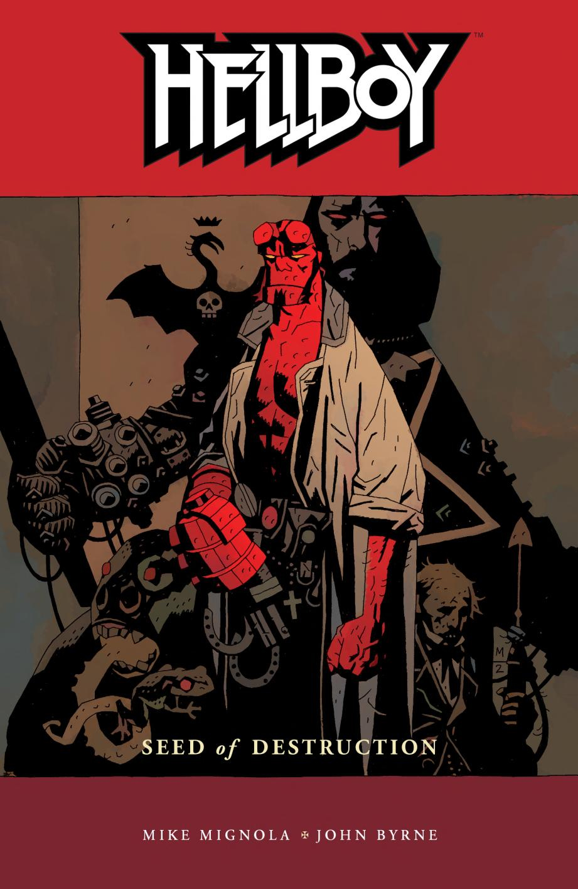MIKE MIGNOLA
[第 1 卷（Volume 1）](/entry/Hellboy_Library_Editions)

2
<em>唤醒恶魔（Wake the Devil）</em>
June 11, 1997
<ul>
<li><em>[唤醒恶魔（Wake the Devil）](/entry/Wake_the_Devil)</em> #1–5 及尾声</li>
</ul>
<ul>
<li>Alan Moore 作引言</li>
<li>画廊，画作作者包括 Bruce Timm、P. Craig Russell、Derek Thompson、Dave Cooper、Jay Stephens 与 Oliver Vatine（7 页）</li>
</ul>
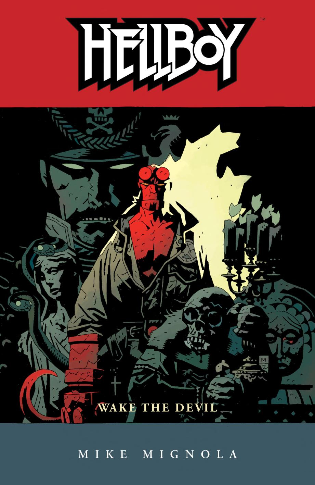MIKE MIGNOLA

3
<em>被锁链的棺材 
及其他故事（The Chained Coffin and Others）</em>
August 5, 1998
<ul>
<li><em>[尸体（The Corpse）](/entry/The_Corpse)</em></li>
<li><em>[铁鞋（The Iron Shoes）](/entry/The_Iron_Shoes)</em></li>
<li><em>[芭芭·雅嘎（The Baba Yaga）](/entry/The_Baba_Yaga)</em></li>
<li><em>[地下圣诞节（A Christmas Underground）](/entry/A_Christmas_Underground)</em></li>
<li><em>[被锁链的棺材（The Chained Coffin）](/entry/The_Chained_Coffin)</em></li>
<li><em>[圣奥古斯丁之狼（The Wolves of Saint August）](/entry/The_Wolves_of_Saint_August)</em></li>
<li><em>[近乎巨人（Almost Colossus）](/entry/Almost_Colossus)</em> #1–2</li>
</ul>
<ul>
<li>P. Craig Russell 作引言</li>
<li>画廊，画作作者包括 [Kevin Nowlan](/entry/Kevin_Nowlan)、[Matt Smith](/entry/Matthew_Dow_Smith)、[Duncan Fegredo](/entry/Duncan_Fegredo)、Dave Johnson、Thierry Robin 与 B.C. Boyer（7 页）</li>
</ul>
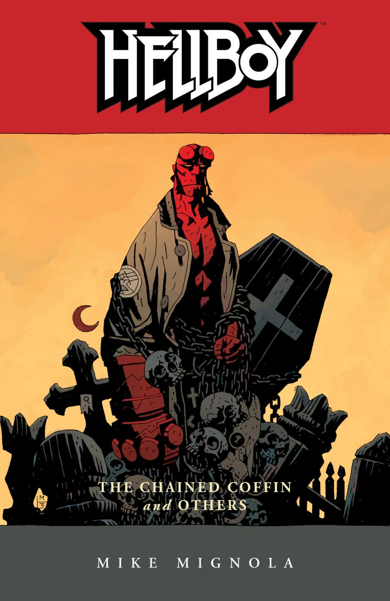MIKE MIGNOLA
[第 2 卷（Volume 2）](/entry/Hellboy_Library_Editions)

4
<em>毁灭之右手（The Right Hand of Doom）</em>
April 26, 2000
<ul>
<li><em>[煎饼（Pancakes）](/entry/Pancakes)</em></li>
<li><em>[野兽的本性（The Nature of the Beast）](/entry/The_Nature_of_the_Beast)</em></li>
<li><em>[沃尔德王（King Vold）](/entry/King_Vold)</em></li>
<li><em>[头颅（Heads）](/entry/Heads)</em></li>
<li><em>[再见，托德先生（Goodbye Mister Tod）](/entry/Goodbye_Mister_Tod)</em></li>
<li><em>[瓦尔科拉克（The Vârcolac）](/entry/The_V%C3%A2rcolac)</em></li>
<li><em>[毁灭之右手（The Right Hand of Doom）](/entry/The_Right_Hand_of_Doom)</em></li>
<li><em>[满盒邪恶（Box Full of Evil）](/entry/Box_Full_of_Evil)</em> #1–2 及尾声</li>
</ul>
<ul>
<li>速写本（19 页）</li>
</ul>
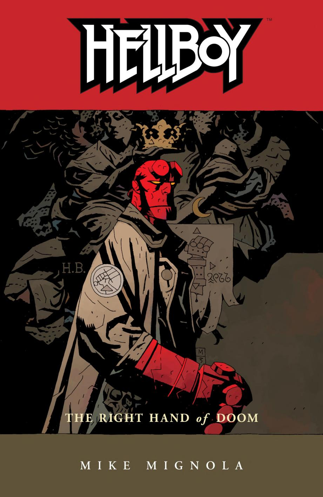MIKE MIGNOLA

5
<em>征服者蠕虫（Conqueror Worm）</em>
February 27, 2002
<ul>
<li><em>[征服者蠕虫（Conqueror Worm）](/entry/Conqueror_Worm_%28story%29)</em> #1–4 及尾声</li>
</ul>
<ul>
<li>[吉尔莫·德尔·托罗（Guillermo del Toro）](/entry/Guillermo_del_Toro)作引言</li>
<li>速写本（5 页）</li>
</ul>
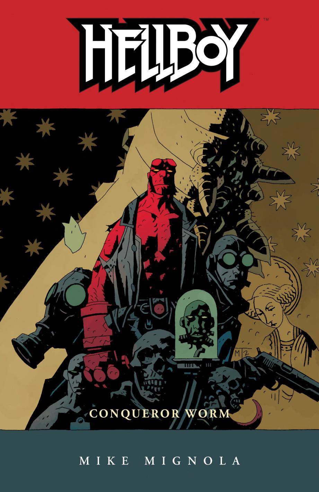MIKE MIGNOLA
[第 3 卷（Volume 3）](/entry/Hellboy_Library_Editions)

6
<em>奇异之地（Strange Places）</em>
April 26, 2006
<ul>
<li><em>[第三个愿望（The Third Wish）](/entry/The_Third_Wish)</em> #1–2</li>
<li><em>[岛屿（The Island）](/entry/The_Island)</em> #1–2 及尾声</li>
</ul>
<ul>
<li>Gary Gianni 作引言</li>
<li><em>岛屿（The Island）</em>未采用的开篇（8 页）</li>
<li><em>岛屿（The Island）</em>第 13–19 页未采用的替代版本</li>
<li>速写本（4 页）</li>
</ul>
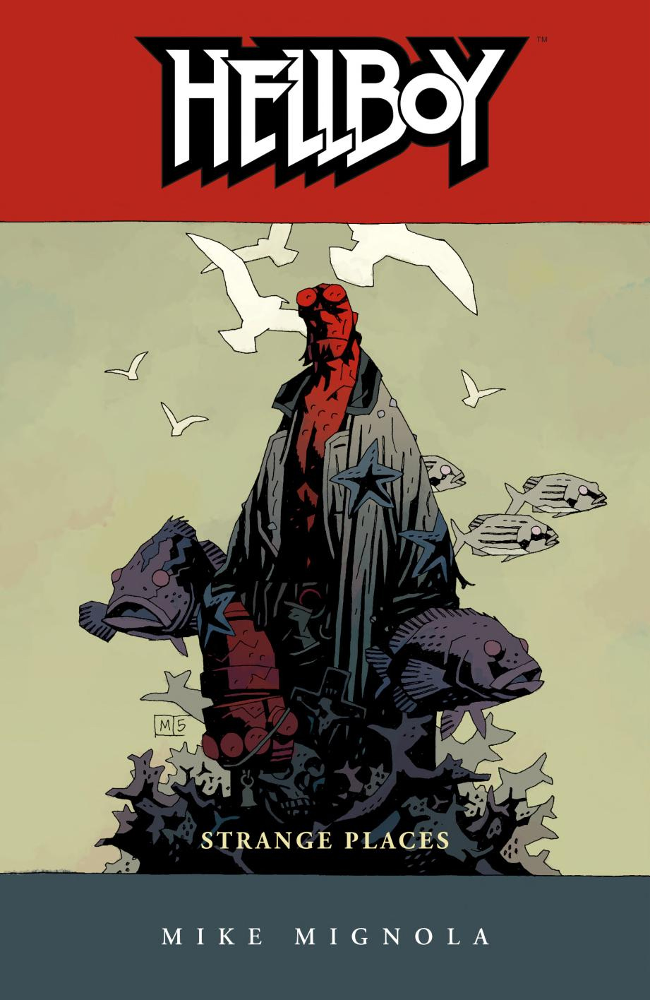MIKE MIGNOLA

7
<em>巨魔女巫 
及其他故事（The Troll Witch and Others）</em>
October 3, 2007
<ul>
<li><em>[潘那嘉兰（The Penanggalan）](/entry/The_Penanggalan)</em></li>
<li><em>[九头蛇与狮子（The Hydra and the Lion）](/entry/The_Hydra_and_the_Lion)</em></li>
<li><em>[巨魔女巫（The Troll-Witch）](/entry/The_Troll_Witch)</em></li>
<li><em>[布拉格的吸血鬼（The Vampire of Prague）](/entry/The_Vampire_of_Prague)</em></li>
<li><em>[卡普博士的实验（Dr. Carp's Experiment）](/entry/Dr._Carp%26)</em></li>
<li><em>[食尸鬼（The Ghoul）](/entry/The_Ghoul)</em></li>
<li><em>[马科马（Makoma）](/entry/Makoma_%28story%29)</em> #1–2</li>
</ul>
<ul>
<li>Walter Simonson 作引言</li>
<li>速写本（13 页）</li>
</ul>
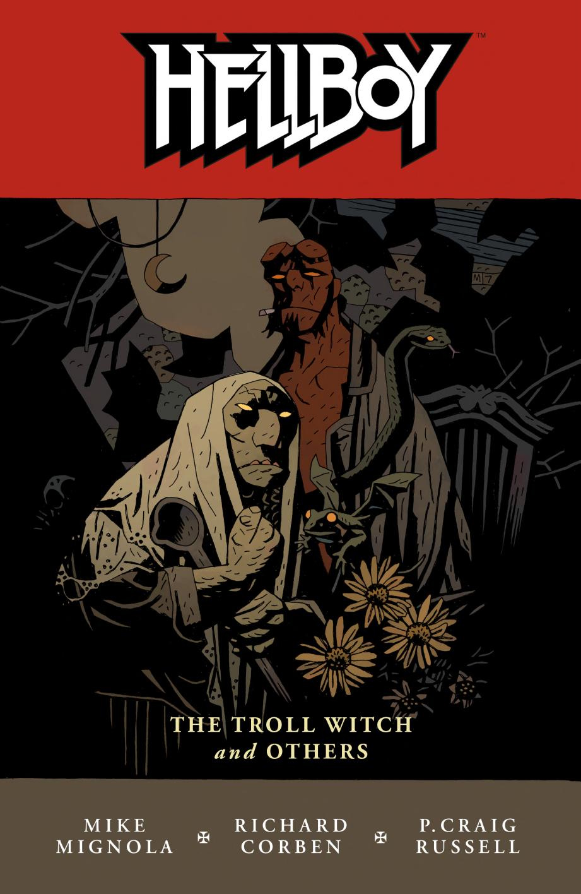MIKE MIGNOLA
[第 4 卷（Volume 4）](/entry/Hellboy_Library_Editions)

8
<em>黑暗召唤（Darkness Calls）</em>
May 16, 2008
<ul>
<li><em>[黑暗召唤（Darkness Calls）](/entry/Darkness_Calls)</em> #1–6 及两段尾声</li>
</ul>
<ul>
<li>Jane Yolen 作引言</li>
<li>速写本（18 页）</li>
</ul>
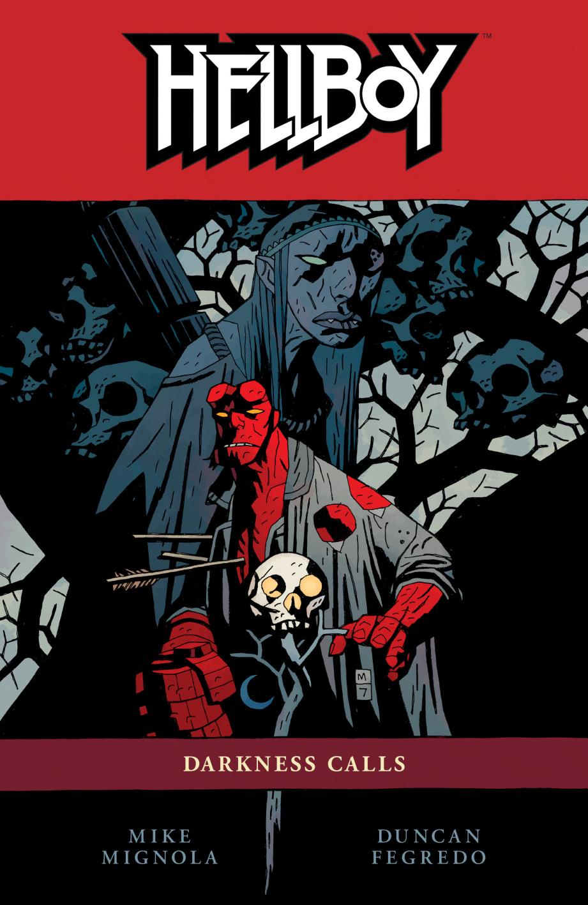MIKE MIGNOLA
[第 5 卷（Volume 5）](/entry/Hellboy_Library_Editions)

9
<em>狂野狩猎（The Wild Hunt）</em>
March 10, 2010
<ul>
<li><em>[狂野狩猎（The Wild Hunt）](/entry/The_Wild_Hunt)</em> #1–8</li>
</ul>
<ul>
<li>Mark Chadbourn 作引言</li>
<li>速写本（13 页）</li>
</ul>
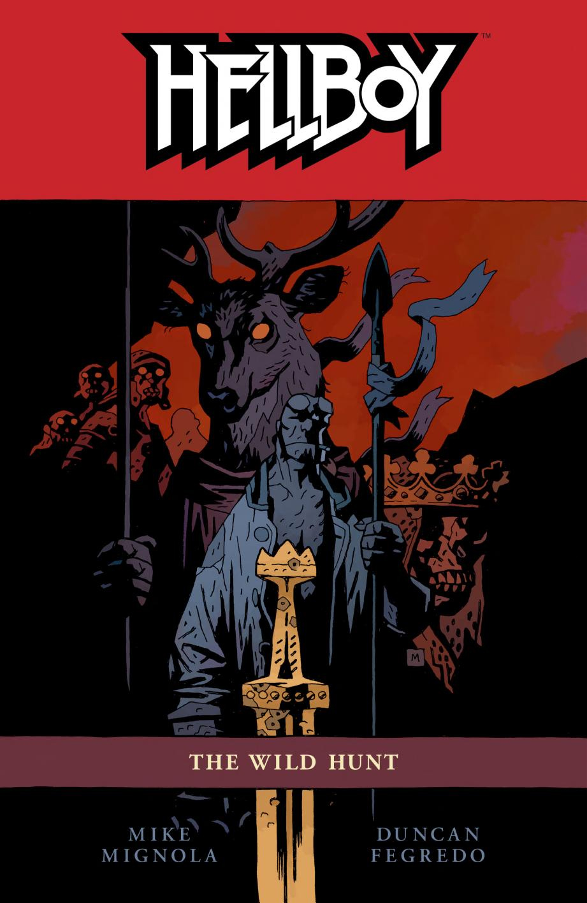MIKE MIGNOLA

10
<em>扭曲人 
及其他故事（The Crooked Man and Others）</em>
June 9, 2010
<ul>
<li><em>[扭曲人（The Crooked Man）](/entry/The_Crooked_Man_%28comic_story%29)</em> #1–3</li>
<li><em>[乘船下海之人（They That Go Down to the Sea in Ships）](/entry/They_That_Go_Down_to_the_Sea_in_Ships)</em></li>
<li><em>[在摩洛神庙中（In the Chapel of Moloch）](/entry/In_the_Chapel_of_Moloch)</em></li>
<li><em>[鼹鼠（The Mole）](/entry/The_Mole)</em></li>
</ul>
<ul>
<li>Gahan Wilson 作引言</li>
<li>速写本（13 页）</li>
<li>John Pelan 撰写的四页文字文章《Manly Wade Wellman：美国神话缔造者》（"Manly Wade Wellman: American Mythmaker"）</li>
</ul>
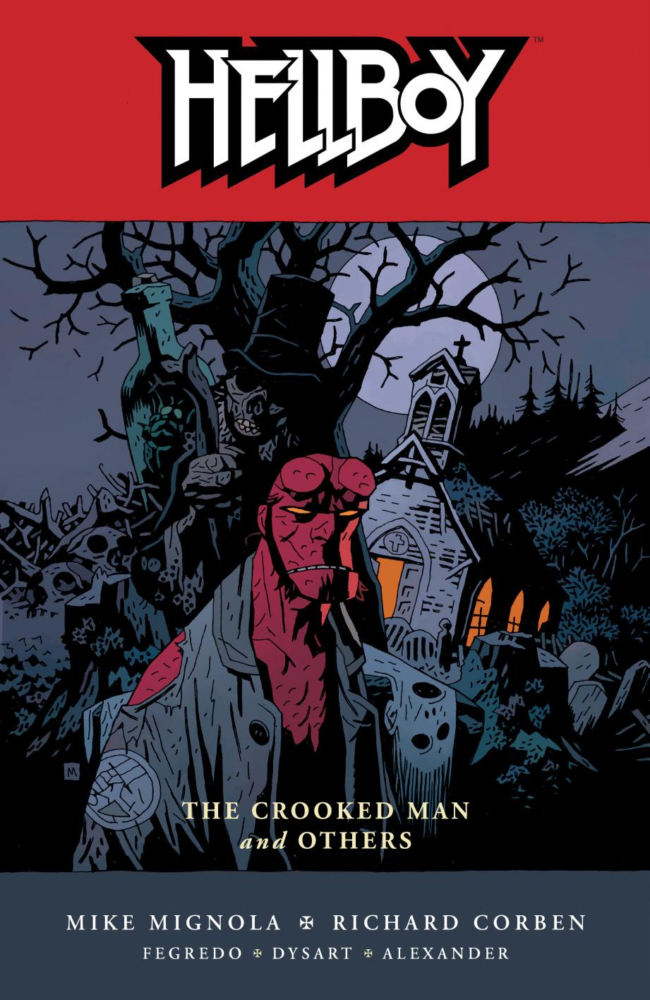MIKE MIGNOLA
[第 4 卷（Volume 4）](/entry/Hellboy_Library_Editions) 
（<em>鼹鼠（The Mole）</em>除外，该篇收录于[第 5 卷（Volume 5）](/entry/Hellboy_Library_Editions)）

11
<em>地狱的新娘 
及其他故事（The Bride of Hell and Others）</em>
October 5, 2011
<ul>
<li><em>[地狱男爵在墨西哥（Hellboy in Mexico）](/entry/Hellboy_in_Mexico_%28story%29)</em></li>
<li><em>[邪恶双片连映（Double Feature of Evil）](/entry/Double_Feature_of_Evil)</em></li>
<li><em>[沉睡者与死者（The Sleeping and the Dead）](/entry/The_Sleeping_and_the_Dead)</em> #1–2</li>
<li><em>[地狱的新娘（The Bride of Hell）](/entry/The_Bride_of_Hell)</em></li>
<li><em>[惠蒂尔的遗产（The Whittier Legacy）](/entry/The_Whittier_Legacy)</em></li>
<li><em>[巴斯特·奥克利如愿以偿（Buster Oakley Gets His Wish）](/entry/Buster_Oakley_Gets_His_Wish)</em></li>
</ul>
<ul>
<li>速写本（21 页）</li>
</ul>
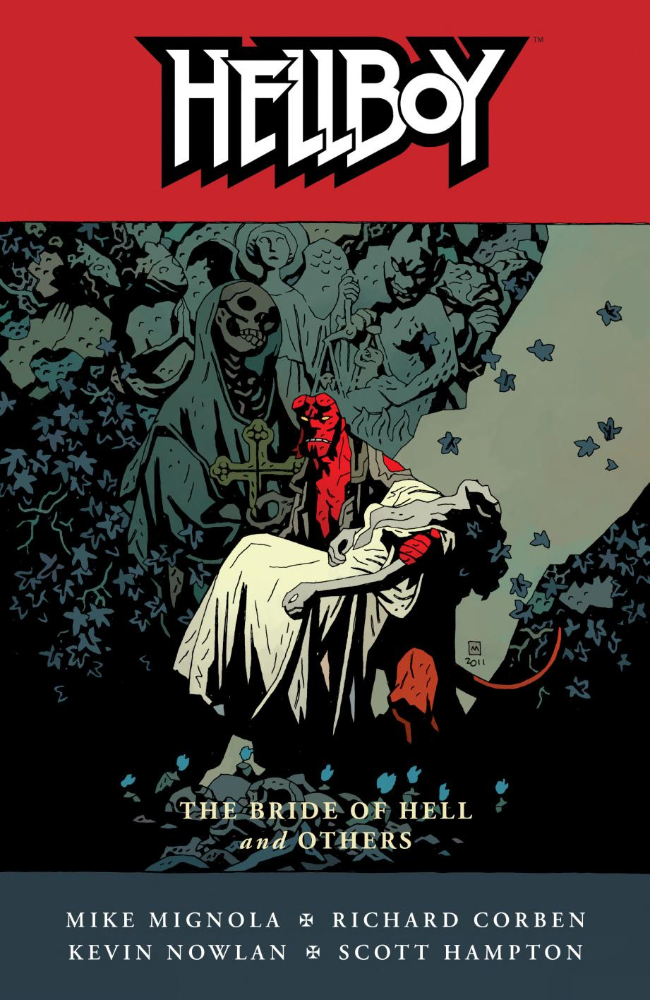MIKE MIGNOLA
[第 6 卷（Volume 6）](/entry/Hellboy_Library_Editions)

12
<em>风暴与狂怒（The Storm and the Fury）</em>
March 7, 2012
<ul>
<li><em>[风暴（The Storm）](/entry/The_Storm)</em> #1–3</li>
<li><em>[狂怒（The Fury）](/entry/The_Fury)</em> #1–3 及尾声</li>
</ul>
<ul>
<li>Glen David Gold 作引言</li>
<li>速写本（7 页）</li>
<li><em>狂怒（The Fury）</em> #1 中回顾<em>风暴（The Storm）</em>剧情的两页在平装合订本中被移除。这两页不含任何新画作。</li>
</ul>
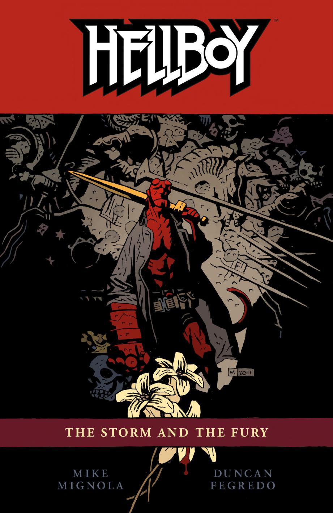MIKE MIGNOLA

N/A
<em>地狱男爵在墨西哥（Hellboy in Mexico）</em>
April 13, 2016
<ul>
<li>[<em>地狱男爵在墨西哥（Hellboy in Mexico）</em>（又名<em>一场醉醺醺的模糊（A Drunken Blur）</em>）](/entry/Hellboy_in_Mexico_%28story%29)</li>
<li><em>[地狱男爵大战阿兹特克木乃伊（Hellboy versus the Aztec Mummy）](/entry/Hellboy_versus_the_Aztec_Mummy)</em></li>
<li><em>[地狱男爵结婚记（Hellboy Gets Married）](/entry/Hellboy_Gets_Married)</em></li>
<li><em>[棺材人（The Coffin Man）](/entry/The_Coffin_Man)</em></li>
<li><em>[棺材人 2：再战一场（The Coffin Man 2: The Rematch）](/entry/The_Coffin_Man_2%3A_The_Rematch)</em></li>
<li><em>[活死人之屋（House of the Living Dead）](/entry/House_of_the_Living_Dead)</em></li>
</ul>
<ul>
<li>速写本（17 页）</li>
</ul>
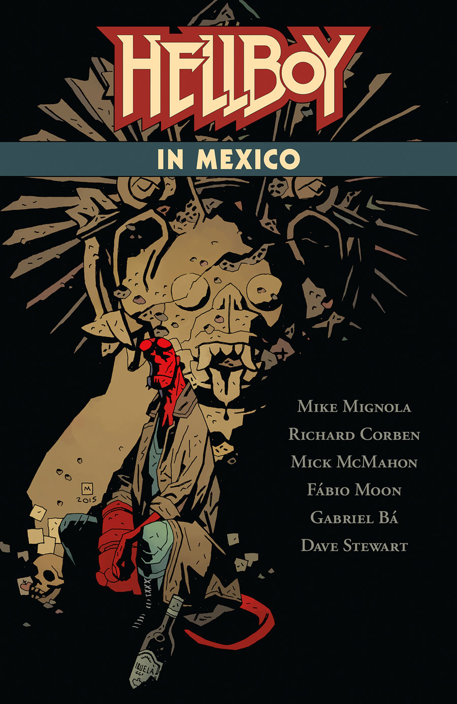MIKE MIGNOLA
N/A

N/A
<em>银灯俱乐部（The Silver Lantern Club）</em> 
（精装）
September 7, 2022
<ul>
<li>[<em>银灯俱乐部（The Silver Lantern Club）</em>](/entry/The_Silver_Lantern_Club_%28story%29) #1–5</li>
</ul>
<ul>
<li>速写本（20 页）</li>
</ul>
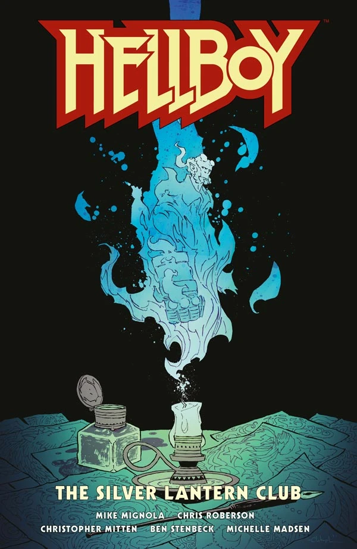CHRISTOPHER MITTEN
N/A

N/A
<em>巨人之骨（The Bones of Giants）</em> 
（精装）
September 7, 2022
<ul>
<li>[<em>巨人之骨（The Bones of Giants）</em>](/entry/The_Bones_of_Giants_%28comic_miniseries%29) #1–4</li>
</ul>
<ul>
<li>速写本（18 页）</li>
</ul>
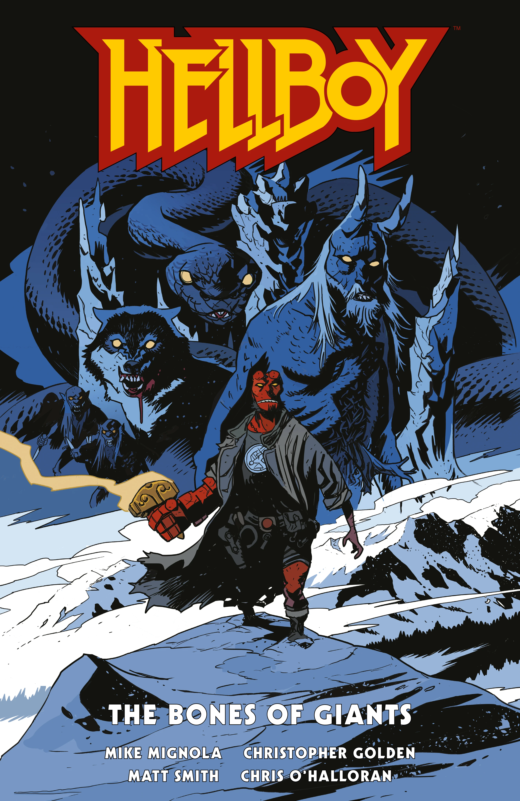MATT SMITH
N/A

N/A
<em>扭曲人与艾菲·科尔布的归来（The Crooked Man & The Return of Effie Kolb）</em>
June 18, 2024
<ul>
<li>[<em>地狱男爵：扭曲人（Hellboy: The Crooked Man）</em>](/entry/The_Crooked_Man_%28comic_story%29) #1–3</li>
</ul>
N/A
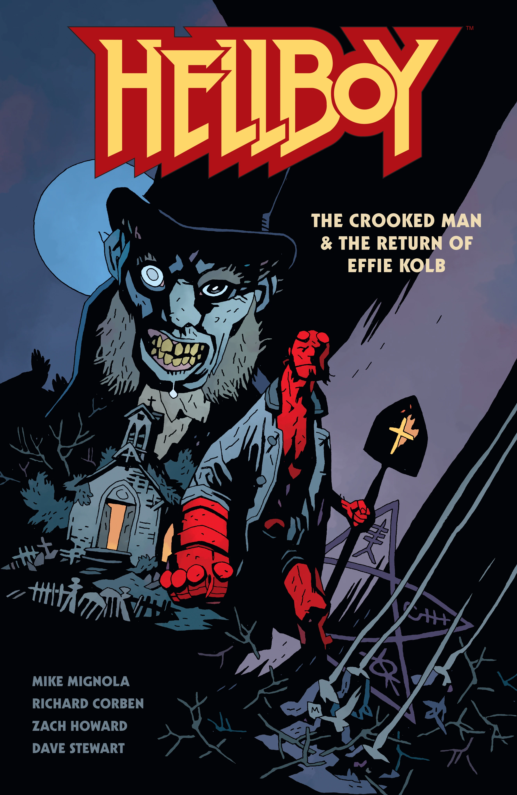MIKE MIGNOLA
[第 4 卷（Volume 4）](/entry/Hellboy_Library_Editions)

<ul>
<li><em>[地狱男爵与超自然调查防御署：艾菲·科尔布的归来（Hellboy and the B.P.R.D.: The Return of Effie Kolb）](/entry/The_Return_of_Effie_Kolb)</em> #1–2</li>
</ul>
N/A

</tbody>

#### *《地狱男爵》（Hellboy）* 原创图像小说（Original Graphic Novels）

这些原创故事以精装合订本形式发行。这些合订本不包含地狱男爵平装本通常附带的任何特别内容（没有作者札记，没有速写本/画廊）。

书名
出版日期
编剧
绘者
封面
收录于

<tbody>

<em>[活死人之屋（House of the Living Dead）](/entry/House_of_the_Living_Dead)</em>
November 2, 2011
[Mike Mignola](/entry/Mike_Mignola)
[Richard Corben](/entry/Richard_Corben)
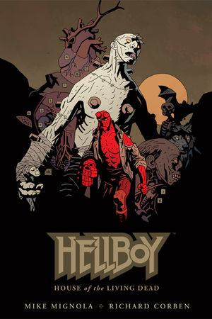MIKE MIGNOLA
[<em>地狱男爵在墨西哥（Hellboy in Mexico）</em>](/entry/TPB) 
— 
[<em>地狱男爵：短篇故事全集——第 1 卷（Hellboy: The Complete Short Stories – Volume 1）</em>（大全集版）](/entry/Omnibus_Editions)

<em>[午夜马戏团（The Midnight Circus）](/entry/The_Midnight_Circus)</em>
October 23, 2013
[Mike Mignola](/entry/Mike_Mignola)
[Duncan Fegredo](/entry/Duncan_Fegredo)
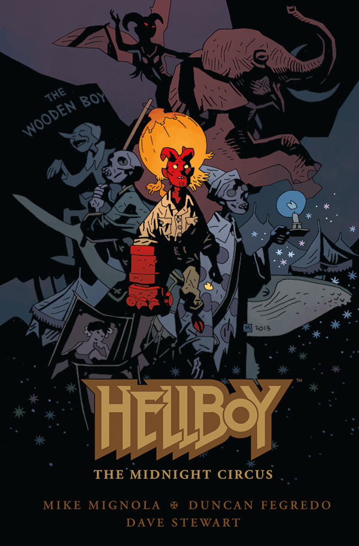MIKE MIGNOLA
[<em>地狱男爵：短篇故事全集——第 1 卷（Hellboy: The Complete Short Stories – Volume 1）</em>（大全集版）](/entry/Omnibus_Editions)

<em>[驶入寂静之海（Into the Silent Sea）](/entry/Into_the_Silent_Sea)</em>
April 19, 2017
[Mike Mignola](/entry/Mike_Mignola) 
[Gary Gianni](/entry/Gary_Gianni)
[Gary Gianni](/entry/Gary_Gianni)
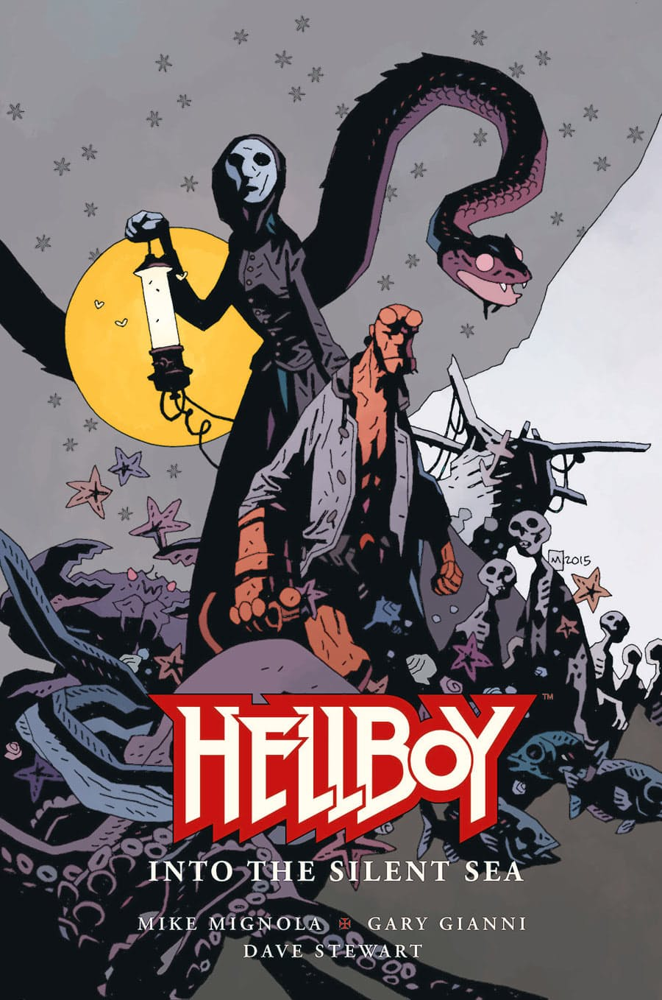MIKE MIGNOLA
[<em>地狱男爵——第 2 卷：奇异之地（Hellboy – Volume 2: Strange Places）</em>（大全集版）](/entry/Omnibus_Editions)

</tbody>

#### 未被收录的 *《地狱男爵》（Hellboy）* 故事

以下 *《地狱男爵》（Hellboy）* 故事目前尚未被收录进任何合订本：

- *[巨型机器人地狱男爵（Giant Robot Hellboy）](/entry/Giant_Robot_Hellboy_%28story%29)*
- *[巨型机器人地狱男爵归来（Giant Robot Hellboy Returns）](/entry/Giant_Robot_Hellboy_Returns)*

### *地狱男爵在地狱（Hellboy in Hell）*

#
书名
出版日期
收录内容
附加内容
封面
图书馆版
大全集版（Omnibus）

<tbody>

1
<em>降临（The Descent）</em>
May 21, 2014
<ul>
<li><em>[地狱男爵在地狱（Hellboy in Hell）](/entry/Hellboy_in_Hell_%28first_story_arc%29)</em> #1–4</li>
<li><em>[三条金鞭（The Three Gold Whips）](/entry/The_Three_Gold_Whips)</em></li>
</ul>
<ul>
<li>速写本（24 页）</li>
</ul>
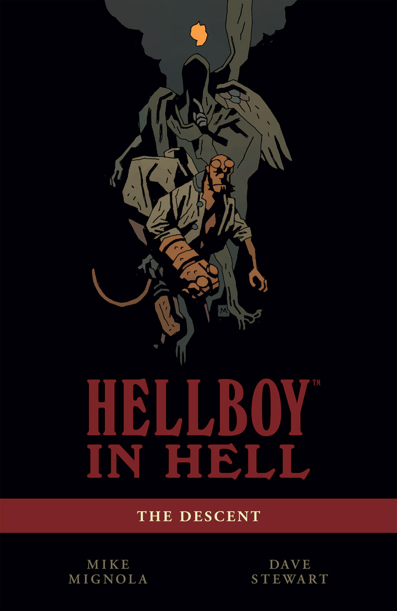MIKE MIGNOLA
[<em>地狱男爵在地狱（Hellboy in Hell）</em>](/entry/Hellboy_Library_Editions)
[<em>地狱男爵——第 4 卷： 
地狱男爵在地狱（Hellboy – Volume 4: Hellboy in Hell）</em>](/entry/Omnibus_Editions)

2
<em>死亡牌（The Death Card）</em>
October 5, 2016
<ul>
<li><em>[死亡牌（The Death Card）](/entry/The_Death_Card)</em>（含序幕）</li>
<li><em>[冥府的猎犬（The Hounds of Pluto）](/entry/The_Hounds_of_Pluto)</em></li>
<li><em>[西班牙新娘（The Spanish Bride）](/entry/The_Spanish_Bride)</em></li>
<li><em>[丧钟为谁而鸣（For Whom the Bell Tolls）](/entry/For_Whom_the_Bell_Tolls)</em></li>
<li><em>[沃尔斯克的驱魔人（The Exorcist of Vorsk）](/entry/The_Exorcist_of_Vorsk)</em></li>
</ul>
<ul>
<li>[Mike Mignola](/entry/Mike_Mignola)作后记</li>
<li>速写本（12 页）</li>
</ul>
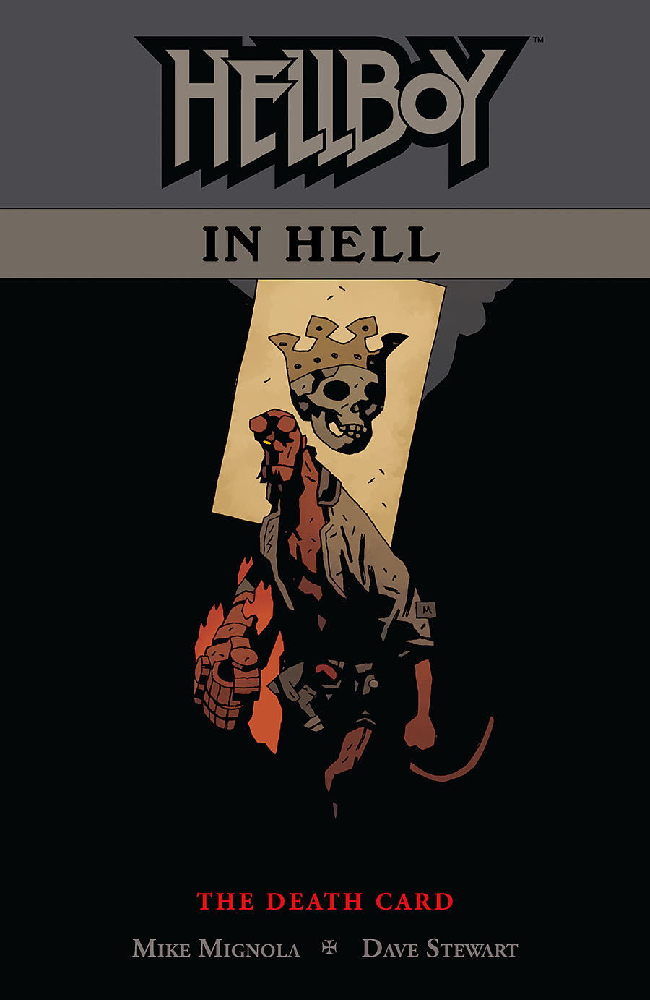MIKE MIGNOLA

</tbody>

#### 未被收录的 *《地狱男爵在地狱》（Hellboy in Hell）* 故事

以下 *《地狱男爵在地狱》（Hellboy in Hell）* 故事目前尚未被收录进任何合订本：

- *[唯有鲜血（Nothing But Blood）](/entry/Nothing_But_Blood)*

### *[超自然调查防御署（B.P.R.D.）](/entry/B.P.R.D._%28series%29)*

#
书名
出版日期
收录内容
附加内容
封面
大全集版

<tbody>

1
<em>空心地球 
及其他故事（Hollow Earth & Other Stories）</em>
January 29, 2003
<ul>
<li><em>[空心地球（Hollow Earth）](/entry/Hollow_Earth)</em> #1–3</li>
<li><em>[龙虾人约翰逊：我头颅中的杀手（Lobster Johnson: The Killer in My Skull）](/entry/The_Killer_in_My_Skull)</em></li>
<li><em>[亚伯·赛皮恩大战科学（Abe Sapien versus Science）](/entry/Abe_Sapien_versus_Science)</em></li>
<li><em>[亚伯·赛皮恩：亡者之鼓（Abe Sapien: Drums of the Dead）](/entry/Drums_of_the_Dead)</em></li>
<li><em>[《空心地球》Dark Horse Extra 加页（Hollow Earth Dark Horse Extra）](/entry/Hollow_Earth_Dark_Horse_Extra)</em></li>
</ul>
<ul>
<li>速写本（9 页）</li>
</ul>
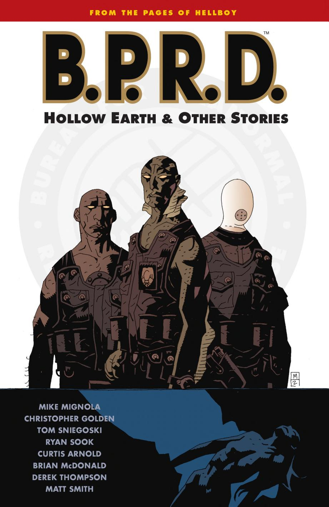MIKE MIGNOLA
[<em>超自然调查防御署： 
蛙疫（B.P.R.D.: Plague of Frogs）</em> 
第 1 卷](/entry/Omnibus_Editions)

2
<em>威尼斯之魂 
及其他故事（The Soul of Venice & Other Stories）</em>
August 25, 2004
<ul>
<li><em>[威尼斯之魂（The Soul of Venice）](/entry/The_Soul_of_Venice)</em></li>
<li><em>[黑暗之水（Dark Waters）](/entry/Dark_Waters)</em></li>
<li><em>[夜行列车（Night Train）](/entry/Night_Train)</em></li>
<li><em>[我床下有东西（There's Something Under My Bed）](/entry/There%26)</em></li>
<li><em>[办公室里又一天（Another Day at the Office）](/entry/Another_Day_at_the_Office)</em></li>
</ul>
<ul>
<li>速写本（13 页）</li>
</ul>
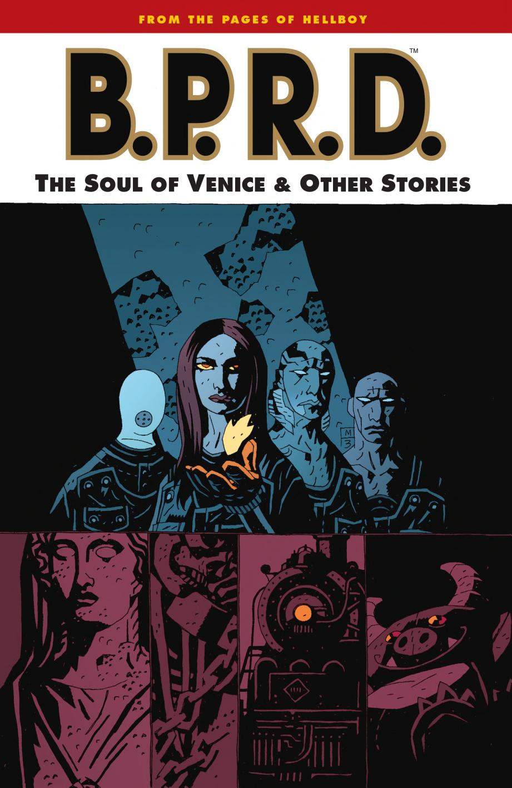MIKE MIGNOLA

3
<em>蛙疫（Plague of Frogs）</em>
February 23, 2005
<ul>
<li><em>[蛙疫（Plague of Frogs）](/entry/Plague_of_Frogs_%28story%29)</em> #1–5</li>
</ul>
<ul>
<li>[Mike Mignola](/entry/Mike_Mignola)作后记</li>
<li>速写本（8 页）</li>
</ul>
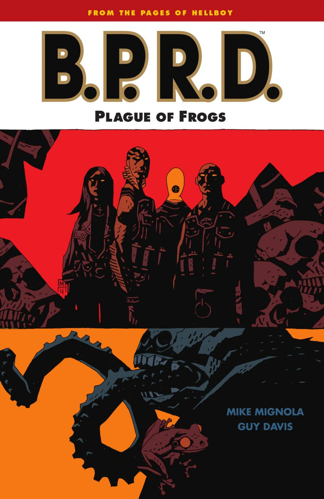MIKE MIGNOLA

4
<em>死者（The Dead）</em>
September 28, 2005
<ul>
<li><em>[重生（Born Again）](/entry/Born_Again)</em></li>
<li><em>[死者（The Dead）](/entry/The_Dead)</em> #1–5</li>
</ul>
<ul>
<li>[John Arcudi](/entry/John_Arcudi)作引言</li>
<li>[Mike Mignola](/entry/Mike_Mignola)作后记</li>
<li>速写本（11 页）</li>
</ul>
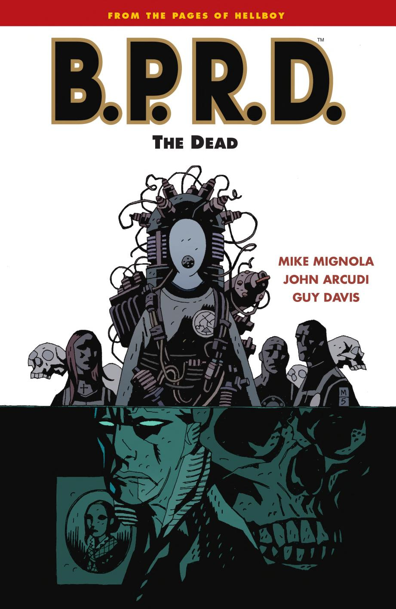MIKE MIGNOLA
[<em>超自然调查防御署： 
蛙疫（B.P.R.D.: Plague of Frogs）</em> 
第 2 卷](/entry/Omnibus_Editions)

5
<em>黑焰（The Black Flame）</em>
July 12, 2006
<ul>
<li><em>[黑焰（The Black Flame）](/entry/The_Black_Flame_%28story%29)</em> #1–6</li>
</ul>
<ul>
<li>[Mike Mignola](/entry/Mike_Mignola)作后记</li>
<li>速写本（6 页）</li>
</ul>
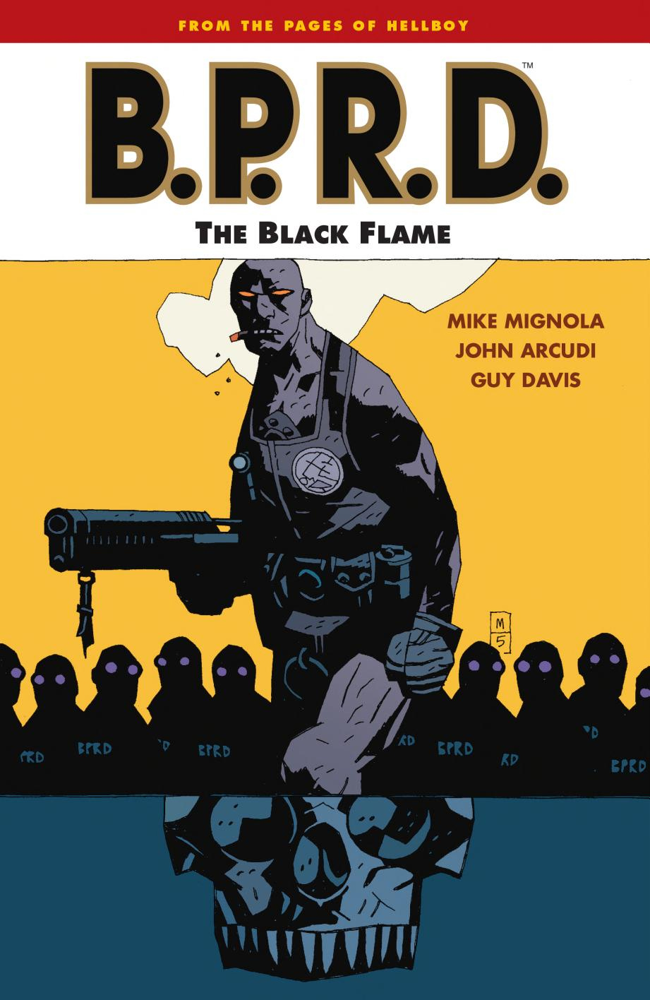MIKE MIGNOLA

6
<em>宇宙机器（The Universal Machine）</em>
January 17, 2007
<ul>
<li><em>[宇宙机器（The Universal Machine）](/entry/The_Universal_Machine)</em> #1–5</li>
</ul>
<ul>
<li>[Mike Mignola](/entry/Mike_Mignola)作后记</li>
<li>速写本（7 页）</li>
</ul>
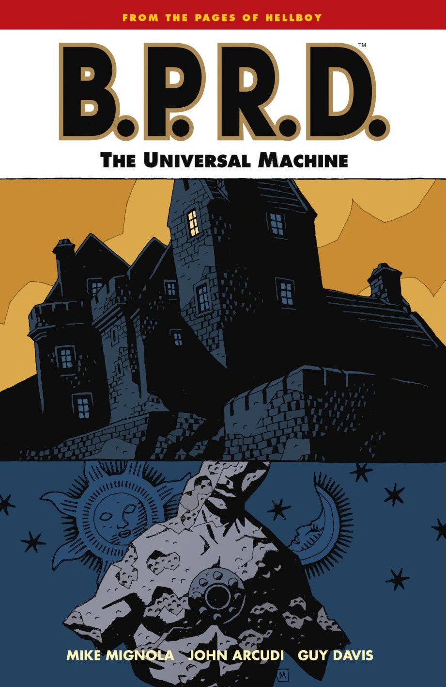MIKE MIGNOLA
[<em>超自然调查防御署： 
蛙疫（B.P.R.D.: Plague of Frogs）</em> 
第 3 卷](/entry/Omnibus_Editions)

7
<em>灵魂花园（Garden of Souls）</em>
January 30, 2008
<ul>
<li><em>[灵魂花园（Garden of Souls）](/entry/Garden_of_Souls)</em> #1–5</li>
</ul>
<ul>
<li>[John Arcudi](/entry/John_Arcudi)作后记</li>
<li>速写本（13 页）</li>
</ul>
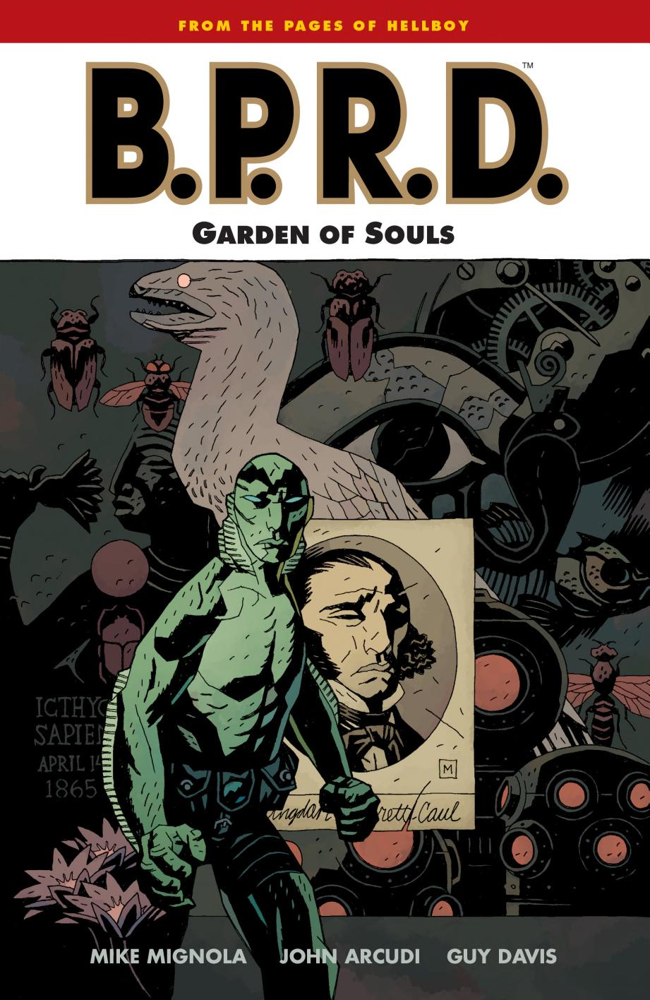MIKE MIGNOLA

8
<em>杀戮之地（Killing Ground）</em>
May 21, 2008
<ul>
<li><em>[杀戮之地（Killing Ground）](/entry/Killing_Ground)</em> #1–5</li>
</ul>
<ul>
<li>[John Arcudi](/entry/John_Arcudi)作后记</li>
<li>速写本（8 页）</li>
</ul>
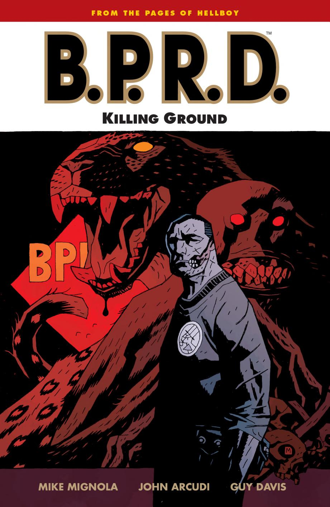MIKE MIGNOLA

9
<em>1946</em>
November 5, 2008
<ul>
<li><em>[1946](/entry/1946)</em> #1–5</li>
<li><em>[奥莱克主教的恶魔（Bishop Olek's Devil）](/entry/Bishop_Olek%26)</em></li>
</ul>
<ul>
<li>[Joshua Dysart](/entry/Joshua_Dysart)作后记</li>
<li>速写本（8 页）</li>
</ul>
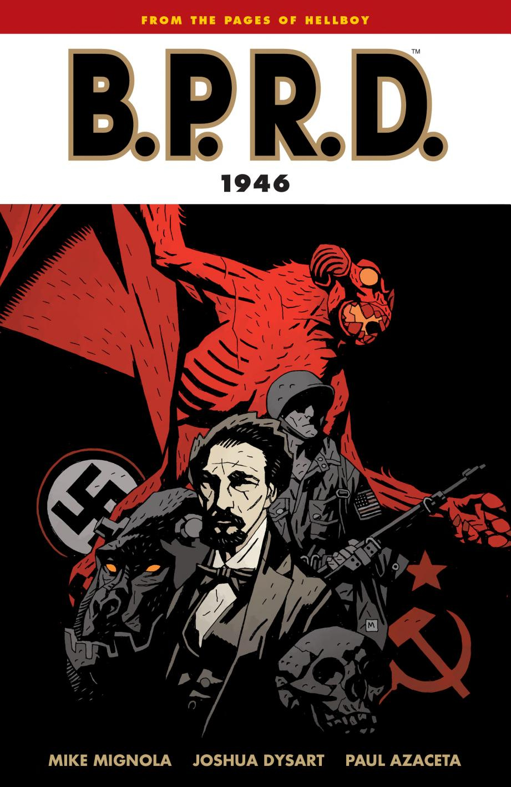MIKE MIGNOLA
[<em>超自然调查防御署： 
1946–1948</em>](/entry/Omnibus_Editions)

10
<em>警告（The Warning）</em>
April 15, 2009
<ul>
<li><em>[鞭长莫及（Out of Reach）](/entry/Out_of_Reach)</em></li>
<li><em>[警告（The Warning）](/entry/The_Warning)</em> #1–5</li>
</ul>
<ul>
<li>[John Arcudi](/entry/John_Arcudi)作后记</li>
<li>速写本（6 页）</li>
</ul>
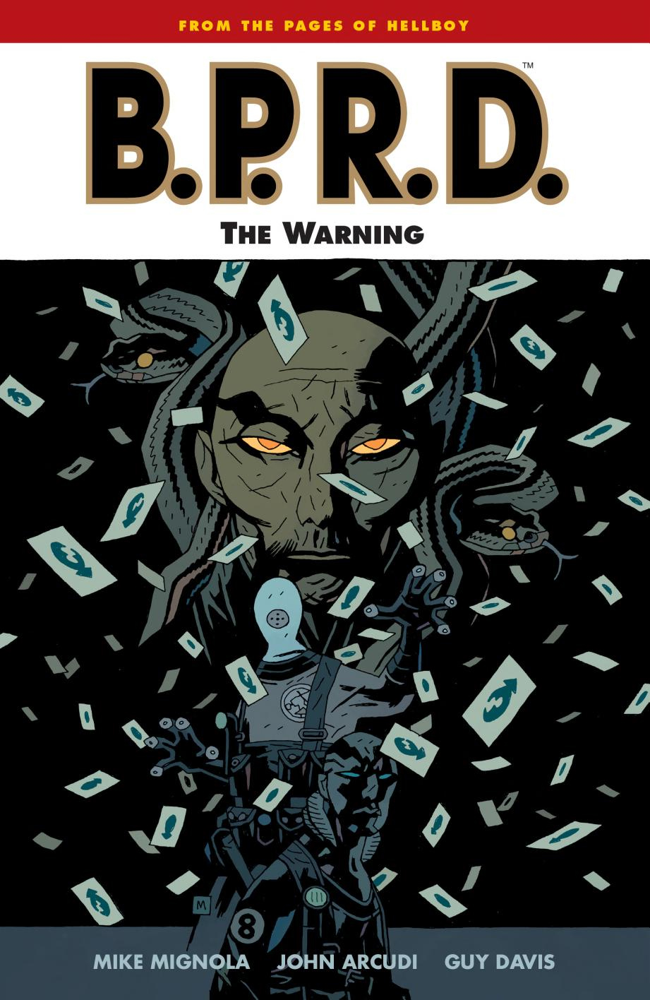MIKE MIGNOLA
[<em>超自然调查防御署： 
蛙疫（B.P.R.D.: Plague of Frogs）</em> 
第 4 卷](/entry/Omnibus_Editions)

11
<em>黑色女神（The Black Goddess）</em>
October 21, 2009
<ul>
<li><em>[黑色女神（The Black Goddess）](/entry/The_Black_Goddess_%28story%29)</em> #1–5</li>
</ul>
<ul>
<li>速写本（13 页）</li>
<li>[Guy Davis](/entry/Guy_Davis)撰写的《蟹角的钥匙童年回忆》（"Latchkey Memories from Crab Point"）</li>
</ul>
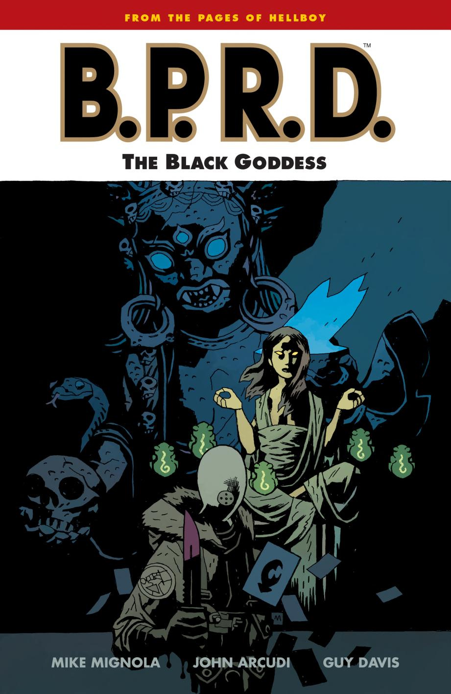MIKE MIGNOLA

12
<em>向青蛙开战（War on Frogs）</em>
April 28, 2010
<ul>
<li><em>[向青蛙开战（War on Frogs）](/entry/War_on_Frogs)</em> #1–4</li>
<li><em>[复苏（Revival）](/entry/Revival)</em></li>
</ul>
<ul>
<li>速写本（8 页）</li>
</ul>
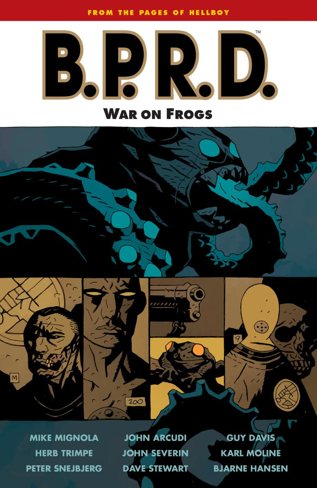MIKE MIGNOLA
[<em>超自然调查防御署： 
蛙疫（B.P.R.D.: Plague of Frogs）</em> 
第 2 卷](/entry/Omnibus_Editions)

13
<em>1947</em>
July 7, 2010
<ul>
<li><em>[1947](/entry/1947)</em> #1–5</li>
<li><em>[我会在那里找到什么？（And What Shall I Find There?）](/entry/And_What_Shall_I_Find_There%3F)</em></li>
</ul>
<ul>
<li>[Mike Mignola](/entry/Mike_Mignola)作后记</li>
<li>速写本（15 页）</li>
</ul>
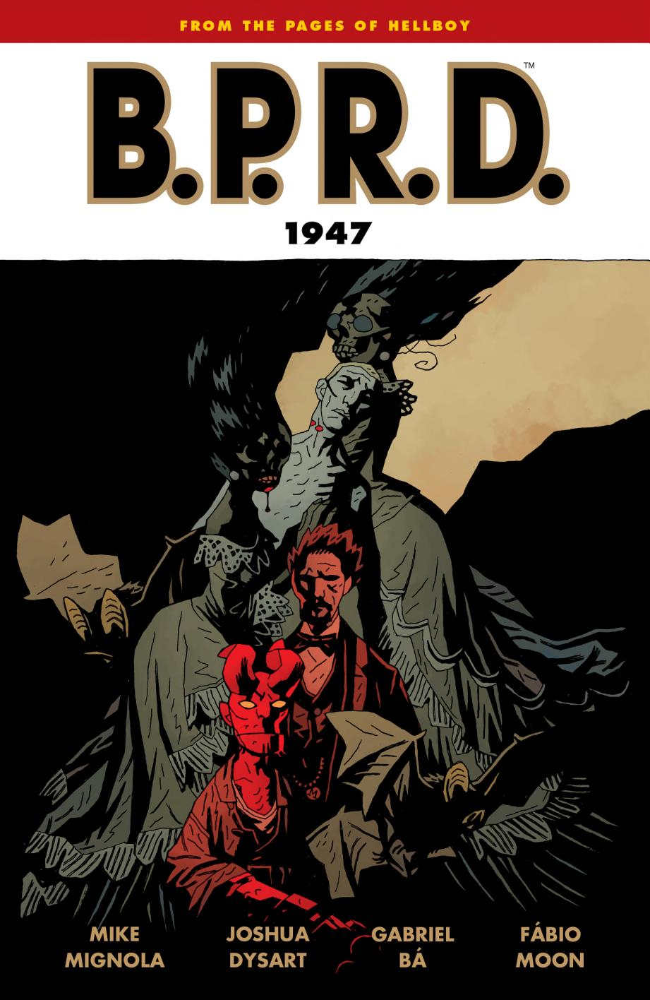MIKE MIGNOLA
[超自然调查防御署： 
1946 – 1948](/entry/Omnibus_Editions)

14
<em>恐惧之王（King of Fear）</em>
November 3, 2010
<ul>
<li><em>[恐惧之王（King of Fear）](/entry/King_of_Fear_%28story%29)</em> #1–5</li>
</ul>
<ul>
<li>[Mike Mignola](/entry/Mike_Mignola)作后记</li>
<li>速写本（18 页）</li>
</ul>
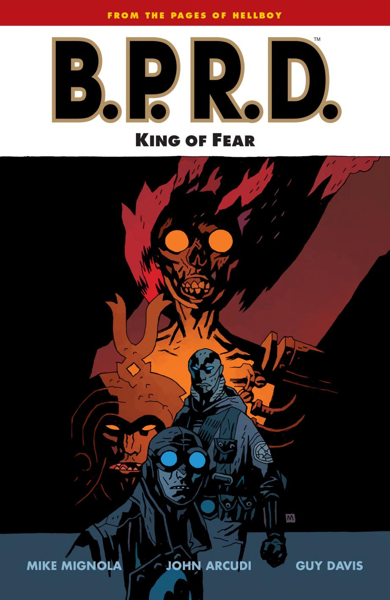MIKE MIGNOLA
[<em>超自然调查防御署： 
蛙疫（B.P.R.D.: Plague of Frogs）</em> 
第 4 卷](/entry/Omnibus_Editions)

N/A
<em>身而为人（Being Human）</em>
November 30, 2011
<ul>
<li><em>[死者的追忆（The Dead Remembered）](/entry/The_Dead_Remembered)</em> #1–3</li>
</ul>
<ul>
<li>速写本（12 页）</li>
</ul>
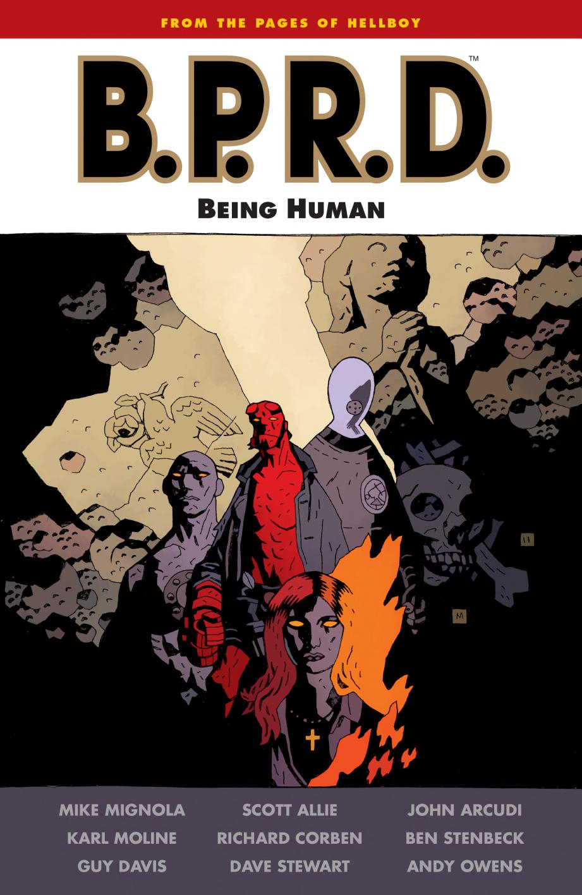MIKE MIGNOLA
N/A

<ul>
<li><em>[伤亡者（Casualties）](/entry/Casualties)</em></li>
</ul>
[<em>亚伯·赛皮恩： 
溺水及其他故事（Abe Sapien: The Drowning and Other Stories）</em>](/entry/Omnibus_Editions)

<ul>
<li><em>[身而为人（Being Human）](/entry/Being_Human)</em></li>
</ul>
[<em>地狱男爵——第 2 卷： 
奇异之地（Hellboy – Volume 2: Strange Places）</em>](/entry/Omnibus_Editions)

<ul>
<li><em>[灵质人（The Ectoplasmic Man）](/entry/The_Ectoplasmic_Man)</em></li>
</ul>
N/A

N/A
<em>1948</em>
September 11, 2013
<ul>
<li><em>[1948](/entry/1948)</em> #1–5</li>
</ul>
<ul>
<li>速写本（18 页）</li>
</ul>
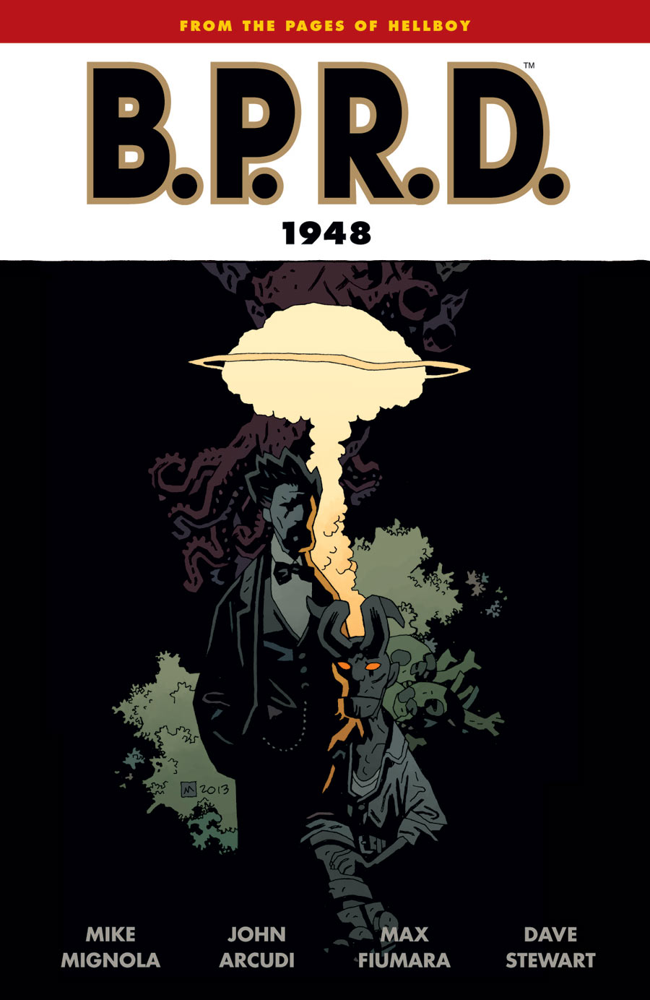MIKE MIGNOLA
[<em>超自然调查防御署： 
1946 – 1948</em>](/entry/Omnibus_Editions)

</tbody>

### *超自然调查防御署：吸血鬼（B.P.R.D.: Vampire）*

#
书名
出版日期
收录内容
附加内容
封面

<tbody>

1
<em>吸血鬼（Vampire）</em>
<strong>第 1 版（1st EDITION）</strong>
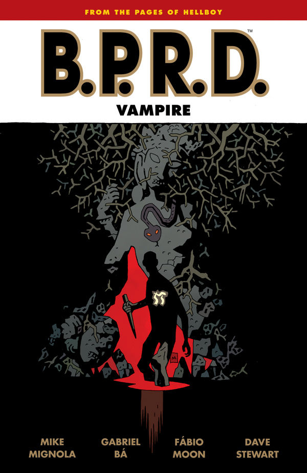MIKE MIGNOLA

November 27, 2013
<ul>
<li><em>[吸血鬼（Vampire）](/entry/Vampire_%28story%29)</em> #1–5</li>
</ul>
<ul>
<li>速写本（17 页）</li>
</ul>

<strong>第 2 版（2nd EDITION）</strong>

February 27, 2019
<ul>
<li><em>[吸血鬼（Vampire）](/entry/Vampire_%28story%29)</em> #1–5</li>
<li><em>[迷失者（Lost Ones）](/entry/Lost_Ones)</em></li>
</ul>
<ul>
<li>Gabriel Bá 与 Fábio Moon 作引言</li>
<li>速写本（19 页）</li>
</ul>

</tbody>

### *[超自然调查防御署：人间炼狱（B.P.R.D.: Hell on Earth）](/entry/B.P.R.D._%28series%29)*

#
书名
出版日期
收录内容
附加内容
封面
大全集版

<tbody>

1
<em>新世界（New World）</em>
August 17, 2011
<ul>
<li><em>[新世界（New World）](/entry/New_World_%28B.P.R.D._story_arc%29)</em> #1–5</li>
<li><em>[西雅图（Seattle）](/entry/Seattle)</em></li>
</ul>
<ul>
<li>[Mike Mignola](/entry/Mike_Mignola)作后记</li>
<li>速写本（8 页）</li>
</ul>
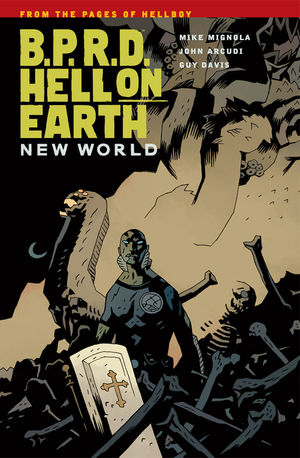MIKE MIGNOLA
[<em>超自然调查防御署： 
人间炼狱（B.P.R.D.: Hell on Earth）</em> 
第 1 卷](/entry/Omnibus_Editions)

2
<em>众神与怪物（Gods and Monsters）</em>
January 11, 2012
<ul>
<li><em>[众神（Gods）](/entry/Gods)</em> #1–3</li>
<li><em>[怪物（Monsters）](/entry/Monsters)</em> #1–2</li>
</ul>
<ul>
<li>速写本（19 页）</li>
</ul>
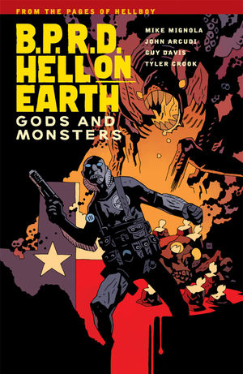MIKE MIGNOLA

3
<em>俄罗斯（Russia）</em>
August 15, 2012
<ul>
<li><em>[俄罗斯（Russia）](/entry/Russia)</em> #1–5</li>
<li><em>[无名坟墓（An Unmarked Grave）](/entry/An_Unmarked_Grave)</em></li>
</ul>
<ul>
<li>速写本（24 页）</li>
</ul>
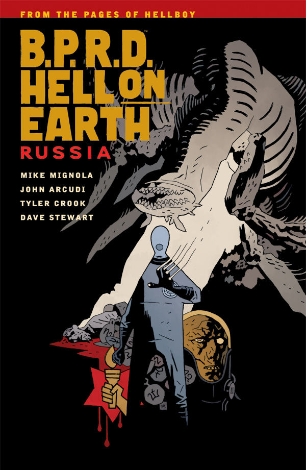MIKE MIGNOLA

4
<em>恶魔的引擎 
与漫长的死亡（The Devil's Engine & The Long Death）</em>
December 5, 2012
<ul>
<li><em>[恶魔的引擎（The Devil's Engine）](/entry/The_Devil%26)</em> #1–3</li>
<li><em>[漫长的死亡（The Long Death）](/entry/The_Long_Death)</em> #1–3</li>
</ul>
<ul>
<li>速写本（27 页）</li>
</ul>
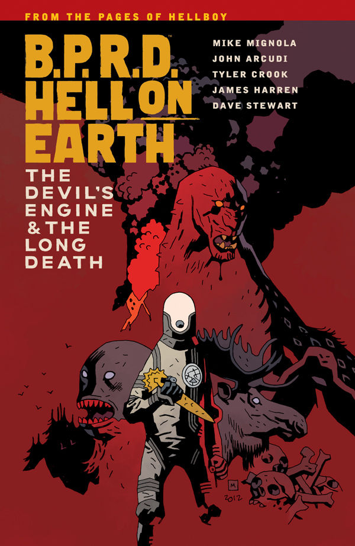MIKE MIGNOLA
[<em>超自然调查防御署： 
人间炼狱（B.P.R.D.: Hell on Earth）</em> 
第 2 卷](/entry/Omnibus_Editions)

5
<em>皮肯斯县惊魂 
及其他故事（The Pickens County Horror and Others）</em>
July 17, 2013
<ul>
<li><em>[皮肯斯县惊魂（The Pickens County Horror）](/entry/The_Pickens_County_Horror)</em> #1–2</li>
<li><em>[J.H. 奥唐奈的蜕变（The Transformation of J.H. O'Donnell）](/entry/The_Transformation_of_J.H._O%26)</em></li>
<li><em>[时间深渊（The Abyss of Time）](/entry/The_Abyss_of_Time)</em> #1–2</li>
</ul>
<ul>
<li>速写本（30 页）</li>
</ul>
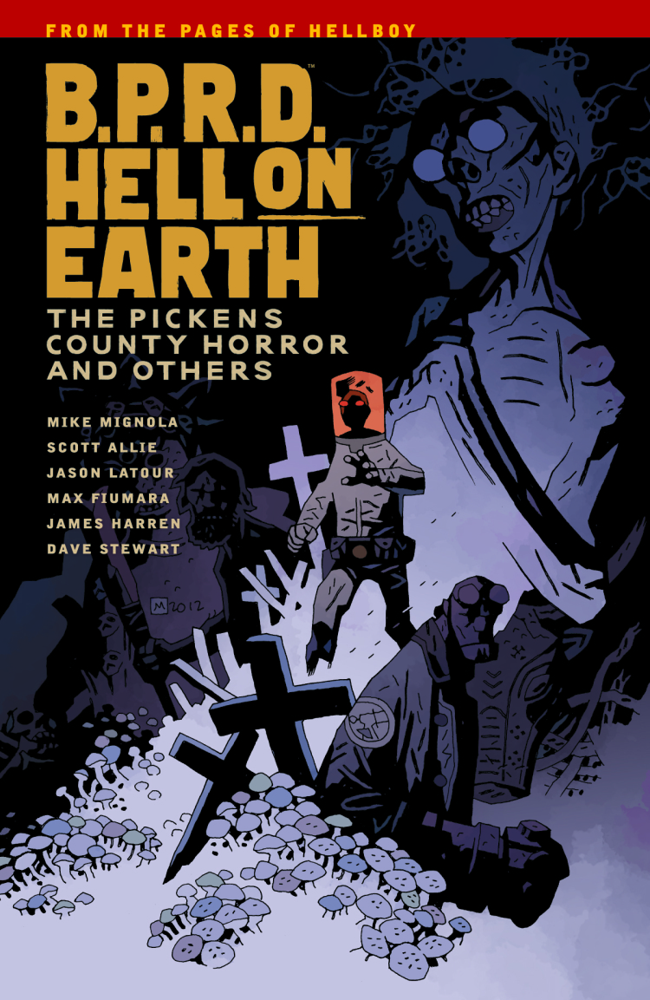MIKE MIGNOLA

6
<em>主人的归来（The Return of the Master）</em>
August 7, 2013
<ul>
<li><em>[主人的归来（The Return of the Master）](/entry/The_Return_of_the_Master)</em> #1–5</li>
</ul>
<ul>
<li>速写本（34 页）</li>
</ul>
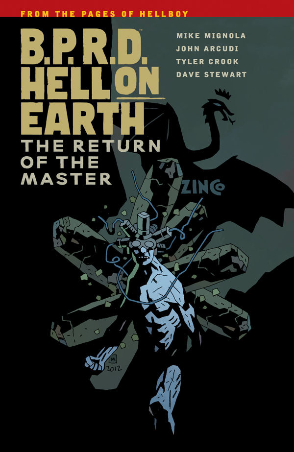MIKE MIGNOLA

7
<em>地狱里的寒日（A Cold Day in Hell）</em>
January 22, 2014
<ul>
<li><em>[荒原（Wasteland）](/entry/Wasteland)</em> #1–3</li>
<li><em>[地狱里的寒日（A Cold Day in Hell）](/entry/A_Cold_Day_in_Hell)</em> #1–2</li>
</ul>
<ul>
<li>速写本（18 页）</li>
</ul>
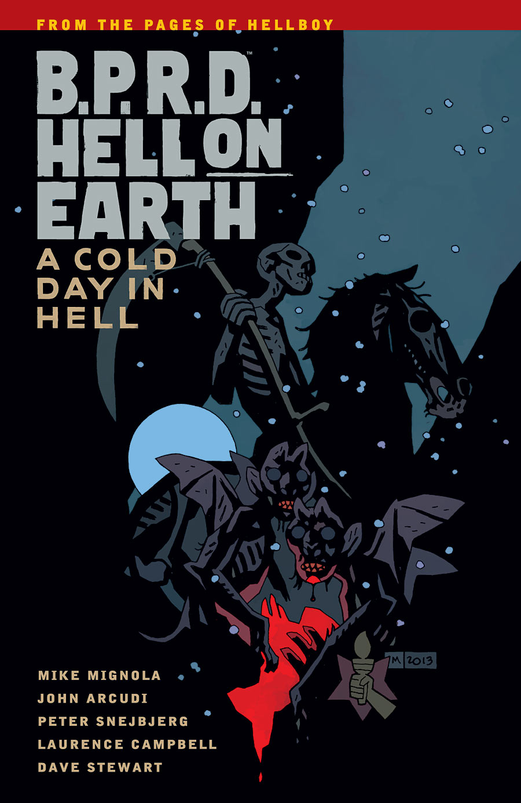MIKE MIGNOLA
[<em>超自然调查防御署： 
人间炼狱（B.P.R.D.: Hell on Earth）</em> 
第 3 卷](/entry/Omnibus_Editions)

8
<em>火湖（Lake of Fire）</em>
April 9, 2014
<ul>
<li><em>[火湖（Lake of Fire）](/entry/Lake_of_Fire)</em> #1–5</li>
</ul>
<ul>
<li>速写本（18 页）</li>
</ul>
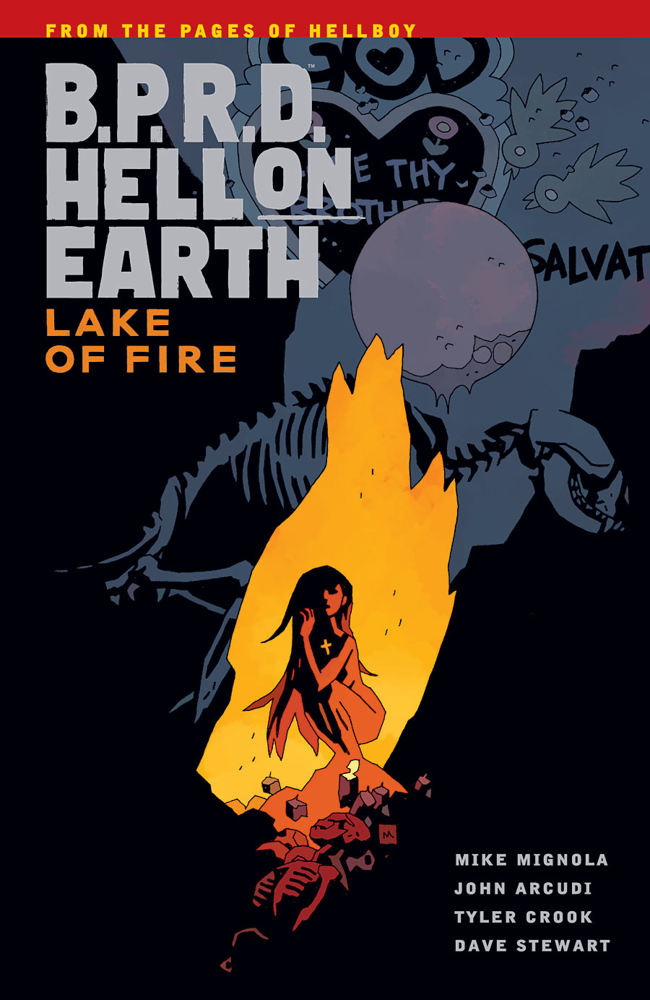MIKE MIGNOLA

9
<em>黑焰的 
统治（The Reign of the Black Flame）</em>
September 10, 2014
<ul>
<li><em>[黑焰的统治（The Reign of the Black Flame）](/entry/The_Reign_of_the_Black_Flame)</em> #1–5</li>
</ul>
<ul>
<li>速写本（18 页）</li>
</ul>
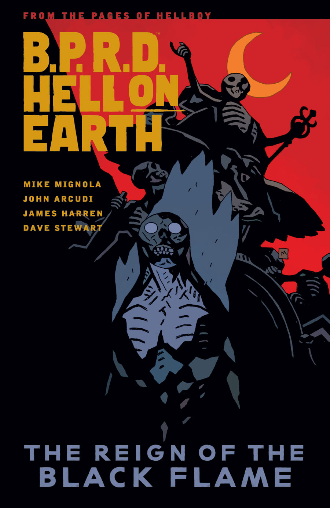MIKE MIGNOLA

10
<em>恶魔之翼（The Devil's Wings）</em>
March 18, 2015
<ul>
<li><em>[恶魔之翼（The Devil's Wings）](/entry/The_Devil%26)</em> #1–2</li>
<li><em>[破碎的方程式（The Broken Equation）](/entry/The_Broken_Equation)</em> #1–2</li>
<li><em>[碾压（Grind）](/entry/Grind)</em></li>
</ul>
<ul>
<li>速写本（22 页）</li>
</ul>
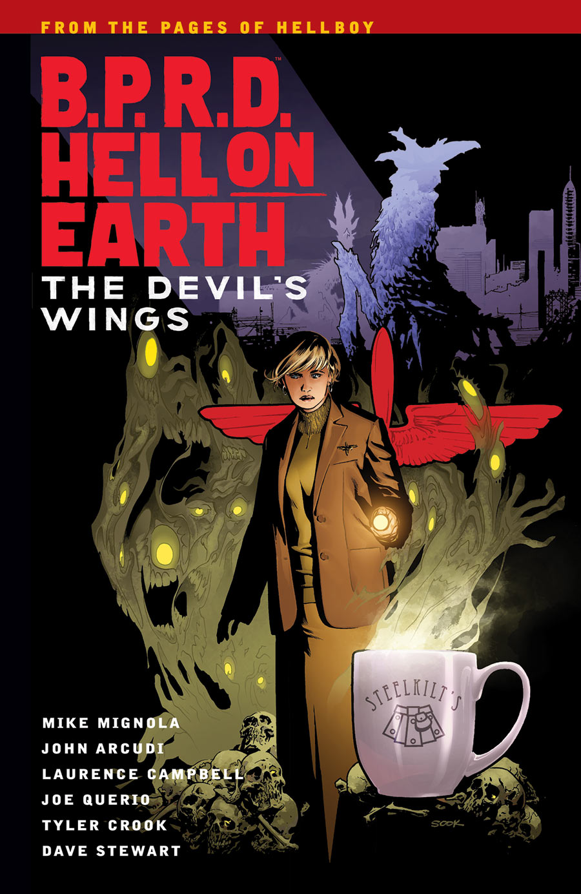RYAN SOOK
[<em>超自然调查防御署： 
人间炼狱（B.P.R.D.: Hell on Earth）</em> 
第 4 卷](/entry/Omnibus_Editions)

11
<em>血肉与磐石（Flesh and Stone）</em>
September 23, 2015
<ul>
<li><em>[血肉与磐石（Flesh and Stone）](/entry/Flesh_and_Stone)</em> #1–5</li>
</ul>
<ul>
<li>速写本（18 页）</li>
</ul>
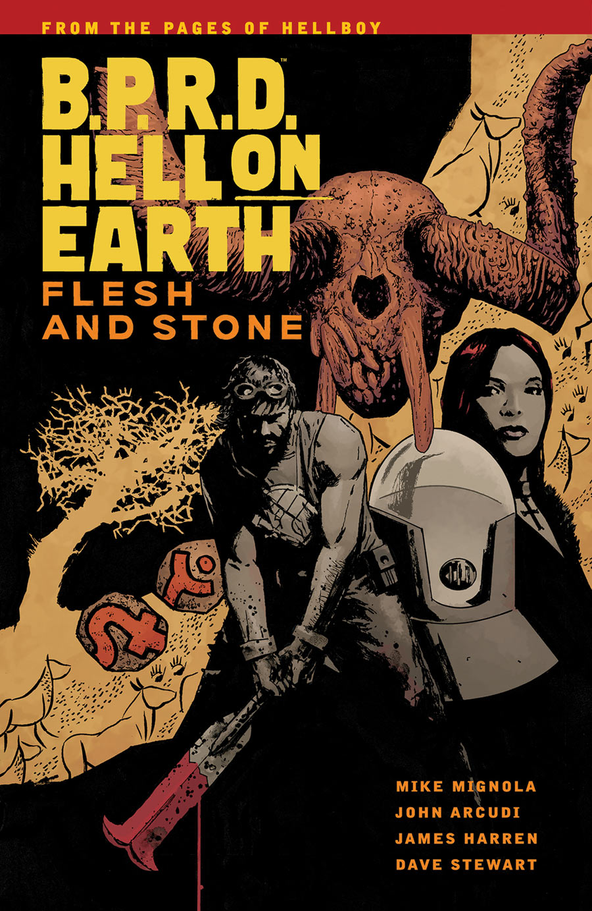LAURENCE CAMPBELL

12
<em>蜕变（Metamorphosis）</em>
December 23, 2015
<ul>
<li><em>[无处、虚无、永不（Nowhere, Nothing, Never）](/entry/Nowhere%2C_Nothing%2C_Never)</em> #1–3</li>
<li><em>[现代普罗米修斯（Modern Prometheus）](/entry/Modern_Prometheus)</em> #1–2</li>
</ul>
<ul>
<li>速写本（18 页）</li>
</ul>
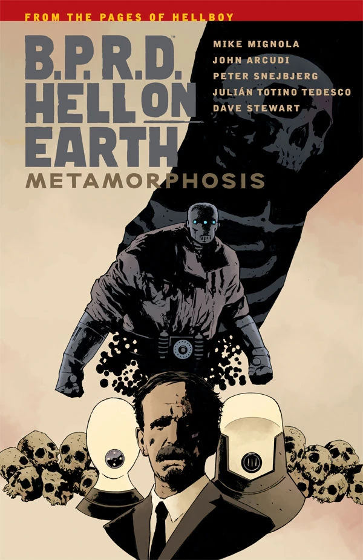LAURENCE CAMPBELL
[<em>超自然调查防御署： 
人间炼狱（B.P.R.D.: Hell on Earth）</em> 
第 5 卷](/entry/Omnibus_Editions)

13
<em>末日（End of Days）</em>
May 18, 2016
<ul>
<li><em>[末日（End of Days）](/entry/End_of_Days)</em> #1–5</li>
</ul>
<ul>
<li>速写本（10 页）</li>
</ul>
LAURENCE CAMPBELL

14
<em>驱魔人（The Exorcist）</em>
September 21, 2016
<ul>
<li><em>[驱魔（Exorcism）](/entry/Exorcism)</em> #1–2</li>
<li><em>[驱魔人（The Exorcist）](/entry/The_Exorcist)</em> #1–3</li>
</ul>
<ul>
<li>速写本（8 页）</li>
</ul>
LAURENCE CAMPBELL
[<em>超自然调查防御署： 
人间炼狱（B.P.R.D.: Hell on Earth）</em> 
第 4 卷](/entry/Omnibus_Editions)

15
<em>时辰已到（Cometh the Hour）</em>
March 29, 2017
<ul>
<li><em>[时辰已到（Cometh the Hour）](/entry/Cometh_the_Hour)</em> #1–5</li>
</ul>
<ul>
<li>速写本（13 页）</li>
</ul>
LAURENCE CAMPBELL
[<em>超自然调查防御署： 
人间炼狱（B.P.R.D.: Hell on Earth）</em> 
第 5 卷](/entry/Omnibus_Editions)

</tbody>

### *[超自然调查防御署：你所熟知的恶魔（B.P.R.D.: The Devil You Know）](/entry/B.P.R.D._%28series%29)*

#
书名
出版日期
收录内容
附加内容
封面
大全集版

<tbody>

1
<em>弥赛亚（Messiah）</em>
April 11, 2018
<ul>
<li><em>[弥赛亚（Messiah）](/entry/Messiah)</em> #1–5</li>
<li><em>[破碎的容器（Broken Vessels）](/entry/Broken_Vessels)</em></li>
</ul>
<ul>
<li>速写本（9 页）</li>
</ul>
LAURENCE CAMPBELL
[<em>超自然调查防御署： 
你所熟知的恶魔（B.P.R.D.: The Devil You Know）</em>](/entry/Omnibus_Editions)

2
<em>潘地曼尼南（Pandemonium）</em>
February 6, 2019
<ul>
<li>[<em>潘地曼尼南（Pandemonium）</em>](/entry/Pandemonium_%28story_arc%29) #1–5</li>
</ul>
<ul>
<li>速写本（18 页）</li>
</ul>
LAURENCE CAMPBELL

3
<em>诸神黄昏计划（Ragna Rok）</em>
July 17, 2019
<ul>
<li>[<em>诸神黄昏计划（Ragna Rok）</em>](/entry/Ragna_Rok_%28story_arc%29) #1–5</li>
</ul>
<ul>
<li>[Mike Mignola](/entry/Mike_Mignola)作后记</li>
<li>速写本（14 页）</li>
</ul>
LAURENCE CAMPBELL

</tbody>

### *[龙虾人约翰逊（Lobster Johnson）](/entry/Lobster_Johnson_%28series%29)*

#
书名
出版日期
收录内容
附加内容
封面
大全集版

<tbody>

1
<em>钢铁普罗米修斯（The Iron Prometheus）</em>
June 18, 2008
<ul>
<li><em>[钢铁普罗米修斯（The Iron Prometheus）](/entry/The_Iron_Prometheus)</em> #1–5</li>
</ul>
<ul>
<li><em>龙虾人约翰逊的真实历史（The True History of Lobster Johnson）</em></li>
<li>速写本（17 页）</li>
</ul>
MIKE MIGNOLA
[<em>龙虾人约翰逊（Lobster Johnson）</em>第 2 卷](/entry/Omnibus_Editions)

2
<em>燃烧之手（The Burning Hand）</em>
November 14, 2012
<ul>
<li><em>[燃烧之手（The Burning Hand）](/entry/The_Burning_Hand)</em> #1–5</li>
</ul>
<ul>
<li>速写本（18 页）</li>
</ul>
MIKE MIGNOLA
[<em>龙虾人约翰逊（Lobster Johnson）</em>第 1 卷](/entry/Omnibus_Editions)

3
<em>撒旦闻到老鼠味（Satan Smells a Rat）</em>
February 12, 2014
<ul>
<li><em>[枯颅（Caput Mortuum）](/entry/Caput_Mortuum)</em></li>
<li><em>[撒旦闻到老鼠味（Satan Smells a Rat）](/entry/Satan_Smells_a_Rat)</em></li>
<li><em>[托尼·马索的辉煌时刻（Tony Masso's Finest Hour）](/entry/Tony_Masso%26)</em></li>
<li><em>[一缕莲花香（A Scent of Lotus）](/entry/A_Scent_of_Lotus)</em> #1–2</li>
<li><em>[奈芙鲁的祈祷（The Prayer of Neferu）](/entry/The_Prayer_of_Neferu)</em></li>
</ul>
<ul>
<li>速写本（18 页）</li>
</ul>
MIKE MIGNOLA

4
<em>抓住龙虾人！（Get the Lobster!）</em>
December 10, 2014
<ul>
<li><em>[抓住龙虾人（Get the Lobster）](/entry/Get_the_Lobster)</em> #1–5</li>
</ul>
<ul>
<li>速写本（18 页）</li>
</ul>
TONCI ZONJIC

5
<em>海盗的鬼魂 
与 
中城的金属怪物（The Pirate's Ghost and Metal Monsters of Midtown）</em>
December 13, 2017
<ul>
<li><em>[中城的金属怪物（Metal Monsters of Midtown）](/entry/Metal_Monsters_of_Midtown)</em> #1–3</li>
<li><em>[海盗的鬼魂（The Pirate's Ghost）](/entry/The_Pirate%26)</em> #1–3</li>
</ul>
<ul>
<li>[Clem Robins](/entry/Clem_Robins)作后记</li>
<li>速写本（16 页）</li>
</ul>
TONCI ZONJIC
[<em>龙虾人约翰逊（Lobster Johnson）</em>第 2 卷](/entry/Omnibus_Editions)

6
<em>以生命铸就的锁链（A Chain Forged in Life）</em>
March 7, 2018
<ul>
<li><em>[以生命铸就的锁链（A Chain Forged in Life）](/entry/A_Chain_Forged_in_Life)</em></li>
<li><em>[被遗忘的人（The Forgotten Man）](/entry/The_Forgotten_Man)</em></li>
<li><em>[玻璃螳螂（The Glass Mantis）](/entry/The_Glass_Mantis)</em></li>
<li><em>[白骨花园（Garden of Bones）](/entry/Garden_of_Bones)</em></li>
<li><em>[万花筒（Mangekyō）](/entry/Mangeky%C5%8D)</em></li>
</ul>
<ul>
<li>速写本（18 页）</li>
</ul>
TONCI ZONJIC

</tbody>

#### 未被收录的 *《龙虾人约翰逊》（Lobster Johnson）* 故事

以下 *《龙虾人约翰逊》（Lobster Johnson）* 故事目前尚未被收录进任何合订本：

- *[空椅子（The Empty Chair）](/entry/The_Empty_Chair)*（收录于[*龙虾人约翰逊——第 1 卷（Lobster Johnson – Volume 1）* 大全集版](/entry/Omnibus_Editions)）
- *[宫保龙虾人（Kung Pao Lobster）](/entry/Kung_Pao_Lobster)*（幽默漫画，不太可能被收录）

### *[亚伯·赛皮恩（Abe Sapien）](/entry/Abe_Sapien_%28series%29)*

#
书名
出版日期
收录内容
附加内容
封面
大全集版

<tbody>

1
<em>溺水（The Drowning）</em>
September 17, 2008
<ul>
<li><em>[溺水（The Drowning）](/entry/The_Drowning)</em> #1–5</li>
</ul>
<ul>
<li>速写本（8 页）</li>
</ul>
MIKE MIGNOLA
<em>[亚伯·赛皮恩： 
溺水 
及其他故事（Abe Sapien: The Drowning and Other Stories）](/entry/Omnibus_Editions)</em>

2
<em>恶魔不开玩笑 
及其他故事（The Devil Does Not Jest and Other Stories）</em>
May 9, 2012
<ul>
<li><em>[闹鬼的男孩（The Haunted Boy）](/entry/The_Haunted_Boy)</em></li>
<li><em>[深海平原（The Abyssal Plain）](/entry/The_Abyssal_Plain)</em> #1–2</li>
<li><em>[恶魔不开玩笑（The Devil Does Not Jest）](/entry/The_Devil_Does_Not_Jest)</em> #1–2</li>
</ul>
<ul>
<li>速写本（20 页）</li>
</ul>
MIKE MIGNOLA

3
<em>黑暗与可怖 
与 
人类新种族（Dark and Terrible and The New Race of Man）</em>
December 11, 2013
<ul>
<li><em>[黑暗与可怖（Dark and Terrible）](/entry/Dark_and_Terrible_%28story%29)</em> #1–3</li>
<li><em>[人类新种族（The New Race of Man）](/entry/The_New_Race_of_Man)</em> #1–2</li>
</ul>
<ul>
<li>速写本（24 页）</li>
</ul>
MIKE MIGNOLA
[<em>亚伯·赛皮恩： 
黑暗与可怖（Abe Sapien: Dark and Terrible）</em> 
第 1 卷](/entry/Omnibus_Editions)

4
<em>未来事物的 
形状（The Shape of Things to Come）</em>
July 9, 2014
<ul>
<li><em>[未来事物的形状（The Shape of Things to Come）](/entry/The_Shape_of_Things_to_Come)</em> #1–2</li>
<li><em>[战至最后一人（To the Last Man）](/entry/To_the_Last_Man)</em> #1–3</li>
</ul>
<ul>
<li>速写本（18 页）</li>
</ul>
MIKE MIGNOLA

5
<em>神圣之地（Sacred Places）</em>
January 21, 2015
<ul>
<li><em>[花园（一）（The Garden (I)）](/entry/The_Garden_%28I%29)</em></li>
<li><em>[治疗者（The Healer）](/entry/The_Healer)</em></li>
<li><em>[幻象、梦境与垂钓（Visions, Dreams, and Fishin'）](/entry/Visions%2C_Dreams%2C_and_Fishin%26)</em></li>
<li><em>[神圣之地（Sacred Places）](/entry/Sacred_Places)</em> #1–2</li>
</ul>
<ul>
<li>速写本（20 页）</li>
</ul>
MAX FIUMARA & SEBASTIÁN FIUMARA

6
<em>如此 
深重的黑暗（A Darkness So Great）</em>
July 15, 2015
<ul>
<li><em>[如此深重的黑暗（A Darkness so Great）](/entry/A_Darkness_so_Great)</em> #1–5</li>
</ul>
<ul>
<li>速写本（18 页）</li>
</ul>
MAX FIUMARA & SEBASTIÁN FIUMARA
[<em>亚伯·赛皮恩： 
黑暗与可怖（Abe Sapien: Dark and Terrible）</em> 
第 2 卷](/entry/Omnibus_Editions)

7
<em>隐秘之火（The Secret Fire）</em>
June 15, 2016
<ul>
<li><em>[苏万尼上空的阴影（The Shadow Over Suwanee）](/entry/The_Shadow_Over_Suwanee)</em> #1–3</li>
<li><em>[花园（二）（The Garden (II)）](/entry/The_Garden_%28II%29)</em> #1–2</li>
<li><em>[黑色学派（The Black School）](/entry/The_Black_School)</em></li>
</ul>
<ul>
<li>速写本（18 页）</li>
</ul>
MAX FIUMARA & SEBASTIÁN FIUMARA

8
<em>荒凉之岸（The Desolate Shore）</em>
January 18, 2017
<ul>
<li><em>[退行（Regressions）](/entry/Regressions)</em> #1–2</li>
<li><em>[黑暗与可怖的深渊（Dark and Terrible Deep）](/entry/Dark_and_Terrible_Deep)</em></li>
<li><em>[花园（三）（The Garden (III)）](/entry/The_Garden_%28III%29)</em></li>
<li><em>[荒凉之岸（The Desolate Shore）](/entry/The_Desolate_Shore)</em></li>
</ul>
<ul>
<li>速写本（19 页）</li>
<li>[Scott Allie](/entry/Scott_Allie)作后记</li>
</ul>
MAX FIUMARA & SEBASTIÁN FIUMARA

9
<em>逝去的生命 
及其他故事（Lost Lives and Other Stories）</em>
June 7, 2017
<ul>
<li><em>[亡者之地（The Land of the Dead）](/entry/The_Land_of_the_Dead)</em></li>
<li><em>[巫术与恶魔学（Witchcraft & Demonology）](/entry/Witchcraft_%26amp%3B_Demonology)</em></li>
<li><em>[奥戈波戈（The Ogopogo）](/entry/The_Ogopogo)</em></li>
<li><em>[潜意识（Subconscious）](/entry/Subconscious)</em></li>
<li><em>[逝去的生命（Lost Lives）](/entry/Lost_Lives)</em></li>
<li><em>[鱼人赛皮恩（Icthyo Sapien）](/entry/Icthyo_Sapien)</em></li>
</ul>
<ul>
<li>速写本（14 页）</li>
</ul>
SEBASTIÁN FIUMARA
<em>[亚伯·赛皮恩： 
溺水 
及其他故事（Abe Sapien: The Drowning and Other Stories）](/entry/Omnibus_Editions)</em>

</tbody>

#### 未被收录的 *《亚伯·赛皮恩》（Abe Sapien）* 故事

以下 *《亚伯·赛皮恩》（Abe Sapien）* 故事目前尚未被收录进任何合订本：

- *[风暴前的宁静（The Calm Before the Storm）](/entry/The_Calm_Before_the_Storm)*（收录于 [*亚伯·赛皮恩：溺水及其他故事（Abe Sapien: The Drowning and Other Stories）*](/entry/Omnibus_Editions) 大全集版）

### *[爱德华·格雷爵士：猎巫人（Sir Edward Grey: Witchfinder）](/entry/Witchfinder)*

#
书名
出版日期
收录内容
附加内容
封面
大全集版

<tbody>

1
<em>为天使效力（In the Service of Angels）</em>
April 7, 2010
<ul>
<li><em>[为天使效力（In the Service of Angels）](/entry/In_the_Service_of_Angels)</em> #1–5</li>
<li><em>[杀机（Murderous Intent）](/entry/Murderous_Intent)</em></li>
<li>Henry Hood 出场的<em>[凯瑟琳·贝克的葬礼（The Burial of Katharine Baker）](/entry/The_Burial_of_Katharine_Baker)</em></li>
</ul>
<ul>
<li>[Mike Mignola](/entry/Mike_Mignola)作后记</li>
<li>速写本（10 页）</li>
</ul>
MIKE MIGNOLA
[<em>爱德华·格雷爵士：猎巫人（Sir Edward Grey: Witchfinder）</em> 
第 1 卷](/entry/Omnibus_Editions)

2
<em>永远消逝（Lost and Gone Forever）</em>
January 11, 2012
<ul>
<li><em>[永远消逝（Lost and Gone Forever）](/entry/Lost_and_Gone_Forever)</em> #1–5</li>
</ul>
<ul>
<li>[John Arcudi](/entry/John_Arcudi)作后记</li>
<li>速写本（9 页）</li>
</ul>
MIKE MIGNOLA

3
<em>昂兰之谜（The Mysteries of Unland）</em>
April 22, 2015
<ul>
<li><em>[昂兰之谜（The Mysteries of Unland）](/entry/The_Mysteries_of_Unland)</em> #1–5</li>
<li><em>[当心猿猴（Beware the Ape）](/entry/Beware_the_Ape)</em></li>
</ul>
<ul>
<li>速写本（18 页）</li>
</ul>
MIKE MIGNOLA

4
<em>死者之城（City of the Dead）</em>
April 19, 2017
<ul>
<li><em>[死者之城（City of the Dead）](/entry/City_of_the_Dead)</em> #1–5</li>
</ul>
<ul>
<li>速写本（10 页）</li>
</ul>
JULIÁN TOTINO TEDESCO
[<em>爱德华·格雷爵士：猎巫人（Sir Edward Grey: Witchfinder）</em> 
第 2 卷](/entry/Omnibus_Editions)

5
<em>天堂之门（The Gates of Heaven）</em>
January 2, 2019
<ul>
<li><em>[天堂之门（The Gates of Heaven）](/entry/The_Gates_of_Heaven)</em> #1–5</li>
</ul>
<ul>
<li>速写本（18 页）</li>
</ul>
JULIÁN TOTINO TEDESCO

6
<em>黑暗的统治（The Reign of Darkness）</em>
September 23, 2020
<ul>
<li><em>[黑暗的统治（The Reign of Darkness）](/entry/The_Reign_of_Darkness)</em> #1–5</li>
</ul>
<ul>
<li>速写本（18 页）</li>
</ul>
JULIÁN TOTINO TEDESCO

</tbody>

#### 未被收录的 *《爱德华·格雷爵士：猎巫人》（Sir Edward Grey: Witchfinder）* 故事

以下 *《爱德华·格雷爵士：猎巫人》（Sir Edward Grey: Witchfinder）* 故事目前尚未被收录进任何合订本：

- *[大暴风雪（The Great Blizzard）](/entry/The_Great_Blizzard)*（收录于[*爱德华·格雷爵士：猎巫人——第 2 卷（Sir Edward Grey: Witchfinder – Volume 2）* 大全集版](/entry/Omnibus_Editions)）

### *[重锤 44（Sledgehammer 44）](/entry/Sledgehammer_44_%28series%29)*

书名
出版日期
收录内容
附加内容
封面
大全集版

<tbody>

<em>重锤 44（Sledgehammer 44）</em>
May 28, 2014
<ul>
<li><em>[重锤 44（Sledgehammer 44）](/entry/Sledgehammer_44_%28story%29)</em> #1–2</li>
<li><em>[闪电战（Lightning War）](/entry/Lightning_War)</em> #1–3</li>
</ul>
<ul>
<li>[Scott Allie](/entry/Scott_Allie)作后记</li>
<li>速写本（17 页）</li>
</ul>
MIKE MIGNOLA
[<em>地狱男爵宇宙： 
秘史（Hellboy Universe: The Secret Histories）</em> 
第 1 卷](/entry/Omnibus_Editions)

</tbody>

### *[地狱男爵与超自然调查防御署（Hellboy and the B.P.R.D.）](/entry/Hellboy_and_the_B.P.R.D.)*

书名
出版日期
收录内容
附加内容
封面
大全集版

<tbody>

<em>1952</em>
August 12, 2015
<ul>
<li><em>[1952](/entry/1952)</em> #1–5</li>
</ul>
<ul>
<li>速写本（18 页）</li>
</ul>
MIKE MIGNOLA
[<em>地狱男爵 
与 
超自然调查防御署： 
1952–1954</em>](/entry/Omnibus_Editions)

<em>1953</em>
August 10, 2016
<ul>
<li><em>[幻影之手（The Phantom Hand）](/entry/The_Phantom_Hand)</em></li>
<li><em>[无头血骨（Rawhead and Bloody Bones）](/entry/Rawhead_and_Bloody_Bones)</em></li>
<li><em>[女巫树（The Witch Tree）](/entry/The_Witch_Tree)</em></li>
<li><em>[凯尔派（The Kelpie）](/entry/The_Kelpie)</em></li>
<li><em>[游荡的灵魂（Wandering Souls）](/entry/Wandering_Souls)</em></li>
<li><em>[藩篱之外（Beyond the Fences）](/entry/Beyond_the_Fences)</em> #1–3</li>
</ul>
<ul>
<li>速写本（24 页）</li>
</ul>
MIKE MIGNOLA

<em>1954</em>
January 10, 2018
<ul>
<li><em>[黑日（Black Sun）](/entry/Black_Sun)</em> #1–2</li>
<li><em>[无理性之兽（The Unreasoning Beast）](/entry/The_Unreasoning_Beast)</em></li>
<li><em>[鬼月（Ghost Moon）](/entry/Ghost_Moon)</em> #1–2</li>
<li><em>[镜子（The Mirror）](/entry/The_Mirror)</em></li>
</ul>
<ul>
<li>速写本（14 页）</li>
</ul>
MIKE MIGNOLA

<em>1955</em>
June 6, 2018
<ul>
<li><em>[隐秘的本性（Secret Nature）](/entry/Secret_Nature)</em></li>
<li><em>[神秘情报（Occult Intelligence）](/entry/Occult_Intelligence)</em> #1–3</li>
<li><em>[燃烧的季节（Burning Season）](/entry/Burning_Season)</em></li>
</ul>
<ul>
<li>速写本（22 页）</li>
</ul>
PAOLO RIVERA
[<em>地狱男爵 
与 
超自然调查防御署： 
1955–1957</em>](/entry/Omnibus_Editions)

<em>1956</em>
September 4, 2019
<ul>
<li><em>[1956](/entry/1956)</em> #1–5</li>
<li><em>[地狱男爵大战龙虾人约翰逊： 
死亡之环（Hellboy vs. Lobster Johnson: The Ring of Death）](/entry/Hellboy_vs._Lobster_Johnson%3A_The_Ring_of_Death)</em></li>
<li><em>[南下墨西哥（Down Mexico Way）](/entry/Down_Mexico_Way)</em></li>
</ul>
<ul>
<li>速写本（18 页）</li>
</ul>
ADAM HUGHES

<em>瓦尔古之兽 
及其他故事（The Beast of Vargu and Others）</em>
June 24, 2020
<ul>
<li><em>[瓦尔古之兽（The Beast of Vargu）](/entry/The_Beast_of_Vargu)</em></li>
<li><em>[罗姆人的隐秘神祇（The Secret God of the Roma）](/entry/The_Secret_God_of_the_Roma)</em></li>
<li><em>[土星回归（Saturn Returns）](/entry/Saturn_Returns)</em> #1–3</li>
<li><em>[坎卜斯之夜（Krampusnacht）](/entry/Krampusnacht)</em></li>
<li><em>[兰姆顿蠕虫的归来（Return of the Lambton Worm）](/entry/Return_of_the_Lambton_Worm)</em></li>
</ul>
<ul>
<li>速写本（30 页）</li>
</ul>
ADAM HUGHES

<em>艾菲·科尔布的归来 
及其他故事（The Return of Effie Kolb and Others）</em>
November 9, 2022
<ul>
<li><em>[艾菲·科尔布的归来（The Return of Effie Kolb）](/entry/The_Return_of_Effie_Kolb)</em> #1–2</li>
<li><em>[戈洛斯基站长夜（Long Night at Goloski Station）](/entry/Long_Night_at_Goloski_Station)</em></li>
<li><em>[她的致命时刻（Her Fatal Hour）](/entry/Her_Fatal_Hour)</em></li>
<li><em>[派遣（The Sending）](/entry/The_Sending)</em></li>
<li><em>[七妻俱乐部（The Seven Wives Club）](/entry/The_Seven_Wives_Club)</em></li>
</ul>
<ul>
<li>速写本（20 页）</li>
</ul>
MIKE MIGNOLA

<em>切斯布罗宅的秘密 
及其他故事 
（The Secret of Chesbro House & Others）</em>
October 17, 2023
<ul>
<li><em>[独眼巨人之夜（Night of the Cyclops）](/entry/Night_of_the_Cyclops)</em></li>
<li><em>[切斯布罗宅的秘密（The Secret of Chesbro House）](/entry/The_Secret_of_Chesbro_House)</em> #1–2</li>
<li><em>[惠蒂尔老头（Old Man Whittier）](/entry/Old_Man_Whittier)</em></li>
<li><em>[守财奴的礼物（The Miser's Gift）](/entry/The_Miser%26)</em></li>
<li><em>[时间如河（Time Is a River）](/entry/Time_Is_a_River)</em></li>
</ul>
<ul>
<li>速写本（26 页）</li>
</ul>
MIKE MIGNOLA

<em>1957</em>
December 19, 2023
<ul>
<li><em>[家族纽带（Family Ties）](/entry/Family_Ties_%28Hellboy_and_the_B.P.R.D._arc%29)</em></li>
<li><em>[被遗忘的生命（Forgotten Lives）](/entry/Forgotten_Lives)</em></li>
<li><em>[恐惧的对称（Fearful Symmetry）](/entry/Fearful_Symmetry)</em></li>
<li><em>[坠落的天空（Falling Sky）](/entry/Falling_Sky)</em></li>
<li><em>[来自地下（From Below）](/entry/From_Below)</em></li>
<li><em>[新年快乐，艾娃·加卢奇（Happy New Year, Ava Galluci）](/entry/Happy_New_Year%2C_Ava_Galluci)</em></li>
</ul>
<ul>
<li>速写本（13 页）</li>
</ul>
MIKE MIGNOLA
[<em>地狱男爵 
与 
超自然调查防御署： 
1955–1957</em>](/entry/Omnibus_Editions)

<em>拉布拉多的幽灵船 
及其他故事 
（The Ghost Ships of Labrador and Other Stories）</em>
October 27, 2026
<ul>
<li><em>[拉布拉多的幽灵船（The Ghost Ships of Labrador）](/entry/The_Ghost_Ships_of_Labrador)</em> #1–2</li>
<li><em>[哈维教授不见了（Professor Harvey Is Gone）](/entry/Professor_Harvey_Is_Gone)</em></li>
<li><em>[尼沃拉的怪物（The Monster of Nivola）](/entry/The_Monster_of_Nivola)</em></li>
<li><em>[圣诞猫（The Yule Cat）](/entry/The_Yule_Cat)</em></li>
<li><em>[算命师（The Fortune Teller）](/entry/The_Fortune_Teller)</em></li>
</ul>
<ul>
<li>TBD</li>
</ul>
BEN STENBECK

</tbody>

### *[弗兰肯斯坦（Frankenstein）](/entry/Frankenstein_%28series%29)*

书名
出版日期
收录内容
附加内容
封面

<tbody>

<em>地下弗兰肯斯坦（Frankenstein Underground）</em>
November 25, 2015
<ul>
<li><em>[地下弗兰肯斯坦（Frankenstein Underground）](/entry/Frankenstein_Underground)</em> #1–5</li>
</ul>
<ul>
<li>速写本（18 页）</li>
</ul>
MIKE MIGNOLA

</tbody>

#### *[弗兰肯斯坦：新世界（Frankenstein: New World）](/entry/New_World_%28Frankenstein_story_cycle%29)*

#
书名
出版日期
收录内容
附加内容
封面

<tbody>

1
<em>新世界（New World）</em> 
（精装）
May 10, 2023
<ul>
<li><em>[弗兰肯斯坦：新世界（Frankenstein: New World）](/entry/New_World_%28Frankenstein_story_arc%29)</em> #1–4</li>
</ul>
<ul>
<li>速写本（16 页）</li>
</ul>
PETER BERGTING

2
<em>永恒之海（The Sea of Forever）</em> 
（精装）
December 2, 2025
<ul>
<li><em>[弗兰肯斯坦：新世界——永恒之海（Frankenstein: New World—The Sea of Forever）](/entry/The_Sea_of_Forever)</em> #1–4</li>
</ul>
<ul>
<li>速写本（18 页）</li>
</ul>
PETER BERGTING

3
<em>黑暗的速度（The Speed of Darkness）</em> 
（精装）
<em>计划于</em> 
January 12, 2027
<ul>
<li><em>[弗兰肯斯坦：新世界——黑暗的速度（Frankenstein: New World—The Speed of Darkness）](/entry/The_Speed_of_Darkness)</em> #1–4</li>
</ul>
<ul>
<li>TBD</li>
</ul>
PETER BERGTING

</tbody>

#### 未被收录的 *《弗兰肯斯坦》（Frankenstein）* 故事

由五期组成的迷你系列 *[弗兰肯斯坦：未了（Frankenstein Undone）](/entry/Frankenstein_Undone)* 将不会被收录。该系列在第 #2 期后被取消，并被追溯性地认定为非正典。

### *[黑焰的崛起（Rise of the Black Flame）](/entry/Rise_of_the_Black_Flame)*

书名
出版日期
收录内容
附加内容
封面
大全集版

<tbody>

<em>黑焰的崛起（Rise of the Black Flame）</em>
May 3, 2017
<ul>
<li><em>[黑焰的崛起（Rise of the Black Flame）](/entry/Rise_of_the_Black_Flame)</em> #1–5</li>
</ul>
<ul>
<li>速写本（10 页）</li>
</ul>
LAURENCE CAMPBELL
[<em>地狱男爵宇宙： 
秘史（Hellboy Universe: The Secret Histories）</em> 
第 2 卷](/entry/Omnibus_Editions)

</tbody>

### *[访客：他为何而留（The Visitor: How & Why He Stayed）](/entry/The_Visitor%3A_How_%26_Why_He_Stayed)*

书名
出版日期
收录内容
附加内容
封面
大全集版

<tbody>

<em>访客： 
他为何而留（The Visitor: How & Why He Stayed）</em>
October 17, 2017
<ul>
<li><em>[访客：他为何而留（The Visitor: How & Why He Stayed）](/entry/The_Visitor%3A_How_%26amp%3B_Why_He_Stayed)</em> #1–5</li>
<li><em>[愿你快乐（God Rest Ye Merry）](/entry/God_Rest_Ye_Merry)</em></li>
</ul>
<ul>
<li>Chris Roberson 作后记</li>
<li>速写本（7 页）</li>
</ul>
PAUL GRIST
[<em>地狱男爵宇宙： 
秘史（Hellboy Universe: The Secret Histories）</em> 
第 1 卷](/entry/Omnibus_Editions)

</tbody>

### *[拉斯普京：龙之声（Rasputin: The Voice of the Dragon）](/entry/Rasputin%3A_The_Voice_of_the_Dragon)*

书名
出版日期
收录内容
附加内容
封面
大全集版

<tbody>

<em>拉斯普京： 
龙之声（Rasputin: The Voice of the Dragon）</em>
July 25, 2018
<ul>
<li><em>[拉斯普京：龙之声（Rasputin: The Voice of the Dragon）](/entry/Rasputin%3A_The_Voice_of_the_Dragon)</em> #1–5</li>
</ul>
<ul>
<li>速写本（10 页）</li>
</ul>
MIKE MIGNOLA
[<em>地狱男爵宇宙： 
秘史（Hellboy Universe: The Secret Histories）</em> 
第 1 卷](/entry/Omnibus_Editions)

</tbody>

### *[科西切（Koshchei）](/entry/Koshchei_%28series%29)*

书名
出版日期
收录内容
附加内容
封面
大全集版

<tbody>

<em>不死的科西切（Koshchei the Deathless）</em>
September 12, 2018
<ul>
<li><em>[不死的科西切（Koshchei the Deathless）](/entry/Koshchei_the_Deathless_%28story%29)</em> #1–6</li>
</ul>
<ul>
<li>速写本（18 页）</li>
</ul>
MIKE MIGNOLA
[<em>不死的 
科西切（Koshchei the Deathless）</em>](/entry/Omnibus_Editions)

<em>科西切在地狱（Koshchei in Hell）</em> 
（精装）
September 5, 2023
<ul>
<li>[<em>爱德华·格雷爵士：阿刻戎（Sir Edward Grey: Acheron）</em>](/entry/Acheron_%28story%29)</li>
<li><em>[科西切在地狱（Koshchei in Hell）](/entry/Koshchei_in_Hell)</em> #1–4 及尾声</li>
</ul>
<ul>
<li>速写本（12 页）</li>
</ul>
MIKE MIGNOLA

</tbody>

### *[赤莲（Crimson Lotus）](/entry/Crimson_Lotus_%28story%29)*

书名
出版日期
收录内容
附加内容
封面

<tbody>

<em>赤莲（Crimson Lotus）</em>
July 3, 2019
<ul>
<li><em>[赤莲（Crimson Lotus）](/entry/Crimson_Lotus_%28story%29)</em> #1–5</li>
</ul>
<ul>
<li>速写本（18 页）</li>
</ul>
TONCI ZONJIC

</tbody>

### *[少年地狱男爵（Young Hellboy）](/entry/Young_Hellboy)*

书名
出版日期
收录内容
附加内容
封面

<tbody>

<em>隐秘之地（The Hidden Land）</em> 
（精装）
October 13, 2021
<ul>
<li><em>[隐秘之地（The Hidden Land）](/entry/The_Hidden_Land)</em> #1–4</li>
</ul>
<ul>
<li>速写本（18 页）</li>
</ul>
MATT SMITH

<em>突袭死亡城堡（Assault on Castle Death）</em> 
（精装）
July 4, 2023
<ul>
<li><em>[突袭死亡城堡（Assault on Castle Death）](/entry/Assault_on_Castle_Death)</em> #1–4</li>
</ul>
<ul>
<li>速写本（10 页）</li>
</ul>
MATT SMITH

<em>惊心动魄的天空冒险（Thrilling Sky Adventures）</em> 
（精装）
<em>计划于</em> 
January 12, 2027
<ul>
<li><em>[惊心动魄的天空冒险（Thrilling Sky Adventures）](/entry/Thrilling_Sky_Adventures)</em> #1–4</li>
</ul>
<ul>
<li>TBD</li>
</ul>
CRAIG ROUSSEAU

</tbody>

### *[莎拉·朱厄尔探案集（The Sarah Jewell Mysteries）](/entry/The_Sarah_Jewell_Mysteries)*

书名
出版日期
收录内容
附加内容
封面
大全集版

<tbody>

<em>失落地平线之屋： 
莎拉·朱厄尔探案（The House of Lost Horizons: A Sarah Jewell Mystery）</em> 
（精装）
February 9, 2022
<ul>
<li><em>[失落地平线之屋（The House of Lost Horizons）](/entry/The_House_of_Lost_Horizons)</em> #1–5</li>
<li><em>[最漫长的一夜（The Longest Night）](/entry/The_Longest_Night)</em></li>
</ul>
<ul>
<li>速写本（12 页）</li>
</ul>
CHRISTOPHER MITTEN
[<em>地狱男爵宇宙： 
秘史（Hellboy Universe: The Secret Histories）</em> 
第 2 卷](/entry/Omnibus_Editions)

</tbody>

### *[极北之剑（The Sword of Hyperborea）](/entry/The_Sword_of_Hyperborea_%28story%29)*

书名
出版日期
收录内容
附加内容
封面

<tbody>

<em>极北之剑（The Sword of Hyperborea）</em> 
（精装）
September 14, 2022
<ul>
<li><em>[极北之剑（The Sword of Hyperborea）](/entry/The_Sword_of_Hyperborea_%28story%29)</em> #1–4</li>
</ul>
<ul>
<li>[Laurence Campbell](/entry/Laurence_Campbell)作引言</li>
<li>[Rob Williams](/entry/Rob_Williams)作引言</li>
<li>速写本（18 页）</li>
</ul>
LAURENCE CAMPBELL

</tbody>

### *[英国超自然协会（The British Paranormal Society）](/entry/The_British_Paranormal_Society_%28series%29)*

书名
出版日期
收录内容
附加内容
封面
大全集版

<tbody>

<em>心不在焉（Time Out of Mind）</em> 
（精装）
March 22, 2023
<ul>
<li><em>[心不在焉（Time Out of Mind）](/entry/Time_Out_of_Mind)</em> #1–4</li>
</ul>
<ul>
<li>速写本（18 页）</li>
</ul>
SEBASTIÁN FIUMARA
[<em>地狱男爵宇宙： 
秘史（Hellboy Universe: The Secret Histories）</em> 
第 2 卷](/entry/Omnibus_Editions)

</tbody>

### *[黑鸟盘踞的城堡（Castle Full of Blackbirds）](/entry/Castle_Full_of_Blackbirds)*

书名
出版日期
收录内容
附加内容
封面

<tbody>

<em>黑鸟盘踞的城堡（Castle Full of Blackbirds）</em> 
（精装）
July 25, 2023
<ul>
<li><em>[黑鸟盘踞的城堡（Castle Full of Blackbirds）](/entry/Castle_Full_of_Blackbirds)</em> #1–4</li>
</ul>
<ul>
<li>速写本（18 页）</li>
</ul>
WYLIE BECKERT

</tbody>

### *[恋爱中的地狱男爵（Hellboy in Love）](/entry/Hellboy_in_Love)*

《恋爱中的地狱男爵》（*Hellboy in Love*）精装本存在印刷问题：合订本中的色彩比各单期刊物中的颜色要暗得多。

#
书名
出版日期
收录内容
附加内容
封面

<tbody>

1
<em>恋爱中的地狱男爵（Hellboy in Love）</em> 
（精装）
December 5, 2023
<ul>
<li><em>[哥布林之夜（Goblin Night）](/entry/Goblin_Night)</em> #1–2</li>
<li><em>[影子剧场（Shadow Theater）](/entry/Shadow_Theater)</em> #1–2</li>
<li><em>[万物的钥匙（The Key to It All）](/entry/The_Key_to_It_All)</em></li>
</ul>
<ul>
<li>速写本（23 页）</li>
</ul>
MATT SMITH

</tbody>

#### 未被收录的 *《恋爱中的地狱男爵》（Hellboy in Love）* 故事

以下 *《恋爱中的地狱男爵》（Hellboy in Love）* 故事目前尚未被收录进任何合订本：

- *[火焰的艺术（The Art of Fire）](/entry/The_Art_of_Fire)*
- *[黑眼睛（Black Eyes）](/entry/Black_Eyes)*

### *[特鲁斯代尔小姐（Miss Truesdale）](/entry/Miss_Truesdale_%28series%29)*

书名
出版日期
收录内容
附加内容
封面

<tbody>

<em>特鲁斯代尔小姐与极北的陷落（Miss Truesdale and the Fall of Hyperborea）</em> 
（精装）
January 30, 2024
<ul>
<li><em>[特鲁斯代尔小姐与极北的陷落（Miss Truesdale and the Fall of Hyperborea）](/entry/Miss_Truesdale_and_the_Fall_of_Hyperborea)</em> #1–4</li>
</ul>
<ul>
<li>速写本（26 页）</li>
</ul>
JESSE LONERGAN

<em>特鲁斯代尔小姐与人类的崛起（Miss Truesdale and the Rise of Man）</em> 
（精装）
<em>计划于</em> 
August 18, 2026
<ul>
<li><em>[特鲁斯代尔小姐与人类的崛起（Miss Truesdale and the Rise of Man）](/entry/Miss_Truesdale_and_the_Rise_of_Man)</em> #1–4</li>
</ul>
<ul>
<li>TBD</li>
</ul>
JESSE LONERGAN

</tbody>

### *[潘雅（Panya）](/entry/Panya_%28series%29)*

书名
出版日期
收录内容
附加内容
封面

<tbody>

<em>潘雅：木乃伊的诅咒（Panya: The Mummy's Curse）</em> 
（精装）
April 2, 2024
<ul>
<li><em>[木乃伊的诅咒（The Mummy's Curse）](/entry/The_Mummy%26)</em> #1–4</li>
</ul>
<ul>
<li>速写本（18 页）</li>
</ul>
CHRISTOPHER MITTEN

</tbody>

### *[园中之蛇：埃德·格雷与英格兰的最后之战（The Serpent in the Garden: Ed Grey and the Last Battle for England）](/entry/The_Serpent_in_the_Garden%3A_Ed_Grey_and_the_Last_Battle_for_England)*

书名
出版日期
收录内容
附加内容
封面
大全集版

<tbody>

<em>园中之蛇： 
埃德·格雷与英格兰的最后之战（The Serpent in the Garden: Ed Grey and the Last Battle for England）</em> 
（精装）
September 2, 2025
<ul>
<li><em>[园中之蛇（The Serpent in the Garden: Ed Grey and the Last Battle for England）](/entry/The_Serpent_in_the_Garden%3A_Ed_Grey_and_the_Last_Battle_for_England)</em> #1–3 及分为两部分的尾声</li>
</ul>
<ul>
<li>速写本（11 页）</li>
</ul>
BEN STENBECK
[<em>不死的 
科西切（Koshchei the Deathless）</em>](/entry/Omnibus_Editions)

</tbody>

### *[金鹤之影（Shadow of the Golden Crane）](/entry/Shadow_of_the_Golden_Crane)*

书名
出版日期
收录内容
附加内容
封面

<tbody>

<em>金鹤之影（Shadow of the Golden Crane）</em> 
（精装）
November 11, 2025
<ul>
<li><em>[金鹤之影（Shadow of the Golden Crane）](/entry/Shadow_of_the_Golden_Crane)</em> #1–4</li>
</ul>
<ul>
<li>TBA</li>
</ul>
MICHAEL AVON OEMING

</tbody>

### *[亨利船长与时间墓地（Captain Henry and the Graveyard of Time）](/entry/Captain_Henry_and_the_Graveyard_of_Time)*

书名
出版日期
收录内容
附加内容
封面

<tbody>

<em>亨利船长与时间墓地（Captain Henry and the Graveyard of Time）</em> 
（精装）
<em>计划于</em> 
July 21, 2026
<ul>
<li><em>[亨利船长与时间墓地（Captain Henry and the Graveyard of Time）](/entry/Captain_Henry_and_the_Graveyard_of_Time)</em> #1–4</li>
</ul>
<ul>
<li>TBA</li>
</ul>
BRUCE ZICK

</tbody>

### *卡门·雷德克劳（Carmen Redclaw）*

书名
出版日期
收录内容
附加内容
封面

<tbody>

<em>卡门·雷德克劳： 
巨兽腹中（Carmen Redclaw: Belly of the Beast）</em> 
（精装）
<em>计划于</em> 
September 29, 2026
<ul>
<li><em>[卡门·雷德克劳：巨兽腹中（Carmen Redclaw: Belly of the Beast）](/entry/Belly_of_the_Beast)</em> #1–4</li>
</ul>
<ul>
<li>TBA</li>
</ul>
RAE ALLEN

</tbody>

### *地狱男爵宇宙基础读（Hellboy Universe Essentials）*

2020 年 10 月，[黑马漫画（Dark Horse Comics）](https://en.wikipedia.org/wiki/Dark_Horse_Comics)宣布[1]推出一条名为《地狱男爵宇宙基础读》（*Hellboy Universe Essentials*）的全新平装合订本产品线。每一卷都围绕一条既有的出版产品线展开。前四卷将分别聚焦于[*《地狱男爵》（Hellboy）*](/entry/Hellboy_%28series%29)、[*《超自然调查防御署》（B.P.R.D.）*](/entry/B.P.R.D._%28series%29)、[*《龙虾人约翰逊》（Lobster Johnson）*](/entry/Lobster_Johnson_%28series%29)与*[《猎巫人》（Witchfinder）](/entry/Witchfinder)*。这些书面向休闲读者——他们希望阅读漫画而不必操心更宏大的正典连续性与持续推进的剧情线，类似于黑马为《异形》（*Aliens*）和《铁血战士》（*Predators*）推出的 Essential 产品线。

书名
出版日期
收录内容
附加内容
封面

<tbody>

<em>地狱男爵（Hellboy）</em>
July 7, 2021
<ul>
<li><em>[煎饼（Pancakes）](/entry/Pancakes)</em></li>
<li><em>[野兽的本性（The Nature of the Beast）](/entry/The_Nature_of_the_Beast)</em></li>
<li><em>[尸体（The Corpse）](/entry/The_Corpse)</em></li>
<li><em>[巨魔女巫（The Troll Witch）](/entry/The_Troll_Witch)</em></li>
<li><em>[芭芭·雅嘎（The Baba Yaga）](/entry/The_Baba_Yaga)</em></li>
<li><em>[地下圣诞节（A Christmas Underground）](/entry/A_Christmas_Underground)</em></li>
<li><em>[食尸鬼（The Ghoul）](/entry/The_Ghoul)</em></li>
<li><em>[被锁链的棺材（The Chained Coffin）](/entry/The_Chained_Coffin)</em></li>
<li><em>[第三个愿望（The Third Wish）](/entry/The_Third_Wish)</em></li>
</ul>
<ul>
<li>Mike Mignola 作前言</li>
</ul>
MIKE MIGNOLA

<em>超自然调查防御署（B.P.R.D.）</em>
November 10, 2021
<ul>
<li>[<em>超自然调查防御署：蛙疫（B.P.R.D.: Plague of Frogs）</em> #1–5](/entry/Plague_of_Frogs_%28story%29)</li>
</ul>
<ul>
<li>Mike Mignola 作引言</li>
</ul>
MIKE MIGNOLA

<em>龙虾人约翰逊（Lobster Johnson）</em>
March 9, 2022
<ul>
<li>[<em>龙虾人约翰逊：燃烧之手（Lobster Johnson: The Burning Hand）</em> #1–5](/entry/The_Burning_Hand)</li>
</ul>
<ul>
<li>Katii O'Brien 作引言</li>
</ul>
MIKE MIGNOLA

<em>猎巫人（Witchfinder）</em>
August 10, 2022
<ul>
<li>[<em>猎巫人：为天使效力（Witchfinder: In the Service of Angels）</em> #1–5](/entry/In_the_Service_of_Angels)</li>
</ul>
<ul>
<li>Ben Stenbeck 作引言</li>
</ul>
MIKE MIGNOLA

</tbody>

### 孤立故事（Orphaned Stories）

以下故事尚未被收录，也不专门隶属于任何既有系列。

- *[情绪波动（Mood Swings）](/entry/Mood_Swings)*
- *[费尔菲尔德最后的女巫（The Last Witch of Fairfield）](/entry/The_Last_Witch_of_Fairfield)*
- *[英格尔海姆之兽（The Beast of Ingelheim）](/entry/The_Beast_of_Ingelheim)*（若 *[圣哈根最后的骑士（The Last Knight of St. Hagan）](/entry/The_Last_Knight_of_St._Hagan)* 系列未被取消，本篇很可能会与其一同收录）
- *[王冠：地狱故事一则（The Crown: A Tale of Hell）](/entry/The_Crown%3A_A_Tale_of_Hell)*

## 正典外合订本（Out of Continuity Collections）

除了主线正典的 *地狱男爵宇宙（Hellboy Universe）* 平装本之外，还出版了若干非正典书籍。

### *地狱男爵：奇谈（Hellboy: Weird Tales）*

《地狱男爵：奇谈》（*Hellboy: Weird Tales*）最初以两本平装合订本的形式收录。后来，它被收录进一本[精装大全集](/entry/Omnibus_Editions)，与两个正典故事一同收录：*[科西切如何成为不死之身（How Koshchei Became Deathless）](/entry/How_Koshchei_Became_Deathless)* 与 *[芭芭·雅嘎的盛宴（Baba Yaga's Feast）](/entry/Baba_Yaga%27s_Feast)*。

书名
出版日期
收录内容
封面

<tbody>

<em>[地狱男爵：奇谈——第 1 卷（Hellboy: Weird Tales – Volume 1）](/entry/Hellboy%3A_Weird_Tales)</em>
December 17, 2003
<ul>
<li><em>地狱男爵：奇谈（Hellboy: Weird Tales）</em> #1–4</li>
</ul>
MIKE MIGNOLA

<em>[地狱男爵：奇谈——第 2 卷（Hellboy: Weird Tales – Volume 2）](/entry/Hellboy%3A_Weird_Tales)</em>
October 27, 2004
<ul>
<li><em>地狱男爵：奇谈（Hellboy: Weird Tales）</em> #5–8</li>
</ul>
MIKE MIGNOLA

</tbody>

### 跨界合集（Crossovers）

书名
出版日期
收录内容
封面
附加内容

<tbody>

<em>[面具与怪物（Masks and Monsters）](/entry/Masks_and_Monsters)</em>
October 13, 2010
<ul>
<li><em>[蝙蝠侠/地狱男爵/星侠（Batman/Hellboy/Starman）](/entry/Batman/Hellboy/Starman)</em></li>
<li><em>[幽灵/地狱男爵（Ghost/Hellboy）](/entry/Ghost/Hellboy)</em></li>
</ul>
MIKE MIGNOLA
<ul>
<li>速写本（6 页）</li>
<li>Claire Wendling 绘制的法国版《幽灵》（Ghost）#5 封面插页</li>
</ul>

</tbody>

#### 孤立故事（Orphaned Stories）

地狱男爵还曾与以下漫画跨界，但这些故事尚未被收录进 *《地狱男爵》（Hellboy）* 平装本中。

- *[约翰·伯恩的《下一代人》（John Byrne's Next Men）](/entry/Next_Men%3A_Faith_%E2%80%93_Part_3)*
- *[狂人（Madman）](/entry/Madman_Comics)*
- *[野蛮龙（Savage Dragon）](/entry/Savage_Dragon/Hellboy)*
- *[止痛简（Painkiller Jane）](/entry/Painkiller_Jane/Hellboy)*
- *[亡命暴徒（The Goon）](/entry/The_Goon_7)*
- *[负重兽（Beasts of Burden）](/entry/Hellboy_/_Beasts_of_Burden%3A_Sacrifice)*
- *[无畏道恩（Fearless Dawn）](/entry/Fearless_Dawn_Meets_Hellboy)*

### 幽默出版物（Humor Publications）

书名
出版日期
收录内容
封面

<tbody>

<em>[少年地狱男爵（Hellboy Junior）](/entry/Hellboy_Junior)</em>
January 21, 2004
<ul>
<li><em>少年地狱男爵：万圣节特刊（Hellboy Junior: Halloween Special）</em></li>
<li><em>少年地狱男爵（Hellboy Junior）</em> #1–2</li>
</ul>
BILL WRAY

<em>[小小地狱男爵（Itty Bitty Hellboy）](/entry/Itty_Bitty_Hellboy)</em>
April 16, 2014
<ul>
<li><em>小小地狱男爵（Itty Bitty Hellboy）</em> #1–5</li>
</ul>
ART BALTAZAR

<em>[小小地狱男爵：寻找美洲虎人！（Itty Bitty Hellboy: The Search for the Were-Jaguar!）](/entry/Itty_Bitty_Hellboy%3A_The_Search_for_the_Were-Jaguar%21)</em>
May 18, 2016
<ul>
<li><em>小小地狱男爵：寻找美洲虎人（Itty Bitty Hellboy: The Search for the Were-Jaguar）</em> #1–4</li>
</ul>
ART BALTAZAR

</tbody>

#### 未被收录的幽默故事（Uncollected Humor Stories）

以下幽默故事尚未被收录进任何合订本：

- *[小小地狱男爵：被锁链的咳嗽鬼（Itty Bitty Hellboy: The Chained Coughin'）](/entry/Itty_Bitty_Hellboy)*

## 大全集版与图书馆版（Omnibus and Library Editions）

随着素材积累到足够数量，*《地狱男爵》（Hellboy）* 及其衍生作品被重新收录进[大全集版本（omnibus editions）](/entry/Omnibus_Editions)，先出精装，后出平装。*《地狱男爵》（Hellboy）* 产品线还推出了名为[图书馆版（library editions）](/entry/Hellboy_Library_Editions)的超大开本精装卷。这两种版本经常提供不同的/扩充过的附加内容，尤其是速写本部分。

## 参考资料

[1] <https://io9.gizmodo.com/these-new-collections-are-the-perfect-place-to-start-re-1845507353>
