合订本（Omnibus Editions）是将此前以平装本（trade paperbacks）形式发行的材料结集而成的版本。它始于大部分《*[B.P.R.D.（超自然调查防御署）](/entry/B.P.R.D._%28series%29)*》平装本在该系列品牌重塑时被一并结集，并将这一丛书周期命名为"*[青蛙瘟疫（Plague of Frogs）](/entry/Plague_of_Frogs_%28story_cycle%29)*"。

最初这些卷册只有精装本，但从2014年末开始，合订本的平装版本陆续发行。2014年，一本收录《*[地狱男爵：怪谈（Hellboy: Weird Tales）](/entry/Hellboy__Weird_Tales)*》的合订本面世；随后2015年发行了[*B.P.R.D. 1946–1948*](/entry/1946%E2%80%931948_%28story_cycle%29)，2017年推出《*[B.P.R.D.：人间地狱（B.P.R.D. Hell on Earth）](/entry/BPRD%3F%E4%BA%BA%E9%97%B4%E5%9C%B0%E7%8B%B1))*》与《*[亚伯·塞皮恩（Abe Sapien）](/entry/Abe_Sapien_%28series%29)*》系列，2018年又推出了采用全新阅读顺序的《*[地狱男爵（Hellboy）](/entry/Hellboy_%28series%29)*》合订本系列。

## *超自然调查防御署（B.P.R.D.）*

### *青蛙瘟疫（Plague of Frogs）*

2011年1月，在[《青蛙瘟疫》周期](/entry/Plague_of_Frogs_%28story_cycle%29)的最后一本平装本出版两个月后，黑马漫画（Dark Horse）开始发行《B.P.R.D.：青蛙瘟疫》合订本，共四卷，每隔八到九个月推出一卷。每卷收录三本《B.P.R.D.》平装本的内容，并附有额外的素描本材料。

这些合订本收录《B.P.R.D.》平装本第1–8卷、第10–12卷及第14卷。[1] 黑马漫画于2014年开始发行这些合订本的平装版本。

封面
出版日期
内容

<tbody>

<em>第1卷（Volume 1）</em>
收录

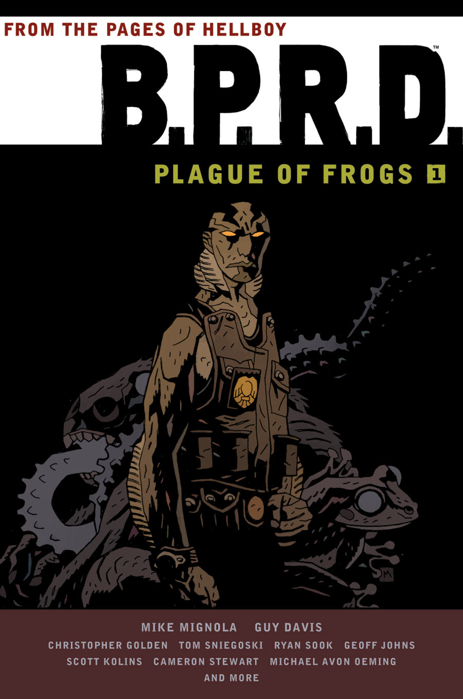MIKE MIGNOLA
January 19, 2011 (HC) October 22, 2014 (TPB)
<ul>
<li>[<em>B.P.R.D.——第1卷：空洞地球及其他故事（B.P.R.D. – Volume 1: Hollow Earth &amp; Other Stories）</em>](/entry/Trade_Collections)</li>
<li>[<em>B.P.R.D.——第2卷：威尼斯之魂及其他故事（B.P.R.D. – Volume 2: The Soul of Venice &amp; Other Stories）</em>](/entry/Trade_Collections)</li>
<li>[<em>B.P.R.D.——第3卷：青蛙瘟疫（B.P.R.D. – Volume 3: Plague of Frogs）</em>](/entry/Trade_Collections)</li>
</ul>

附加内容

<ul>
<li><strong>[斯科特·阿利（Scott Allie）](/entry/Scott_Allie)作序</strong></li>
<li><strong>[迈克·米格诺拉（Mike Mignola）](/entry/Mike_Mignola)后记</strong>（最初发表于<em>B.P.R.D.——第3卷：青蛙瘟疫</em>。在此处出现时有少量改动。）</li>
<li><strong>扩充素描本</strong>
<ul>
<li><em>空洞地球及其他故事（The Hollow Earth and Other Stories）</em> 9页</li>
<li><em>威尼斯之魂及其他故事（The Soul of Venice and Other Stories）</em> 15页</li>
<li><em>青蛙瘟疫（Plague of Frogs）</em> 13页</li>
</ul></li>
</ul>

<em>第2卷（Volume 2）</em>
收录

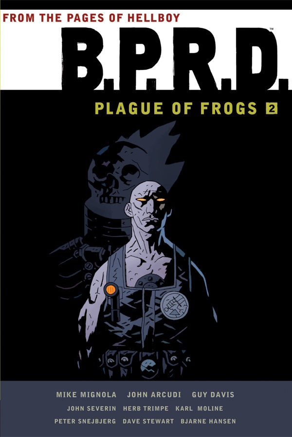MIKE MIGNOLA
August 17, 2011 (HC) January 21, 2015 (TPB)
<ul>
<li>[<em>B.P.R.D.——第4卷：亡者（B.P.R.D. – Volume 4: The Dead）</em>](/entry/Trade_Collections)</li>
<li>[<em>B.P.R.D.——第12卷：青蛙战争（B.P.R.D. – Volume 12: War on Frogs）</em>](/entry/Trade_Collections)</li>
<li>[<em>B.P.R.D.——第5卷：黑色火焰（B.P.R.D. – Volume 5: The Black Flame）</em>](/entry/Trade_Collections)</li>
</ul>

附加内容

<ul>
<li><strong>[斯科特·阿利](/entry/Scott_Allie)作序</strong></li>
<li><strong>[迈克·米格诺拉](/entry/Mike_Mignola)后记</strong>（由<em>B.P.R.D.——第4卷：亡者</em>与<em>B.P.R.D.——第5卷：黑色火焰</em>中的后记拼凑而成，并有少量改动。）</li>
<li><strong>扩充素描本</strong>
<ul>
<li><em>亡者（The Dead）</em> 16页</li>
<li><em>黑色火焰（The Black Flame）</em> 8页</li>
<li><em>青蛙战争（War on Frogs）</em> 6页</li>
</ul></li>
</ul>

补充说明

本卷对故事重新排序以获得更好的阅读顺序，正如[斯科特·阿利](/entry/Scott_Allie)在序言中所解释的：
<ol>
<li><em>[亡者（The Dead）](/entry/The_Dead)</em> #1-5</li>
<li><em>[黑色火焰（The Black Flame）](/entry/The_Black_Flame_%28story%29)</em> #1（改题为<em>青蛙战争：第1章（War on Frogs: Chapter 1）</em>）</li>
<li><em>[青蛙战争（War on Frogs）](/entry/War_on_Frogs)</em> #1（改题为<em>青蛙战争：第2章</em>）</li>
<li><em>[复苏（Revival）](/entry/Revival)</em>（改题为<em>青蛙战争：第3章</em>）</li>
<li><em>[青蛙战争](/entry/War_on_Frogs)</em> #2（改题为<em>青蛙战争：第4章</em>）</li>
<li><em>[青蛙战争](/entry/War_on_Frogs)</em> #4（改题为<em>青蛙战争：第5章</em>）</li>
<li><em>[黑色火焰](/entry/The_Black_Flame_%28story%29)</em> #2–6（改题为<em>黑色火焰：第1–5章</em>）</li>
<li><em>[青蛙战争](/entry/War_on_Frogs)</em> #3（改题为<em>黑色火焰：尾声</em>）</li>
</ol>

<em>第3卷（Volume 3）</em>
收录

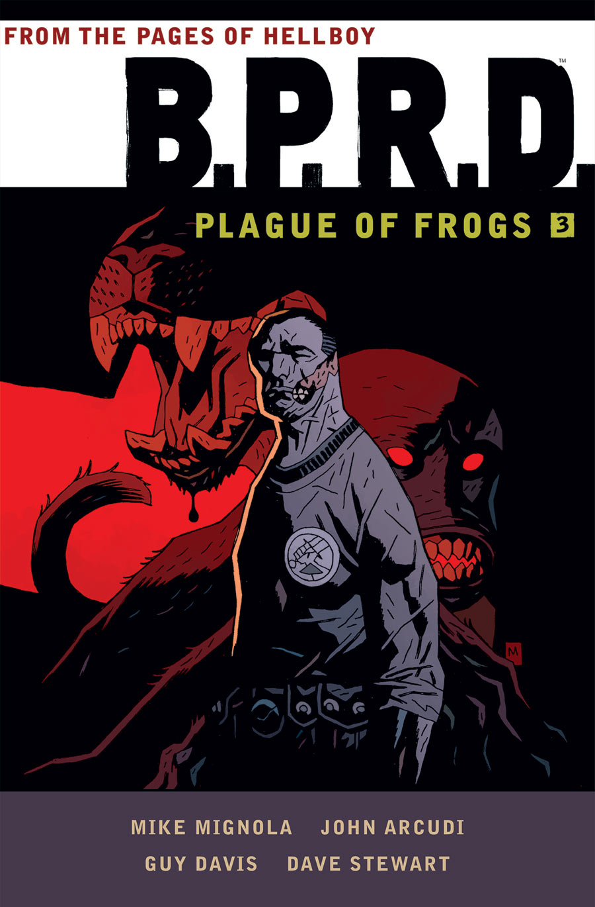MIKE MIGNOLA
March 21, 2012 (HC) March 25, 2015 (TPB)
<ul>
<li>[<em>B.P.R.D.——第6卷：宇宙机器（B.P.R.D. – Volume 6: The Universal Machine）</em>](/entry/Trade_Collections)</li>
<li>[<em>B.P.R.D.——第7卷：灵魂花园（B.P.R.D. – Volume 7: Garden of Souls）</em>](/entry/Trade_Collections)</li>
<li>[<em>B.P.R.D.——第8卷：杀戮之地（B.P.R.D. – Volume 8: Killing Ground）</em>](/entry/Trade_Collections)</li>
</ul>

附加内容

<ul>
<li><strong>[斯科特·阿利](/entry/Scott_Allie)作序</strong></li>
<li><strong>[约翰·阿库迪（John Arcudi）](/entry/John_Arcudi)后记</strong>（最初发表于<em>B.P.R.D.——第8卷：杀戮之地</em>。在此处出现时有少量改动。）</li>
<li><strong>扩充素描本</strong>
<ul>
<li><em>宇宙机器（The Universal Machine）</em> 12页</li>
<li><em>灵魂花园（Garden of Souls）</em> 14页</li>
<li><em>杀戮之地（Killing Ground）</em> 6页</li>
</ul></li>
</ul>

<em>第4卷（Volume 4）</em>
收录

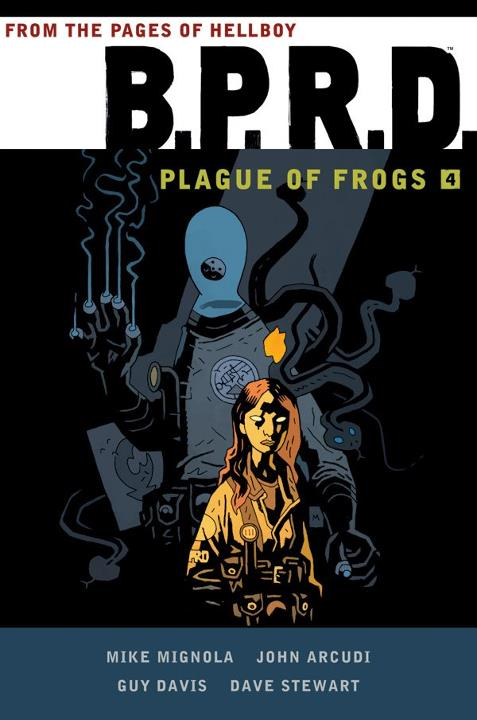MIKE MIGNOLA
November 7, 2012 (HC) May 20, 2015 (TPB)
<ul>
<li>[<em>B.P.R.D.——第10卷：警告（B.P.R.D. – Volume 10: The Warning）</em>](/entry/Trade_Collections)</li>
<li>[<em>B.P.R.D.——第11卷：黑色女神（B.P.R.D. – Volume 11: The Black Goddess）</em>](/entry/Trade_Collections)</li>
<li>[<em>B.P.R.D.——第14卷：恐惧之王（B.P.R.D. – Volume 14: King of Fear）</em>](/entry/Trade_Collections)</li>
</ul>

附加内容

<ul>
<li><strong>[斯科特·阿利](/entry/Scott_Allie)作序</strong></li>
<li><strong>[约翰·阿库迪](/entry/John_Arcudi)后记</strong></li>
<li><strong>扩充素描本</strong>
<ul>
<li><em>警告（The Warning）</em> 6页</li>
<li><em>黑色女神（The Black Goddess）</em> 13页</li>
<li><em>恐惧之王（King of Fear）</em> 29页</li>
</ul></li>
<li><strong>盖伊·戴维斯（Guy Davis）的<em>《来自 Crab Point 的挂钥匙回忆（Latchkey Memories From Crab Point）》</em></strong></li>
</ul>

</tbody>

### *1946–1948*

2014年圣迭戈漫展（San Diego Comic Convention）上公布了一本新合订本的封面。精装版于2015年6月推出。

封面
出版日期
内容

<tbody>

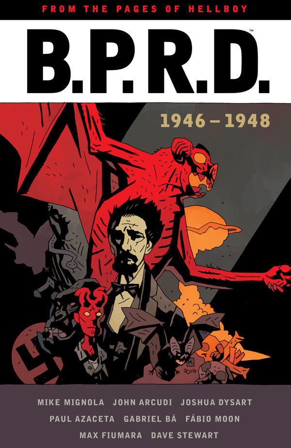MIKE MIGNOLA
June 10, 2015 (HC) February 26, 2020 (TPB)
收录

<ul>
<li>[<em>B.P.R.D.：1946</em>](/entry/Trade_Collections)（原为[<em>B.P.R.D.</em>](/entry/B.P.R.D._%28series%29)第9卷）</li>
<li>[<em>B.P.R.D.：1947</em>](/entry/Trade_Collections)（原为[<em>B.P.R.D.</em>](/entry/B.P.R.D._%28series%29)第13卷）</li>
<li>[<em>B.P.R.D.：1948</em>](/entry/Trade_Collections)</li>
</ul>

附加内容

<ul>
<li><strong>[斯科特·阿利](/entry/Scott_Allie)作序</strong></li>
<li><strong>[克里斯·罗伯森（Chris Roberson）](/entry/Chris_Roberson)后记</strong></li>
<li><strong>扩充素描本</strong>
<ul>
<li><em>1946</em> 9页</li>
<li><em>1947</em> 31页</li>
<li><em>1948</em> 20页</li>
</ul></li>
</ul>

补充说明

本卷将故事按时间顺序重新排列：
<ol>
<li><em>[我在那里会找到什么？（And What Shall I Find There?）](/entry/And_What_Shall_I_Find_There)</em></li>
<li><em>[奥莱克主教的恶魔（Bishop Olek's Devil）](/entry/Bishop_Olek%26)</em></li>
<li><em>[1946](/entry/1946)</em></li>
<li><em>[1947](/entry/1947)</em></li>
<li><em>[1948](/entry/1948)</em></li>
</ol>

</tbody>

### *人间地狱（Hell on Earth）*

五本合订本中的第一本于2017年3月15日在 [Crave Online](http://www.craveonline.com/entertainment/1231813-dark-horse-reveals-mike-mignolas-hellboy-hell-library-edition) 上公布。

封面
出版日期
内容

<tbody>

<em>第1卷（Volume 1）</em>
收录

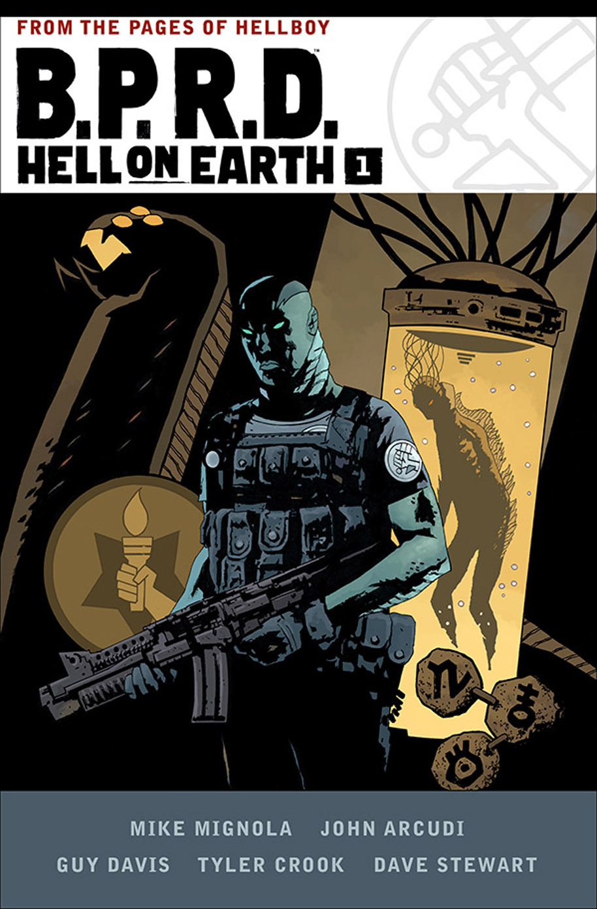LAURENCE CAMPBELL
December 27, 2017 (HC) 
March 24, 2021 (TPB)
<ul>
<li>[<em>B.P.R.D.：人间地狱——第1卷：新世界（B.P.R.D.: Hell on Earth – Volume 1: New World）</em>](/entry/Trade_Collections)</li>
<li>[<em>B.P.R.D.：人间地狱——第2卷：神与怪物（B.P.R.D.: Hell on Earth – Volume 2: Gods and Monsters）</em>](/entry/Trade_Collections)</li>
<li>[<em>B.P.R.D.：人间地狱——第3卷：俄罗斯（B.P.R.D.: Hell on Earth – Volume 3: Russia）</em>](/entry/Trade_Collections)</li>
</ul>

附加内容

<ul>
<li><strong>[约翰·阿库迪](/entry/John_Arcudi)作序</strong></li>
<li><strong>[迈克·米格诺拉](/entry/Mike_Mignola)前言</strong>（最初发表于<em>B.P.R.D.：人间地狱——第1卷：新世界</em>）</li>
<li><strong>扩充素描本</strong>
<ul>
<li><em>新世界（New World）</em> 8页</li>
<li><em>神与怪物（Gods and Monsters）</em> 22页</li>
<li><em>俄罗斯（Russia）</em> 26页</li>
</ul></li>
</ul>

<em>第2卷（Volume 2）</em>
收录

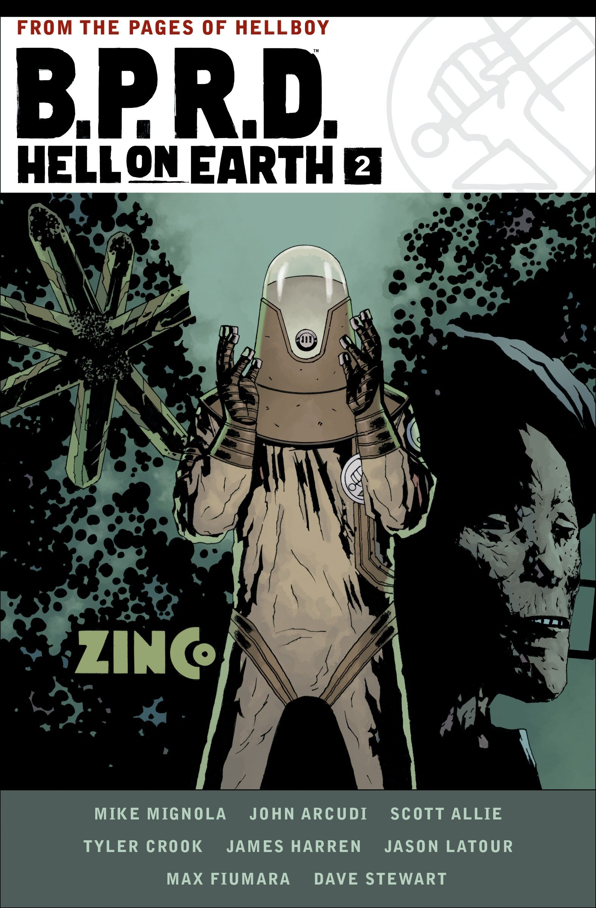LAURENCE CAMPBELL
April 18, 2018 (HC) 
August 1, 2018 (corrected HC) 
August 4, 2021 (TPB)
<ul>
<li>[<em>B.P.R.D.：人间地狱——第4卷：恶魔的引擎与漫长的死亡（B.P.R.D.: Hell on Earth – Volume 4: The Devil's Engine &amp; The Long Death）</em>](/entry/Trade_Collections)</li>
<li>[<em>B.P.R.D.：人间地狱——第5卷：皮肯斯郡恐怖事件及其他（B.P.R.D.: Hell on Earth – Volume 5: The Pickens County Horror &amp; Others）</em>](/entry/Trade_Collections)</li>
<li>[<em>B.P.R.D.：人间地狱——第6卷：主人归来（B.P.R.D.: Hell on Earth – Volume 6: The Return of the Master）</em>](/entry/Trade_Collections)</li>
</ul>

附加内容

<ul>
<li><strong>[斯科特·阿利](/entry/Scott_Allie)作序</strong></li>
<li><strong>扩充素描本</strong>
<ul>
<li><em>恶魔的引擎与漫长的死亡（The Devil's Engine &amp; The Long Death）</em> 24页</li>
<li><em>皮肯斯郡恐怖事件及其他（The Pickens County Horror &amp; Others）</em> 30页</li>
<li><em>主人归来（The Return of the Master）</em> 33页</li>
<li>平装本封面 3页</li>
</ul></li>
</ul>

补充说明

最初的印次有一处错误：<em>漫长的死亡（The Long Death）</em>缺失了最后一页。修正后的印次于2018年8月1日发行。

<em>第3卷（Volume 3）</em>
收录

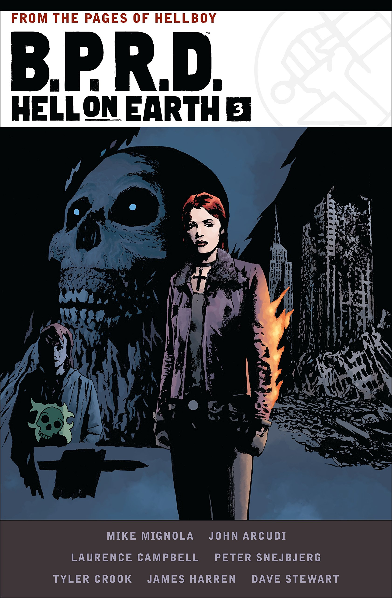LAURENCE CAMPBELL
October 24, 2018 (HC) 
December 1, 2021 (TPB)
<ul>
<li>[<em>B.P.R.D.：人间地狱——第7卷：地狱里的寒日（B.P.R.D.: Hell on Earth – Volume 7: A Cold Day in Hell）</em>](/entry/Trade_Collections)</li>
<li>[<em>B.P.R.D.：人间地狱——第8卷：火湖（B.P.R.D.: Hell on Earth – Volume 8: Lake of Fire）</em>](/entry/Trade_Collections)</li>
<li>[<em>B.P.R.D.：人间地狱——第9卷：黑色火焰的统治（B.P.R.D.: Hell on Earth – Volume 9: The Reign of the Black Flame）</em>](/entry/Trade_Collections)</li>
</ul>

附加内容

<ul>
<li><strong>[斯科特·阿利](/entry/Scott_Allie)作序</strong></li>
<li><strong>扩充素描本</strong>
<ul>
<li><em>地狱里的寒日（A Cold Day in Hell）</em> 16页</li>
<li><em>火湖（Lake of Fire）</em> 18页</li>
<li><em>黑色火焰的统治（The Reign of the Black Flame）</em> 17页</li>
<li>平装本封面 3页</li>
</ul></li>
</ul>

<em>第4卷（Volume 4）</em>
收录

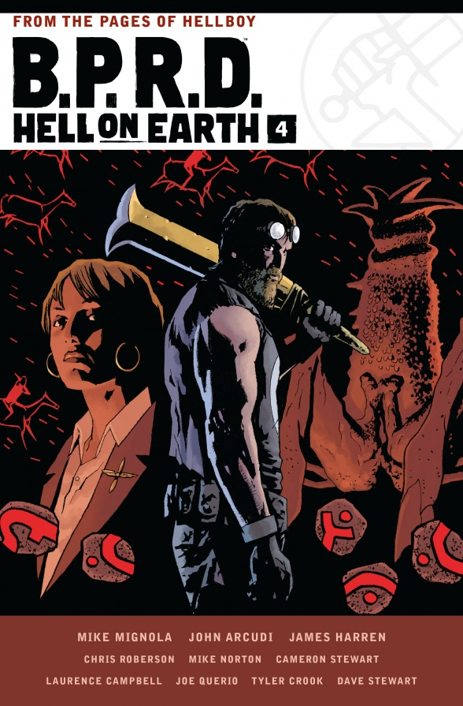LAURENCE CAMPBELL
January 2, 2019 (HC) 
March 23, 2022 (TPB)
<ul>
<li>[<em>B.P.R.D.：人间地狱——第10卷：恶魔之翼（B.P.R.D.: Hell on Earth – Volume 10: The Devil's Wings）</em>](/entry/Trade_Collections)</li>
<li>[<em>B.P.R.D.：人间地狱——第11卷：血肉与石头（B.P.R.D.: Hell on Earth – Volume 11: Flesh and Stone）</em>](/entry/Trade_Collections)</li>
<li>[<em>B.P.R.D.：人间地狱——第14卷：驱魔人（B.P.R.D.: Hell on Earth – Volume 14: The Exorcist）</em>](/entry/Trade_Collections)</li>
</ul>

附加内容

<ul>
<li><strong>[斯科特·阿利](/entry/Scott_Allie)作序</strong></li>
<li><strong>扩充素描本</strong>
<ul>
<li><em>恶魔之翼（The Devil's Wings）</em> 22页</li>
<li><em>血肉与石头（Flesh and Stone）</em> 17页</li>
<li><em>驱魔人（The Exorcist）</em> 10页</li>
<li>平装本封面 3页</li>
</ul></li>
</ul>

<em>第5卷（Volume 5）</em>
收录

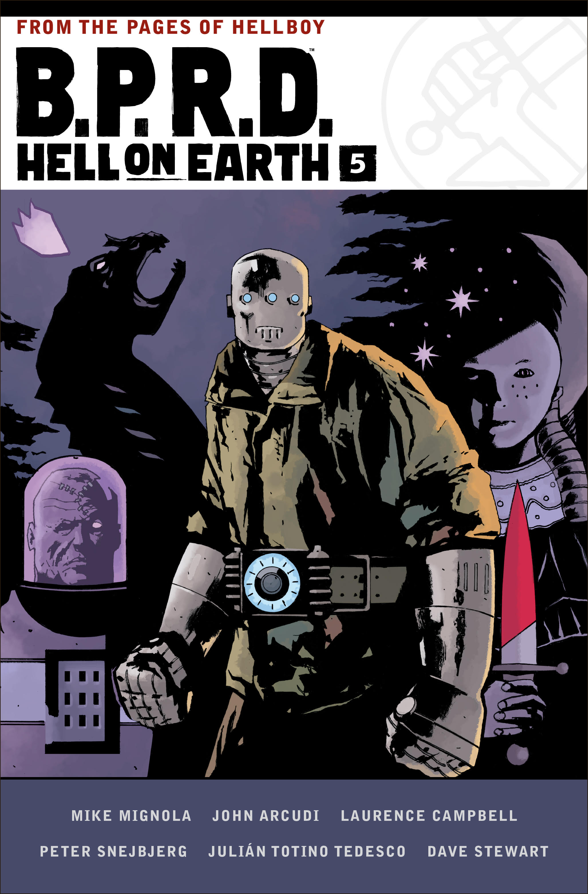LAURENCE CAMPBELL
March 20, 2019 (HC) 
September 7, 2022 (TPB)
<ul>
<li>[<em>B.P.R.D.：人间地狱——第12卷：变形（B.P.R.D.: Hell on Earth – Volume 12: Metamorphosis）</em>](/entry/Trade_Collections)</li>
<li>[<em>B.P.R.D.：人间地狱——第13卷：末日（B.P.R.D.: Hell on Earth – Volume 13: End of Days）</em>](/entry/Trade_Collections)</li>
<li>[<em>B.P.R.D.：人间地狱——第15卷：时辰将至（B.P.R.D.: Hell on Earth – Volume 15: Cometh the Hour）</em>](/entry/Trade_Collections)</li>
</ul>

附加内容

<ul>
<li><strong>[约翰·阿库迪](/entry/John_Arcudi)作序</strong></li>
<li><strong>扩充素描本</strong>
<ul>
<li><em>变形（Metamorphosis）</em> 13页1</li>
<li><em>末日（End of Days）</em> 11页</li>
<li><em>时辰将至（Cometh the Hour）</em> 14页</li>
<li>平装本封面 3页</li>
</ul></li>
</ul>

</tbody>

**1** 这份素描本比原版平装本短五页。两页被压缩为一页，五页被删去，并新增了一页。

### *你所知的恶魔（The Devil You Know）*

Horror DNA 于2020年1月22日公布了一本收录《你所知的恶魔》的合订本。[2]

封面
出版日期
内容

<tbody>

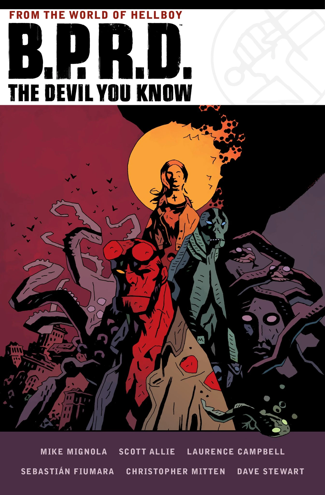MIKE MIGNOLA
March 10, 2021 (HC) 
May 25, 2022 (TPB)
收录

<ul>
<li>[<em>B.P.R.D.：你所知的恶魔——第1卷：弥赛亚（B.P.R.D.: The Devil You Know – Volume 1: Messiah）</em>](/entry/Trade_Collections)</li>
<li>[<em>B.P.R.D.：你所知的恶魔——第2卷：万魔殿（B.P.R.D.: The Devil You Know – Volume 2: Pandemonium）</em>](/entry/Trade_Collections)</li>
<li>[<em>B.P.R.D.：你所知的恶魔——第3卷：拉格纳洛克（B.P.R.D.: The Devil You Know – Volume 3: Ragna Rok）</em>](/entry/Trade_Collections)</li>
</ul>

附加内容

<ul>
<li><strong>[劳伦斯·坎贝尔（Laurence Campbell）](/entry/Laurence_Campbell)作序</strong></li>
<li><strong>[迈克·米格诺拉](/entry/Mike_Mignola)后记</strong>（取自<em>B.P.R.D.：你所知的恶魔</em> #15）</li>
<li><strong>扩充素描本</strong>
<ul>
<li><em>弥赛亚（Messiah）</em> 10页</li>
<li><em>万魔殿（Pandemonium）</em> 18页</li>
<li><em>拉格纳洛克（Ragna Rok）</em> 13页1</li>
<li>平装本封面 3页</li>
</ul></li>
</ul>

</tbody>

**1** 虽然这比原版平装本素描本少一页，但没有删去任何材料；只是进行了压缩。

### 品牌重塑（Rebranding）

2022年，黑马漫画对《B.P.R.D.：青蛙瘟疫》《B.P.R.D.：人间地狱》和《B.P.R.D.：你所知的恶魔》的合订本进行了品牌重塑，去掉了周期标题。这些版本采用了新封面。

封面
出版日期
最初出版名

<tbody>

<em>B.P.R.D.合订本 第1卷（B.P.R.D. Omnibus Volume 1）</em>

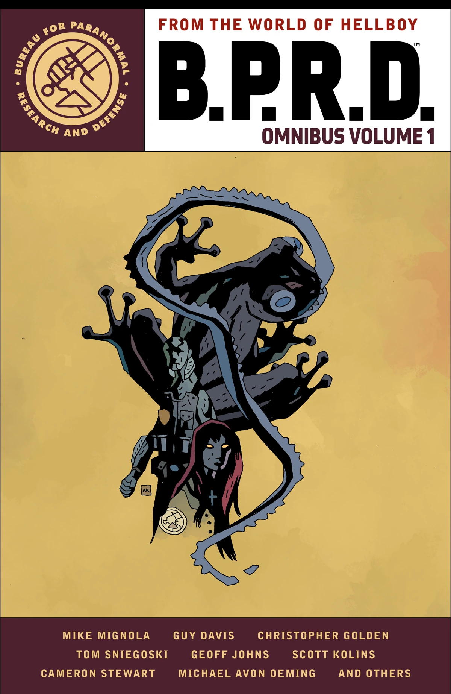MIKE MIGNOLA
September 14, 2022 (TPB)
<em>B.P.R.D.：青蛙瘟疫——第1卷</em> 
（不包括<em>[我头颅中的杀手（The Killer in My Skull）](/entry/The_Killer_in_My_Skull)</em>，该篇被重新收录于[《龙虾人约翰逊》合订本](/entry/Omnibus_Editions)中）

<em>B.P.R.D.合订本 第2卷（B.P.R.D. Omnibus Volume 2）</em>

MIKE MIGNOLA
November 2, 2022 (TPB)
<em>B.P.R.D.：青蛙瘟疫——第2卷</em>

<em>B.P.R.D.合订本 第3卷（B.P.R.D. Omnibus Volume 3）</em>

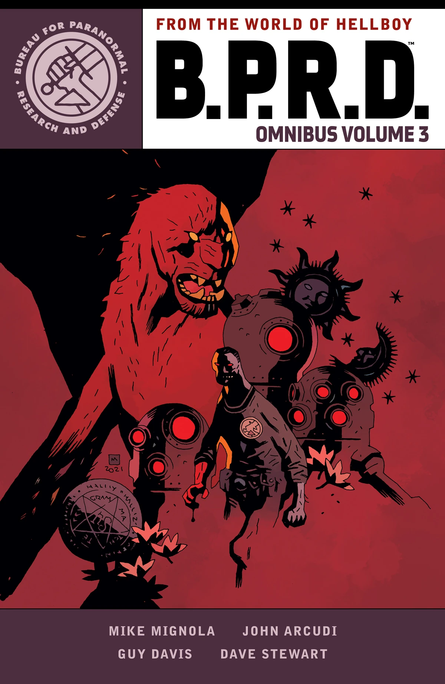MIKE MIGNOLA
December 21, 2022 (TPB)
<em>B.P.R.D.：青蛙瘟疫——第3卷</em>

<em>B.P.R.D.合订本 第4卷（B.P.R.D. Omnibus Volume 4）</em>

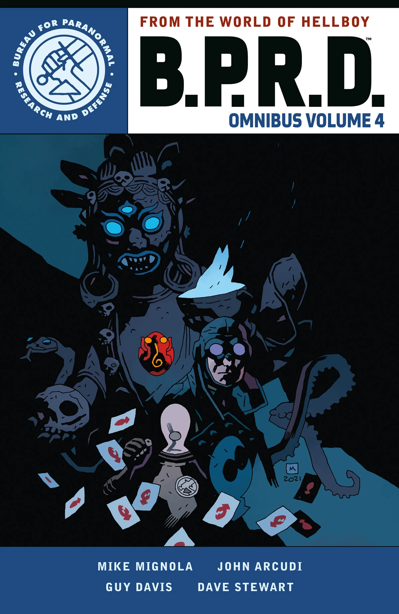MIKE MIGNOLA
February 22, 2023 (TPB)
<em>B.P.R.D.：青蛙瘟疫——第4卷</em>

<em>B.P.R.D.合订本 第5卷（B.P.R.D. Omnibus Volume 5）</em>

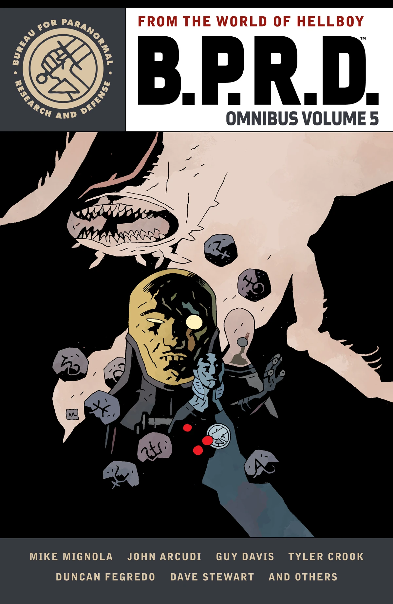MIKE MIGNOLA
April 19, 2023 (TPB)
<em>B.P.R.D.：人间地狱——第1卷</em>

<em>B.P.R.D.合订本 第6卷（B.P.R.D. Omnibus Volume 6）</em>

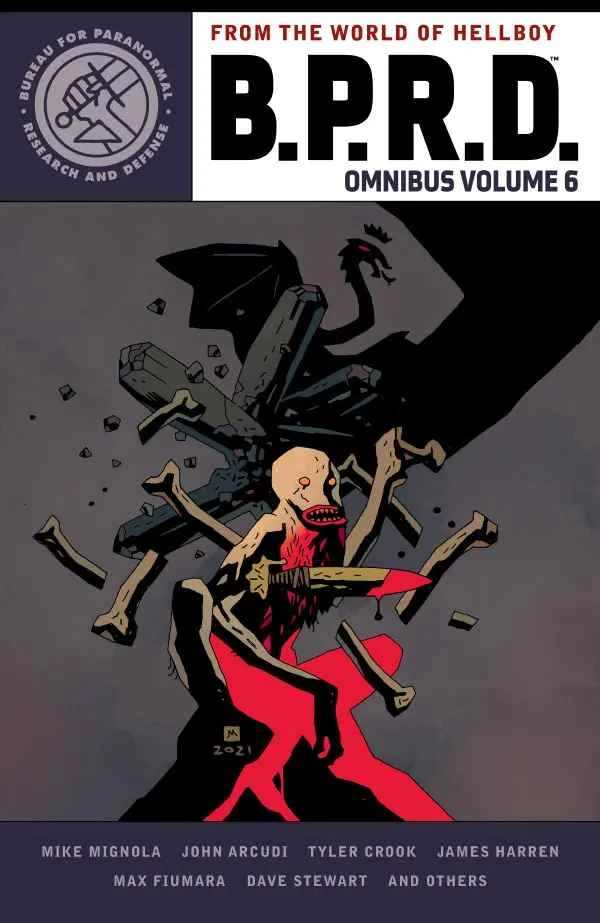MIKE MIGNOLA
August 1, 2023 (TPB)
<em>B.P.R.D.：人间地狱——第2卷</em>

<em>B.P.R.D.合订本 第7卷（B.P.R.D. Omnibus Volume 7）</em>

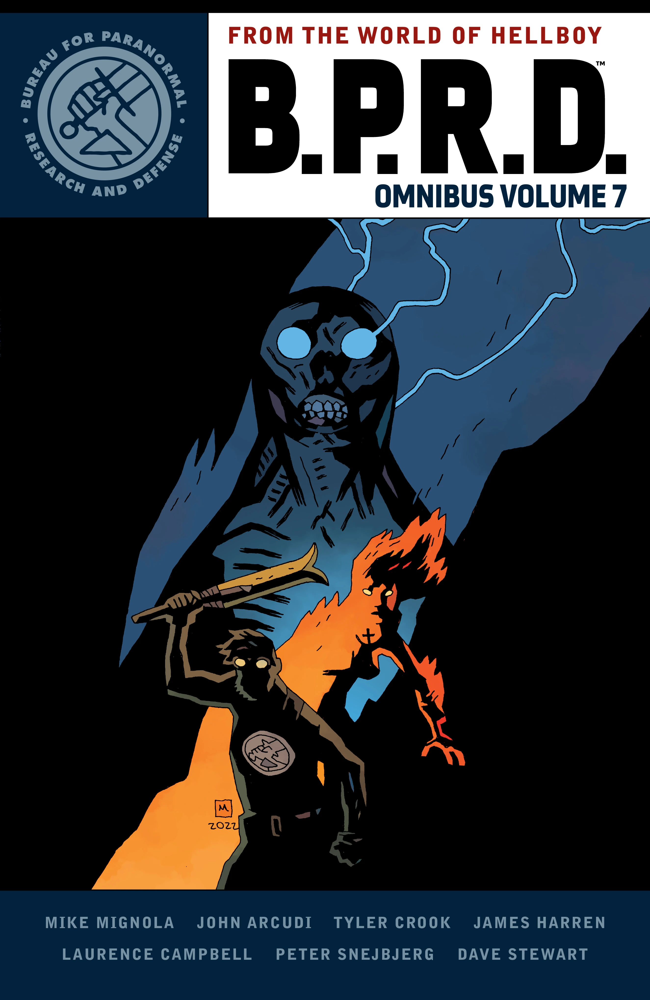MIKE MIGNOLA
October 3, 2023 (TPB)
<em>B.P.R.D.：人间地狱——第3卷</em>

<em>B.P.R.D.合订本 第8卷（B.P.R.D. Omnibus Volume 8）</em>

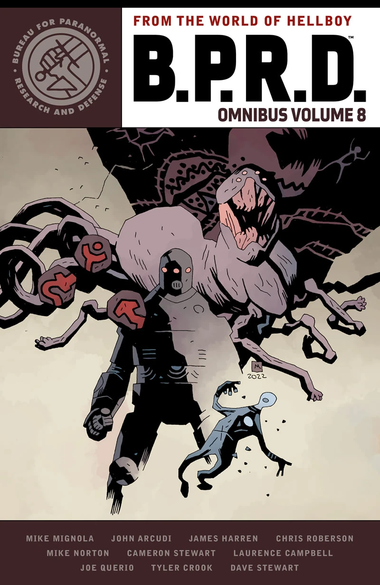MIKE MIGNOLA
November 14, 2023 (TPB)
<em>B.P.R.D.：人间地狱——第4卷</em>

<em>B.P.R.D.合订本 第9卷（B.P.R.D. Omnibus Volume 9）</em>

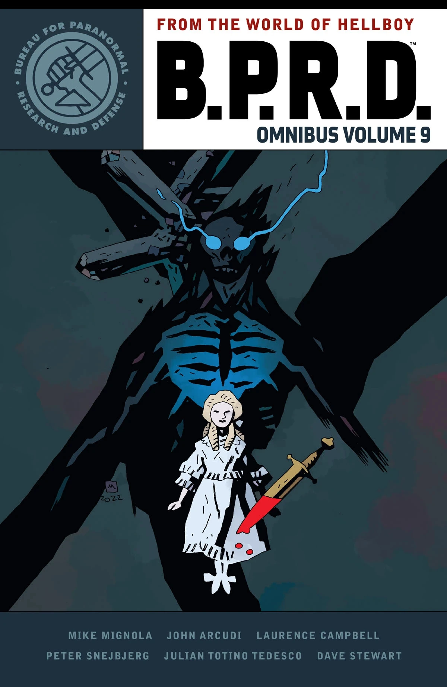MIKE MIGNOLA
January 2, 2024 (TPB)
<em>B.P.R.D.：人间地狱——第5卷</em>

<em>B.P.R.D.合订本 第10卷（B.P.R.D. Omnibus Volume 10）</em>

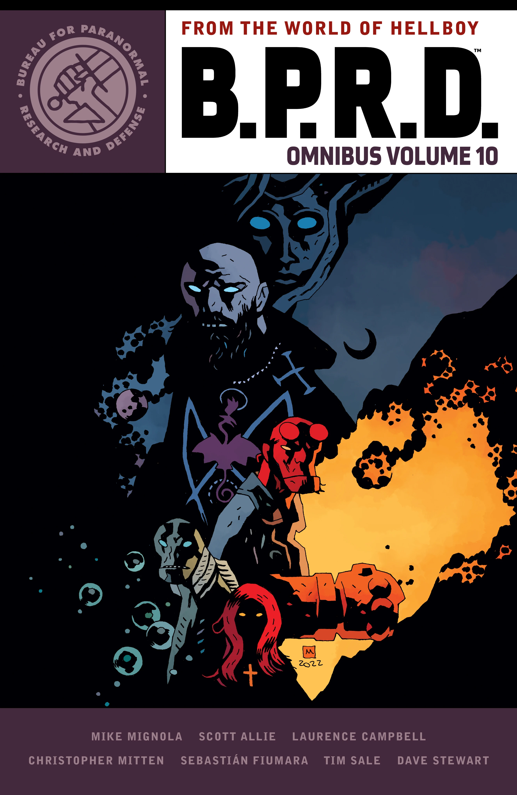MIKE MIGNOLA
March 5, 2024 (TPB)
<em>B.P.R.D.：你所知的恶魔</em>

</tbody>

## *亚伯·塞皮恩（Abe Sapien）*

两本《黑暗而可怖（Dark and Terrible）》合订本于2017年4月12日在 [Freak Sugar](http://www.freaksugar.com/abe-sapien-dark-and-terrible-hardcovers-covers-first-look-dark-horse-max-fiumara/) 上公布。此后2018年又推出了第三本合订本，收录《*[亚伯·塞皮恩](/entry/Abe_Sapien_%28series%29)*》中所有的闪回材料。

封面
出版日期
内容

<tbody>

<em>黑暗而可怖——第1卷（Dark and Terrible – Volume 1）</em>
收录

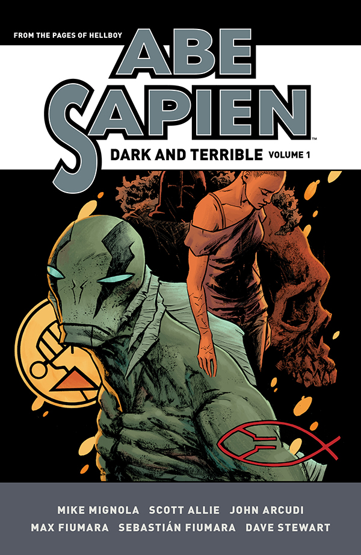SEBASTIÁN FIUMARA
November 8, 2017 (HC) 
November 16, 2022 (TPB)
<ul>
<li>[<em>亚伯·塞皮恩——第3卷：黑暗而可怖，以及人类新种族（Abe Sapien – Volume 3: Dark and Terrible and The New Race of Man）</em>](/entry/Trade_Collections)</li>
<li>[<em>亚伯·塞皮恩——第4卷：未来之事的形状（Abe Sapien – Volume 4: The Shape of Things to Come）</em>](/entry/Trade_Collections)</li>
<li>[<em>亚伯·塞皮恩——第5卷：神圣之地（Abe Sapien – Volume 5: Sacred Places）</em>](/entry/Trade_Collections)</li>
</ul>

附加内容

<ul>
<li><strong>[斯科特·阿利](/entry/Scott_Allie)作序</strong></li>
<li><strong>扩充素描本</strong>
<ul>
<li><em>黑暗而可怖，以及人类新种族（Dark and Terrible and The New Race of Man）</em> 30页</li>
<li><em>未来之事的形状（The Shape of Things to Come）</em> 17页</li>
<li><em>神圣之地（Sacred Places）</em> 33页</li>
</ul></li>
</ul>

<em>黑暗而可怖——第2卷（Dark and Terrible – Volume 2）</em>
收录

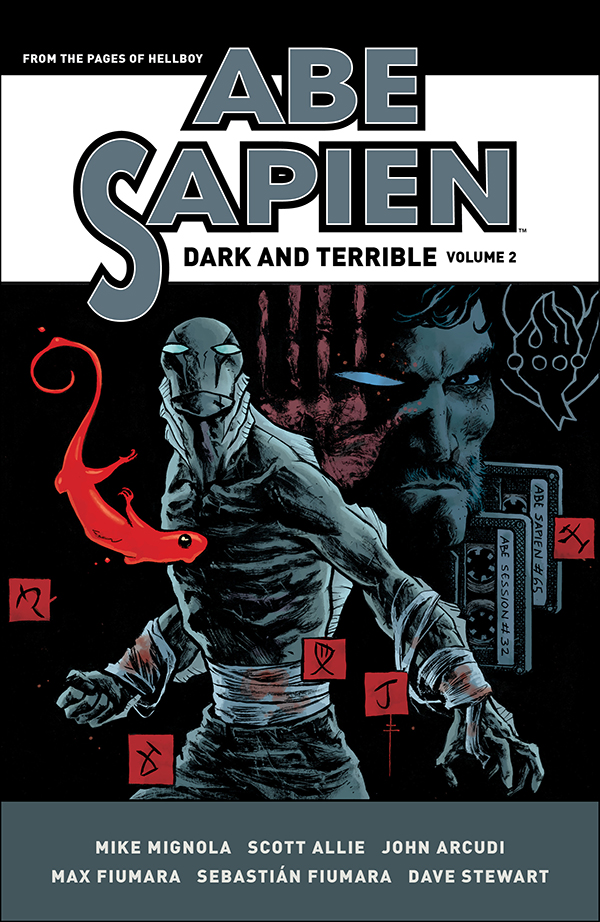SEBASTIÁN FIUMARA
March 21, 2018 (HC) 
April 12, 2022 (TPB)
<ul>
<li>[<em>亚伯·塞皮恩——第6卷：如此巨大的黑暗（Abe Sapien – Volume 6: A Darkness so Great）</em>](/entry/Trade_Collections)</li>
<li>[<em>亚伯·塞皮恩——第7卷：秘火（Abe Sapien – Volume 7: The Secret Fire）</em>](/entry/Trade_Collections)</li>
<li>[<em>亚伯·塞皮恩——第8卷：荒凉之岸（Abe Sapien – Volume 8: The Desolate Shore）</em>](/entry/Trade_Collections)</li>
</ul>

附加内容

<ul>
<li><strong>[斯科特·阿利](/entry/Scott_Allie)作序</strong></li>
<li><strong>[斯科特·阿利](/entry/Scott_Allie)后记</strong>（最初发表于<em>亚伯·塞皮恩——第8卷：荒凉之岸</em>。）</li>
<li><strong>扩充素描本</strong>
<ul>
<li><em>如此巨大的黑暗（A Darkness so Great）</em> 17页</li>
<li><em>秘火（The Secret Fire）</em> 26页</li>
<li><em>荒凉之岸（The Desolate Shore）</em> 17页</li>
<li>委托画作 9页</li>
</ul></li>
</ul>

<em>沉沦及其他故事（The Drowning and Other Stories）</em>
收录

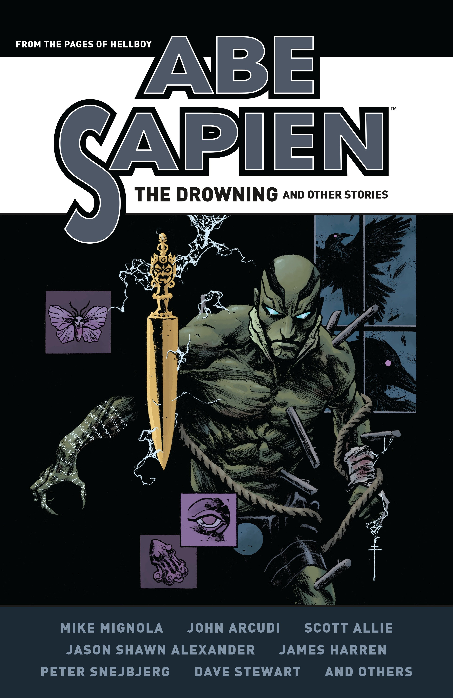SEBASTIÁN FIUMARA
July 11, 2018 (HC) 
August 1, 2023 (TPB)
<ul>
<li>[<em>亚伯·塞皮恩——第1卷：沉沦（Abe Sapien – Volume 1: The Drowning）</em>](/entry/Trade_Collections)</li>
<li>[<em>亚伯·塞皮恩——第2卷：恶魔不开玩笑及其他故事（Abe Sapien – Volume 2: The Devil Does Not Jest and Other Stories）</em>](/entry/Trade_Collections)</li>
<li>[<em>亚伯·塞皮恩——第9卷：逝去的生命及其他故事（Abe Sapien – Volume 9: Lost Lives and Other Stories）</em>](/entry/Trade_Collections)</li>
<li><em>[伤亡者（Casualties）](/entry/Casualties)</em></li>
<li><em>[暴风雨前的宁静（The Calm Before the Storm）](/entry/The_Calm_Before_the_Storm)</em>（在素描本中）</li>
</ul>

附加内容

<ul>
<li><strong>[斯科特·阿利](/entry/Scott_Allie)作序</strong></li>
<li><strong>扩充素描本</strong>
<ul>
<li><em>沉沦（The Drowning）</em> 8页</li>
<li><em>恶魔不开玩笑及其他故事（The Devil Does Not Jest and Other Stories）</em> 20页</li>
<li><em>逝去的生命及其他故事（Lost Lives and Other Stories）</em> 12页</li>
<li>封面 9页</li>
</ul></li>
</ul>

补充说明

本卷对故事重新排序以获得更好的阅读顺序，正如[斯科特·阿利](/entry/Scott_Allie)在序言中所解释的：
<ol>
<li><em>[沉沦（The Drowning）](/entry/The_Drowning)</em></li>
<li><em>[伤亡者（Casualties）](/entry/Casualties)</em></li>
<li><em>[闹鬼男孩（The Haunted Boy）](/entry/The_Haunted_Boy)</em></li>
<li><em>[亡者之地（The Land of the Dead）](/entry/The_Land_of_the_Dead)</em></li>
<li><em>[巫术与恶魔学（Witchcraft &amp; Demonology）](/entry/Witchcraft_%26amp%3B_Demonology)</em></li>
<li><em>[深渊平原（The Abyssal Plain）](/entry/The_Abyssal_Plain)</em></li>
<li><em>[恶魔不开玩笑（The Devil Does Not Jest）](/entry/The_Devil_Does_Not_Jest)</em></li>
<li><em>[奥戈波戈（The Ogopogo）](/entry/The_Ogopogo)</em></li>
<li><em>[潜意识（Subconscious）](/entry/Subconscious)</em></li>
<li><em>[逝去的生命（Lost Lives）](/entry/Lost_Lives)</em></li>
<li><em>[鱼人（Icthyo Sapien）](/entry/Icthyo_Sapien)</em>（为合订本扩充）</li>
<li><em>[暴风雨前的宁静](/entry/The_Calm_Before_the_Storm)</em>（在素描本中）</li>
</ol>

</tbody>

## *地狱男爵（Hellboy）*

《地狱男爵》通过一系列合订本结集，其中四卷按1994年以后的主线故事推进，另有两卷收录1940年代至1993年的短篇闪回故事。这六本合订本将是平装版本。

《地狱男爵》合订本收录平装本[《地狱男爵：第1–12卷》（Hellboy: Volumes 1–12）](/entry/Trade_Collections)、[《地狱男爵在地狱：第1–2卷》（Hellboy in Hell: Volumes 1–2）](/entry/Trade_Collections)、[《地狱男爵在墨西哥》（Hellboy in Mexico）](/entry/Trade_Collections)、原创图像小说[《地狱男爵：午夜马戏团》（Hellboy: The Midnight Circus）](/entry/Trade_Collections)、[《地狱男爵：驶入寂静之海》（Hellboy: Into the Silent Sea）](/entry/Trade_Collections)，以及单篇故事*[生而为人（Being Human）](/entry/Being_Human)*，它出自[《B.P.R.D.：生而为人》（B.P.R.D.: Being Human）](/entry/Trade_Collections)。

封面
出版日期
内容

<tbody>

<em>第1卷：毁灭之种（Volume 1: Seed of Destruction）</em>
收录

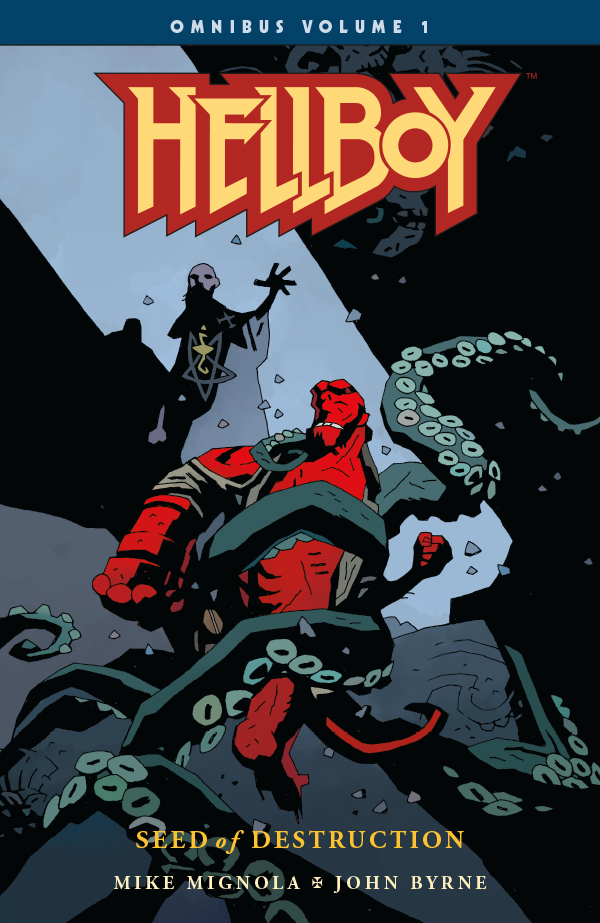MIKE MIGNOLA
May 9, 2018 (TPB)
<ul>
<li><em>[毁灭之种（Seed of Destruction）](/entry/Seed_of_Destruction)</em></li>
<li><em>[圣奥古斯丁之狼（The Wolves of Saint August）](/entry/The_Wolves_of_Saint_August)</em></li>
<li><em>[被锁链的棺材（The Chained Coffin）](/entry/The_Chained_Coffin)</em></li>
<li><em>[唤醒恶魔（Wake the Devil）](/entry/Wake_the_Devil)</em></li>
<li><em>[近乎巨像（Almost Colossus）](/entry/Almost_Colossus)</em></li>
<li>[1993年宣传漫画（1993 Promotional Comic）](/entry/World%26)</li>
<li>[1994年宣传漫画（1994 Promotional Comic）](/entry/World%26)</li>
</ul>

附加内容

<ul>
<li><strong>素描本</strong>（17页）</li>
</ul>

<em>第2卷：诡异之地（Volume 2: Strange Places）</em>
收录

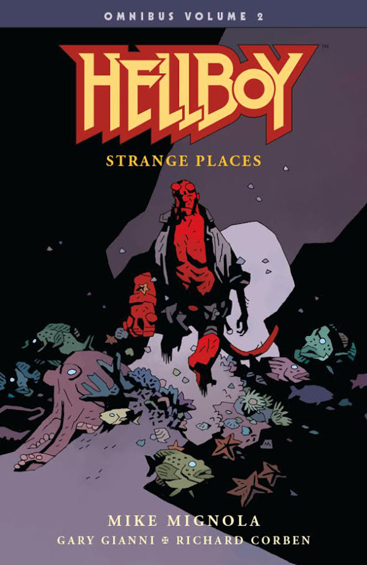MIKE MIGNOLA
June 20, 2018 (TPB)
<ul>
<li><em>[末日右手（The Right Hand of Doom）](/entry/The_Right_Hand_of_Doom)</em></li>
<li><em>[装满邪恶的盒子（Box Full of Evil）](/entry/Box_Full_of_Evil)</em></li>
<li><em>[生而为人（Being Human）](/entry/Being_Human)</em></li>
<li><em>[征服者蠕虫（Conqueror Worm）](/entry/Conqueror_Worm)</em></li>
<li><em>[第三个愿望（The Third Wish）](/entry/The_Third_Wish)</em></li>
<li><em>[岛屿（The Island）](/entry/The_Island)</em></li>
<li><em>[驶入寂静之海（Into the Silent Sea）](/entry/Into_the_Silent_Sea)</em></li>
</ul>

附加内容

<ul>
<li><strong>素描本</strong>（13页）</li>
</ul>

<em>第3卷：狂猎（Volume 3: The Wild Hunt）</em>
收录

MIKE MIGNOLA
July 18, 2018 (TPB)
<ul>
<li><em>[鼹鼠（The Mole）](/entry/The_Mole)</em></li>
<li><em>[黑暗在召唤（Darkness Calls）](/entry/Darkness_Calls)</em></li>
<li><em>[狂猎（The Wild Hunt）](/entry/The_Wild_Hunt)</em></li>
<li><em>[风暴（The Storm）](/entry/The_Storm)与[狂怒（the Fury）](/entry/The_Fury)</em></li>
</ul>

附加内容

<ul>
<li><strong>素描本</strong>（9页）</li>
</ul>

<em>第4卷：地狱男爵在地狱（Volume 4: Hellboy in Hell）</em>
收录

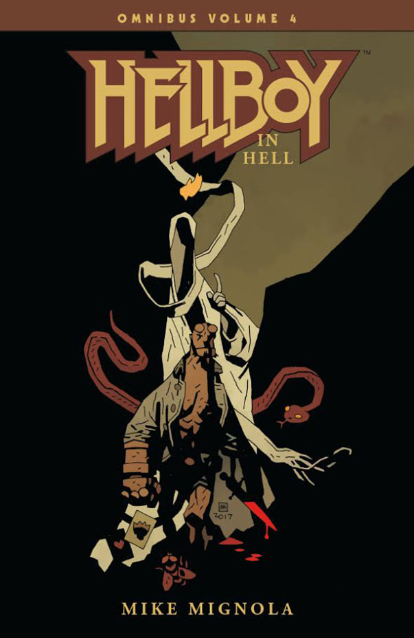MIKE MIGNOLA
September 5, 2018 (TPB)
<ul>
<li><em>[坠落（The Descent）](/entry/Hellboy_in_Hell_%28first_story_arc%29)</em></li>
<li><em>[万魔殿（Pandemonium）](/entry/Hellboy_in_Hell_%28first_story_arc%29)</em></li>
<li><em>[家族羁绊（Family Ties）](/entry/Hellboy_in_Hell_%28first_story_arc%29)</em></li>
<li><em>[骑象的死神（Death Riding an Elephant）](/entry/Hellboy_in_Hell_%28first_story_arc%29)</em></li>
<li><em>[三条金鞭（The Three Gold Whips）](/entry/The_Three_Gold_Whips)</em></li>
<li><em>[死亡牌（The Death Card）](/entry/The_Death_Card)<strong>1</strong></em></li>
<li><em>[霍夫曼博士的审判（The Trials of Dr. Hoffmann）](/entry/The_Hounds_of_Pluto)</em></li>
<li><em>[冥王星的猎犬（The Hounds of Pluto）](/entry/The_Hounds_of_Pluto)</em></li>
<li><em>[西班牙新娘（The Spanish Bride）](/entry/The_Spanish_Bride)</em></li>
<li><em>[丧钟为谁而鸣（For Whom the Bell Tolls）](/entry/For_Whom_the_Bell_Tolls)</em></li>
<li><em>[魔术师与蛇（The Magician and the Snake）](/entry/The_Magician_and_the_Snake)</em></li>
<li><em>[沃尔斯克的驱魔人（The Exorcist of Vorsk）](/entry/The_Exorcist_of_Vorsk)</em></li>
</ul>

附加内容

<ul>
<li><strong>素描本</strong>（24页）</li>
</ul>

<em>地狱男爵合订本盒装套装（Hellboy Omnibus Boxed Set）</em>

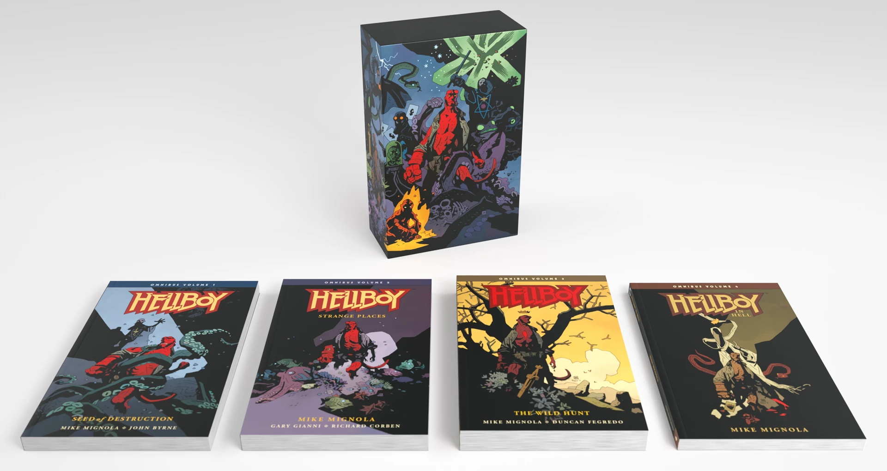 
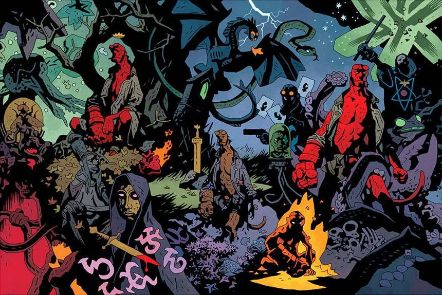MIKE MIGNOLA

出版日期
内容

October 13, 2021
<ul>
<li><em>地狱男爵合订本——第1卷：毁灭之种（Hellboy Omnibus – Volume 1: Seed of Destruction）</em></li>
<li><em>地狱男爵合订本——第2卷：诡异之地（Hellboy Omnibus – Volume 2: Strange Places）</em></li>
<li><em>地狱男爵合订本——第3卷：狂猎（Hellboy Omnibus – Volume 3: The Wild Hunt）</em></li>
<li><em>地狱男爵合订本——第4卷：地狱男爵在地狱（Hellboy Omnibus – Volume 4: Hellboy in Hell）</em></li>
</ul>

</tbody>

**1** 平装本合集中回顾此前各期的序章未被收录。

### *完整短篇故事集（The Complete Short Stories）*

封面
出版日期
内容

<tbody>

<em>第1卷（Volume 1）</em>
收录

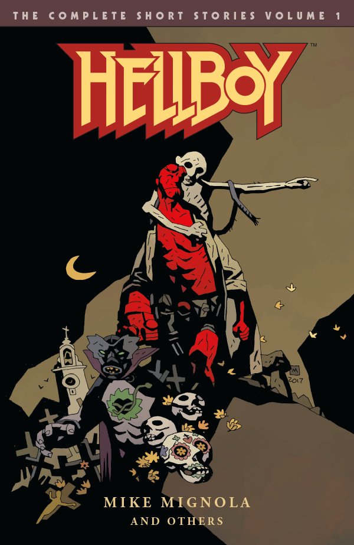MIKE MIGNOLA
June 13, 2018 (TPB)
<ul>
<li><em>[煎饼（Pancakes）](/entry/Pancakes)</em></li>
<li><em>[午夜马戏团（The Midnight Circus）](/entry/The_Midnight_Circus)</em></li>
<li><em>[野兽的本性（The Nature of the Beast）](/entry/The_Nature_of_the_Beast)</em></li>
<li><em>[沃尔德王（King Vold）](/entry/King_Vold)</em></li>
<li><em>[地狱男爵在墨西哥（Hellboy in Mexico）](/entry/Hellboy_in_Mexico)</em></li>
<li><em>[地狱男爵大战阿兹特克木乃伊（Hellboy versus the Aztec Mummy）](/entry/Hellboy_versus_the_Aztec_Mummy)</em></li>
<li><em>[地狱男爵结婚（Hellboy Gets Married）](/entry/Hellboy_Gets_Married)</em></li>
<li><em>[棺材人（The Coffin Man）](/entry/The_Coffin_Man)</em></li>
<li><em>[棺材人2：再战（The Coffin Man 2: The Rematch）](/entry/The_Coffin_Man_2__The_Rematch)</em></li>
<li><em>[活死人之屋（House of the Living Dead）](/entry/House_of_the_Living_Dead)</em></li>
<li><em>[歪男人（The Crooked Man）](/entry/The_Crooked_Man_%28comic_story%29)</em></li>
<li><em>[飞头女鬼（The Penanggalan）](/entry/The_Penanggalan)</em></li>
<li><em>[尸体（The Corpse）](/entry/The_Corpse)</em></li>
<li><em>[邪恶双片连映（Double Feature of Evil）](/entry/Double_Feature_of_Evil)</em></li>
<li><em>[铁鞋（The Iron Shoes）](/entry/The_Iron_Shoes)</em></li>
</ul>

附加内容

<ul>
<li><strong>素描本</strong>（23页）</li>
</ul>

<em>第2卷（Volume 2）</em>
收录

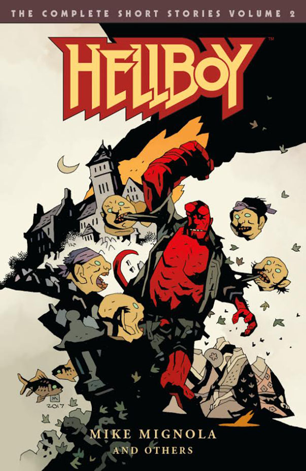MIKE MIGNOLA
August 15, 2018 (TPB)
<ul>
<li><em>[九头蛇与狮子（The Hydra and the Lion）](/entry/The_Hydra_and_the_Lion)</em></li>
<li><em>[巨魔女巫（The Troll-witch）](/entry/The_Troll_Witch)</em></li>
<li><em>[芭芭·雅加（The Baba Yaga）](/entry/The_Baba_Yaga)</em></li>
<li><em>[沉睡者与亡者（The Sleeping and the Dead）](/entry/The_Sleeping_and_the_Dead)</em></li>
<li><em>[头颅（Heads）](/entry/Heads)</em></li>
<li><em>[再见，托德先生（Goodbye Mister Tod）](/entry/Goodbye_Mister_Tod)</em></li>
<li><em>[布拉格吸血鬼（The Vampire of Prague）](/entry/The_Vampire_of_Prague)</em></li>
<li><em>[沃尔科拉克（The Vârcolac）](/entry/The_V%C3%A2rcolac)</em></li>
<li><em>[地狱新娘（The Bride of Hell）](/entry/The_Bride_of_Hell)</em></li>
<li><em>[惠蒂尔的遗产（The Whittier Legacy）](/entry/The_Whittier_Legacy)</em></li>
<li><em>[巴斯特·奥克利如愿以偿（Buster Oakley Gets His Wish）](/entry/Buster_Oakley_Gets_His_Wish)</em></li>
<li><em>[乘船下海者（They That Go Down to the Sea in Ships）](/entry/They_That_Go_Down_to_the_Sea_in_Ships)</em></li>
<li><em>[地下圣诞节（A Christmas Underground）](/entry/A_Christmas_Underground)</em></li>
<li><em>[卡普博士的实验（Dr. Carp's Experiment）](/entry/Dr._Carp%26)</em></li>
<li><em>[食尸鬼（The Ghoul）](/entry/The_Ghoul)</em></li>
<li><em>[在摩洛神的礼拜堂（In the Chapel of Moloch）](/entry/In_the_Chapel_of_Moloch)</em></li>
<li><em>[马科马（Makoma）](/entry/Makoma_%28story%29)</em></li>
</ul>

附加内容

<ul>
<li><strong>素描本</strong>（25页）</li>
</ul>

</tbody>

### *怪谈（Weird Tales）*

一本收录非正史《*[怪谈（Weird Tales）](/entry/Hellboy__Weird_Tales)*》故事以及两篇正史短篇的合订本。

与大多数其他合订本不同，《地狱男爵：怪谈》在以平装本再版时采用了全新封面图和装帧设计。故事"[玩具兵（Toy Soldier）](/entry/Toy_Soldier)"从该版本中被删去，可能因为它是 C. B. Cebulski 以其有争议的笔名"Akira Yoshida"创作的。斯科特·阿利撰写的序言也被删去。

封面
出版日期
内容

<tbody>

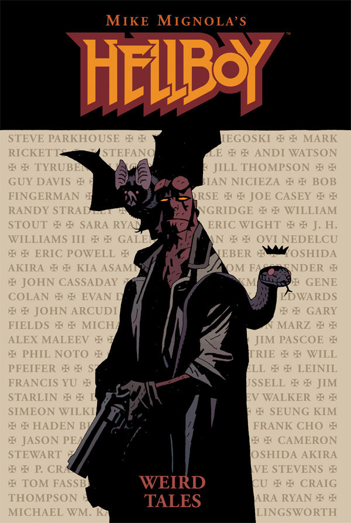MIKE MIGNOLA 
（精装）
November 26, 2014
收录

<ul>
<li><em>[科西切如何成为不死者（How Koshchei Became Deathless）](/entry/How_Koshchei_Became_Deathless)</em></li>
<li><em>[芭芭·雅加的盛宴（Baba Yaga's Feast）](/entry/Baba_Yaga%26)</em></li>
<li>[<em>地狱男爵：怪谈——第1卷（Hellboy: Weird Tales – Volume 1）</em>](/entry/Trade_Collections)</li>
<li>[<em>地狱男爵：怪谈——第2卷（Hellboy: Weird Tales – Volume 2）</em>](/entry/Trade_Collections)</li>
</ul>

附加内容

<ul>
<li><strong>斯科特·阿利作序</strong></li>
<li><strong>画廊</strong>（16页）</li>
</ul>

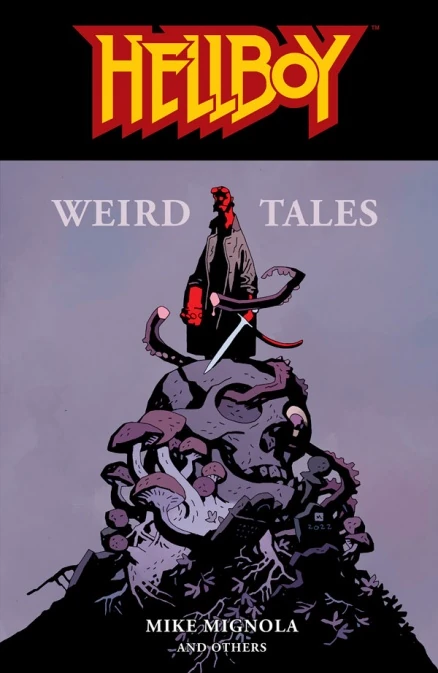MIKE MIGNOLA 
（平装）
November 9, 2022
收录

<ul>
<li><em>[科西切如何成为不死者](/entry/How_Koshchei_Became_Deathless)</em></li>
<li><em>[芭芭·雅加的盛宴](/entry/Baba_Yaga%26)</em></li>
<li>[<em>地狱男爵：怪谈——第1卷</em>](/entry/Trade_Collections)</li>
<li>[<em>地狱男爵：怪谈——第2卷</em>](/entry/Trade_Collections) （"<em>玩具兵</em>"除外）</li>
</ul>

附加内容

<ul>
<li><strong>画廊</strong>（16页）</li>
</ul>

</tbody>

## *爱德华·格雷爵士：寻巫人（Sir Edward Grey: Witchfinder）*

2019年3月18日，[Multiversity Comics](http://www.multiversitycomics.com) 独家公布了第一本《寻巫人》合订本的详情。[3]

封面
出版日期
内容

<tbody>

<em>第一卷（Volume One）</em>
收录

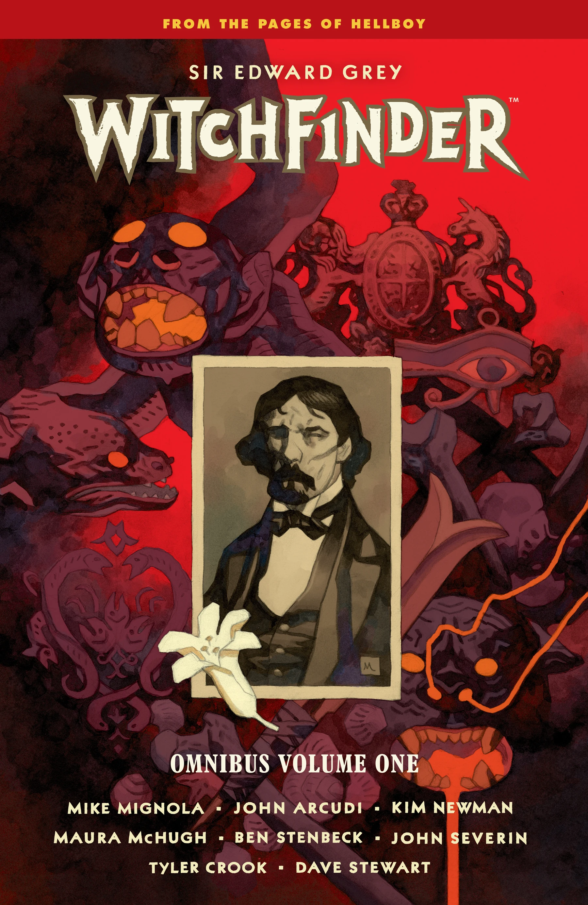MIKE MIGNOLA
November 27, 2019 (HC) 
April 2, 2024 (TPB)
<ul>
<li>[<em>寻巫人——第1卷：为天使效力（Witchfinder – Volume 1: In the Service of Angels）</em>](/entry/Trade_Collections)</li>
<li>[<em>寻巫人——第2卷：永远迷失（Witchfinder – Volume 2: Lost and Gone Forever）</em>](/entry/Trade_Collections)</li>
<li>[<em>寻巫人——第3卷：昂兰之谜（Witchfinder – Volume 3: The Mysteries of Unland）</em>](/entry/Trade_Collections)</li>
</ul>

附加内容

<ul>
<li><strong>[迈克·米格诺拉](/entry/Mike_Mignola)作序</strong></li>
<li><strong>扩充素描本</strong>
<ul>
<li><em>为天使效力（In the Service of Angels）</em> 10页</li>
<li><em>永远迷失（Lost and Gone Forever）</em> 9页</li>
<li><em>昂兰之谜（The Mysteries of Unland）</em> 17页1</li>
<li>封面与插页 7页</li>
</ul></li>
</ul>

补充说明

本卷对故事重新排序：
<ol>
<li><em>[杀机（Murderous Intent）](/entry/Murderous_Intent)</em></li>
<li><em>[为天使效力（In the Service of Angels）](/entry/In_the_Service_of_Angels)</em></li>
<li><em>[永远迷失（Lost and Gone Forever）](/entry/Lost_and_Gone_Forever)</em></li>
<li><em>[当心猿人（Beware the Ape）](/entry/Beware_the_Ape)</em></li>
<li><em>[昂兰之谜（The Mysteries of Unland）](/entry/The_Mysteries_of_Unland)</em></li>
<li><em>[凯瑟琳·贝克的葬礼（The Burial of Katharine Baker）](/entry/The_Burial_of_Katharine_Baker)</em></li>
</ol>

<em>第二卷（Volume Two）</em>
收录

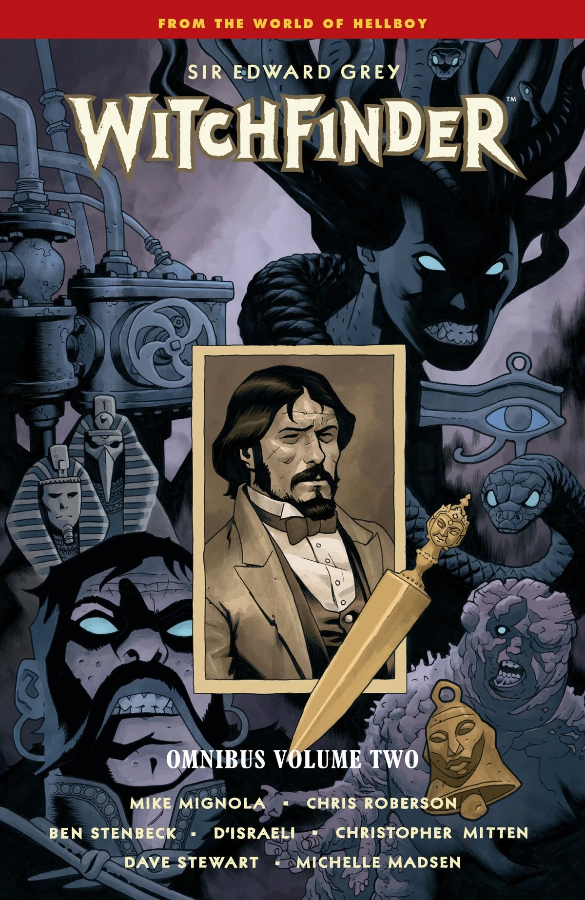BEN STENBECK
November 17, 2021 (HC) 
August 6, 2024 (TPB)
<ul>
<li>[<em>寻巫人——第4卷：亡者之城（Witchfinder – Volume 4: City of the Dead）</em>](/entry/Trade_Collections)</li>
<li>[<em>寻巫人——第5卷：天堂之门（Witchfinder – Volume 5: The Gates of Heaven）</em>](/entry/Trade_Collections)</li>
<li>[<em>寻巫人——第6卷：黑暗统治（Witchfinder – Volume 6: The Reign of Darkness）</em>](/entry/Trade_Collections)</li>
<li><em>[大暴雪（The Great Blizzard）](/entry/The_Great_Blizzard)</em></li>
</ul>

附加内容

<ul>
<li><strong>[克里斯·罗伯森](/entry/Chris_Roberson)作序</strong></li>
<li><strong>扩充素描本</strong>
<ul>
<li><em>亡者之城（City of the Dead）</em> 10页</li>
<li><em>天堂之门（The Gates of Heaven）</em> 18页</li>
<li><em>黑暗统治（The Reign of Darkness）</em> 16页2</li>
<li>封面 2页</li>
</ul></li>
</ul>

</tbody>

**1** 虽然这比原版平装本素描本少一页，但没有删去任何材料；只是进行了压缩。
**2** 虽然这比原版平装本素描本少两页，但没有删去任何材料；只是进行了压缩。

## *地狱男爵与B.P.R.D.（Hellboy and the B.P.R.D.）*

2018年6月6日，编辑[凯蒂·奥布赖恩（Katii O’Brien）](/entry/Katii_O%E2%80%99Brien)确认黑马漫画已开始为《地狱男爵与B.P.R.D.》合订本作早期规划，第一卷将收录从《*[1952](/entry/1952)*》到[*1954*](/entry/Trade_Paperback_Collections)的内容。[4] 与此前那些完结后才出合订本的系列不同，《地狱男爵与B.P.R.D.》将在系列连载的同时陆续推出合订本。

封面
出版日期
内容

<tbody>

<em>1952–1954</em>
收录

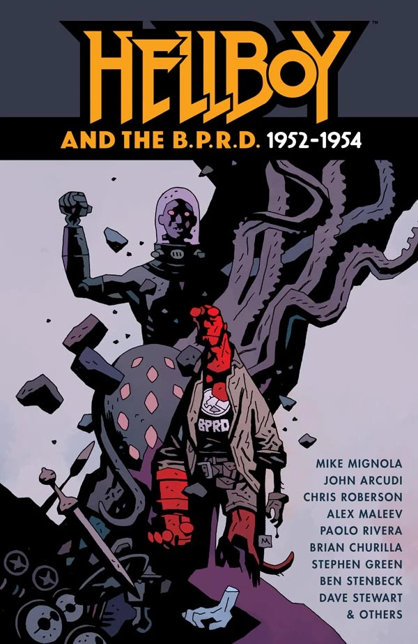MIKE MIGNOLA
June 9, 2021 (HC) 
October 1, 2024 (TPB)
<ul>
<li>[<em>地狱男爵与B.P.R.D.：1952（Hellboy and the B.P.R.D.: 1952）</em>](/entry/Trade_Collections)</li>
<li>[<em>地狱男爵与B.P.R.D.：1953（Hellboy and the B.P.R.D.: 1953）</em>](/entry/Trade_Collections)</li>
<li>[<em>地狱男爵与B.P.R.D.：1954（Hellboy and the B.P.R.D.: 1954）</em>](/entry/Trade_Collections)</li>
</ul>

附加内容

<ul>
<li><strong>[迈克·米格诺拉](/entry/Mike_Mignola)作序</strong></li>
<li><strong>[克里斯·罗伯森](/entry/Chris_Roberson)后记</strong></li>
<li><strong>扩充素描本</strong>
<ul>
<li><em>1952</em> 24页</li>
<li><em>1953</em> 25页</li>
<li><em>1954</em> 13页1</li>
<li>封面 4页</li>
</ul></li>
</ul>

<em>1955–1957</em>
收录

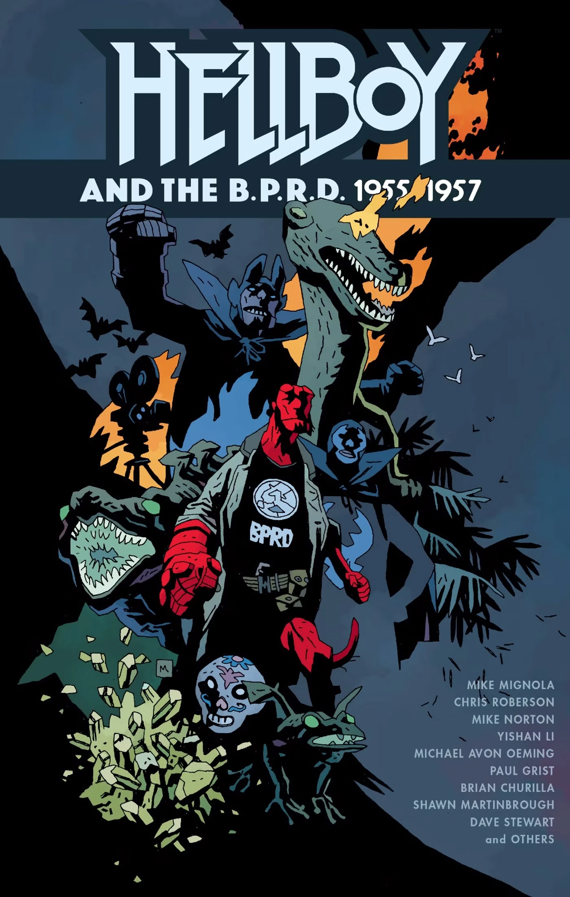MIKE MIGNOLA
December 3, 2024 (HC)
<ul>
<li>[<em>地狱男爵与B.P.R.D.：1955（Hellboy and the B.P.R.D.: 1955）</em>](/entry/Trade_Collections)</li>
<li>[<em>地狱男爵与B.P.R.D.：1956（Hellboy and the B.P.R.D.: 1956）</em>](/entry/Trade_Collections)</li>
<li>[<em>地狱男爵与B.P.R.D.：1957（Hellboy and the B.P.R.D.: 1957）</em>](/entry/Trade_Collections)</li>
</ul>

附加内容

<ul>
<li><strong>待定</strong></li>
</ul>

</tbody>

**1** 虽然这比原版平装本素描本少一页，但没有删去任何材料；只是进行了压缩。

## *地狱男爵宇宙（Hellboy Universe）*

《地狱男爵》编辑[凯蒂·奥布赖恩](/entry/Katii_O%E2%80%99Brien)曾在2019年1月提到，她计划将一些单篇系列结集成合订本。[5] "地狱男爵宇宙"产品线于2020年11月公布。

封面
出版日期
内容

<tbody>

<em>秘史——第一卷（The Secret Histories – Volume One）</em> 1
收录

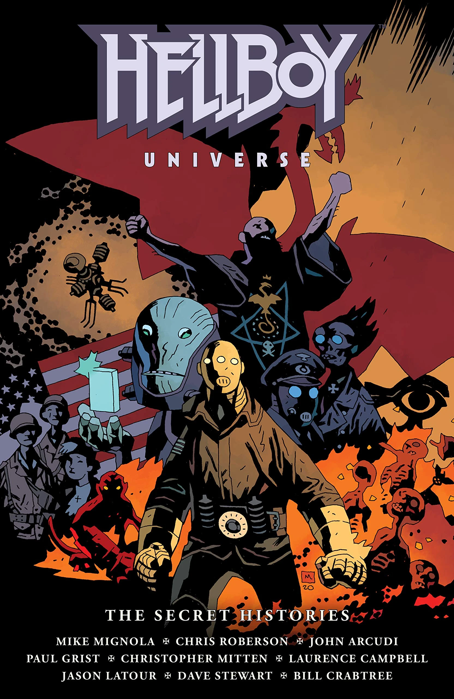MIKE MIGNOLA
June 2, 2021 (HC) 
 
<em>计划于</em> 
March 24, 2026 (TPB)
<ul>
<li>[<em>拉斯普廷：龙之音（Rasputin: The Voice of the Dragon）</em>](/entry/Trade_Collections)</li>
<li>[<em>大锤44（Sledgehammer 44）</em>](/entry/Trade_Collections)</li>
<li>[<em>访客：他为何以及如何留下（The Visitor: How &amp; Why He Stayed）</em>](/entry/Trade_Collections)</li>
</ul>

附加内容

<ul>
<li><strong>[克里斯·罗伯森](/entry/Chris_Roberson)作序</strong></li>
<li><strong>[克里斯·罗伯森](/entry/Chris_Roberson)后记</strong>（取自<em>访客：他为何以及如何留下</em>）
<ul>
<li>节选自<em>地狱男爵：毁灭之种</em> #4</li>
<li>节选自<em>地狱男爵：征服者蠕虫</em> #2</li>
</ul></li>
<li><strong>扩充素描本</strong>
<ul>
<li><em>拉斯普廷：龙之音（Rasputin: The Voice of the Dragon）</em> 11页</li>
<li><em>大锤44（Sledgehammer 44）</em> 16页2</li>
<li><em>访客：他为何以及如何留下（The Visitor: How &amp; Why He Stayed）</em> 8页</li>
<li>平装本封面 2页</li>
<li>米格诺拉的黑白封面</li>
</ul></li>
</ul>

<em>秘史——第二卷（The Secret Histories – Volume Two）</em>
收录

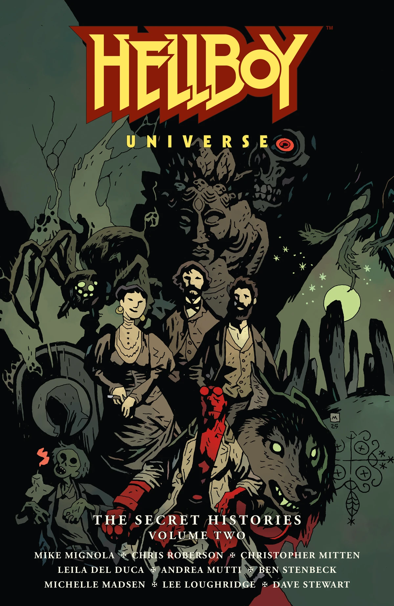MIKE MIGNOLA
<em>计划于</em> 
September 22, 2026 (HC)
<ul>
<li>[<em>黑色火焰的崛起（Rise of the Black Flame）</em>](/entry/Trade_Collections)</li>
<li>[<em>失望之屋：莎拉·朱尔谜案（The House of Lost Horizons: A Sarah Jewell Mystery）</em>](/entry/Trade_Collections)</li>
<li>[<em>英国超自然学会：心不在焉（The British Paranormal Society: Time Out of Mind）</em>](/entry/Trade_Collections)</li>
<li>[<em>地狱男爵：银灯俱乐部（Hellboy: The Silver Lantern Club）</em>](/entry/Trade_Collections)</li>
</ul>

附加内容

<ul>
<li>待定</li>
</ul>

</tbody>

**1** "第一卷（Volume One）"是在平装本版本中加入书名的。
**2** 斯科特·阿利致约翰·塞维林（John Severin）的献词，以及原版平装本中塞维林的画页未收录于本合集。

## *龙虾人约翰逊（Lobster Johnson）*

封面
出版日期
内容

<tbody>

<em>第I卷（Volume I）</em>
收录

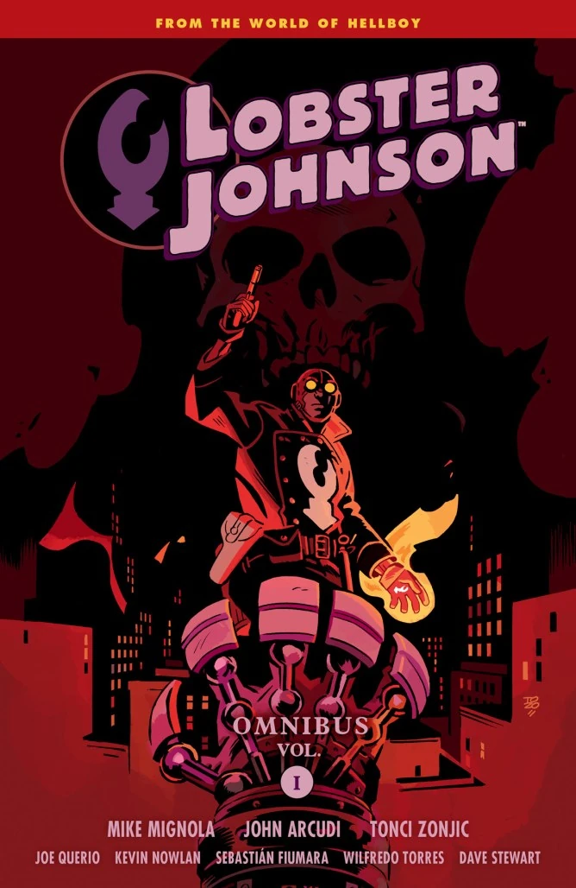TONCI ZONJIC
February 16, 2022 (HC)
<ul>
<li><em>[空椅子（The Empty Chair）](/entry/The_Empty_Chair)</em></li>
<li>[<em>龙虾人约翰逊——第2卷：燃烧之手（Lobster Johnson – Volume 2: The Burning Hand）</em>](/entry/Trade_Collections)</li>
<li>[<em>龙虾人约翰逊——第3卷：撒旦闻到老鼠味（Lobster Johnson – Volume 3: Satan Smells A Rat）</em>](/entry/Trade_Collections)</li>
<li>[<em>龙虾人约翰逊——第4卷：抓住龙虾！（Lobster Johnson – Volume 4: Get the Lobster!）</em>](/entry/Trade_Collections)</li>
</ul>

附加内容

<ul>
<li><strong>待定</strong></li>
</ul>

<em>第II卷（Volume II）</em>
收录

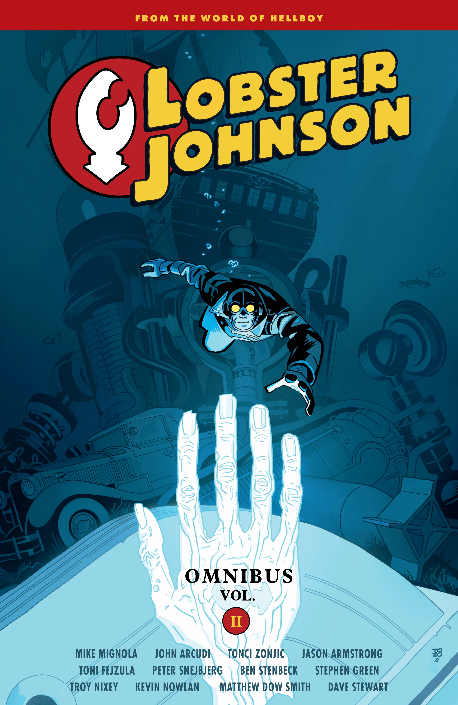TONCI ZONJIC
August 22, 2023 (HC)
<ul>
<li>[<em>龙虾人约翰逊——第6卷：生命铸就的锁链（Lobster Johnson – Volume 6: A Chain Forged in Life）</em>](/entry/Trade_Collections)</li>
<li>[<em>龙虾人约翰逊——第5卷：海盗幽灵与中城金属怪物（Lobster Johnson – Volume 5: The Pirate's Ghost and Metal Monsters of Midtown）</em>](/entry/Trade_Collections)</li>
<li>[<em>龙虾人约翰逊——第1卷：钢铁普罗米修斯（Lobster Johnson – Volume 1: The Iron Prometheus）</em>](/entry/Trade_Collections)</li>
<li><em>[我头颅中的杀手（The Killer in My Skull）](/entry/The_Killer_in_My_Skull)</em></li>
</ul>

附加内容

<ul>
<li><strong>待定</strong></li>
</ul>

补充说明

第一版的部分印次误将合订本中的第252页与第253页对调。

</tbody>

## *不死者科西切（Koshchei the Deathless）*

封面
出版日期
内容

<tbody>

<em>不死者科西切（Koshchei the Deathless）</em>
收录

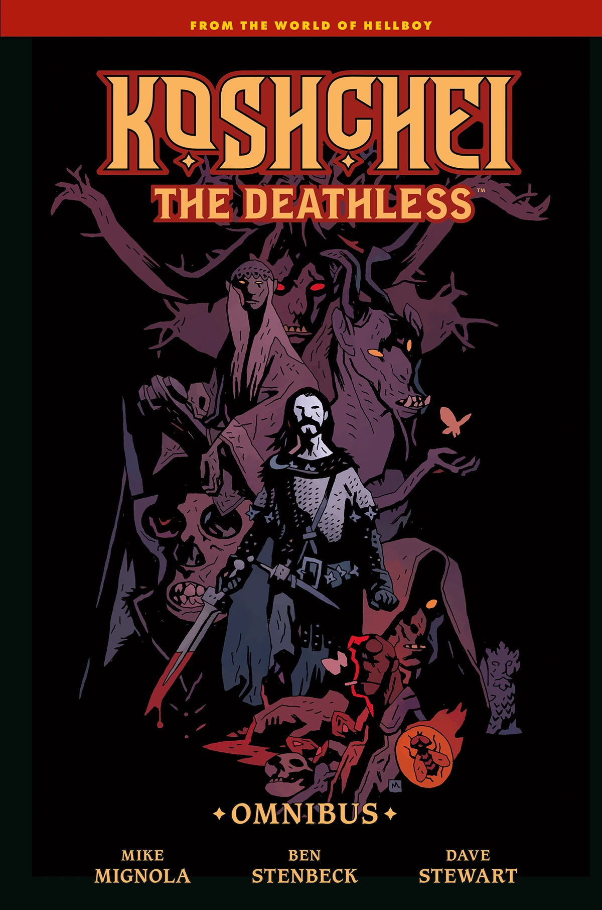MIKE MIGNOLA
<em>计划于</em> 
June 16, 2026 (HC)
<ul>
<li>[<em>不死者科西切（Koshchei the Deathless）</em>](/entry/Trade_Collections)</li>
<li>[<em>科西切在地狱（Koshchei in Hell）</em>](/entry/Trade_Collections)</li>
<li>[<em>园中之蛇：埃德·格雷与英格兰的最后一战（The Serpent in the Garden: Ed Grey and the Last Battle for England）</em>](/entry/Trade_Collections)</li>
</ul>

附加内容

<ul>
<li><strong>待定</strong></li>
</ul>

</tbody>

## 外部链接

黑马漫画（Dark Horse）条目：

- [*B.P.R.D.：青蛙瘟疫——第1卷*（精装）](http://www.darkhorse.com/Books/17-169/B-P-R-D-Plague-of-Frogs-Hardcover-Collection-Vol-1) / [（平装）](http://www.darkhorse.com/Books/17-975/B-P-R-D-Plague-of-Frogs-Volume-1-TPB) / [*B.P.R.D.——第1卷*（平装）](https://www.darkhorse.com/Books/3009-921/B-P-R-D-Omnibus-Volume-1-TPB)
- [*B.P.R.D.：青蛙瘟疫——第2卷*（精装）](http://www.darkhorse.com/Books/17-524/B-P-R-D-Plague-of-Frogs-Volume-2-hardcover-collection) / [（平装）](http://www.darkhorse.com/Books/17-976/B-P-R-D-Plague-of-Frogs-Volume-2-TPB) / [*B.P.R.D.——第2卷*（平装）](https://www.darkhorse.com/Books/3009-922/B-P-R-D-Omnibus-Volume-2-TPB)
- [*B.P.R.D.：青蛙瘟疫——第3卷*（精装）](http://www.darkhorse.com/Books/18-141/B-P-R-D-Plague-of-Frogs-Volume-3-HC) / [（平装）](http://www.darkhorse.com/Books/18-143/B-P-R-D-Plague-of-Frogs-Volume-3-TPB) / [*B.P.R.D.——第3卷*（平装）](https://www.darkhorse.com/Books/3009-923/B-P-R-D-Omnibus-Volume-3-TPB)
- [*B.P.R.D.：青蛙瘟疫——第4卷*（精装）](http://www.darkhorse.com/Books/18-142/B-P-R-D-Plague-of-Frogs-Volume-4-HC) / [（平装）](http://www.darkhorse.com/Books/18-144/B-P-R-D-Plague-of-Frogs-Volume-4-TPB) / [*B.P.R.D.——第4卷*（平装）](https://www.darkhorse.com/Books/3009-924/B-P-R-D-Omnibus-Volume-4-TPB)
- [*B.P.R.D.：1946 – 1948*（精装）](http://www.darkhorse.com/Books/22-957/B-P-R-D-1946-1948-HC) / [（平装）](https://www.darkhorse.com/Books/3004-949/B-P-R-D-1946-1948-TPB)
- [*B.P.R.D.：人间地狱——第1卷*（精装）](https://www.darkhorse.com/Books/3001-039/B-P-R-D-Hell-on-Earth-Volume-1-HC) / [（平装）](https://www.darkhorse.com/Books/3006-939/B-P-R-D-Hell-on-Earth-Volume-1-TPB) / [*B.P.R.D.——第5卷*（平装）](https://www.darkhorse.com/Books/3009-925/B-P-R-D-Omnibus-Volume-5-TPB)
- [*B.P.R.D.：人间地狱——第2卷*（精装）](https://www.darkhorse.com/Books/3001-040/B-P-R-D-Hell-on-Earth-Volume-2-HC) / [（平装）](https://www.darkhorse.com/Books/3007-879/B-P-R-D-Hell-on-Earth-Volume-2-TPB)
- [*B.P.R.D.：人间地狱——第3卷*（精装）](https://www.darkhorse.com/Books/3001-041/B-P-R-D-Hell-on-Earth-Volume-3-HC) / [（平装）](https://www.darkhorse.com/Books/3007-880/B-P-R-D-Hell-on-Earth-Volume-3-TPB)
- [*B.P.R.D.：人间地狱——第4卷*（精装）](https://www.darkhorse.com/Books/3001-042/B-P-R-D-Hell-on-Earth-Volume-4-HC) / [（平装）](https://www.darkhorse.com/Books/3007-881/B-P-R-D-Hell-on-Earth-Volume-4-TPB)
- [*B.P.R.D.：人间地狱——第5卷*（精装）](https://www.darkhorse.com/Books/3001-043/B-P-R-D-Hell-on-Earth-Volume-5-HC) / [（平装）](https://www.darkhorse.com/Books/3007-882/B-P-R-D-Hell-on-Earth-Volume-5-TPB)
- [*B.P.R.D.：你所知的恶魔*（精装）](https://www.darkhorse.com/Books/3006-940/B-P-R-D-The-Devil-You-Know-Omnibus-HC) / [（平装）](https://www.darkhorse.com/Books/3009-350/B-P-R-D-The-Devil-You-Know-TPB)
- [*亚伯·塞皮恩：黑暗而可怖——第1卷*（精装）](https://www.darkhorse.com/Books/3001-045/Abe-Sapien-Dark-and-Terrible-Volume-1-HC) / [（平装）](https://www.darkhorse.com/Books/3011-092/Abe-Sapien-Dark-and-Terrible-Volume-1-TPB)
- [*亚伯·塞皮恩：黑暗而可怖——第2卷*（精装）](https://www.darkhorse.com/Books/3001-046/Abe-Sapien-Dark-and-Terrible-Volume-2-HC)
- [*亚伯·塞皮恩：沉沦及其他故事*（精装）](https://www.darkhorse.com/Books/3001-047/Abe-Sapien-The-Drowning-and-Other-Stories-HC)
- [*地狱男爵合订本——第1卷：毁灭之种*（平装）](https://www.darkhorse.com/Books/3002-363/Hellboy-Omnibus-Volume-1-Seed-of-Destruction-TPB)
- [*地狱男爵合订本——第2卷：诡异之地*（平装）](https://www.darkhorse.com/Books/3002-364/Hellboy-Omnibus-Volume-2-Strange-Places-TPB)
- [*地狱男爵合订本——第3卷：狂猎*（平装）](https://www.darkhorse.com/Books/3002-365/Hellboy-Omnibus-Volume-3-The-Wild-Hunt-TPB)
- [*地狱男爵合订本——第4卷：地狱男爵在地狱*（平装）](https://www.darkhorse.com/Books/3002-366/Hellboy-Omnibus-Volume-4-Hellboy-in-Hell-TPB)
- [*地狱男爵合订本盒装套装*（平装）](https://www.darkhorse.com/Books/3008-474/Hellboy-Omnibus-Boxed-Set-TPB)
- [*地狱男爵：完整短篇故事集——第1卷*（平装）](https://www.darkhorse.com/Books/3002-361/Hellboy-The-Complete-Short-Stories-Volume-1-TPB)
- [*地狱男爵：完整短篇故事集——第2卷*（平装）](https://www.darkhorse.com/Books/3002-362/Hellboy-The-Complete-Short-Stories-Volume-2-TPB)
- [*地狱男爵：怪谈*（精装）](http://www.darkhorse.com/Books/24-712/Hellboy-Weird-Tales-HC) / [（平装）](https://www.darkhorse.com/Books/3011-095/Hellboy-Weird-Tales-TPB)
- [*爱德华·格雷爵士：寻巫人——第1卷*（精装）](https://www.darkhorse.com/Books/3005-258/Witchfinder-Omnibus-Volume-1-HC)
- [*爱德华·格雷爵士：寻巫人——第2卷*（精装）](https://www.darkhorse.com/Books/3008-581/Witchfinder-Omnibus-Volume-2-HC)
- [*地狱男爵与B.P.R.D.：1952–1954*（精装）](https://www.darkhorse.com/Books/3008-404/Hellboy-and-the-B-P-R-D-1952-1954-HC)
- [*地狱男爵宇宙：秘史*（精装）](https://www.darkhorse.com/Books/3008-410/Hellboy-Universe-The-Secret-Histories-HC)
- [*龙虾人约翰逊——第1卷*（精装）](https://www.darkhorse.com/Books/3008-428/Lobster-Johnson-Omnibus-Volume-1-HC)

## 注释

[1] 由[斯科特·阿利](/entry/Scott_Allie)在 [Hellmail](/entry/Hellmail)（刊于《*[永远迷失（Lost and Gone Forever）](/entry/Lost_and_Gone_Forever)*》#1）中所述

[2] <https://www.horrordna.com/features/exclusive-b-p-r-d-the-devil-you-know-omnibus-cover-revealed>

[3] <http://www.multiversitycomics.com/news/witchfinder-omnibus-volume-1/>

[4] <https://www.youtube.com/watch?v=0VCS7AWbOi4&feature=youtu.be&t=759>

[5] <https://www.mignolaverse.com/news/2019/1/28/katii-obrien1>
