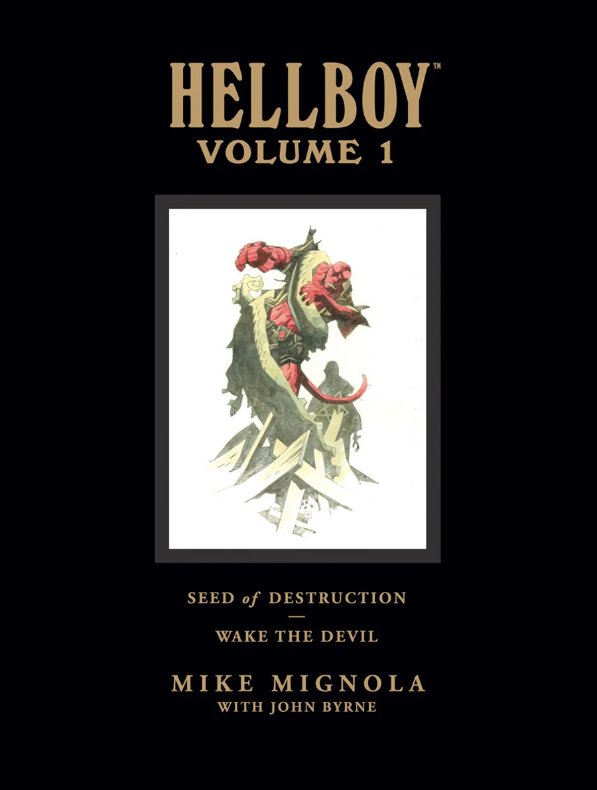
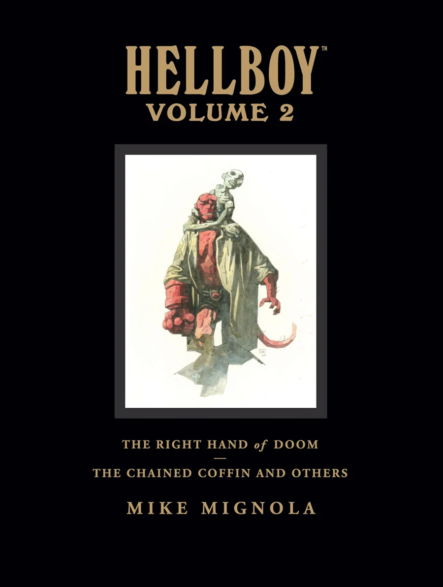
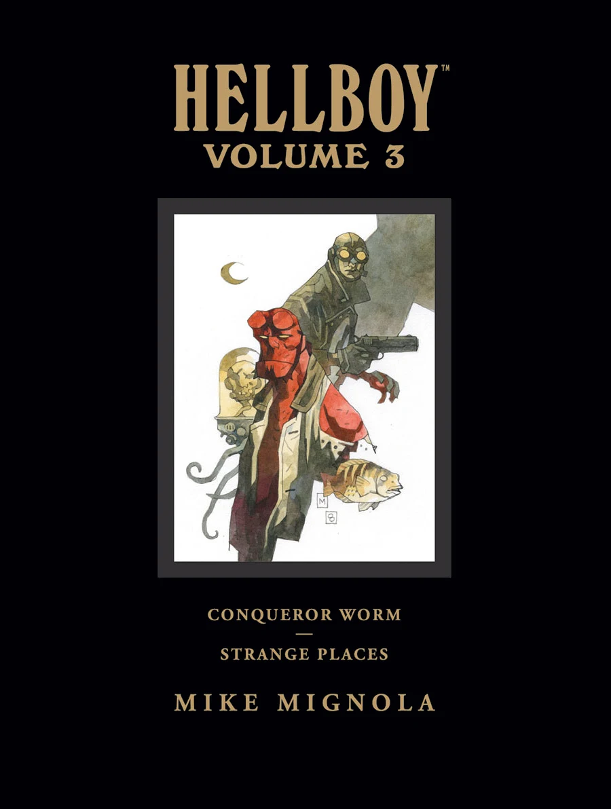
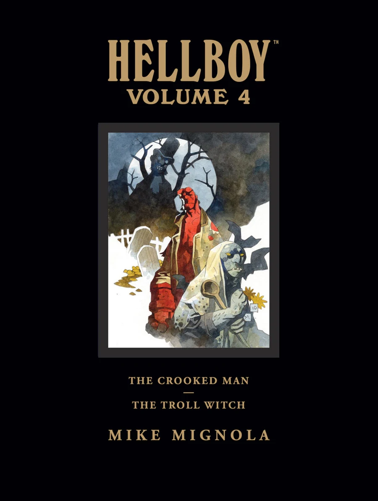
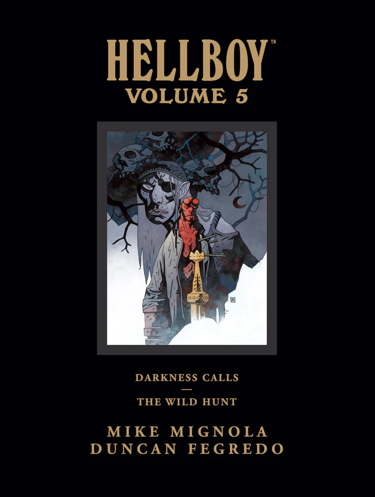
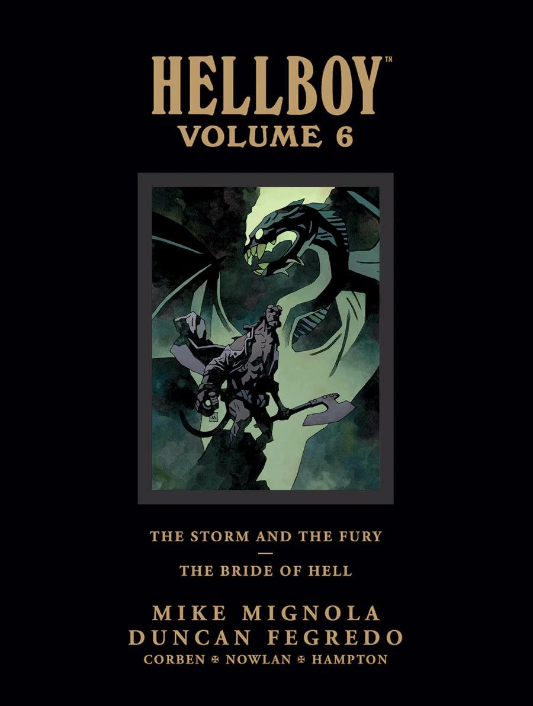
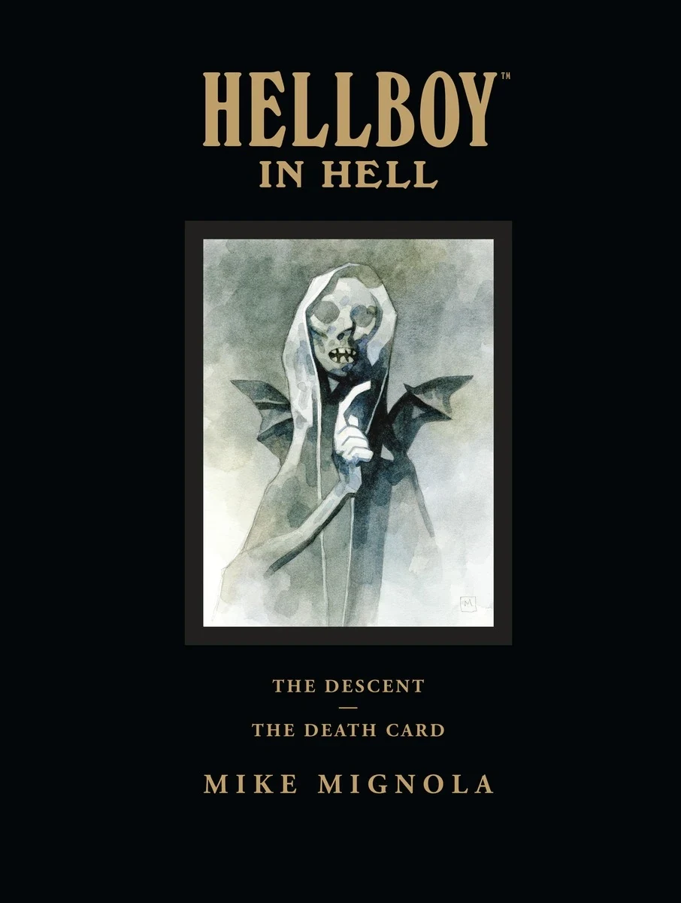

除了[平装合订本系列](/entry/Trade_Paperback_Collections)之外，地狱男爵漫画系列还以大开本的馆藏版（Library Editions）形式推出合订本。每卷内容相当于两本平装合订本，并附有额外的素描本素材。这些书以精装形式出版，尺寸为 9 英寸 × 12 英寸（相比之下平装合订本为 7 英寸 × 10 英寸）。迄今已出版七卷。

## 《地狱男爵》（Hellboy）

#
封面
出版日期
内容

<tbody>

<strong>1</strong>

Hellboy_Library_1.jpg

2008 年 5 月 7 日
收录

<ul>
<li>[<em>地狱男爵——第 1 卷：毁灭之种（Hellboy – Volume 1: Seed of Destruction）</em>](/entry/Trade_Collections)</li>
<li>[<em>地狱男爵——第 2 卷：唤醒恶魔（Hellboy – Volume 2: Wake the Devil）</em>](/entry/Trade_Collections)</li>
</ul>

附加素材

<ul>
<li><strong>馆藏版导言，Scott Allie 作1</strong></li>
<li><strong><em>《毁灭之种》</em>导言，Robert Bloch 作</strong></li>
<li><strong><em>《唤醒恶魔》</em>导言，Alan Moore 作</strong></li>
<li><strong>馆藏版后记，Mike Mignola 作</strong></li>
<li><strong>扩充素描本</strong>（33 页）</strong></li>
</ul>

<strong>2</strong>

Hellboy_Library_2.jpg

2008 年 10 月 8 日
收录

<ul>
<li>[<em>地狱男爵——第 3 卷：被锁链的棺材及其他（Hellboy – Volume 3: The Chained Coffin and Others）</em>](/entry/Trade_Collections)</li>
<li>[<em>地狱男爵——第 4 卷：毁灭之右手（Hellboy – Volume 4: The Right Hand of Doom）</em>](/entry/Trade_Collections)</li>
</ul>

附加素材

<ul>
<li><strong>馆藏版导言，Scott Allie 作1</strong></li>
<li><strong>馆藏版后记，Mike Mignola 作</strong></li>
<li><strong>故事注释</strong></li>
<li><strong>扩充素描本</strong>（39 页）</li>
</ul>

补充说明

本卷中的故事被重新按时间顺序排列：
<ol>
<li><em>[煎饼（Pancakes）](/entry/Pancakes)</em></li>
<li><em>[野兽的本性（The Nature of the Beast）](/entry/The_Nature_of_the_Beast)</em></li>
<li><em>[沃尔德国王（King Vold）](/entry/King_Vold)</em></li>
<li><em>[尸体（The Corpse）](/entry/The_Corpse)</em></li>
<li><em>[铁鞋（The Iron Shoes）](/entry/The_Iron_Shoes)</em></li>
<li><em>[芭芭·雅加（The Baba Yaga）](/entry/The_Baba_Yaga)</em></li>
<li><em>[头颅（Heads）](/entry/Heads)</em></li>
<li><em>[再见，托德先生（Goodbye Mister Tod）](/entry/Goodbye_Mister_Tod)</em></li>
<li><em>[瓦尔科拉克（The Vârcolac）](/entry/The_V%C3%A2rcolac)</em></li>
<li><em>[地下圣诞（A Christmas Underground）](/entry/A_Christmas_Underground)</em></li>
<li><em>[圣奥古斯都之狼（The Wolves of Saint August）](/entry/The_Wolves_of_Saint_August)</em></li>
<li><em>[被锁链的棺材（The Chained Coffin）](/entry/The_Chained_Coffin)</em></li>
<li><em>[近乎巨像（Almost Colossus）](/entry/Almost_Colossus)</em></li>
<li><em>[毁灭之右手（The Right Hand of Doom）](/entry/The_Right_Hand_of_Doom)</em></li>
<li><em>[盛满邪恶的盒子（Box Full of Evil）](/entry/Box_Full_of_Evil)</em></li>
</ol>

<strong>3</strong>

Hellboy_Library_3.jpg

2009 年 9 月 23 日
收录

<ul>
<li>[<em>地狱男爵——第 5 卷：征服者蠕虫（Hellboy – Volume 5: Conqueror Worm）</em>](/entry/Trade_Collections)</li>
<li>[<em>地狱男爵——第 6 卷：奇异之地（Hellboy – Volume 6: Strange Places）</em>](/entry/Trade_Collections)</li>
</ul>

附加素材

<ul>
<li><strong>馆藏版导言，Scott Allie 作1</strong></li>
<li><strong><em>《征服者蠕虫》</em>导言，Guillermo del Toro 作</strong></li>
<li><strong><em>《奇异之地》</em>导言，Gary Gianni 作</strong></li>
<li><strong>馆藏版后记，Mike Mignola 作</strong></li>
<li><strong>未采用页面</strong></li>
<li><strong>扩充素描本</strong>（38 页）</li>
</ul>

<strong>4</strong>

Hellboy_Library_4.jpg

2011 年 6 月 15 日
收录

<ul>
<li>[<em>地狱男爵——第 10 卷：佝偻人及其他（Hellboy – Volume 10: The Crooked Man and Others）</em>](/entry/Trade_Collections)</li>
<li>[<em>地狱男爵——第 7 卷：巨魔女巫及其他（Hellboy – Volume 7: The Troll Witch and Others）</em>](/entry/Trade_Collections)</li>
</ul>

附加素材

<ul>
<li><strong>馆藏版导言，Scott Allie 作1</strong></li>
<li><strong><em>《佝偻人及其他》</em>导言，Gahan Wilson 作</strong></li>
<li><strong>馆藏版后记，Mike Mignola 作</strong></li>
<li><strong>故事注释</strong></li>
<li><strong>扩充素描本</strong>（47 页）</li>
</ul>

补充说明

本卷中的故事被重新按时间顺序排列：
<ol>
<li><em>[佝偻人（The Crooked Man）](/entry/The_Crooked_Man_%28comic_story%29)</em></li>
<li><em>[彭南加兰（The Penanggalan）](/entry/The_Penanggalan)</em></li>
<li><em>[九头蛇与狮子（The Hydra and the Lion）](/entry/The_Hydra_and_the_Lion)</em></li>
<li><em>[巨魔女巫（The Troll Witch）](/entry/The_Troll_Witch)</em></li>
<li><em>[布拉格吸血鬼（The Vampire of Prague）](/entry/The_Vampire_of_Prague)</em></li>
<li><em>[乘船下海的人（They That Go Down to the Sea in Ships）](/entry/They_That_Go_Down_to_the_Sea_in_Ships)</em></li>
<li><em>[卡普博士的实验（Dr. Carp's Experiment）](/entry/Dr._Carp%26)</em></li>
<li><em>[食尸鬼（The Ghoul）](/entry/The_Ghoul)</em></li>
<li><em>[在摩洛神殿中（In the Chapel of Moloch）](/entry/In_the_Chapel_of_Moloch)</em></li>
<li><em>[马科马（Makoma）](/entry/Makoma_%28story%29)</em></li>
</ol>
<strong>注意：</strong><em>[鼹鼠（The Mole）](/entry/The_Mole)</em>未收录在本卷中。

<strong>5</strong>

Hellboy_Library_5.jpg

2012 年 7 月 11 日
收录

<ul>
<li><em>[鼹鼠（The Mole）](/entry/The_Mole)</em>（出自<em>[地狱男爵——第 10 卷：佝偻人及其他](/entry/Trade_Collections)</em>）</li>
<li>[<em>地狱男爵——第 8 卷：黑暗召唤（Hellboy – Volume 8: Darkness Calls）</em>](/entry/Trade_Collections)</li>
<li>[<em>地狱男爵——第 9 卷：狂猎（Hellboy – Volume 9: The Wild Hunt）</em>](/entry/Trade_Collections)</li>
</ul>

附加素材

<ul>
<li><strong>馆藏版导言，Scott Allie 作1</strong></li>
<li><strong><em>《黑暗召唤》</em>导言，Jane Yolen 作</strong></li>
<li><strong><em>《狂猎》</em>导言，Mark Chadbourn 作</strong></li>
<li><strong>馆藏版后记，Mike Mignola 作</strong></li>
<li><strong>扩充素描本</strong>（66 页）</li>
</ul>

补充说明

<em>[鼹鼠](/entry/The_Mole)</em>作为<em>[黑暗召唤](/entry/Darkness_Calls)</em>的序章被收录在本卷中。

<strong>6</strong>

Hellboy_Library_6.jpg

2013 年 6 月 5 日
收录

<ul>
<li>[<em>地狱男爵——第 12 卷：风暴与狂怒（Hellboy – Volume 12: The Storm and the Fury）</em>](/entry/Trade_Collections)</li>
<li>[<em>地狱男爵——第 11 卷：地狱新娘及其他（Hellboy – Volume 11: The Bride of Hell and Others）</em>](/entry/Trade_Collections)</li>
</ul>

附加素材

<ul>
<li><strong>馆藏版导言，Scott Allie 作1</strong></li>
<li><strong><em>《风暴与狂怒》</em>导言，Glen David Gold 作</strong></li>
<li><strong><em>《地狱新娘及其他》</em>故事注释</strong></li>
<li><strong>馆藏版后记，Mike Mignola 作</strong></li>
<li><strong>扩充素描本</strong>（73 页）</li>
</ul>

</tbody>

**1** 2020 年之后出版的版本删除了 Scott Aliie 的导言。

## 《地狱男爵在地狱》（Hellboy in Hell）

封面
出版日期
内容

<tbody>

Hellboy_in_Hell_Library_1.jpg

2017 年 10 月 11 日
收录

<ul>
<li>[<em>地狱男爵在地狱——第 1 卷：坠落（Hellboy in Hell – Volume 1: The Descent）</em>](/entry/Trade_Collections)</li>
<li>[<em>地狱男爵在地狱——第 2 卷：死亡牌（Hellboy in Hell – Volume 2: The Death Card）</em>](/entry/Trade_Collections)<strong>2</strong></li>
<li><em>[魔术师与蛇（The Magician and the Snake）](/entry/The_Magician_and_the_Snake)</em></li>
</ul>

附加素材

<ul>
<li><strong>馆藏版导言，Scott Allie 作3</strong></li>
<li><strong>馆藏版后记，Mike Mignola 作</strong></li>
<li><strong>扩充素描本</strong>（84 页）</li>
</ul>

</tbody>

**2** 包括平装合订本中的序章，该序章被排除在合集版之外；它被放在本合订本的末尾，而不是作为序章。
**3** 2020 年之后出版的版本删除了 Scott Aliie 的导言。
