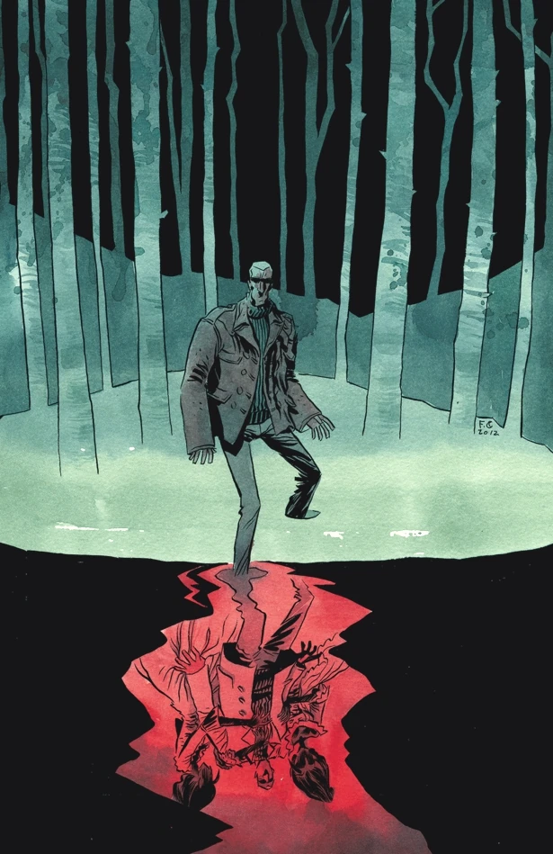
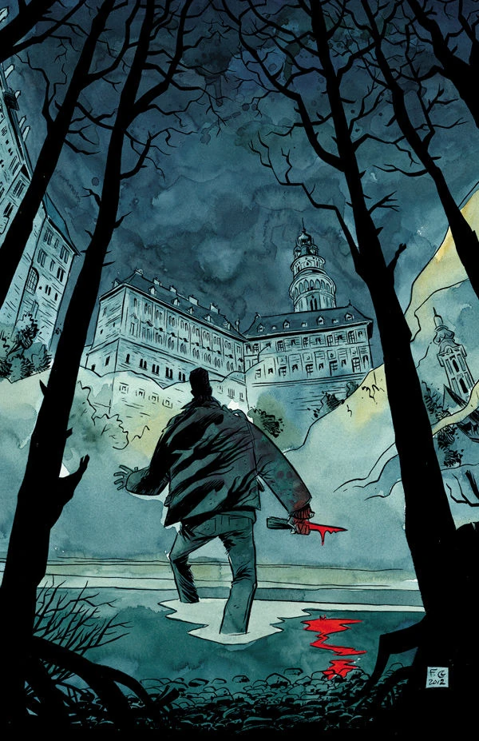
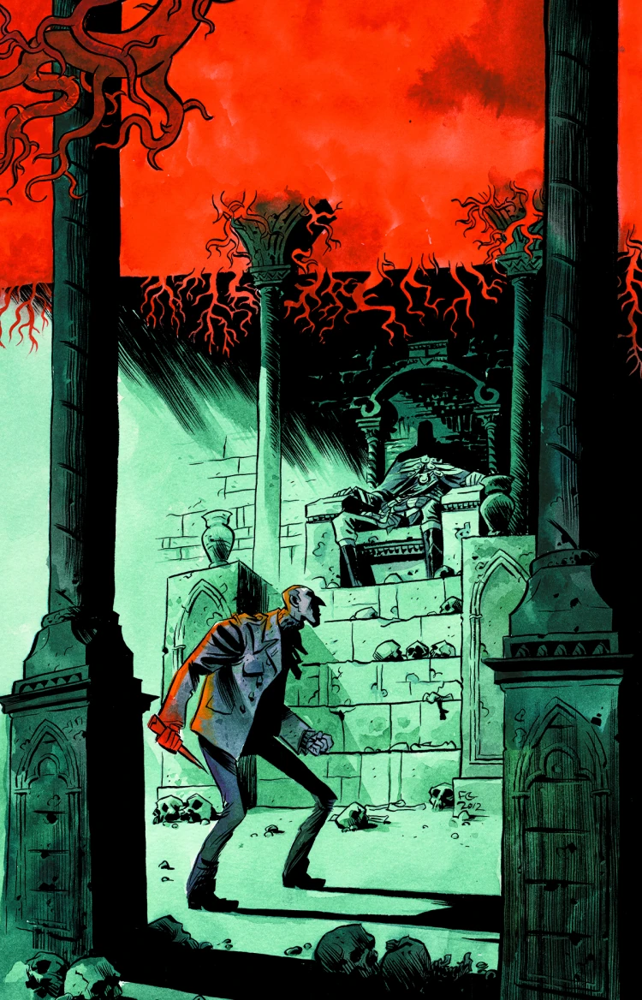
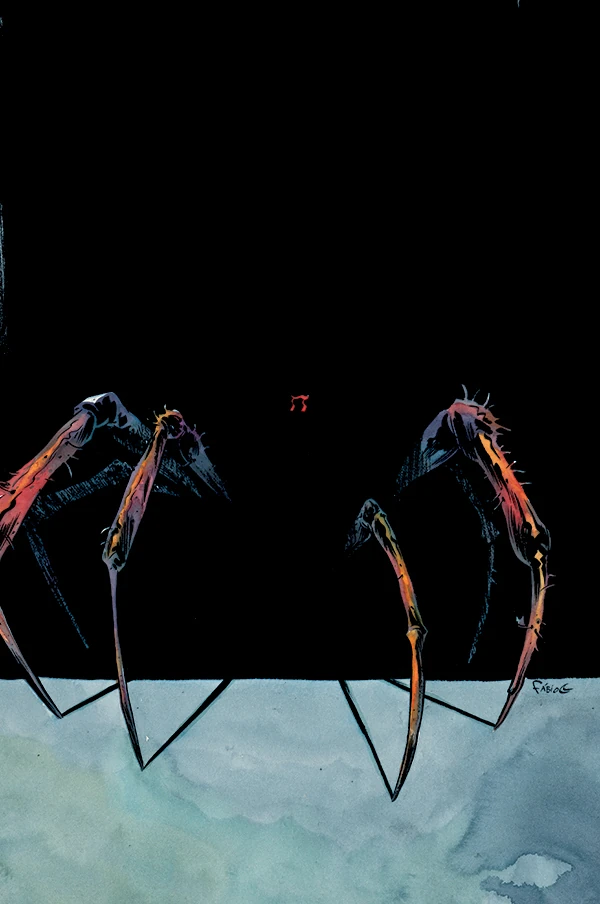
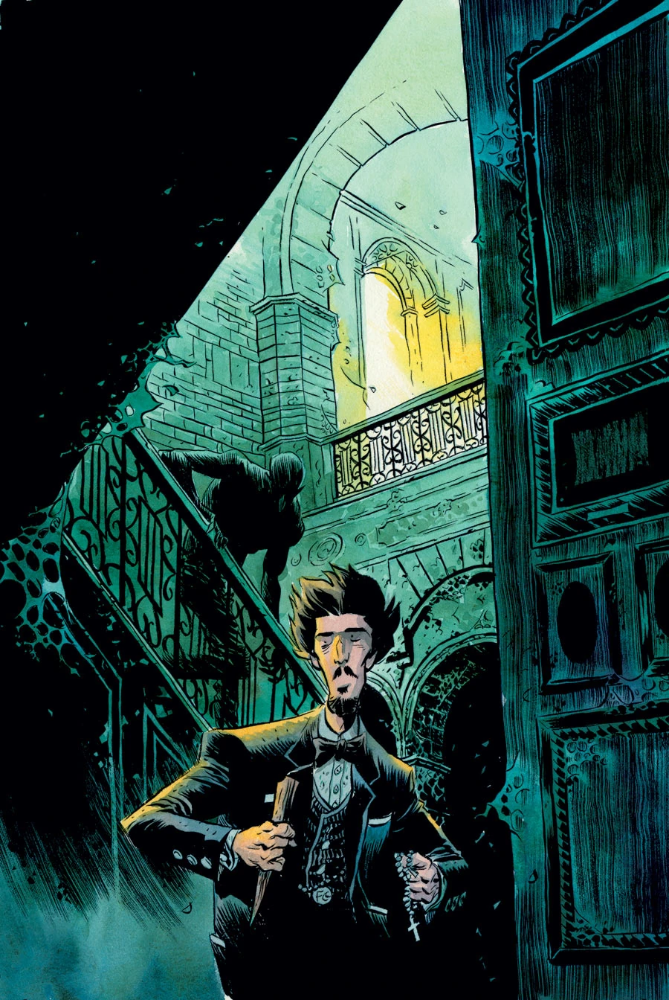

《**吸血鬼**》（Vampire）是一部于 2013 年 3 月出版的五期限定迷你系列，由 Gabriel Bá 与 Fábio Moon 兄弟担纲作画。故事承接 *[B.P.R.D.: 1948](/entry/1948)*，是[吸血鬼故事环](/entry/Vampire_%28story_cycle%29)的第一篇故事，该故事环隶属于 [*B.P.R.D.*](/entry/B.P.R.D._%28series%29)。

## 剧情简介

### 第一部

继 *[B.P.R.D.: 1948](/entry/1948)* 的恐怖事件之后，故事跟随一名劫数难逃的探员，向一个[吸血鬼](/entry/vampires)氏族及其长着戈耳工之眼的女王展开复仇之旅。

### 第二部

[西蒙·安德斯](/entry/Simon_Anders)追寻那个诅咒了他的吸血鬼氏族，在一座饱受一个恐怖家族往事困扰的捷克小镇上找到了答案。

### 第三部

一位贵族吸血鬼曾因与邪恶女神[赫卡特](/entry/Hecate)达成一桩恐怖交易而捡回一命，如今嗜血的西蒙·安德斯要让这致命的交易彻底了结。

### 第四部

两只吸血鬼被困在胸膛之内，西蒙·安德斯苦苦压制着它们，以免它们驱使自己卷入一场与[女巫](/entry/witches)大军的血腥屠杀。

### 第五部

林间血战之后，唯有[布鲁姆教授](/entry/Trevor_Bruttenholm)本人能为这场吸血鬼猎杀画上句号，并查清捷克克鲁姆洛夫（Český Krumlov）亡灵之谜的真相。

## 画廊

