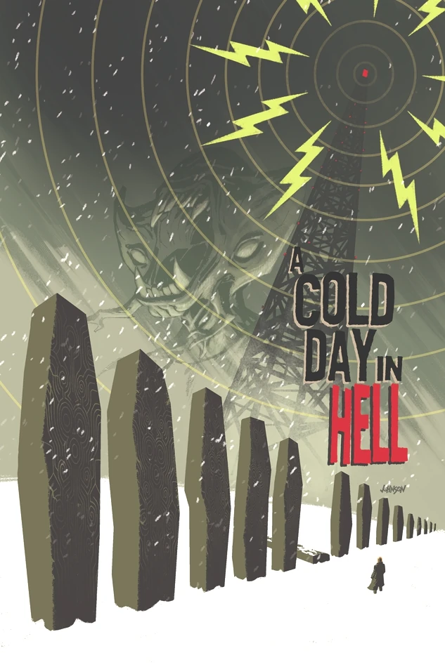
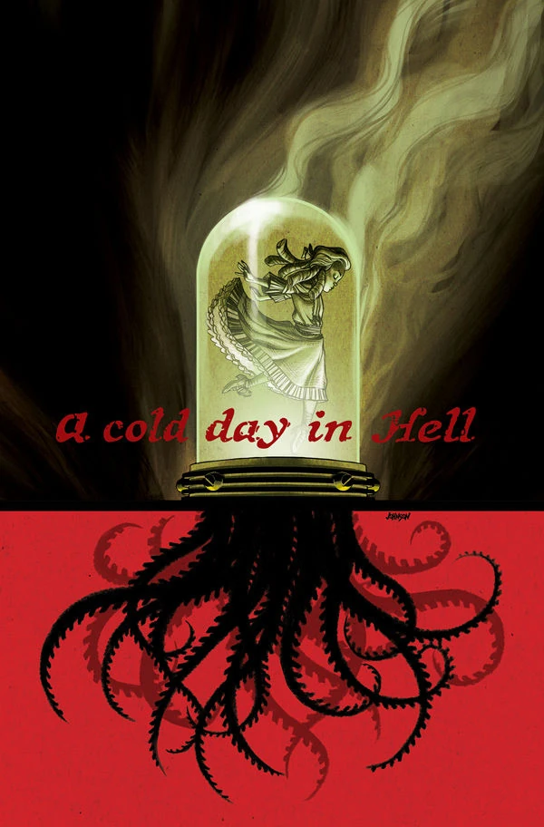

《**地狱寒冬**》（A Cold Day in Hell）是一个两期故事弧，于 2013 年出版，由 [Peter Snejbjerg](/entry/Peter_Snejbjerg) 作画、[Dave Johnson](/entry/Dave_Johnson) 绘制封面。

## 剧情简介

### 第一部

继 *[The Return of the Master](/entry/The_Return_of_the_Master)* 的致命事件之后，俄罗斯秘术科学部门的僵尸局长率领一支营救队穿行于暴风雪中，B.P.R.D. 则与更多蝙蝠脸怪物展开激战。俄罗斯人为何对荒无人烟之处一座倒塌的无线电塔如此痴迷？

### 第二部

俄罗斯的超自然活动骤然升温：来自地狱的恶魔加入战斗，与俄罗斯秘术科学局的僵尸局长交战，企图解救一位被囚禁在人间的高阶恶魔。

## 画廊

 \#2
