*本页介绍的是角色。关于同名漫画连载，参见*[Hellboy（系列）](/entry/Hellboy_%28series%29)。

**地狱男爵**（Hellboy）是一名半恶魔半人类的超自然调查员。他注定要带来世界末日，在第二次世界大战的尾声被召唤到人间，由正义一方抚养长大。尽管恶魔血统赋予他长寿、超凡的神力和与众不同的外貌，他却拒绝自己的天启命运，作为一支向善的力量效力：在为[超自然调查防御署（B.P.R.D.）](/entry/Bureau_for_Paranormal_Research_and_Defense)担当探员以及独自游历的五十年生涯中，与大大小小的超自然威胁作战。

地狱男爵由[迈克·米格诺拉](/entry/Mike_Mignola)创作，也最常由他亲自编剧与绘制，是[同名漫画系列](/entry/Hellboy_%28series%29)以及被称为"地狱男爵宇宙"的庞大作品体系的主角。这个角色还被改编为电影、电子游戏和其他媒体，通常都有米格诺拉的某种程度参与。

## 历史

### 孕育与降生

1574 年 4 月 30 日（[瓦尔普吉斯之夜](/entry/wikipedia%3AWalpurgisnacht)），一场女巫安息日举行。16 岁的女巫 [Sarah Hughes](/entry/Sarah_Hughes) 召唤了恶魔 [Azzael](/entry/Azzael)——她向他祈求并获得了力量，却在不知情中怀上了他的儿子。[1][2]

1617 年 10 月 5 日，[3] Hughes 躺上临终之榻。在她两名已成年、都身为神职人员的子女陪伴下，她在死前忏悔了自己的罪孽，被安放进一具缠着锁链的棺材；她的儿子和女儿要守灵三天，保护她的灵魂不被她此前宣誓效忠的恶魔索走。但 Azzael 不会善罢甘休，他烧死了两人，夺回 Sarah，告诉她腹中怀着他"最宠爱的儿子"，那孩子仍在等待降生。他宣布她永远属于自己，超自然的烈焰锁链钩住 Hughes，把她拖入[地狱](/entry/Hell)。[4]

然而，Azzael 宠爱的并不是 Hughes；他没有像许诺的那样让她恢复青春、与她分享爱意，只是冷漠地看着地狱之火毁灭这个女巫，只留下他刚出生的儿子。这名半恶魔婴儿的右手被砍下，接上一只[巨大的石质前臂](/entry/Right_Hand_of_Doom)，用以迎来世界末日。[5] [万魔殿](/entry/Pandemonium_%28location%29)的其他大公被 Azzael 的图谋激怒，召来毁灭天使惩罚他。就在厄运临头之前，Azzael 把婴儿掷出了地狱。[6]

#### 人间

 1944 年 12 月 23 日之夜，这个地狱之子在人间现身。邪恶的神秘术士[格里高利·拉斯普廷](/entry/Grigori_Rasputin)与第三帝国合作，在其[诸神黄昏计划](/entry/Project_Ragna_Rok)下举行仪式，作为唤醒[奥古·桀哈](/entry/Ogdru_Jahad)流程的一部分。虽然表面看什么都没有发生，他却确信已有某种东西启动了。

在距离拉斯普廷仪式数英里之外的东布罗姆维奇，英国灵媒 [Lady Cynthia Eden-Jones](/entry/Lady_Cynthia_Eden-Jones)（[特雷佛·布鲁姆](/entry/Trevor_Bruttenholm)教授——他隶属于[英国超自然学会](/entry/The_British_Paranormal_Society_%28organization%29)——以及黑修士学院的 [Malcolm Frost](/entry/Malcolm_Frost) 教授陪同在侧）率领一队盟军（由上士 [George Whitman](/entry/George_Whitman) 指挥，装扮奇特的英雄[自由火炬](/entry/the_Torch_of_Liberty)也随行）来到东布罗姆维奇一座教堂的废墟——正是几个世纪前 Sarah Hughes 被索走的那座教堂。就在仪式发生的同一刻，半恶魔婴儿在一团火球中出现在庭院里。尽管在场所有人起初都大惊失色，自由火炬和 Eden-Jones 都认为这个孩童般的生物看起来并不危险；目瞪口呆的布鲁姆吐出一句"地狱男爵（Hellboy）"，这个名字就此叫开。[7]

Eden-Jones[8] 和 [Astaroth](/entry/Astaroth)[9] 都认为：地狱男爵是被 Hughes 那两个人类子女（他同母异父的兄姐）的神圣灵魂吸引到教堂来的，而不是 Azzael 有意把他送到那里，也不是拉斯普廷失手把他召唤到那里。

### 加入 B.P.R.D.

#### 童年

.").") 婴儿地狱男爵被带到新墨西哥州的一处空军基地。不久后，[超自然调查防御署（B.P.R.D.）](/entry/Bureau_for_Paranormal_Research_and_Defense)由布鲁姆（他出任首任局长）和其他超自然专家创立；初创的 B.P.R.D. 获得了地狱男爵的监护权。孩子在特雷佛·布鲁姆和初创的 B.P.R.D. 指导下长大，与基地里的人员互动，例如美国将军 [Norton Ricker](/entry/Norton_Ricker) 和军犬 [Mac](/entry/Mac)。很快喜欢上这个孩子的布鲁姆于 1946 年 3 月正式收养了地狱男爵。[10]

地狱男爵最初是在秘密状态下长大的，陆军高层主要把他视为研究对象；奥本海默、[11] 费曼、爱因斯坦等学界人物被请来研究这个孩子。地狱男爵的消息最终走漏，到 1947 年他已被公之于世，短暂成为原子时代媒体的宠儿；[12] 三岁的地狱男爵登上了 1948 年 5 月号的《LIFE》杂志。[13] 人们通常只把地狱男爵当作一件奇珍异品，像 Frost 那样视他为威胁的人很少，而且基本被当作偏执狂一笑置之。[14]

地狱男爵的身体和心智（即便情感上未必）比人类孩童成熟得更快。[15] 他一周内就学会了爬，一个月大时已经会走路、会说话。[16] 他八岁时看上去已完全成年，此后六十多年里再没有明显衰老。1952 年 8 月 6 日，联合国通过一项特别法案，正式授予地狱男爵荣誉人类身份。[17][18]

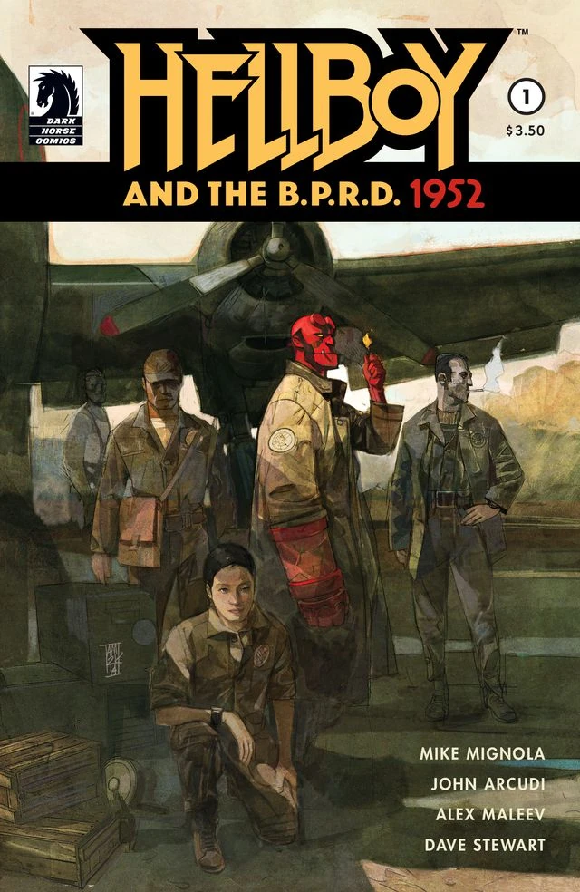

#### 早年生涯

1952 年，在获得荣誉人类身份一周后，地狱男爵作为全职探员正式加入超自然调查防御署。[19][20]

虽然身体已是成年人，地狱男爵的心智成熟得稍慢一些：他仍带着青少年式的叛逆火气和做派。在布鲁姆的教导下，他精通了附身、闹鬼、驱魔、结界、神圣护身符和圣物等诸多超自然科目。

第二次世界大战结束、纳粹政权覆灭后的数年间，地狱男爵周游世界，遭遇并击败了无数超自然生物和异象，例如[狼人](/entry/werewolves)、[吸血鬼](/entry/Vampire_%28creature%29)，还与疯狂的纳粹科学家[赫尔曼·冯·卡朗普特](/entry/Herman_Von_Klempt)交手（*参见[世界上最伟大的超自然调查员](/entry/World%27s_Greatest_Paranormal_Investigator_%28CBG%29)*）。地狱男爵也遭遇过小神祇、神话生物和民间传说中的存在。

两年后，[欧西里斯俱乐部](/entry/Osiris_Club)找到地狱男爵，请他斩杀圣伦纳德之虫——一种形似短吻鳄的怪物。这场战斗实际上是对地狱男爵真正品性的考验：他洒下的鲜血中长出了百合花，这似乎印证了他善良的本性（*参见[野兽的本性](/entry/The_Nature_of_the_Beast)*）。不久后，布鲁姆教授派地狱男爵去协助 [Edmond Aickman](/entry/Edmond_Aickman) 教授研究[沃尔德王](/entry/King_Vold_%28character%29)传说。Aickman 一心惦念着可能的报酬，操纵地狱男爵不情不愿地完成了沃尔德指定的任务（*参见[King Vold](/entry/King_Vold)*）。

1959 年，地狱男爵在爱尔兰执行了一项营救婴儿[爱丽丝·莫纳汉](/entry/Alice_Monaghan)的任务。为了救孩子，他必须背一具尸体前往它的最终安息之地。督办这项任务的是[丹奴神族](/entry/Daoine_Sidhe)之王，他在不久的将来会对地狱男爵产生兴趣（*参见[尸体](/entry/The_Corpse)*）。

##### 1960 年代

1964 年，他与[雅加婆婆](/entry/Baba_Yaga_%28character%29)有过一次著名的遭遇，那是数次交锋中的第一次（见*[雅加婆婆](/entry/The_Baba_Yaga)*）。

##### 1970 年代

1979 年，地狱男爵奉命去协助一位曾名噪一时的实体灵媒 [Mister Tod](/entry/Mister_Tod)。Tod 借助药物进入出神状态，意外放出了一头宇宙怪物，怪物用 Tod 的灵质为自己造出一具躯体（*参见[再见，Tod 先生](/entry/Goodbye_Mister_Tod)*）。这是地狱男爵第一次遭遇[奥格德鲁·赫姆](/entry/Ogdru_Hem)的灵体；他用一种草药击败了那个生物。

##### 1980 年代

1982 年，他追查到了臭名昭著的吸血鬼女伯爵 [Ilona Kakosy](/entry/Ilona_Kakosy)。在她试图用一幅令人不安的幻象分散他的注意后，地狱男爵斩杀了她（*参见[Vârcolac](/entry/The_V%C3%A2rcolac)*）。

##### 1990 年代

1991 年，地狱男爵被召去协助同僚 Pauline Raskine 探员。B.P.R.D. 当时正在调查前 Carp 医生名下宅邸中新发现的一间隐秘地下室。Carp 曾是黄金分会的宗师，那是位于纽约的[拉神赫利奥波利斯兄弟会](/entry/Heliopic_Brotherhood_of_Ra)的一座神庙。地狱男爵了解 H.B.R.，称他们是疯子。一进入房间，地狱男爵就被魔法穿越时间送到了 1902 年，不得不对付那个施虐成性的医生。Carp 设法取得了地狱男爵的恶魔血样，用在一只黑猩猩身上，把猿猴变成了嗜血怪物（*参见[Carp 医生的实验](/entry/Dr._Carp%27s_Experiment)*）。

#### B.P.R.D. 后期生涯

##### 卡文迪什宅邸事件

然而，直到具有开创意义的卡文迪什宅邸任务，地狱男爵才真正遇到一个对他、对同僚亚伯·塞皮恩以及拥有不可控念火能力的[丽兹·舍曼](/entry/Elizabeth_Sherman)都构成极大威胁的挑战。事情始于地狱男爵与导师[特雷佛·布鲁姆](/entry/Trevor_Bruttenholm)会面，教授正想告诉地狱男爵一段令他不安的关键记忆。突然，一群青蛙涌进房间，布鲁姆离奇身亡；愤怒的地狱男爵与一个人形[青蛙怪物](/entry/frog_monster)正面对峙。

一支小队被派往闹鬼的卡文迪什宅邸，成员包括地狱男爵、亚伯和丽兹，去向年迈的[卡文迪什夫人](/entry/Emma_Cavendish)问话——布鲁姆遇害前几秒正努力回想要告诉地狱男爵的事，当时提到了她广为人知的家族传承。卡文迪什夫人是位寡妇，几个月前失去了三个儿子：他们曾与特雷佛·布鲁姆一同前往北极，寻找一座传说中的神庙。她说这是家族的诅咒：自 Elihu Cavendish 起，家族中的每个男人都执迷于从北极取回某样东西。许多人再也没有回来。

真相是，卡文迪什家的几个儿子和布鲁姆一道抵达了北极的一座秘密神庙。他们在那里遇到了格里高利·拉斯普廷，他多年来一直为一头可怕的宇宙巨兽——[奥古·桀哈](/entry/Ogdru_Jahad)——蛰伏效力。拉斯普廷已成了这些生物进入我们世界、在人间掀起末日的唯一希望。小队意外惊醒了一头沉睡的[奥格德鲁·赫姆](/entry/Ogdru_Hem)——[Sadu-Hem](/entry/Sadu-Hem)。它的气息改变了卡文迪什三兄弟和他们向导的身体，而拉斯普廷放过了布鲁姆：他读取了布鲁姆的思想，发现了他与地狱男爵的联系。他们搭上一艘船，抵达美国后，布鲁姆被允许带着一段脆弱的记忆逃脱，以便把地狱男爵引到卡文迪什宅邸。

地狱男爵和伙伴们决定在卡文迪什宅邸过夜，进一步探查可能的线索。探员们不知道，复活的拉斯普廷一直在操纵事态，把地狱男爵引向自己，企图强迫这个恶魔履行他作为末日先兆的使命。当年正是拉斯普廷在 1944 年把地狱男爵召唤到这个世界，他一直耐心等待卷土重来、重新控制他"儿子"的机会。当晚拉斯普廷主动现身，妄图胁迫地狱男爵效忠；地狱男爵发现了他，拒绝了这一命运。

亚伯·塞皮恩用鱼叉刺穿拉斯普廷的胸膛，杀死了他。然而，他当时其实是被 Elihu Cavendish 的灵魂附了身。Cavendish 的鬼魂渴望向拉斯普廷报复，为家人报仇。丽兹·舍曼从出神状态中醒来，召唤出一场烈焰风暴，杀死了 Sadu-Hem。地狱男爵成功拒绝了自己的使命，推迟了末日。拉斯普廷的躯体被毁，灵魂被迫逃走，他发誓地狱男爵最终无论愿不愿意都必将履行他的使命。

###### 更多生涯亮点

以下是卡文迪什宅邸事件后，地狱男爵与伙伴们几段值得一记的冒险：

- **1994 年，英格兰东布罗姆维奇**：地狱男爵回到他初次现身于世的那座教堂废墟，在梦境般的幻象中看到了自己的出身：他的母亲年轻时曾与恶魔亲王 [Azzael](/entry/Azzael) 欢好，并在瓦尔普吉斯之夜（对女巫意义重大的一夜）怀上了地狱男爵。（*参见[锁链棺材](/entry/The_Chained_Coffin)*）
- **1994 年，巴尔干 Griart**：地狱男爵和[凯特·考瑞根](/entry/Kate_Corrigan)造访了一座被愤怒的[狼人](/entry/werewolves)鬼魂屠戮的小镇。地狱男爵的熟人[凯利神父](/entry/Father_Kelly)被一个活着的狼人杀害后，此行变成了复仇任务。凯特第一次亲眼看见鬼魂就发生在这次任务中。（*参见[圣奥古斯丁之狼](/entry/The_Wolves_of_Saint_August)*）
- **1998 年，西班牙利萨尔萨**：地狱男爵见到了 [Adrian Frost](/entry/Adrian_Frost)，他是 [Malcolm Frost](/entry/Malcolm_Frost) 的儿子。地狱男爵向 Frost 讲述了自己的身世，两人意识到地狱男爵的石质右手是触发末日的关键。地狱男爵决定留着这只手，以免别人取走并使用它。（*参见[毁灭之右手](/entry/The_Right_Hand_of_Doom)*）

##### 久列斯库事件

1997 年，地狱男爵探寻自己降世本意的旅程迎来第二个重大转折点：任务始于罗马尼亚，调查一只古老箱子失窃，箱中装着 [Vladimir Giurescu](/entry/Vladimir_Giurescu) 的尸体——此人是拿破仑时代的军官，实际上是个吸血鬼。

传说每当 Giurescu 在战斗中受伤，仆人们就把他的遗体送回家族城堡，满月的月光会神秘地使他完全复原。1882 年，Giurescu 伪装成外国贵族，企图建立一个秘密邪恶帝国来征服英格兰。这在 1940 年代引起了纳粹党的注意，他们派出一个由 [Ilsa Haupstein](/entry/Ilsa_Haupstein) 率领的代表团，招募这名不朽的吸血鬼加入他们的事业。会面不欢而散，结果是希特勒下令逮捕并谋杀 Giurescu 的吸血鬼新娘。他和家人被斩首、木桩穿心，然后焚烧；骨灰被送给希特勒。

然而，[Vladimir Giurescu](/entry/Vladimir_Giurescu) 的故事并未就此结束。1997 年，一个名叫 [Howard Steinman/Hans Ubler](/entry/Hans_Ubler) 的前纳粹在自己的博物馆里被枪杀，一只标有"Giurescu 第 666 号货品"的板条箱被取走。据推测，Ubler 在纳粹时期偷走了 Giurescu 的遗骸，几十年来一直把这个死去的吸血鬼藏在博物馆里。如今看来，Giurescu 的追随者们在 Ilsa Haupenstein 带领下赶来救走他们的主人，把他的遗体送往久列斯库城堡，下一次满月将使他复活。

问题在于，久列斯库城堡从未被人找到，它的位置始终隐秘。B.P.R.D. 探员凯特·考瑞根对城堡可能的位置粗略猜了三处，三组探员被分别派往三地，以防其中一处是真的。地狱男爵独自前往第一处，[Clark 探员](/entry/Clark)和亚伯·塞皮恩前往第二处，丽兹·舍曼、[Bud Waller](/entry/Bud_Waller)和新人探员 [Sidney Leach](/entry/Sidney_Leach)调查第三处。

地狱男爵及时赶到，发现 Ilsa 已经准备好了复活仪式，但他因遭遇鸟身女妖般的色萨利女人而分了心。与此同时，拉斯普廷的灵魂已经归来，他成功把 Ilsa 变成女神[赫卡特](/entry/Hecate)的转世化身，赫卡特与地狱男爵交战。地狱男爵被俘、被锁在柱子上等死之际，复活的 Giurescu 向他冲来，却在一声爆炸中毙命——地狱男爵把柱子折断成两截，击中了吸血鬼的坐骑马。盛怒之下，曾是 Ilsa Haupenstein 的铁处女吞掉地狱男爵，把他困在一个异次元空间中。

他遇到一群自称就是"混沌"本身的存在，它们告诉地狱男爵，他拥抱自己使命的时刻终于到来。它们用它们所认定的他的真名——"阿南·乌·拉玛"（世界毁灭者）——束缚住他，地狱男爵额头上两只被锯断的角开始重新长出，他头顶还浮现出一顶火之冠冕。

然而，地狱男爵拒绝了这个名字，并成功压制住变身，他对那些灵魂说："去你们的！"同时掰断了新长出的角；这一举动体现了地狱男爵对向善事业的忠诚，也证明无论出身和使命如何，他都是一个本性良善的存在。这反抗的一瞬立刻把他送回我们的世界，他在那里见到了凯特·考瑞根。由于机场发生事故，后援始终没有到；凯特告诉震惊的地狱男爵，在他冒险期间，另外两队也各自遭遇了不幸。

丽兹·舍曼意外复活了一个[真人大小的人造人](/entry/Roger)，它吸干了她的力量、杀死了 Bud Waller 后逃走。丽兹对此事深感愧疚。与此同时，亚伯·塞皮恩和 Clark 探员因追踪到地狱男爵的定位装置信号，前往一座教堂，以为会在那里与他会合。

但那其实是拉斯普廷设下的陷阱：卡文迪什宅邸事件中，这名神秘术士曾被亚伯一叉穿胸，他要向亚伯报复。Clark 在过程中被杀，亚伯则侥幸生还。[Vladimir Giurescu](/entry/Vladimir_Giurescu) 的骸骨被 B.P.R.D. 收回，地狱男爵和同僚探员们被空运回家，被刚完成的任务折腾得筋疲力尽。

与此同时，拉斯普廷的另外两个党羽[克焰人](/entry/Karl_Ruprect_Kroenen)和[利奥波德·克茨](/entry/Leopold_Kurtz)在挪威的城堡里试图遵从拉斯普廷的意志。两名纳粹科学家受托为 Giurescu 组建一支军队，由他率领发动毁灭人类的战役，从而促成拉斯普廷策划的"诸神黄昏"末日。然而，由于克焰人违抗命令复活了拉斯普廷所鄙视的纳粹科学家赫尔曼·冯·卡朗普特，并意外导致克茨死亡，这位不死神秘术士弄瞎了[辛科公司](/entry/Zinco_Corporation)的总裁 [Roderick Zinco](/entry/Roderick_Zinco)。Zinco 惊慌失措中误触按钮，炸毁了堡垒。不过，克茨和克焰人不知怎的幸存下来——大概是托了拉斯普廷的福——并在 B.P.R.D. 故事[《俄罗斯》](/entry/Russia)中重新出现。

##### 近乎巨像

丽兹·舍曼的力量被人造人夺走后，在 Wauer 研究所接受 Olasz 医生的治疗。与此同时，地狱男爵和凯特·考瑞根调查一个失踪十字架和几具失踪尸体。罪魁祸首正是那个人造人，他祈祷上帝让自己死去。但他没有死，反而遇到了自己的哥哥，哥哥告诉他关于创造者的事，以及他们推翻人类的计划。地狱男爵和凯特发现了人造人的巢穴，在那里遭到他哥哥那些粗制人造人爪牙的袭击。凯特被擒，人造人的哥哥打算利用她为自己造一具巨大的人造人躯体栖身。凯特获救，但邪恶的哥哥操纵巨躯攻击地狱男爵。第一个人造人随后看似屈从了哥哥的意愿，成为巨躯的一部分。但他用从丽兹那里取来的念火能力摧毁了邪恶哥哥的新躯体。他们火速赶往 Wauer 研究所，抵达时丽兹刚刚断气几分钟。接着，此时已被称作"[罗杰](/entry/Roger)"的人造人把念火能力还给丽兹，以自己的生命为代价换回了她的生命。

##### 邪恶小盒

1999 年，一场神秘袭击后，地狱男爵和亚伯调查了 Guarino 伯爵的城堡。这次任务中，巫师 [Igor Bromhead](/entry/Igor_Bromhead) 释放了被圣邓斯坦封在盒子里的小恶魔 [Ualac](/entry/Ualac)。Ualac 教会 Bromhead 地狱男爵秘密真名的一部分——"阿南·乌·拉玛"——并使他暂时瘫痪。亚伯被一只黑猩猩开枪击中，那猩猩正是从前的伯爵变形而成。Ualac 索取了天启之冠（它无形地戴在地狱男爵头上），随后又企图夺走地狱男爵的石质右手。多亏丹奴神族的指点，地狱男爵挣脱束缚，毁掉了敌人的凡俗躯体。Bromhead 和 Ualac 被恶魔 [Astaroth](/entry/Astaroth) 收走，Astaroth 还把地狱男爵的冠冕带回了地狱。

##### 征服者之虫事件

这是地狱男爵层次丰富的生涯中一个里程碑式的时刻。在罗杰、亚伯·塞皮恩等探员同僚的帮助下，他正面对抗一场前所未有的威胁：一个宇宙实体与一名纳粹科学家结合，那名科学家在太空中漂浮了数十年，如今成了那头巨兽降临人间的容器。这头野兽据称是奥古·桀哈的后裔，纳粹在 40 年代就曾试图与它沟通。阻止这条如今受格里高利·拉斯普廷操控的"巨虫"的任务，最终以人造人罗杰的壮烈牺牲达到高潮：他冒着生命危险，试图把巨虫的灵魂囚禁在自己体内。在著名电视连续剧英雄大螯虾强生的鬼魂协助下，地狱男爵成功驱走了巨虫的意识，受伤的罗杰得到了 B.P.R.D. 探员的救治。

![征服者之虫事件过后，地狱男爵于 2001 年 2 月 5 日从 B.P.R.D. 辞职。[21]](/content/images/Conqueror_Worm_4.jpg "In the wake of the Conqueror Worm Affair, Hellboy resigned from the B.P.R.D. on February 5, 2001.") 任务开始前，Manning 曾交给地狱男爵一个装置，万一罗杰再次变得危险就用来杀死他；如今地狱男爵对自己的职业深感内疚。随后，他心情沉重地向凯特·考瑞根宣布辞职，动身去一劳永逸地查明那个始终萦绕着他的所谓命运背后的真相。

### 离开 B.P.R.D. 之后

#### 独行的地狱男爵

主条目：*[第三个愿望](/entry/The_Third_Wish)*、[岛屿](/entry/The_Island)*

2004 年，地狱男爵前往非洲，在那里见到了一位名叫 [Mohlomi](/entry/Mohlomi) 的非洲巫医。当非洲的灵魂警告他只剩最后一夜可以在它们的土地上安眠时，Mohlomi 把他带到海边，声称大海正在召唤地狱男爵。他最终被三条人鱼俘虏，她们把一根魔法钉钉进他的额头，把他带到 [Bog Roosh](/entry/Bog_Roosh) 那里——那是一位强大的海巫，打算肢解地狱男爵、藏起毁灭之右手，以此阻止末日。Bog Roosh 以满足三条人鱼（她的孙女们）的愿望为交换得到地狱男爵。尽管前两个孙女被自己的愿望害死，第三个活了下来，因为她只愿望寻回亡父的渔叉。人鱼父亲的鬼魂归来，斥责她为了试图挽回父亲的名誉而绑架地狱男爵这个无辜者。她心生愧疚，偷偷回去救出地狱男爵。地狱男爵杀死 Bog Roosh，驱散了她力量的来源——被囚的溺水水手灵魂。然而她的孙女成了新的 Bog Roosh，取代了她。孙女从地狱男爵额头拔出魔法钉，但他陷入昏迷，在海上漂流了两年。

两年后，地狱男爵被冲上一座无名荒岛。在那里，他意外复活了一位古老神秘术士，得知了宇宙的隐秘历史。通过神秘术士的血，[Urgo-Hem](/entry/Urgo-Hem) 复活并一度杀死地狱男爵，随后地狱男爵死而复生、击败了怪物。他再次回绝[赫卡特](/entry/Hecate)要他拥抱命运的劝诱，扬帆离岛，前往英格兰。

#### 雅加婆婆的复仇

*主条目：* *[黑暗召唤](/entry/Darkness_Calls)*

2007 年，地狱男爵回到英格兰，住在多年前已故的朋友 [Harry Middleton](/entry/Harry_Middleton) 家中。一次外出散步时，他被女巫们拦住并带到意大利。她们解释说，[Igor Bromhead](/entry/Igor_Bromhead) 已制服赫卡特、企图成为女巫之王，但她们不肯服从，转而希望地狱男爵来领导她们。地狱男爵拒绝了她们，转身离开。

被激怒的女巫们于是接受[雅加婆婆](/entry/Baba_Yaga_%28character%29)的交易，把他交给她；他被投入她的俄罗斯异次元，在那里受折磨并被处死，以报复他在 1964 年打瞎她的眼睛。地狱男爵与女巫的爪牙战斗时，得到了其他俄罗斯超自然存在的帮助，例如林神列希、雷神佩伦、一个家神，以及一个名叫 [Vasilisa](/entry/Vasilisa) 的小女孩。恼羞成怒的雅加婆婆派出她的勇士——不死的[科谢伊](/entry/Koshchei_%28character%29)——去杀地狱男爵，交换条件是赐予他渴望已久的死亡。Vasilisa 给地狱男爵指明逃出雅加婆婆世界的路，但科谢伊杀死了她，她留下两件礼物帮助地狱男爵逃脱。雅加婆婆耗尽全部魔力来增强科谢伊的力量、欲置地狱男爵于死地，但最终失败，落得几乎法力尽失。

地狱男爵一回到现实世界，就去找 Igor Bromhead。在那里，他发现巫师已变成怪物——赫卡特的力量太强，他根本无法驾驭。Bromhead 求他结束自己的痛苦，地狱男爵如他所愿杀了他。

#### 秘密遗产

*主条目：[狂野狩猎](/entry/The_Wild_Hunt)*

地狱男爵住在已故的 Capobianco 姐妹家中时，收到欧西里斯俱乐部寄来的邀请函，请他到英格兰会面。他们邀请他加入狂野狩猎——一支由英国精英组成的狩猎队，因为一伙作乱的巨人开始在英国乡间肆虐。结果这是个陷阱：狂野狩猎在途中突然对地狱男爵反目，声称他们绝不会允许魔鬼坐上英格兰的王位。地狱男爵从政杀中醒来后，遭遇了那群巨人——他们趁他昏迷时杀光了狂野狩猎的成员。尽管一只鸟给他机会悄悄逃走，地狱男爵拒绝了，故意与巨人打斗，以宣泄自己遭暗杀的挫败和怒火。在嗜血的狂乱中，他屠杀了巨人，唤醒了自己体内潜藏的恶魔力量。他震惊于自己竟以暴虐巨人为乐，随即逃走。

四十七小时后，地狱男爵前往爱尔兰，与爱丽丝·莫纳汉重聚——1963 年爱丽丝还是婴儿时，他曾把她从精怪手中救下。在收到邀请之前，地狱男爵和爱丽丝已在梦中见过一面，一同参加了精灵王 [Dagda](/entry/Dagda) 的葬礼。爱丽丝随后带地狱男爵去见梅布女王，女王告诉地狱男爵，她看到他有一个逃脱天启命运的机会，并警告他：[利恩湖的棕精灵](/entry/Gruagach)复活了[血皇后](/entry/Nimue)——[梅林](/entry/Merlin)从前的学徒、血之女王——让她统治群龙无首的女巫。正是棕精灵的同谋杀害了 Dagda 王，他们与血之女王计划向人类开战，聚集一支被遗忘的魔法生物大军，夺回地表世界。梅布离开后，地狱男爵和爱丽丝被诱入哥布林的陷阱，其中一只成功给爱丽丝下了毒。三只鸟灵现身，把两人带到一座被恶魔围攻的神秘城堡。群鸟指示地狱男爵杀死守桥的恶魔骑士 [Eligos](/entry/Eligos)，他们才能进入。地狱男爵与 Eligos 交战，一度落于下风，直到一个小恶魔现身相助，告诉他 Eligos 的弱点。击败 Eligos 后，地狱男爵一行终于进入城堡，爱丽丝被治愈。他们随后得知，这座城堡属于女巫 [Morgan le Fay](/entry/Morgan_Le_Fay)。

地狱男爵和爱丽丝从 Morgan le Fay 口中得知：地狱男爵的女巫母亲 Sarah Hughes 是她与亚瑟的儿子莫德雷德的直系后裔，因此地狱男爵才是英格兰正统的国王。Morgan 将王者之剑呈给地狱男爵，敦促他拔剑，从而唤起不列颠高贵亡者的大军，对抗血之女王的部队。地狱男爵不愿再扛起一项沉重的命运，花了些时间思量；但 [Astaroth](/entry/Astaroth) 也现身，出于自己的目的怂恿地狱男爵拔剑。Astaroth 相信一则预言：地狱男爵将篡夺地狱的统治阶层、唤醒沉睡的大军，推倒地狱的围墙，让获得解放的恶魔之奴在人间称尊。在与另一个扭曲的自我幻象搏斗后，Vasilisa 出现，敦促地狱男爵相信爱丽丝对他的信念，而不是听信敌人告诉他的种种黑暗预兆。地狱男爵终于从石中拔出王者之剑，把自己和爱丽丝传送回爱尔兰。

### 死亡与来世

#### 最终之战

*主条目：[风暴](/entry/The_Storm)、[狂怒](/entry/The_Fury)*

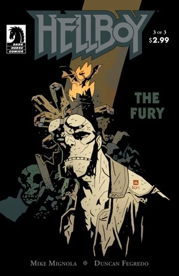 取得王者之剑后，地狱男爵和爱丽丝循着贵族亡者纷纷爬出坟墓的报告前行，印证了 Morgan 的预言。路上他们遭到一个怪物骑士袭击，那是血之女王的勇士，他夸口说血皇后已杀害梅布女王及其盟友。地狱男爵杀死他后，两人在林中发现一家小酒馆并落脚休息。外面风暴渐起，血皇后正集结军队向人类开战，高贵亡者的大军在酒馆外集结，等候地狱男爵的命令。地狱男爵拒绝统率他们，独自走进林中，要用自己的方式面对血皇后。途中他撞见被血皇后逐出的棕精灵——他被吊在绞索上，梅林诅咒他永生不死，好亲眼目睹末日。Astaroth 再次现身，最后一次嘲弄地狱男爵拒绝命运，随后消失。最后，雅加婆婆出现，提出帮他越过血皇后庞大的怪物大军，代价是他的眼睛——他打瞎她眼睛的账终于要还。

地狱男爵赶到血皇后的塔楼，正好目睹她被[奥古·桀哈](/entry/Ogdru_Jahad)附身，变身为一条龙。奥古·桀哈把风暴扩散到整个大不列颠，四处肆虐，为末日做准备。地狱男爵与奥古·桀哈交战，但他渐渐不敌巨龙。Vasilisa 最后一次现身，问他是否准备好面对自己的结局。地狱男爵承认自己准备好了，Vasilisa 递给他一把用血皇后冠冕铸成的剑去斩杀巨龙。与此同时在酒馆，爱丽丝把王者之剑交给一位受祝福的一战士兵 George Washbrook，他重获青春，用圣杯为高贵亡者大军注入力量，率领他们在维格里德——血皇后塔楼下、预言中诸神黄昏的战场——与血之女王的大军交战。爱丽丝逃进森林，遇到由[沃尔德王](/entry/King_Vold_%28character%29)率领的超自然狂野狩猎，却在两军互相屠戮殆尽之后被传送到维格里德。酒馆女酒侍显出梅布的灵魂本相，指引爱丽丝前往塔楼——地狱男爵正在那里与奥古·桀哈作战、拖延末日。爱丽丝及时登上塔顶，目睹地狱男爵击败血皇后和奥古·桀哈。两人还没来得及庆祝，血皇后的鬼魂出现，掏出地狱男爵的心脏，杀死了他，而她自己则被拖入地狱。爱丽丝为地狱男爵哭泣，但英格兰免于覆灭。

#### 在地狱

*主条目：[地狱男爵在地狱（系列）](/entry/Hellboy_in_Hell_%28series%29)*

### 万魔殿

*主条目：[魔鬼旧相识（系列短篇）](/entry/The_Devil_You_Know_%28story_cycle%29)*

## 角色塑造

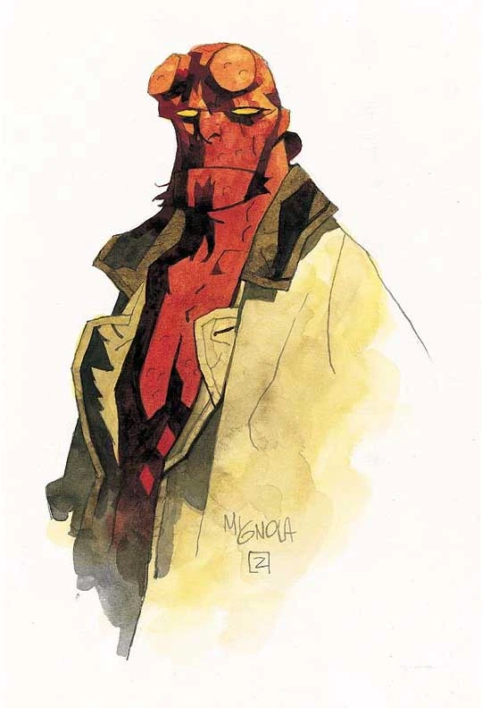

### 性格

地狱男爵常被描述为一个讨喜、粗鲁的人，做派颇有派头，还带着冷幽默。他很容易被自己使用的（往往还不好使的）小装置激怒，但尽管出身恶魔，他却有一颗真正善良的心，对其他人满怀关爱。

他是一个活生生的矛盾体：他是向善的力量，有钢铁般的意志，一心想做正确的事。他一再声明自己对所谓"使命"毫无兴趣，并把内心的矛盾挣扎藏在一个爱插科打诨、闯荡冒险的硬汉外表之下。

### 外貌

地狱男爵身形魁梧，比普通人高出一头（即便他通常佝偻着背），体格结实、肌肉发达（躯干常常不穿上衣）。恶魔血统在他的外貌上一目了然：鲜红的皮肤、纯黄色的眼睛、尖耳朵、偶蹄和一条尾巴。他的面部特征也不完全像人类：鼻子短，下巴巨大如灯笼。

地狱男爵最醒目的特征或许是他的角——他把角截短，只留两个圆圆的大茬。他从小就开始这么做，主要是想让自己少显得"与众不同"一些，[24] 成年后也一直修剪。偶尔，当外部力量试图唤醒他的恶魔命运时，他的角会迅速长成完整长度（远超一英尺），但地狱男爵会立刻拒绝并把角掰断。

他的头发（从年轻时起就）从头顶往后退，通常在脑后紧紧扎成一个简单的发髻。面部胡须修成浓密的连鬓胡和一撮整齐窄短的山羊胡。

##### "毁灭之右手"

*主条目：[毁灭之右手](/entry/Right_Hand_of_Doom)*

地狱男爵另一个最易辨识的特征，是接在他右臂位置的一只巨大石质前肢和三指手掌。它由不属于尘世的材料构成，既无法损毁，也无法分析。[25]

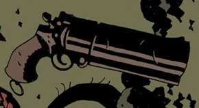

#### 武器与装备

除了天赋异禀，地狱男爵还随身携带各种物件，有些是 B.P.R.D. 的制式装备，有些来自他的私人收藏。

- 地狱男爵通常给自己配上[一把手枪](/entry/Hellboy%27s_gun)，但他枪法糟糕，更爱用拳头战斗。
  - 多年来地狱男爵的主力武器是一把大型单发转轮手枪，是 40 年代超级英雄[自由火炬](/entry/The_Torch_of_Liberty)送给他的。这把枪在 2000 年代初遗失于大海。
  - 2007 年，[Harry Middleton](/entry/Harry_Middleton) 的鬼魂为地狱男爵提供了一把替换枪：一把 1941 年美军制式 M1911A1 .45 口径手枪。
- 地狱男爵常在腰带上或腰带的小袋里装许多护身符和小玩意儿，常被他用来复活死者、保护自己或朋友免受邪恶实体侵害、疗伤等等。
  - 一条天主教玫瑰经念珠和一块铁马掌常被系在他的腰带上。
  - 带扣附近有一个红色大圆片，充当 B.P.R.D. 追踪器，紧急情况下发出信号。[26]
  - 他多功能腰带上的袋子里装满圣物、草药和其他法器，还有各种手榴弹及爆破器材；与超自然野兽搏斗时这些常派上用场。
- 地狱男爵几乎总是穿着一件又大又沉的风衣。
  - 风衣口袋里通常塞满上面提到的许多护身符和图腾，给他更强的超自然防护。
  - 他最初那件风衣袖子上有 B.P.R.D. 的标志，但他离开防御署后标志消失了，说明要么他拆掉了标志，要么他现在穿的根本是一件新风衣。
  - 他的风衣多次严重破损，但每个新故事里它总是修好如初，暗示地狱男爵可能多少懂些织补手艺。
- 在久列斯库任务中，地狱男爵使用喷气背包在城堡上方完成一次高难度降落。然而这个"全新改良"型号很不靠谱：一点火就爆炸，把可想而知怒火中烧的地狱男爵裹在火里。
- 地狱男爵曾短暂挥舞亚瑟王传说中的宝剑[王者之剑](/entry/Excalibur)。据说，挥舞此剑标志着他是英格兰正统国王，并能让他统率英格兰高贵亡者的大军。由于是[亚瑟王](/entry/King_Arthur)的直系后裔，他得以从石中拔出此剑。

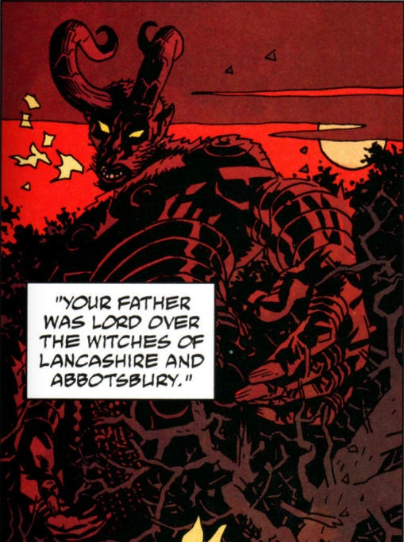

### 出身与命运

地狱男爵的命运一直是该系列一个常见而持续的主题，并且随着每个故事线变得越来越复杂。我们对地狱男爵知道的第一件事，就是他注定成为天启之兽。毁灭之右手来自制造奥古·桀哈的[守望者](/entry/Greater_spirits)之一，手持它的地狱男爵拥有唯一能把可怕巨兽从牢笼中唤醒、放出它们终结人类时代的东西。很长一段时间里，这是他命运的主要焦点，也是他始终回避的事。

然而在狂野狩猎故事线中，他的命运出现了另一个有趣的转折：他的母亲 Sarah Hughes 是叛徒[莫德雷德爵士](/entry/Mordred)的后裔；莫德雷德在杀死[亚瑟王](/entry/King_Arthur)时一同殒命，而他本人是亚瑟王与亚瑟同母异父姐姐 [Morgana Le Fay](/entry/Morgan_Le_Fey) 的私生子。莫德雷德有三个儿子，全被处决，还有一个女儿被藏了起来。通过这个女儿，莫德雷德的血脉一直延续到 Sarah、她的人类子女，以及地狱男爵本人。这使地狱男爵成为亚瑟王的后裔，因而也是英格兰正统的国王。由此有种说法：他注定终要戴上王冠，无论是在地狱还是人间；而作为亚瑟后裔，他的命运就是从石中拔出[王者之剑](/entry/Excalibur)、统率不列颠的亡者大军——这是地狱男爵命运的另一部分，而他对此似乎并不那么确定。

## 盟友与敌人

### 盟友

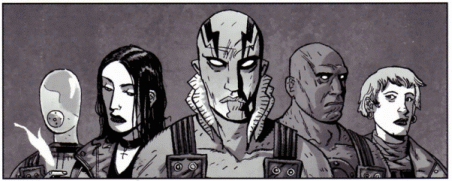
地狱男爵在 B.P.R.D. 的盟友（从左至右：[约翰·克劳斯](/entry/Johann_Kraus)、[丽兹·舍曼](/entry/Liz_Sherman)、[亚伯·塞皮恩](/entry/Abe_Sapien)、[罗杰](/entry/Roger)、[凯特·考瑞根](/entry/Kate_Corrigan)）。

- **[亚伯·塞皮恩](/entry/Abraham_Sapien)**：一名出身神秘的两栖类人形生物，这位同僚探员靠一副鳃在水下呼吸。地狱男爵一开始就同情亚伯，把他从 B.P.R.D. 科学家的解剖刀下救出，此后两人成了最好的朋友，情同手足。在外勤中，亚伯常给地狱男爵当副手，后来在防御署中成为与他平起平坐的一员。
- **[丽兹·舍曼](/entry/Elizabeth_Sherman)**：一个忧郁沉郁的念火者，拥有制造和操控火焰的灵能。然而，她那不稳定、往往极其危险的能力让她满怀负罪感和不自信。童年时她曾意外用能力杀死父母，此后始终被自己的失败和过错纠缠。
  - 在[2004 年电影](/entry/Hellboy_%282004_film%29)中，她被刻画成与地狱男爵有恋爱关系，并在[续集](/entry/Hellboy_II__The_Golden_Army)中怀上他的双胞胎孩子。但在漫画里，两人是兄妹般的关系。
- **[约翰·克劳斯](/entry/Johann_Kraus)**：一名脱离了肉体的德国灵媒；虽然他的身体被毁，他的灵质形态留存了下来。
- **[本·达米奥](/entry/Benjamin_Daimio)**
- **[爱丽丝·莫纳汉](/entry/Alice_Monaghan)**
- **Sidney Leach：**
- **[罗杰](/entry/Roger)**：一个异常巨大的人造人，由血、草药混在罐子里、再拌上马粪创造而成。罗杰是丽兹·舍曼一行在久列斯库事件中发现的：在制造他的秘密实验室里，舍曼好奇地把手伸进他胸口的一个洞，意外把他唤醒。她的火焰能力赋予这个生物生命，受惊、害怕又困惑的人造人出手反击，杀死了 Waller 探员。然而后来，这个最终得名罗杰的生物与地狱男爵对峙，并帮助救活了重伤的丽兹·舍曼。罗杰被授予探员身份，并在征服者之虫任务中成为地狱男爵的亲密伙伴。
- **[特雷佛·布鲁姆](/entry/Trevor_Bruttenholm)**：地狱男爵的导师和养父。姓氏发音为"Broom（布鲁姆）"。教授被格里高利·拉斯普廷召来的一群青蛙杀死，为的是诱使地狱男爵调查这桩离奇凶案，一头栽进疯狂神秘术士的圈套。
- **[Thomas Manning](/entry/Thomas_Manning)**：B.P.R.D. 的负责人、地狱男爵的上司。通常由他向地狱男爵和同僚探员简报新任务。
- **[凯特·考瑞根](/entry/Kate_Corrigan)**：地狱男爵最喜爱的队友之一，凯特是 B.P.R.D. 的资深探员，也是母亲般的人物。她常在旁提供支持、坚定的忠告和批评。作为神秘学专家，凯特是地狱男爵极为亲密的朋友和伙伴。
- 吸血鬼 Angel（同人外传性质）：在 Angel/Buffy 漫画《绝望之城》中，地狱男爵和一个铁血战士在另一个次元客串角斗士，Buffy 和 Angel 最终必须在那里自相残杀。地狱男爵还在另外两部 Angel 漫画中登场：*Past Lives*、*The Book of Carthage*。（[Dark Horse Comics](/entry/w%3Ac%3ABuffy%3ADark_Horse_Comics)）

### 敌人

- **[格里高利·拉斯普廷](/entry/Grigori_Rasputin)**：这位沙俄时代臭名昭著的"疯僧"如今是个不死神秘术士，自称是可怕宇宙实体奥古·桀哈的正式使者，全心全意要不惜一切手段带来末日。40 年代中期他受雇于纳粹，正是那时把地狱男爵召唤到人间，打算让他在即将到来的末日中统率拉斯普廷的军队。他和自己的"造物"在卡文迪什任务中首次相遇，此后一直在操纵诸多事件来推进自己的目的。他与 Ilsa Haupenstein 有过一段恋情。他被认为是地狱男爵的头号宿敌。
- **[赫尔曼·冯·卡朗普特](/entry/Herman_von_Klempt)**：一个疯狂的纳粹科学家，实际上是一颗被养在液体罐子里维持生命的断头。他用无助的乡村女孩做恐怖实验，因而与地狱男爵结下梁子，后者成了他种种扭曲计划的最大对手。他控制着一支巨猩大军，靠植入猩猩大脑的精神装置操控。粗活都由冯·卡朗普特的猩猩们承担，而在疯子冯·卡朗普特无知无觉的控制下，它们其实是多少令人同情的生物。
- **[雅加婆婆](/entry/Baba_Yaga_%28character%29)**：这位强大而古老的女巫住在一栋长着鸡腿的房子里，已在世间存在数百年；自从地狱男爵打瞎她的左眼，她就对他怀恨在心。拉斯普廷称雅加婆婆为祖母，她与这位神秘术士之间有一种温柔的、母亲般的关系。
- **[Ilsa Haupstein](/entry/Ilsa_Haupstein)**：这个纳粹女人是格里高利·拉斯普廷极其忠诚的追随者，对他怀有浪漫的迷恋。她被诱骗相信了拉斯普廷的预言——奥古·桀哈将彻底毁灭地球，再让它重生为一个没有冲突、没有道德罪孽的美丽天堂——于是被说服进入一台金属刑具，那装置把 Ilsa 变成了恶毒的女神赫卡特。这个邪恶实体吞掉地狱男爵，把他送到一个诡异的领域，在那里他直面自己的使命，经历了双角重生。
- **[赫卡特](/entry/Hecate)**：地狱男爵第一次击败 [Vladimir Giurescu](/entry/Vladimir_Giurescu) 后首次遭遇女巫女神赫卡特。赫卡特告诉地狱男爵，他们两人都与末日相连，要么一起死，要么一起活着见证新世界。地狱男爵击败了赫卡特，但她靠 Ilsa Haupstein 的血与骨驱动的铁躯继续存活。

## 其他媒体

*另见：[地狱男爵的其他版本列表](/entry/%3ACategory%3AAlternative_versions_of_Hellboy)*

### 电影

#### 2004–2008 电影系列

*参见[地狱男爵（2004–2008 电影角色）](/entry/Hellboy_%282004%E2%80%932008_film_character%29)*

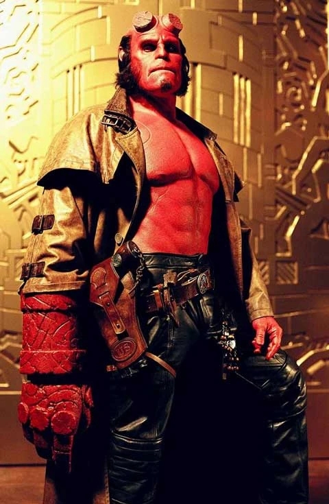 [2004 年电影](/entry/Hellboy_%282004_film%29)由 [吉尔莫·德尔·托罗](/entry/Guillermo_del_Toro) 执导，它帮助公众更广泛地认识了这个角色，催生了更多粉丝。

剧情主要围绕地狱男爵的出身展开，序幕描绘了格里高利·拉斯普廷把他召唤到人间，以及年轻的特雷佛·布鲁姆把他从邪恶势力手中救出。到了现代，地狱男爵已是超自然调查防御署的超自然调查员。他发现自己不仅要与一支不断增殖、威胁要压倒人类的萨麦尔怪物大军作战，还要面对复活的拉斯普廷的诱惑——后者终于要来实现地狱男爵的使命了……

续集名为《[地狱男爵 2：黄金军团](/entry/Hellboy_II__The_Golden_Army)》，于 2008 年 7 月上映，许多演员回归，如 Ron Perlman、Selma Blair、Doug Jones、Jeffrey Tambor 和 John Hurt（在一段回忆场景中饰演特雷佛·布鲁姆教授）。影片讲述童话生物的隐秘族群（他们被日益崇尚科学的人类拒斥、无视）愤而向人类起义，B.P.R.D. 是阻止这场不断升级的战争的唯一希望。

第三部电影曾有过早期计划，但从未成为现实。

#### *[地狱男爵动画版](/entry/Hellboy_Animated)*

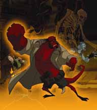 地狱男爵在动画领域也大获成功，主演了一系列直接发行 DVD 的动画长片，并由真人电影的演员们配音（最主要的是 Ron Perlman、Selma Blair 和 Doug Jones）。迄今只发行了两部：《[地狱男爵动画版：风暴之剑](/entry/Hellboy_Animated%3A_Sword_of_Storms)》和《[地狱男爵动画版：铁血惊魂](/entry/Hellboy_Animated%3A_Blood_%26_Iron)》；第三部名为 *Hellboy Animated: The Phantom Claw* 的长片曾投入开发但最终取消。地狱男爵宇宙的这条动画连续性还通过黑马漫画发行的一套短篇图像小说系列得到扩展，（目前）包括漫画合集 *Hellboy Animated: Phantom Legs*（《风暴之剑》DVD 独占）、*Hellboy Animated: The Black Wedding* 和 *Hellboy Animated: The Judgement Bell*。

#### [2019 年电影](/entry/Hellboy_(2019_film))

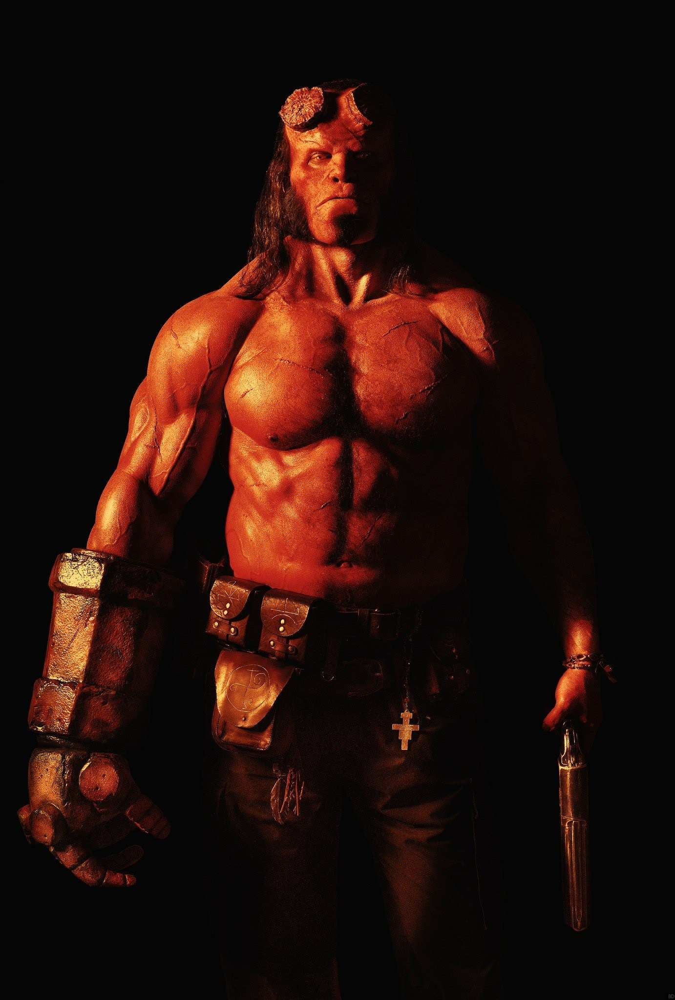 [2019 年电影](/entry/Hellboy_(2019_film))是一部 R 级重启电影，由 [Neil Marshall](/entry/Neil_Marshall) 执导，[David Harbour](/entry/David_Harbour) 饰演地狱男爵（吉尔莫·德尔·托罗未获得头两部电影那样完整的编剧兼导演权限，而 Ron Perlman 拒绝在没有德尔·托罗参与的情况下回归）；影片主要改编自《[黑暗召唤](/entry/Darkness_Calls)》、[狂野狩猎](/entry/The_Wild_Hunt)、[风暴](/entry/The_Storm)和[狂怒](/entry/The_Fury)故事线，讲述地狱男爵对抗[血皇后](/entry/Nimue)。

David Harbour 称这部电影是一部"角色作品，具有成熟主题和复杂题材，足以支撑 R 级评级"；为更好地准备地狱男爵一角，他不仅研究了这个角色，还发短信向迈克·米格诺拉请教他的过往，以及他对某些问题可能的看法；Harbour 还刻意避免模仿 Ron Perlman 对地狱男爵的演绎，而把他演成一个"青少年"，形容他"更年轻、更粗粝，并纠结于自己到底是不是个好人"。米格诺拉也评价 Harbour 版地狱男爵"比 Perlman 版更具戏剧性、更粗砺、情感更有爆发力"。

对于地狱男爵长角的造型，化妆师 Joel Harlow 决定在地狱男爵常规外形基础上做一个"全面升级的版本"："我们给了他更大的下巴、更厚重的眉骨、更鲜亮的黄眼睛、更大的牙齿，当然还有一对极其巨大的角。"

#### *[扭曲人](/entry/Hellboy__The_Crooked_Man_%28film%29)*

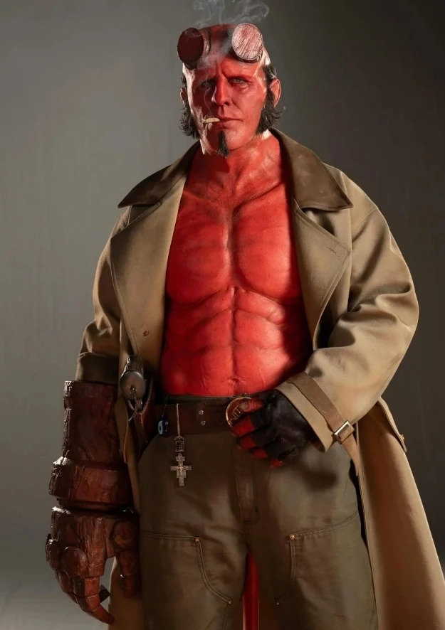 [Jack Kesy](/entry/Jack_Kesy) 在 2024 年的《地狱男爵：扭曲人》中饰演地狱男爵。

### 电子游戏

#### *夜之猎犬* / *寻求庇护者*

地狱男爵主演了 2000 年的 PC 游戏《[地狱男爵：夜之猎犬](/entry/Hellboy__Dogs_of_the_Night)》，由 [David Gasman](/entry/David_Gasman) 配音。

2003 年，这款游戏被移植到 PlayStation，名为 *Hellboy: Asylum Seeker*。

#### *恶魔科学*

《[地狱男爵：恶魔科学](/entry/Hellboy__The_Science_of_Evil)》是 2008 年发行于 PS3、Xbox 360 和 PSP 的电子游戏。游戏改编自 2004 年电影，为宣传续集《黄金军团》而推出，Ron Perlman 为地狱男爵配音。

#### *邪恶恶臭*

《[地狱男爵：邪恶恶臭](/entry/Hellboy%3A_The_Stench_of_Evil)》是 2008 年为手机开发的游戏。

#### *[不义联盟 2](/entry/Injustice_2)*

[地狱男爵](/entry/Hellboy_%28Injustice%29)在 NetherRealm Studios 2017 年的游戏《不义联盟 2》中作为 DLC 角色登场，由 [Bruce Barker](/entry/Bruce_Barker) 配音。在他的单人结局中，原来 Brainiac 曾把他带到 DC 宇宙，想把他收入自己的"特别收藏"，地狱男爵的回应是把他揍倒。此后，击败 Brainiac 的他人气大涨，许多人向他提供职位，但他很快就腻了，表示"这不是我的菜"。等他回到自己的宇宙和防御署，一切都已物是人非。地狱男爵不久决定辞职退休，到非洲隐居。

这个版本的地狱男爵也在《[不义联盟 2 手游版](/entry/w%3Ac%3Ainjustice%3AInjustice_2_Mobile)》中登场。

#### *[Brawlhalla](/entry/Brawlhalla)*

Blue Mammoth Games 的格斗游戏《Brawlhalla》加入了数款仿《地狱男爵》角色的皮肤，作为[2019 年电影](/entry/Hellboy_(2019_film))的联动宣传。[地狱男爵](/entry/Hellboy_%28Brawlhalla%29)作为角色 [Cross](/entry/w%3Ac%3Abrawlhalla%3ACross) 的"史诗联动"皮肤登场。

#### *[地狱男爵：韦尔德之网](/entry/Hellboy_Web_of_Wyrd)*

地狱男爵主演了 2023 年 Good Shepherd Entertainment 的电子游戏《地狱男爵：韦尔德之网》，由 [Lance Reddick](/entry/Lance_Reddick) 配音，这也是这位演员最后的角色之一。

#### 画廊

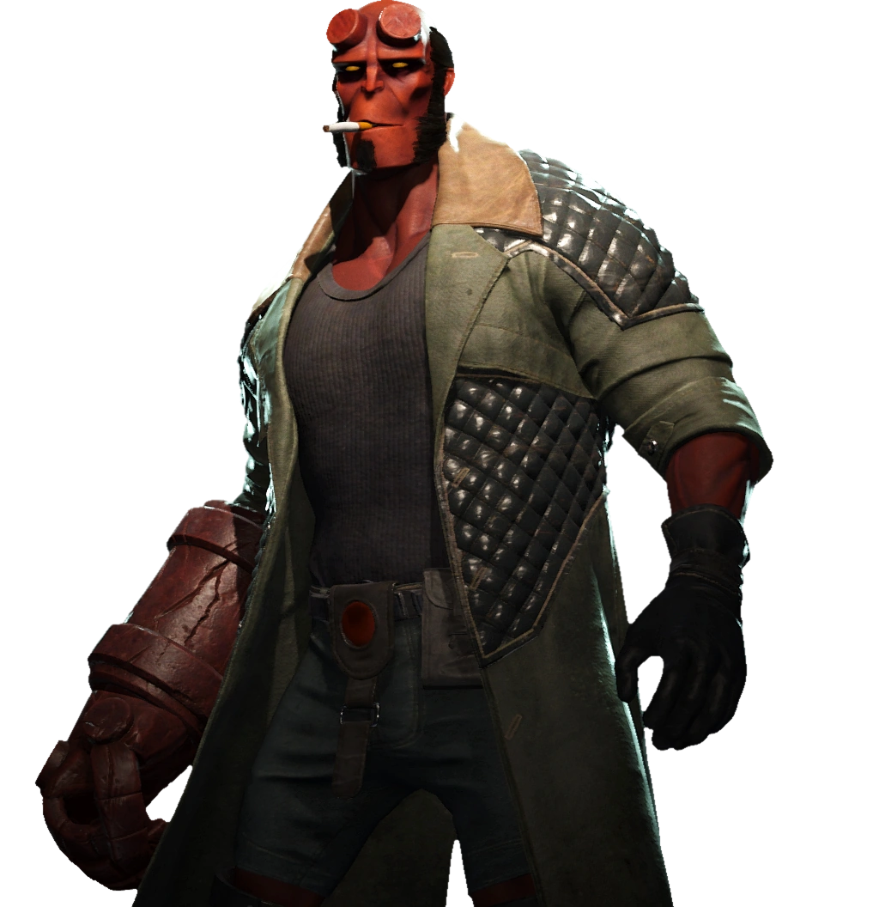

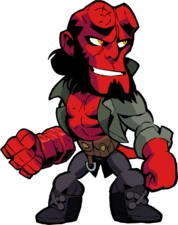

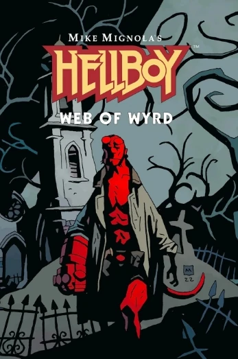

## 幕后

地狱男爵由漫画家[迈克·米格诺拉](/entry/Mike_Mignola)创作，漫画由[黑马漫画](/entry/Dark_Horse_Comics)出版。

这个角色深受漫画读者和评论界好评，由于在其他媒体中的亮相，其人气大幅攀升，最著名的是两部真人电影[《地狱男爵》（2004）](/entry/Hellboy_%282004_film%29)和《[地狱男爵 2：黄金军团](/entry/Hellboy_II__The_Golden_Army)》，两部均由漫画的忠实粉丝[吉尔莫·德尔·托罗](/entry/Guillermo_del_Toro)执导。时至今日，地狱男爵仍是米格诺拉最受喜爱、最具辨识度的创造。

### 史前史

至少有五幅不同的插画可以算作地狱男爵的"首次登场"，因为米格诺拉不断打磨角色的设计和故事，而他发表作品的刊物也越来越有分量。

迈克·米格诺拉笔下第一个名为"地狱男爵"的恶魔角色画作诞生于 1991 年。这幅插画为 91 年大盐湖漫展手册而绘，[27] 画中是一个龇牙咆哮、肌肉发达的恶魔，腰带上印着"Hell Boy"，与最终的角色设计几乎没有相似之处。数十年后米格诺拉回忆道："我在最后一刻加上了地狱男爵这个名字，它把我逗乐了。我并不是想创造一个角色。我只是想画一只怪物。"[28] 他还在展会上为当地一家漫画店老板画过另一幅这个地狱男爵原型的素描。[29]

第一幅与"地狱男爵"角色相像的插画，是他 1993 年 5 月的下一次亮相，[30] 由米格诺拉为意大利同人志 *Dime Press* 第 4 期绘制封面。[31] 此时的角色已清晰可辨地接近最终设计——标志性的断角茬、顶髻、多功能腰带和巨大而不规则的石质右前臂——不过他是灰色皮肤，许多其他细节也与定稿不同。他赤裸的胸口似乎还贴着一个雏形的 B.P.R.D. 徽章。

第一部以地狱男爵为主角的叙事漫画是 [《San Diego Comic-Con Comics》第 2 期](/entry/World%27s_Greatest_Paranormal_Investigator_%28SDCC%29)中一个四页故事，发行于 1993 年 8 月。[32] [John Byrne](/entry/John_Byrne) 根据米格诺拉的故事编写剧本；此时地狱男爵已是一名超自然调查员，设计被进一步打磨，包括他标志性的风衣。这部漫画以黑白制作，印量很小，主要用于宣传圣迭戈漫展。

地狱男爵第一次出现在全国发行的长篇漫画中，是 1993 年 12 月的[《John Byrne's Next Men》第 21 期](/entry/Next_Men__Faith_%E2%80%93_Part_3)。这也是他第一次被画成红色皮肤。[33] 地狱男爵出现在米格诺拉绘制的一段情节中：两个孩子在废弃地铁隧道里遇到他，认出他是漫画书里的角色；他保护他们免受怪物伤害，等他们找到通往地面的出口时便消失了（此时绘画工作交回给 Byrne）。早在几个月前，这部漫画里就出现过一张《地狱男爵》海报（1993 年 4 月的《Next Men》第 14 期）。

第一部独立的、以自己名字命名的《[地狱男爵](/entry/Hellboy_%28series%29)》漫画是四期满的迷你系列《[毁灭之种](/entry/Seed_of_Destruction)》，于 1994 年 3 月推出。Byrne 再次担任编剧，不过这个系列结束后，米格诺拉就不再需要他的协助了。

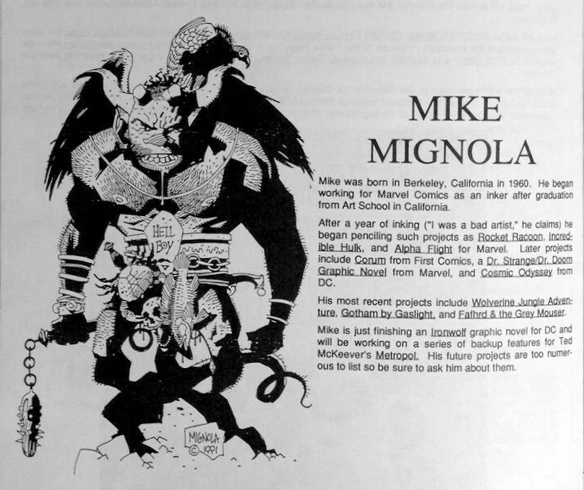

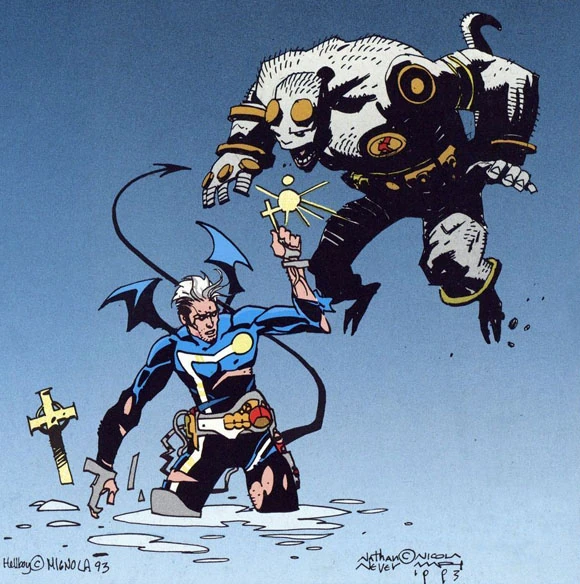

|*Dime Press* 第 4 期（1993 年 5 月）

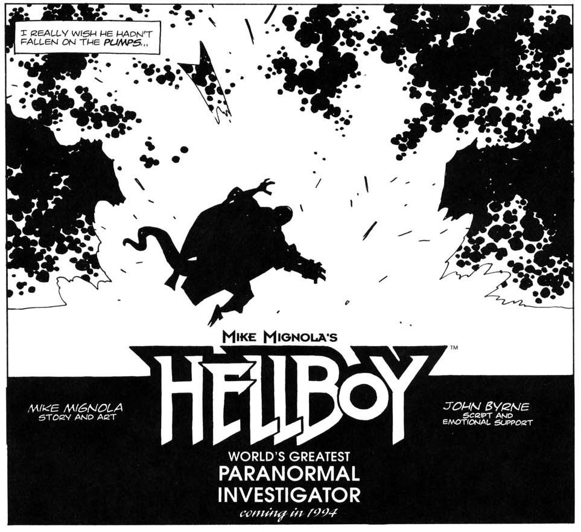

|[《San Diego Comic-Con Comics》第 2 期](/entry/World%27s_Greatest_Paranormal_Investigator_%28SDCC%29)（1993 年 8 月）

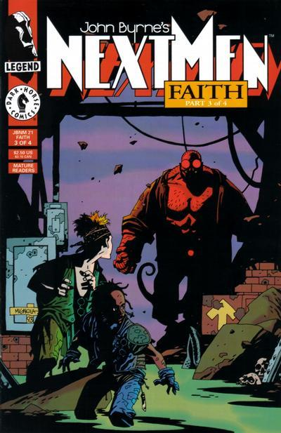

|[《John Byrne's Next Men》第 21 期](/entry/Next_Men__Faith_%E2%80%93_Part_3)（1993 年 12 月）

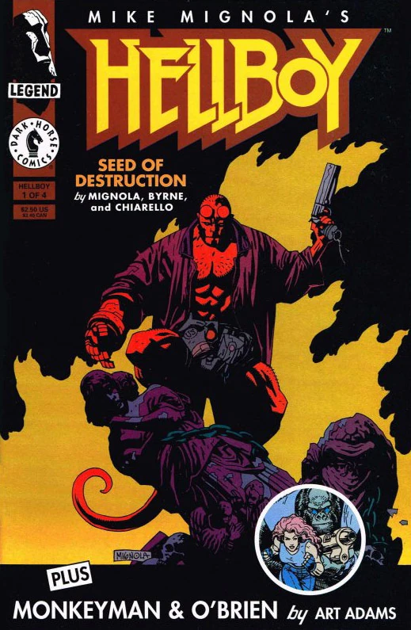

## 趣闻

- 据[米格诺拉](/entry/Mike_Mignola)所说，地狱男爵的性格主要以他父亲为原型：他父亲是个工人，常带着一身伤回家，却总用冷幽默一笑置之。
- 《地狱男爵》漫画，以及米格诺拉作品总体的艺术风格，深受著名连环画插画家杰克·科比的画风影响，此外还受到古斯塔夫·多雷、H. P. 洛夫克拉夫特，甚至布拉姆·斯托克的名著《德古拉》的影响——《德古拉》是米格诺拉最爱的作品之一。
- 最初，地狱男爵本应是米格诺拉构思的一支超级英雄队伍的成员，但画师想不出其他英雄合适的名字，便放弃了队伍的构想。这个概念最终演变成了[*B.P.R.D.*](/entry/B.P.R.D._%28series%29)系列。
- 在执导两部《地狱男爵》电影之前，[吉尔莫·德尔·托罗](/entry/Guillermo_del_Toro)曾为《征服者之虫》故事线的精装版作序。
- 地狱男爵用枪的枪法烂透了，但扔枪却一扔一个准。
- 尽管许多人认为地狱男爵的真名是"阿南·乌·拉玛"（世界毁灭者），他的真名其实是"阿南·乌·拉玛，乌鲁什·安·拉玛"（世界毁灭者，世界创造者）。
- 地狱男爵没有肚脐眼，[34] 这很可能是因为他并非以传统方式"出生"。

## 外部链接

- 黑马漫画网站上的 [Hellboy/B.P.R.D. Zone](https://www.darkhorse.com/Zones/Hellboy)
- [地狱男爵](/entry/wikipedia%3AHellboy) 维基百科条目
  - Heroes Wiki 上的[地狱男爵](/entry/w%3Ac%3Ahero%3AHellboy_%28Hellboy%29)

## 参考资料

[`pt-br:Hellboy`](/entry/pt-br%3AHellboy)` `

[1]

[2]

[3] [*Hellboy in Hell*](/entry/Hellboy_in_Hell) \#2

[4]

[5]

[6]

[7] *[Seed of Destruction](/entry/Seed_of_Destruction)* \#1

[8]

[9] *Hellboy in Hell* \#3

[10] *[Hellboy: The Companion](/entry/Hellboy__The_Companion)*

[11] *[The Chained Coffin](/entry/The_Chained_Coffin)*

[12]

[13] *[Hellboy: The Crooked Man](/entry/The_Crooked_Man_%28comic_story%29)* \#1

[14]

[15] *[B.P.R.D.](/entry/B.P.R.D._%28series%29): [1947](/entry/1947)* \#4

[16]

[17]

[18] ["Hi, My Name's Hellboy"](/entry/Hi%2C_My_Name%27s_Hellboy)

[19]

[20]

[21]

[22]

[23] *[Box Full of Evil](/entry/Box_Full_of_Evil)*（尾声）

[24] *[B.P.R.D.](/entry/B.P.R.D._%28series%29) [1948](/entry/1948)* \#5

[25]

[26] *[Wake the Devil](/entry/Wake_the_Devil)* \#5

[27] Johnston, Rich. ["Mike Mignola's First Hellboy From 1991 Sells For $5000 on eBay"](https://bleedingcool.com/comics/mike-mignolas-first-hellboy-from-1991-sells-for-5000-on-ebay/). *Bleeding Cool*. 2019 年 10 月 22 日

[28] [Omnibus](/entry/Omnibus_Editions) 第 1 卷：*Seed of Destruction*

[29] Flickr 上的["Original Hellboy from 1991 by Mike Mignola"](https://www.flickr.com/photos/40432378@N04/9473412545/in/photostream/)

[30] ["When Was Hellboy's First Appearance? Well…"](https://www.comicsonline.com/2016/01/origins-of-hellboy/). *Comics Online*. 2016 年 1 月 11 日

[31] ["SDCC-Comics \#2 & Dime Press \#4"](https://recalledcomics.com/SDCC-Comics2andDimePress4.php) *Recalled Comics*

[32]

[33]

[34] [*Hellboy and the B.P.R.D.: 1952–1954*](/entry/Omnibus_Editions). 第 403 页。（[Paolo Rivera](/entry/Paolo_Rivera)："我一直想知道地狱男爵有没有肚脐眼——后来我发现他没有。"）
