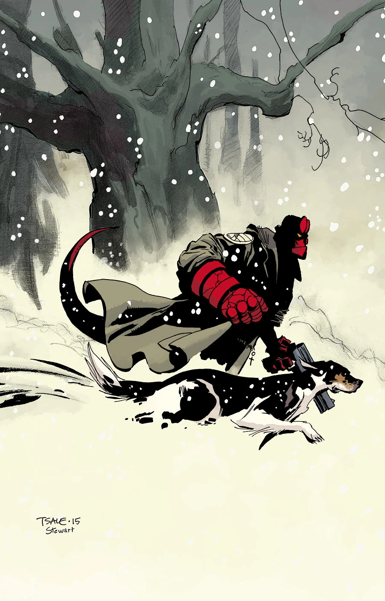
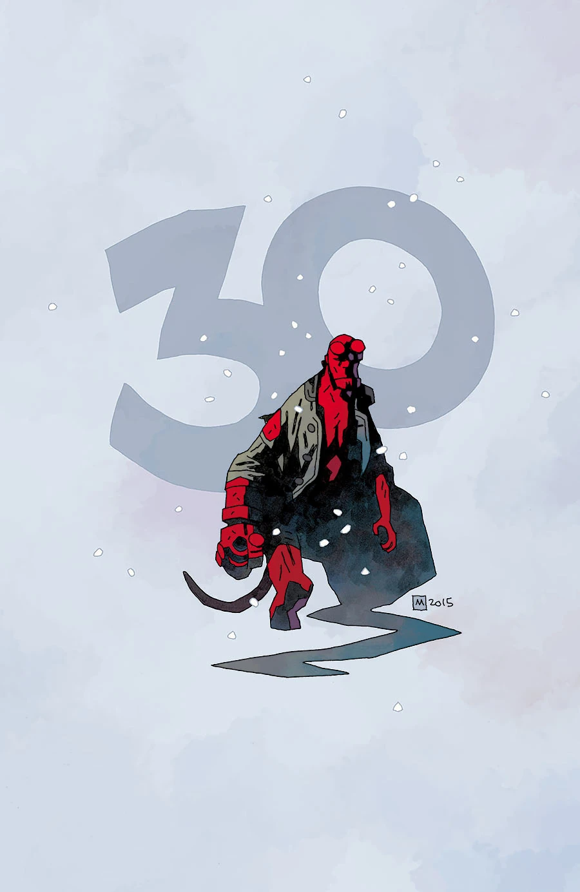
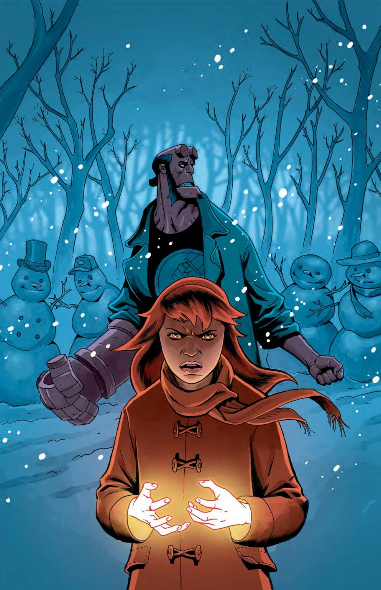
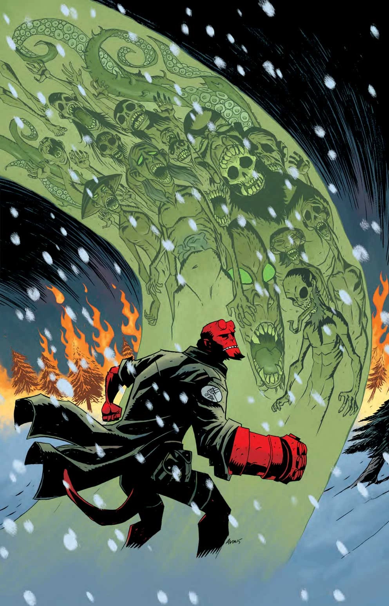

一部收录四个故事的漫画特刊。这部漫画是蒂姆·塞尔（Tim Sale）、迈克尔·沃尔什（Michael Walsh）、克里斯·罗伯森（Chris Roberson）和切尔西·凯恩（Chelsea Cain）在地狱男爵宇宙中的首次亮相。这是一年一度的《[地狱男爵冬季特刊](/entry/Hellboy_Winter_Special)》（Hellboy Winter Special）选集的第一期。

## 征订预告

畅销小说家切尔西·凯恩编剧、迈克尔·埃冯·奥明作画，带来三个大雪封门故事中的第一篇。随后蒂姆·塞尔造访米格诺拉笔下的史前神话；而在即将推出的《[地狱男爵与 B.P.R.D.：1953](/entry/Beyond_the_Fences)》（Hellboy and the B.P.R.D.: 1953）各期的序幕故事中，地狱男爵在怀俄明州的不毛荒原里探查一座闹鬼的矿井。

## 收录内容

- 《[破碎之躯](/entry/Broken_Vessels)》（Broken Vessels），编剧：迈克·米格诺拉、斯科特·阿利；作画：蒂姆·塞尔
- 《[游魂](/entry/Wandering_Souls)》（Wandering Souls），编剧：迈克·米格诺拉、克里斯·罗伯森；作画：迈克尔·沃尔什
- 《[情绪波动](/entry/Mood_Swings)》（Mood Swings），编剧：切尔西·凯恩；作画：迈克尔·埃冯·奥明
- 《[宫保龙虾](/entry/Kung_Pao_Lobster)》（Kung Pao Lobster），作者：迪恩·兰金

## 图集

 斯滕贝克变体封面

 埃冯·奥明变体封面
