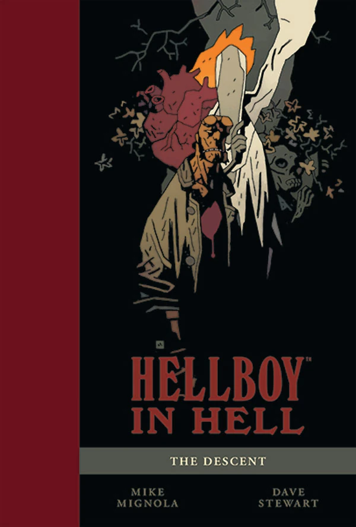
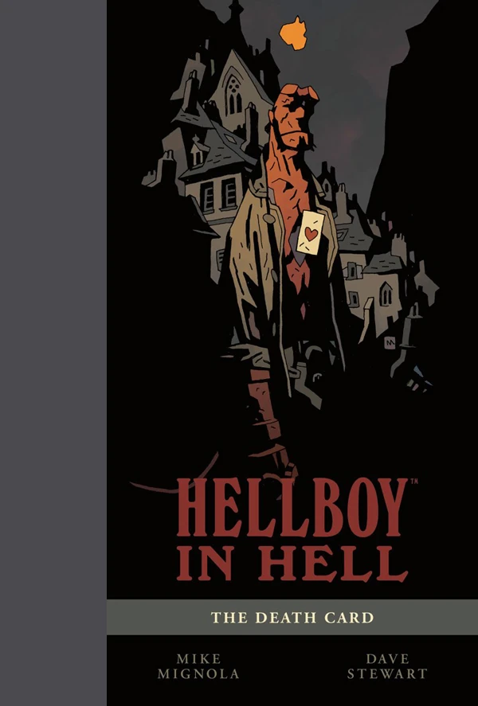

 ***《地狱男爵：地狱篇》（Hellboy in Hell）*** 是一系列围绕角色[地狱男爵](/entry/Hellboy_%28character%29)展开的漫画，是原版[《地狱男爵》系列](/entry/Hellboy_%28series%29)的延续。

## 出版历史

《地狱男爵：地狱篇》（Hellboy in Hell）于 2012 年 12 月创刊，故事紧接*[《地狱男爵：狂怒》（The Fury）](/entry/The_Fury)* 的结尾。与此前的系列不同，《地狱男爵：地狱篇》是一部连载系列（ongoing series）。前四期以月刊形式推出，同属一个故事弧；但此后该系列将以不定期的节奏出版，许多故事弧仅有一期的篇幅。不过，多期故事弧仍将按月刊计划推出。

《地狱男爵：地狱篇》也标志着迈克·米格诺拉（Mike Mignola）回归，重新担任该角色的长期画师。他将亲自编写并绘制《地狱男爵：地狱篇》的全部故事。

2015 年 12 月，迈克·米格诺拉宣布《地狱男爵：地狱篇》将在第 10 期完结。

## 期号编号

《地狱男爵：地狱篇》是一部连载系列，封面上有清晰的期号编号。它不延续其母系列的内部编号。

1.  *[《降临》（The Descent）](/entry/Hellboy_in_Hell_%28first_story_arc%29)*
2.  *[《群魔殿》（Pandemonium）](/entry/Hellboy_in_Hell_%28first_story_arc%29)*
3.  *[《家族纽带》（Family Ties）](/entry/Hellboy_in_Hell_%28first_story_arc%29)*
4.  *[《骑象的死神》（Death Riding an Elephant）](/entry/Hellboy_in_Hell_%28first_story_arc%29)*
5.  *[《三条金鞭》（The Three Gold Whips）](/entry/The_Three_Gold_Whips)*
6.  *[《死亡牌》（The Death Card）](/entry/The_Death_Card)*
7.  [*《冥府的猎犬》（The Hounds of Pluto）*（第一部分）](/entry/The_Hounds_of_Pluto)（亦称*《霍夫曼博士的审判》（The Trials of Dr. Hoffmann）*）
8.  *《冥府的猎犬》（The Hounds of Pluto）*（第二部分）
9.  [*《西班牙新娘》（The Spanish Bride）*](/entry/The_Spanish_Bride)
10. [*《丧钟为谁而鸣》（For Whom the Bell Tolls）*](/entry/For_Whom_the_Bell_Tolls)

## 未编号故事

在《地狱男爵：地狱篇》最初连载完结之后，米格诺拉于 2026 年重返该系列，与其他画师合作，包括[西里尔·波梅斯（Cyrille Pomés）](/entry/Cyrille_Pom%C3%A9s)和[马克·拉斯洛（Márk László）](/entry/M%C3%A1rk_L%C3%A1szl%C3%B3)。

> 是的，我也曾以为《地狱男爵：地狱篇》已经画上了句号——但不久前我发现了西里尔·波梅斯的作品，并立刻爱上了它。我们实际上见了面，当他说想画一个地狱男爵的故事时，我又怎么可能拒绝呢？我脑子里还萦绕着一个地狱故事的半成品构想，便邀请他把它充实起来，所以现在大家看到的是故事层面上真正的合作，再加上他绝妙无比的画技与叙事。[1]

- [*《唯有鲜血》（Nothing But Blood）*](/entry/Nothing_But_Blood)
- [*《恐怖游行》（Parade of Horrors）*](/entry/Parade_of_Horrors)

## 合订本

### 平装合订本（Trade Paperbacks）

*另见[《地狱男爵：地狱篇》平装合订本](/entry/TPB)*
 

《地狱男爵：地狱篇》有其独立的平装合订本系列。

### 图书馆版（Library Editions）

*另见[《地狱男爵》图书馆版](/entry/Hellboy_Library_Editions)*

《地狱男爵：地狱篇》以图书馆版形式结集出版，形式类似*[《地狱男爵》](/entry/Hellboy_%28series%29)*图书馆版。

### SDCC 限定版

《地狱男爵：地狱篇》曾在 2014 年和 2016 年的圣迭戈国际动漫展（San Diego Comic Convention）上推出精装合订本。这些版本不包含任何新内容，而是以超大豪华开本呈现与平装合订本相同的内容，装帧设计与*[《地狱男爵：最初 20 年》（Hellboy: The First 20 Years）](/entry/Hellboy__The_First_20_Years)*艺术画册相配套。

#
出版日期
封面
ISBN

<tbody>

1
July 24, 2014
MIKE MIGNOLA
[ISBN 978-1-61655-545-0](/entry/Special%3ABooksources/978-1-61655-545-0)

2
July 21, 2016
MIKE MIGNOLA
[ISBN 978-1-5067-0243-8](/entry/Special%3ABooksources/978-1-5067-0243-8)

</tbody>

## 角色

- [芭芭·雅嘎（Baba Yaga）](/entry/Baba_Yaga)
- [爱德华·格雷（Edward Grey）](/entry/Edward_Grey)
- [地狱男爵（Hellboy）](/entry/Hellboy_%28character%29)
- [埃利戈斯（Eligos）](/entry/Eligos)
- [撒旦（Satan）](/entry/Satan)
- [阿斯塔罗特（Astaroth）](/entry/Astaroth)
- [阿扎艾尔（Azzael）](/entry/Azzael)（回忆登场 & 冰封状态）
- [萨拉·休斯（Sarah Hughes）](/entry/Sarah_Hughes)（回忆登场）
- [加蒙（Gamon）](/entry/Gamon)
- [拉斯克（Lusk）](/entry/Lusk)
- [利维坦（Leviathan）](/entry/Leviathan)
- [阿姆杜西亚斯（Amdusias）](/entry/Amdusias)（回忆登场）
- [布拉格吸血鬼（Vampire of Prague）](/entry/Vampire_of_Prague)
- [伊扎尔·霍夫曼（Izar Hoffman）](/entry/Izar_Hoffman)
- [厄里倪厄斯（Erinyes）](/entry/Erinyes)
- [加莫里（Gamori）](/entry/Gamori)
- [沙克斯（Shax）](/entry/Shax)（尸体）
- [鲁梅尔（Rumael）](/entry/Rumael)（尸体）
- [地狱男爵的妻子](/entry/Hellboy%27s_wife)
- [别西卜（Beelzebub）](/entry/Beelzebub)
- [普鲁托（Pluto）](/entry/Pluto)
- [贝希摩斯（Behemoth）](/entry/Behemoth)

[1] [地狱男爵（在地狱中）在创作者迈克·米格诺拉的新大事件中回归——抢先看](https://www.polygon.com/hellboy-in-hell-nothing-but-blood-announcement)
