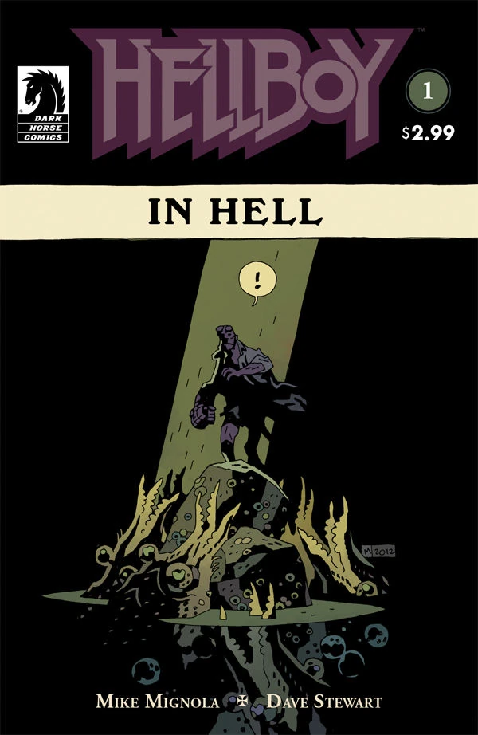
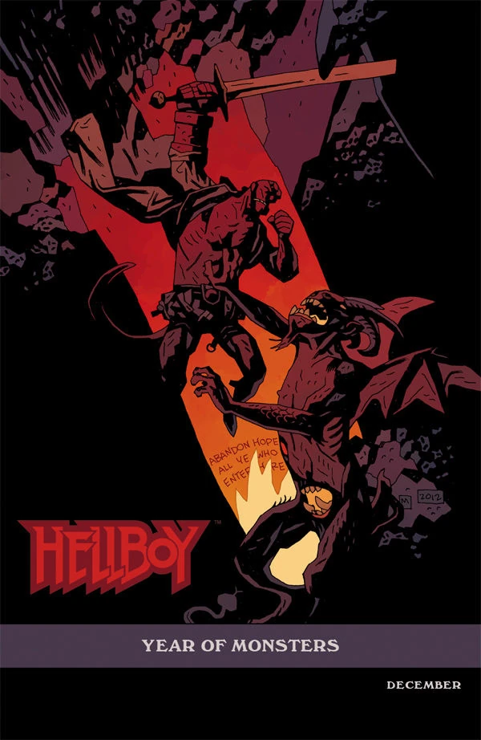
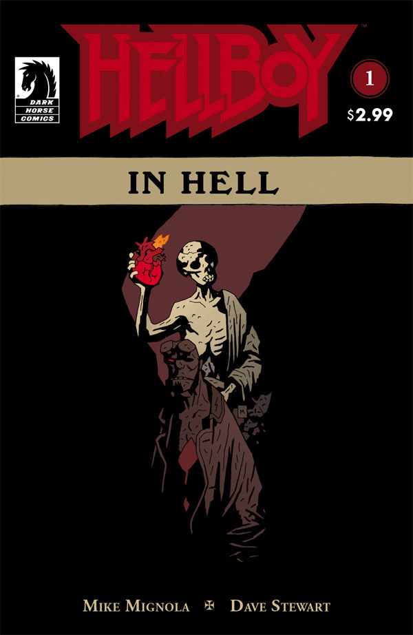
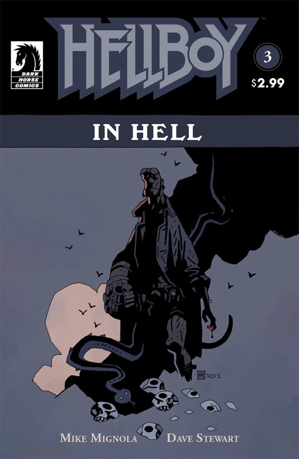

《**地狱篇**》（Hellboy in Hell）讲述了《[怒火燎原](/entry/The_Fury)》（The Fury）事件之后，地狱男爵游历地狱的故事。本文介绍的是该系列的第一个故事弧，有时被称作「The Descent」——这也是收录《Hellboy in Hell》前五期的平装合集之名。官方层面上，这个故事弧并没有标题，但奇怪的是，弧中的每一章却各有其名。这种命名方式在整个《地狱男爵》各条作品线中独一无二。

## 出版史

这个故事弧标志着《地狱男爵》故事的一次重大转变：作品形态从一系列迷你系列转为一部持续连载的 ongoing 漫画。《Hellboy in Hell》的前四期是该系列的第一个故事弧，按月出版。

## 剧情梗概

### 第一章：《The Descent》

尽管地狱男爵在《[山雨欲来](/entry/The_Storm)》（The Storm）和《[怒火燎原](/entry/The_Fury)》中拯救了世界，他最终还是被濒死的[血皇后](/entry/Nimue)（Nimue）所杀——她拖着他的心脏一同坠入了地狱。

本期开篇，[爱德华·格雷](/entry/Edward_Grey)正与[雅加婆婆](/entry/Baba_Yaga_%28character%29)交谈，表明自己希望拯救地狱男爵，帮他分担命运的重负。

地狱男爵抵达了「深渊」（The Abyss）——这地方还算不上地狱，但无疑是在通往地狱的路上。他被一群巨虾般的怪物团团围住。爱德华·格雷赶到，从怪物手中护住了地狱男爵。然而，趁格雷分神之际，地狱男爵遭到了[埃利戈斯](/entry/Eligos)的袭击。这个恶魔是摩根勒菲城堡的桥梁守卫，一心要报《[狂猎](/entry/The_Wild_Hunt)》（The Wild Hunt）中被地狱男爵杀死之仇。

地狱男爵挨了一顿痛打，格雷最终再次出手相救。格雷困住恶魔之后，埃利戈斯发出警告：如果格雷为了敌人而与自己为敌，必将被毁灭。埃利戈斯挣脱了陷阱，此时格雷自觉不是对手，便施法将自己和地狱男爵传送到一处避风港，把恶魔独自留在黑暗之中。

在避风港里，格雷说那恶魔一定会追来，而他打算等埃利戈斯赶到时，就在此地将它困住、并争取将其消灭。地狱男爵说，他记得在《[怒火燎原](/entry/The_Fury)》事件期间的高塔上见过爱德华·格雷（尽管当时并不知道他是谁）。格雷告诉他，自己已经观察他很久，本盼着两人能稍作交谈。可还没等他们来得及说话，埃利戈斯便再次杀到，格雷把地狱男爵送出避风港以保他周全，自己则留下来迎战恶魔。

地狱男爵滚下一段楼梯，落地之后，迎接他的是一场木偶戏，演的正是《圣诞颂歌》（A Christmas Carol）里斯克鲁奇与马利会面的一幕。一个通体白衣的幽灵现身。地狱男爵问它是不是「过去圣诞节之灵」，幽灵答道：「差得远呢。」随即幽灵便带着地狱男爵腾空而去。

### 第二章：《Pandemonium》

幽灵带着地狱男爵离开地狱的众城，越过斯提克斯河（Stygian sea），抵达万魔殿（Pandemonium）——位于地狱中心的撒旦雄城。幽灵透露，地狱男爵不必担心在此遇袭：各路亲王、大臣、公爵、侯爵、伯爵与骑士听闻地狱男爵正在赶来，除了一位之外，全都率领军队逃出了万魔殿。

地狱男爵随后被带往「苍蝇城堡」（Citadel of the Fly）——万魔殿跳动的心脏。幽灵在那里向他展示了属于他的王座、王冠、[他父亲](/entry/Azzael)的佩剑与权戒，这些都理应归地狱男爵所有。地狱男爵拒绝了这一切，幽灵对此似乎毫不意外。

幽灵接着带地狱男爵去见唯一留在万魔殿的恶魔——[撒旦](/entry/Satan)。幽灵告诉地狱男爵，两千年来撒旦一直沉睡在万魔殿的深处，孤身一人，无人守卫，地狱则由他那些低等造物统治着；幽灵随即指出，要杀他易如反掌。幽灵递给地狱男爵一把匕首，匕首随即当啷落地，沾满鲜血。地狱男爵问，为什么恶魔们听说他要来便四散奔逃。幽灵避而不答，地狱男爵突然被传送到科赛特斯河（Cocytus）畔，第二个幽灵在那里迎接他。

地狱男爵看到了普通亡魂的模样：他们像鱼一样在科赛特斯河中游动，被「捕魂者」（The Fisher of Souls）捕捞、锻造成地狱的士兵。幽灵告诉地狱男爵，这支军队将归他指挥，而他的[毁灭之右手](/entry/Right_Hand_of_Doom)正是能赋予这支军队生命的东西——它将摧毁隔开地狱、天堂与人间的壁垒。地狱男爵再次表示，这一切他一概不要。

第三个幽灵抓住他的手臂，地狱男爵立刻被拉回了 1617 年 10 月 5 日——他出生的那一刻。地狱男爵看见自己的母亲[莎拉·休斯](/entry/Sarah_Hughes)被吊在钩子上，面前是地狱男爵的恶魔父亲[阿撒艾尔](/entry/Azzael)、他的叔父[阿斯塔罗斯](/entry/Astaroth)，以及两个哥哥[加蒙](/entry/Gamon)和[卢斯克](/entry/Lusk)。在她被焚烧之际，婴儿形态的地狱男爵从火焰中现身。父亲砍断婴儿的右手，一个通体素白的骷髅形幽灵用「毁灭之右手」替换了被砍去的手。

地狱男爵被拉回当下，阿斯塔罗斯正在那里等候，并以「欢迎回家」一语迎接他。

### 第三章：《Family Ties》

地狱男爵的叔父阿斯塔罗斯一边讲述阿撒艾尔的下落与地狱男爵诞生之地的变故，一边试图说服地狱男爵领取他理应拥有的力量。其他亲王发现阿撒艾尔持有那只手、而且地狱男爵已经降生，便召来毁灭天使，要让这一家覆灭。但他们还是迟了一步：在被毁灭之前，阿撒艾尔把地狱男爵送走了——[拉斯普廷](/entry/Rasputin)——或他人间兄弟姐妹的鬼魂——在《[毁灭之芽](/entry/Seed_of_Destruction)》（Seed of Destruction）的开篇事件中，无意之中把他带到了人间。

他进一步解释：作为创造地狱男爵的惩罚，阿撒艾尔被剥夺了全部力量，永远囚禁在寒冰之中。地狱男爵问阿斯塔罗斯：「为什么是我？」就在此刻，阿撒艾尔的其他儿子们赶到了（他的[女儿](/entry/Gamori)加莫利谢绝前来）。两个哥哥都觉得自己比地狱男爵更有资格继承王座与力量，阿斯塔罗斯则坦言，他已经等得不耐烦，不想再等地狱男爵认领与生俱来的权利。两兄弟向地狱男爵发难，想置他于死地、把那只手据为己有。战斗十分惨烈，阿斯塔罗斯还透露：无论哪个兄弟夺得那只手，他都会从旁辅佐。他接着说，与其看到地狱男爵如今这副模样，倒不如当初让阿撒艾尔死了更好。

加蒙此时插嘴，说阿撒艾尔是个老糊涂，竟挑中地狱男爵而不是他。阿斯塔罗斯闻言动怒，当即将加蒙斩首，以惩其不敬。卢斯克对阿斯塔罗斯的举动大为震惊，阿斯塔罗斯却骂他软弱。最后一番蛊惑落空之后，巨龙般的庞然恶魔[利维坦](/entry/Leviathan)从阿斯塔罗斯、加蒙与卢斯克脚下的冰层中破出，将三人尽数吞吃。

《狂猎》中在桥上助地狱男爵大战埃利戈斯的那个小飞魔出现，告诉地狱男爵：阿斯塔罗斯与利维坦之间有段旧怨，如今算是了结了。小飞魔抱怨说，当初地狱男爵答应过，进入自己的王国后会记着它的功劳，可如今根本没有什么王国，这承诺自然也无法兑现。它接着告诉地狱男爵，有人偷偷潜入撒旦的寝宫，割断了他的喉咙。

随后画面转到地狱男爵走进撒旦寝宫，那把染血的利刃再次当啷落地。地狱男爵对这一切毫无记忆。小飞魔告诉地狱男爵：如今撒旦已死，万魔殿成了一座坟墓，地狱男爵也不再重要了。话音落下，地狱男爵便被送回了深渊。

### 第四章：《Death Riding an Elephant》

地狱男爵在深渊中漂浮，直到爱德华·格雷施展法术，经由一面镜子把他带进自己在地狱中的住所。格雷说，他已经把埃利戈斯困在了两人先前交战之处，但愿能永世不得脱身。

地狱男爵被房间里一幅名为「骑象的死神」（Death Riding an Elephant）的画作吸引。他回忆起自己第一次去伦敦时见过这幅画：当时他去了白教堂区一家如今已被烧毁的酒馆，爱德华当年就是在那里处理事务的。爱德华说他不忍心让这幅画付之一炬，便把它带到了这里。地狱男爵这才把线索串联起来，意识到与自己交谈的正是传说中的爱德华·格雷。

地狱男爵问，格雷既然是好人一方，怎么会落得身在地狱的下场。格雷回答说，人生并不总是公平的，这一点地狱男爵应当比大多数人更能体会。格雷告诉地狱男爵，他知道是他杀了撒旦；地狱男爵不愿、也不必记起自己做过这件事，但重要的是，事情确已发生。

格雷随后讲述了自己 1916 年如何失踪、最终来到地狱的经过：他当时破坏了[拉神赫利奥皮斯兄弟会](/entry/Heliopic_Brotherhood_of_Ra)召唤恶魔[安杜西亚斯](/entry/Amdusias)的仪式——后者是地狱的大公爵之一；那个只被召唤出一半的造物把爱德华一起拖回地狱，诅咒他永生不死，随即将他撕成碎片，撒落在阿刻戎河（Acheron）畔的礁石间。

后来，栖居在那些礁石中的奇异生物把他重新缝合起来，他如今便以它们重塑的形态生活。早年对自身命运的悔恨如今已经消散——在漫长的生命里，他见识了太多令人惊叹的事物。

两人谈话的这幢房子，原属一个名叫[安格斯·威尔](/entry/Angus_Weir)的巫师：他出卖了灵魂，却又想耍诈让主人们拿不到他们的战利品。他们在他屋里将他攫走，连同整幢房子一起搬进了地狱。威尔死时忏悔了自己的恶行，并在屋子上刻满符文，使任何恶魔都无法入内。地狱男爵能被准许进入，恰恰证明他远非寻常恶魔。

地狱男爵说不，他不过是生前那个自己的死后版本罢了。格雷却让他好好想想：在死亡之中，他终于自由了，世上再没有人觊觎他的右手。地狱男爵似乎接受了这个说法，随后离去。

格雷接着与一个看似安格斯·威尔灵魂的存在交谈。对方指责他对地狱男爵撒了谎——他根本没有自由。地狱男爵仍受宿命束缚，至少还有三件事非做不可。格雷说，他会亲自扛起其中头一副重担，哪怕代价是自身的毁灭；他只希望其余的事还很遥远，好让地狱男爵拥有一段属于自己的时光，暂时感受自由。

## 画廊

封面作者：[Mike Mignola](/entry/Mike_Mignola)。

 \#1

 \#1 变体封面

 \#1 重印版

 \#2

 \#3

 \#4

[pt-br:Hellboy in Hell (primeiro arco da história)](/entry/pt-br%3AHellboy_in_Hell_%28primeiro_arco_da_hist%C3%B3ria%29)
