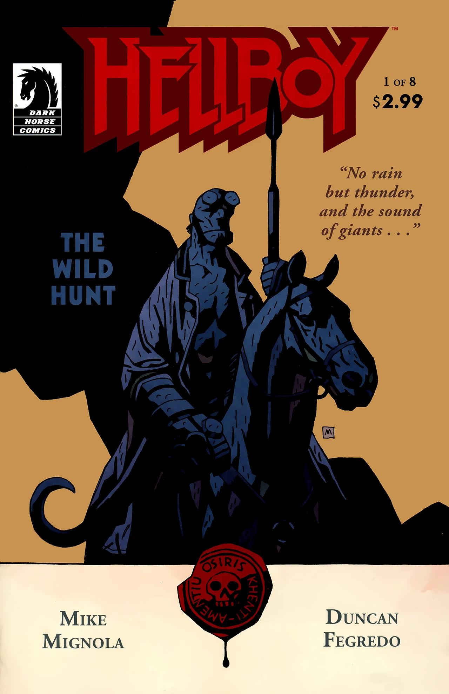
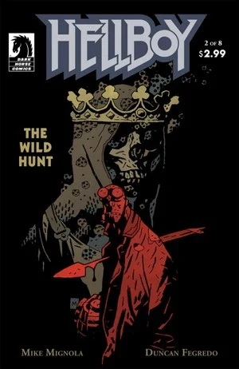
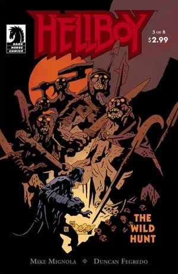
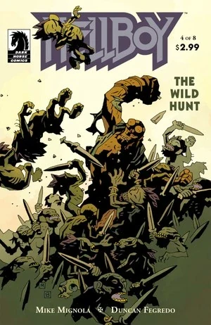
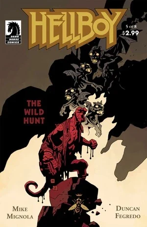
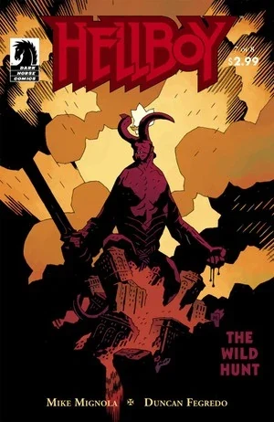
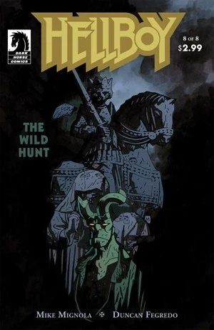

在《**大捕猎**》（The Wild Hunt）中，[地狱男爵](/entry/Hellboy)被[奥西里斯俱乐部](/entry/Osiris_Club)召回英国，与[爱丽丝·莫纳汉](/entry/Alice_Monaghan)重逢，并得知了更多关于自己身世与命运的事情。与此同时，[格鲁阿加赫](/entry/Gruagach)复活了[血之女王](/entry/Queen_of_Blood)，她开始召集自己的军队，准备战争。

## 出版历史

《大捕猎》以八期限定迷你系列的形式出版。它分两个为期四个月的批次发行：2008 年 12 月至 2009 年 3 月，然后是 2009 年 8 月至 11 月。

第 2–7 期每期都包含一个六页的备份故事；

- 第 2–3 期：《[科什切伊如何获得不死之身](/entry/How_Koshchei_Became_Deathless)》
- 第 4 期：《[芭芭·雅加的盛宴](/entry/Baba_Yaga%27s_Feast)》
- 第 5–6 期：[MonsterMen](/entry/MonsterMen) 登场的《O Sinner Beneath Us!》
- 第 7 期：[Henry Hood](/entry/Henry_Hood) 登场的《[凯瑟琳·贝克的葬礼](/entry/The_Burial_of_Katharine_Baker)》

## 剧情简介

### 第一部

紧接着《[黑暗召唤](/entry/Darkness_Calls)》的事件之后，[地狱男爵](/entry/Hellboy)一直待在意大利，和卡波比安科家的两姐妹在一起。在那里他做了一个梦。

地狱男爵身处一片林间空地，看着[达格达](/entry/Dagda)国王的葬礼。有人告诉他，达格达是图哈德达南的最后一位国王，不久之后他所有的族人都将永远离开这个世界。地狱男爵看到了[爱丽丝·莫纳汉](/entry/Alice_Monaghan)——她上次出现时还是《[尸体](/entry/The_Corpse)》里的一个婴儿——但他醒了过来。

两姐妹交给地狱男爵一封信，我们看到这两姐妹和[哈里·米德尔顿](/entry/Harry_Middleton)在《[黑暗召唤](/entry/Darkness_Calls)》中一样，实际上都已经死了。信来自[奥西里斯俱乐部](/entry/Osiris_Club)，地狱男爵随即动身返回英国。在一栋废弃建筑里，他见到了俱乐部的三名成员。他们说一直掌握他的行踪很不容易，并简要回顾了他从《[岛屿](/entry/The_Island)》到《[黑暗召唤](/entry/Darkness_Calls)》的冒险经历。他们告诉地狱男爵，巨人会不时地从坟墓中苏醒，人们会组织一场猎杀将他们再次杀死。这一次出现了六个巨人。他们邀请地狱男爵加入猎杀，他同意了。

在英国的别处，[格鲁阿加赫](/entry/Gruagach)带着盒子来到一座小山顶上，周围聚集着精怪生物。他说当时机成熟时，女王将向集结的军队发表讲话，并召集一支庞大的大军。

猎杀队伍骑马冲向一座桥。队伍中的一个人用长矛刺穿了地狱男爵，他跌入河中。猎队主人告诉地狱男爵，他本不该回来，恶魔永远不可能坐上英格兰的王座。随后他启动长矛，长矛放出电流击中地狱男爵。[1]

### 第二部

地狱男爵被刺穿躺在河岸边。他痛苦地大喊，突然发现自己来到了一个满是死去骑士的房间。房间中央坐着一个头戴王冠的身影，他的壁炉架上有一条红龙。

地狱男爵在河中醒来，周围是如今已经死去的猎手们。一只鸟告诉他，是它女主人的一朵花使他隐形了。地狱男爵折返到巨人们那里，扔下花，向巨人发起攻击。

[格鲁阿加赫](/entry/Gruagach)被化作老人模样的[Astaroth](/entry/Astaroth)走近。阿斯塔罗特问他为什么是公猪的形态。格鲁阿加赫讲述了自己的故事，包括《[尸体](/entry/The_Corpse)》中的事件。阿斯塔罗特给他一只带盖的金杯，杯里盛满了一整个村庄的人的血。格鲁阿加赫把血倒进盒子里，一个浑身是血的女人从盒子中升起。

### 第三部

[地狱男爵](/entry/Hellboy)前往爱尔兰[爱丽丝·莫纳汉](/entry/Alice_Monaghan)的家。爱丽丝说她又开始看见仙灵了。地狱男爵说他本打算在[达格达](/entry/Dagda)的葬礼之后早点来，但他遇上了麻烦。爱丽丝说他们得去见一个人。

那女人坐在曾经装着她身体的盒子上。一个女巫走近她，告诉女王，女巫们都躲藏着，想先看看她会怎么做。女王惩罚了两个背叛她的女巫，并原谅了其他所有把她遗弃在盒子里的女巫。她召唤一支被遗忘者的军队与她一同崛起。

地狱男爵和爱丽丝前去觐见[梅布](/entry/Mab)女王。爱丽丝告诉地狱男爵，一场战争即将来临。她解释说这是地狱男爵造成的，因为他冤屈了[格鲁阿加赫](/entry/Gruagach)、摧毁了[赫卡忒](/entry/Hecate)、又拒绝成为女巫之王，所以格鲁阿加赫才拥立了一位新女王。梅布出现，告诉他们新的女巫女王只想要战争和流血。她解释说，在《[岛屿](/entry/The_Island)》上，那个死去的人取走了他的血，成为了地狱男爵本该成为的那个存在。地狱男爵被派来是为了毁灭世界，即使他拒绝接受这一点。梅布说他无法逃避，但他唯一的机会在于他的母亲，他注定要戴上王冠、召集一支军队来对抗[血之女王](/entry/Queen_of_Blood)。本期结束时，一个小生物出现了。

### 第四部

[地狱男爵](/entry/Hellboy)回想起那场猎杀，回忆起自己屠杀巨人、双角在那一刻重新长出来的情景。

那生物自称名叫埃德蒙，领着[爱丽丝](/entry/Alice_Monaghan)和地狱男爵穿行于世界之间。路上爱丽丝问地狱男爵死去是什么感觉，但地狱男爵并没有真正的答案。埃德蒙问地狱男爵关于一位女神的事，她曾住在莱斯特郡的一棵树下。地狱男爵在 1962 年杀死了那生物，她的追随者——一群小矮人——从地下冒出来攻击地狱男爵。埃德蒙骂地狱男爵是凶手，问他到底杀死过多少拥有力量的存在。小矮人们投掷有毒的小长矛，其中一支击中了爱丽丝的手。三只鸟飞来，吓跑了那些生物。鸟变成三个女人，说她们的女主人有能帮忙的药，并把他们带到了一座被火之护城河环绕的城堡外。

### 第五部

[格鲁阿加赫](/entry/Gruagach)把头枕在[血之女王](/entry/Queen_of_Blood)的腿上坐着。她看到自己的军队开始集结。格鲁阿加赫说，如果能恢复他从前的力量，他就能更好地侍奉她。她说当时机成熟时他会重新变得强大，而[地狱男爵](/entry/Hellboy)会归他所有。

鸟女们告诉地狱男爵，这座城堡已经被恶魔围攻了五百年。地狱男爵前去击败[守桥的恶魔](/entry/Eligos)。那恶魔把地狱男爵摔来摔去，直到火之护城河里的一个下级恶魔把自己的秘密告诉了地狱男爵。地狱男爵击碎了恶魔的戒指，集结的军团随即消失。

一进城堡，一个老人递给[爱丽丝](/entry/Alice_Monaghan)一杯药。地狱男爵转过身，看见了城堡的女主人[摩根勒菲](/entry/Morgan_Le_Fey)。

血之女王接见了一位来自日德兰的使者。他说在开战之日，他的国王将在她身旁作战，并献上一顶王冠。她命令使者把王冠锤成一把用来杀死他国王的刀，并为她打造一顶三只乌鸦造型的铁头盔。她说她将不再被称为女巫之王，而要被称为战争女神。

### 第六部

[地狱男爵](/entry/Hellboy)、[爱丽丝](/entry/Alice_Monaghan)和[摩根勒菲](/entry/Morgan_Le_Fey)围坐在桌旁交谈。摩根问地狱男爵是否知道她是谁。地狱男爵回答说，摩根是亚瑟王同母异父的姐姐，也是亚瑟唯一的儿子莫德雷德的母亲。莫德雷德和亚瑟在战斗中同归于尽，亚瑟幸存的骑士们杀死了莫德雷德的三个儿子。然而莫德雷德还有一个女儿，她活了下来，繁衍出一脉女儿，全都是女巫。摩根说最后一个女儿就是莎拉·休斯，地狱男爵的母亲。她解释说，休斯于 1574 年嫁给了恶魔[阿扎尔](/entry/Azzael)，尽管她在临终前试图忏悔（如《[被锁链的棺材](/entry/The_Chained_Coffin)》中所见），她的人类子女都被杀害，只剩下地狱男爵，作为亚瑟王的继承人、不列颠名正言顺的国王。

摩根领着地狱男爵穿过一扇门，来到一片起伏的草地。草地中央的一个小水潭里，石中插着一把剑。她告诉他，因为他死过又活了过来，不列颠高贵的亡灵将追随他投入战斗。

地狱男爵问[血之女王](/entry/Queen_of_Blood)究竟是谁。摩根解释说她是薇薇安，也叫[Nimue](/entry/Nimue)，她迷惑了梅林并夺走了他的力量。她听到了[奥德鲁·贾哈德](/entry/Ogdru_Jahad)的召唤，那召唤使她发了疯。其他女巫杀了她，但如今她又活了过来，一心只想嗜血。

地狱男爵闪回到自己杀死巨人的时刻。他看到了自己成为天启之兽的潜能，但他掰断双角，否定了那条道路。她告诉他，有了这把剑，他就能拯救自己的人民。地狱男爵问已经明显是一具死尸的摩根，她为什么还在乎这个世界。她回答说，她的儿子莫德雷德国王本该成为国王，但将来成为国王的会是地狱男爵。

### 第七部

地狱男爵穿行在[摩根](/entry/Morgan_Le_Fay)的城堡中，思索着自己得知的一切。他走进[爱丽丝](/entry/Alice_Monaghan)的房间，却看见[瓦西丽萨](/entry/Vasilisa)站在熟睡的爱丽丝身旁。瓦西丽萨告诫地狱男爵要小心。爱丽丝醒来，问地狱男爵关于王者之剑（Excalibur）的事，问他为什么没有拿走它。她问他在来她家之前是不是发生了什么事。他想起了巨人们，但什么也没说。爱丽丝给地狱男爵讲了她的梦。她站在一个满是等待着的高贵骑士的房间里，亚瑟王站在中央，告诉她，她与那把剑紧紧相连，她将第一个看到新国王加冕。她告诉地狱男爵，只要他拿起那把剑，一切都会好起来。

地狱男爵听到嚎叫声，离开了爱丽丝。[阿斯塔罗特](/entry/Astaroth)出现，告诉他那是大捕猎（Wild Hunt）。恶魔提到，有人认为[沃尔德国王](/entry/King_Vold)骑在队伍的最前头。地狱男爵回答说有人说那是魔鬼，但阿斯塔罗特说撒旦已经沉睡了将近两千年。他告诉地狱男爵，总有一天他会前往地狱，杀死撒旦，取得地狱的王冠。他将拿起父亲的剑，率领地狱的军队。他将推倒地狱的高墙，在人间为他们创造一个乐园。

地狱男爵的影子变大，告诉他这一切都将发生。那影子戴着地狱的王冠，握着地狱的剑。地狱男爵与自己的影子搏斗，阿斯塔罗特则一直在告诉他，他必须拿起[Excalibur](/entry/Excalibur)以阻止[Nimue](/entry/Nimue)血腥的大屠杀，而一把剑将指引他找到另一把剑。他的影子长到巨大无比，把地狱男爵打倒。突然火焰从地狱男爵体内喷射而出，一瞬间阿斯塔罗特和影子都消失了。火焰退去，地狱男爵站在冒烟的城堡中。

### 第八部

[地狱男爵](/entry/Hellboy)穿过冒烟的城堡寻找[爱丽丝](/entry/Alice_Monaghan)。他走进她的房间，看到她冒烟的尸体躺在她床的残骸中。[瓦西丽萨](/entry/Vasilisa)再次出现，问他为什么没有拔出那把剑。地狱男爵告诉她，他害怕自己对流血的热爱。瓦西丽萨回答说，爱丽丝相信那把剑会拯救他。地狱男爵慢慢走近那把剑。许多来自地狱男爵过去的生灵在旁观看。[梅布](/entry/Mab)评论说，[达格达](/entry/Dagda)真该活着看到这一幕。[阿斯塔罗特](/entry/Astaroth)、[爱德华·格雷爵士](/entry/Sir_Edward_Grey)、[莫洛米](/entry/Mohlomi)、[芭芭·雅加](/entry/Baba_Yaga_%28character%29)和[科库](/entry/Koku)都在旁看着地狱男爵把剑从石头中拔出。

突然之间，地狱男爵手持剑和爱丽丝站在一起。她完全不记得他们前往摩根城堡的旅程。摩根坐在一张桌旁，桌上摆着棋子。两支骷髅大军对峙，一支黑色一支白色，中央是一个红色的棋子。

[血之女王](/entry/Queen_of_Blood)向地狱男爵挑衅说，即使拿着那把剑，他也不是她的对手。[格鲁阿加赫](/entry/Gruagach)请求恢复他从前的力量，但她说她做不到。她暴怒地拒绝了他，把他扔出了营地。

[奥西里斯俱乐部](/entry/Osiris_Club)的成员围站在一个水晶球旁观察地狱男爵。两个人试图给首相打电话，但被其他成员开枪打死。这些人解释说，他们是 1866 年俱乐部成立时的最初七名成员，当时[Larzod](/entry/Larzod)向他们显现，让他们等待一位国王的降临。最终他们计划砍下他的右手，用它来提升自己的地位。最初的七人杀死了剩下的"新"成员。

群山中传来锤子的敲击声。一位国王死了，被一把镶满宝石的刀刺死。一个矮个子男人在一座巨大的熔炉前锻打。他流着泪举起一顶三只乌鸦造型的头盔。

## 象征意义

### 逆向圣餐

[血之女王](/entry/Queen_of_Blood)在第二部中的复活，可以说是对基督教圣餐仪式的一种反转。[阿斯塔罗特](/entry/Astaroth)用一只圣体杯（Ciborium）——传统上用于圣餐的带盖高脚杯——端来血。在基督教传统中，耶稣自愿献出自己的血以拯救人类。基督徒在庆祝这一救赎时象征性地喝下他的血。而在这里，一个恶魔屠灭了一整个镇子，取走他们的血来复活女王。基督献出自己的血以赐予永生与和平，血之女王却夺取他人的血，带来死亡与战争。

### 王国

在第五部桥上的战斗中，一个下级恶魔主动提出帮助地狱男爵，但他说："你进入你的王国时——求你记念我。"这是对《路加福音》23:42 的引用。耶稣被钉在十字架上时，还有两个罪犯一同被钉。一个嘲讽耶稣，但另一个责备他说，他们作为罪犯罪有应得，但耶稣是无辜的。那罪犯请求耶稣："你进入你的王国时，求你记念我。"[2]

此前，在《[黑暗召唤](/entry/Darkness_Calls)》第 6 期中，[Igor Bromhead](/entry/Igor_Bromhead)也曾请求地狱男爵在他率领地狱军队时记念他。

## 内容

### 角色

#### 一般角色

- 邮递员
- [地狱男爵](/entry/Hellboy_%28character%29)
- [爱丽丝·莫纳汉](/entry/Alice_Monaghan)
  - 莫纳汉夫妇（照片）
- 卡波比安科姐妹
- [奥西里斯俱乐部](/entry/Osiris_Club)成员
- [哈里·米德尔顿](/entry/Harry_Middleton)（闪回）
- [特雷弗·布鲁滕霍尔姆](/entry/Trevor_Bruttenholm)（照片）
- 大捕猎成员
  - 理查德·阿什特里
- 赫恩（壁画）
- 巨蛞蝓
- [亚瑟王](/entry/King_Arthur)
- [科什切伊](/entry/Koshchei_%28character%29)（闪回）
- [莎拉·休斯](/entry/Sarah_Hughes)的子女（闪回）
- [奥德鲁·贾哈德](/entry/Ogdru_Jahad)
- [沃尔德国王](/entry/King_Vold_%28character%29)
- [瓦西丽萨](/entry/Vasilisa)
- [爱德华·格雷](/entry/Edward_Grey)
- [莫洛米](/entry/Mohlomi)
- 俄罗斯式的死神形象[3]

#### [恶魔](/entry/Demon)、[女巫](/entry/Witches)与[巫师](/entry/Witches)

- [恶魔](/entry/Demon)
  - [阿斯塔罗特](/entry/Astaroth)
  - 小恶魔们
  - [埃利戈斯](/entry/Eligos)
  - [阿扎尔](/entry/Azzael)（幻象）
  - 老西班牙人（前神父）
- [女巫与巫师](/entry/Witches)
  - [妮穆艾](/entry/Nimue)
  - 赫莱娜
  - 加内达
  - [博格·鲁什](/entry/Bog_Roosh)（幻象）
  - [伊戈尔·布罗姆黑德](/entry/Igor_Bromhead)（闪回）
  - [摩根勒菲](/entry/Morgan_Le_Fay)
    - 鸟女们
  - [莎拉·休斯](/entry/Sarah_Hughes)（闪回）
  - [芭芭·雅加](/entry/Baba_Yaga_%28character%29)
    - [科库](/entry/Koku)
  - [拉斯普京](/entry/Rasputin)（幻象）
  - [赫卡忒](/entry/Hecate)（幻象）
  - 其他女巫

#### [达努神族](/entry/Daoine_Sidhe)

- [达格达](/entry/Dagda)
- [巨人](/entry/Giant)
- 刺猬
- [格鲁阿加赫](/entry/Gruagach)
  - [格鲁阿加赫的](/entry/Gruagach)情人（闪回）
- [格罗姆（弗摩尔人）](/entry/Grom_%28Fomorian%29)
- [梅布女王](/entry/Queen_Mab)
- "埃德蒙，格洛斯特公爵"[4]
- 黑安妮斯（闪回）
- 黑安妮斯的族人
- 抽烟斗的无名哥布林
- 其他达努神族
- 温德维克国王派来的使者

### 地点

- 意大利
  - 卡波比安科姐妹的宅邸
- 英国
  - 大捕猎集合地
  - [哈里·米德尔顿的](/entry/Harry_Middleton)宅邸（闪回）
  - [摩根勒菲的](/entry/Morgan_Le_Fay)城堡
- 葡萄牙海岸外的岛屿（闪回）
  - 城堡（闪回）
- 爱尔兰
  - 莫纳汉宅邸
- [地狱](/entry/Hell)
  - [万魔殿](/entry/Pandemonium_%28location%29)
- 异界（The Elsewhere）
- [世界之树](/entry/Yggdrasil)

### 值得注意的物品

- 血之圣杯
- "苍蝇之屋"戒指
- [Excalibur](/entry/Excalibur)
- [妮穆艾的](/entry/Nimue)头盔

## 画廊

全部封面由 [Mike Mignola](/entry/Mike_Mignola) 绘制。

第 1 期

第 2 期

第 3 期

第 4 期

第 5 期

第 6 期

第 7 期

第 8 期

## 注释

[1] 一把类似的长矛曾出现在《[卡普博士的实验](/entry/Dr._Carp%27s_Experiment)》中

[2] 《路加福音》23:42，新国际版

[3] *据 Duncan Fegredo 所说（Hellboy Book Club 第 21 集 - Hellboy: Darkness Calls，1:48:05）*

[4] *速写簿中的"Hob Noggins"*
