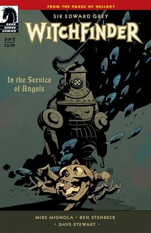
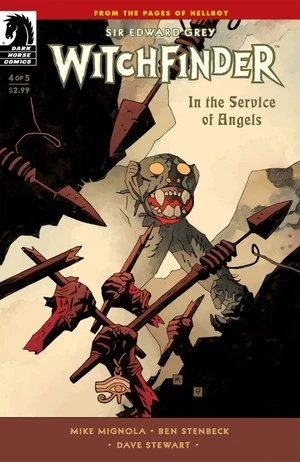

《**天使之令**》（In the Service of Angels）是一部于 2009 年 7 月至 11 月间出版的五期限定连载。它是第一部《[猎巫人](/entry/Witchfinder)》限定连载。

## 剧情简介

### 第一部

1879 年的伦敦，[爱德华·格雷](/entry/Edward_Grey)正在调查一系列残忍的谋杀案，受害者看起来像是遭到了猛兽的撕咬。他拜访了威灵顿勋爵，后者与每一名受害者都存在关联。

威灵顿勋爵曾参加一支前往一座古老的[希波里尔人](/entry/Hyperboreans)城市的探险队，那座城市可能是 Urrasan 或 Hypos。在废墟深处的地下，他们发现了一具完整的、形似人类的[生物](/entry/Servants_of_the_Left_Hand)的骸骨。他们决定把这具骸骨带回英格兰。

不久之后，探险队成员开始因种种神秘的原因死去。两名幸存的队员意识到这与那具骸骨有关，便雇了一名劳工去处理掉它。

威灵顿勋爵在努力回忆那名劳工的名字时突然停止了说话。格雷转过头，看见威灵顿勋爵已经成了一具干瘪的尸体，那只生物正栖息在尸体上方。

格雷遭到那只生物的袭击，但他从威灵顿勋爵的藏品中拿起一把希波里尔之刃后，成功将它逼退。他命令那生物说出自己的名字，然而开口的却是威灵顿的尸体，吐出了唐纳德·布莱克伍德这个名字。

那生物逃走，格雷紧追不舍。他开枪击中了它，但似乎毫无效果，那生物化作迷雾消散了。

格雷设法寻找布莱克伍德，但伦敦的户籍登记册中查无此人。随后，一名神秘的信使送来一张名片，上面写着布莱克伍德的姓名和住址。尽管那个住址位于出了名混乱的东区，格雷仍坚持前往该地址，却只在里面发现了一具被肢解的尸体。

### 第二部

格雷仍在东区的凶案现场，罗伯特·索尔特找上了他。他告诉格雷，自己掌握着与这些谋杀案有关的情报，并要求格雷单独跟他走。索尔特把格雷带到"船长"那里，这个男人关注格雷已有很长时间。

船长虽然对格雷的过去知之甚多，却似乎对这些谋杀案没有更多了解，但他提出可以带格雷去见一个能帮上忙的人。他把格雷带到玛丽·沃尔夫那里，她是一名灵媒，能通过她的灵界向导佐拉与新近亡故者交谈。

玛丽把自己关进一个壁橱里，用自己的生命能量召唤出佐拉。格雷拿不准是否该信任佐拉，认为她或许是魔鬼的爪牙。他坚持要往壁橱里看，结果看到了玛丽，她的身体看起来与威灵顿遭到那生物袭击之后的模样十分相似。佐拉告诉爱德华，他是在为天使效力，并要他当心，因为如此效力者皆有其宿命；她还说，一个幻影走在他身后，额头上写着阿刻戎（Archeron）之名。

随后佐拉唤来了布莱克伍德，他就是受雇去处理那个袋子的劳工。他声称自己把袋子扔进了河里。就在那一瞬间，那生物破门而入，发动袭击。

### 第三部

那只生物变得大得多，显然也更加强大。它杀死了索尔特，并袭击了玛丽所在的壁橱。格雷再一次用希波里尔之刃将它赶走。玛丽认为它袭击自己，是因为她知道它的骨头沉在河里的什么位置。

在等待一队人手打捞骸骨期间，格雷推测那只生物起初以受害者的生命能量为食，直到它能够取得实体形态。它似乎还专门针对那些知道它的来历或其骸骨所在之处的人。

打捞队成功把骸骨捞了上来，[太阳神赫利奥皮克兄弟会](/entry/Heliopic_Brotherhood_of_Ra)的一名代表立刻找上格雷，出价要买这些骸骨。格雷拒绝了，那名代表留下一句警告后离去。

由于拿不准下一步该往何处去，玛丽凭直觉感到他们应该去造访"内在世界教会"。一进门，他们就发现全体会众都坐在长椅上，已经死去，血液被抽干。他们在里屋找到了布鲁姆牧师，他还活着。

布鲁姆解释说，那生物曾向他显形，他误以为它是天使。那生物曾是那些逃入地下的希波里尔人的奴隶。奴隶们起义并屠杀了希波里尔人之后，那生物辗转来到地表，在那里被原始人杀死。那生物再度复活，这一次成了不死之身。近来，每当它虚弱之时，就会造访布鲁姆的会众，而会众们会献出自己的生命之血，帮助它变得更强。最终，它把他们彻底吸干了。

被问及它在哪里时，布鲁姆说它在地窖里。

### 第四部

一只[恐怖的怪物](/entry/Servants_of_the_Left_Hand)在维多利亚时代的伦敦街头横冲直撞，但并非所有人都希望看到这个威胁被消灭。太阳神赫利奥皮克兄弟会想要捕获这只生物，以服务于他们自己的黑暗目的；爱德华·格雷若想在它落入兄弟会手中之前有一丝杀死这头野兽的希望，就必须到一个最不可能的地方去寻求援助——一座疯人院。

### 第五部

在一座疯人院深处，爱德华·格雷与那只一直在维多利亚时代伦敦街头肆虐的神秘野兽展开最终对决。当格雷与年轻的[梅姆南·萨](/entry/Memnan_Saa)相遇时，他领悟到：有时你必须用魔鬼自己的工具来与魔鬼作战。

## 画廊

全部封面作者均为 [Mike Mignola](/entry/Mike_Mignola)。

第 1 期

第 2 期

第 3 期

第 4 期

第 5 期
