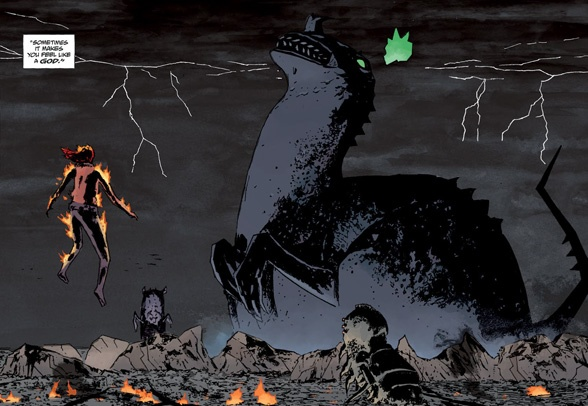
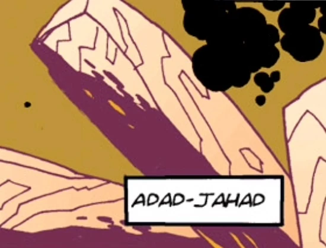
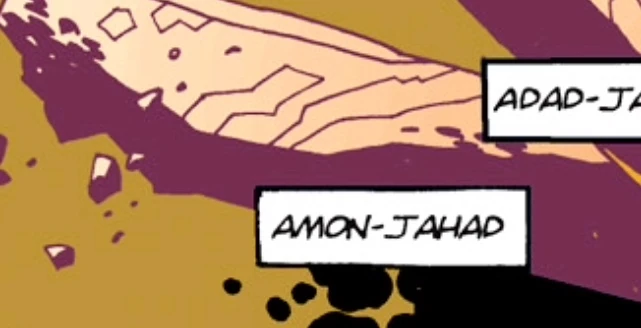
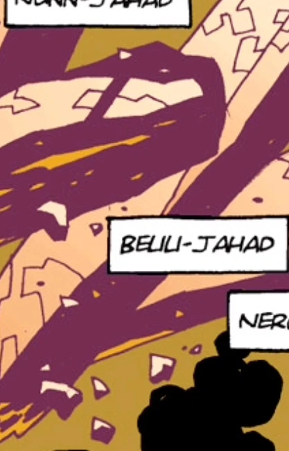
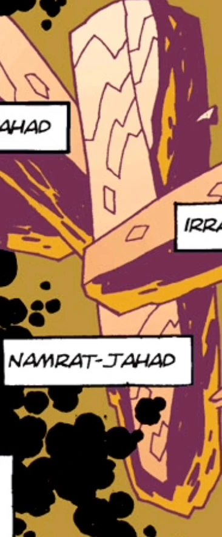
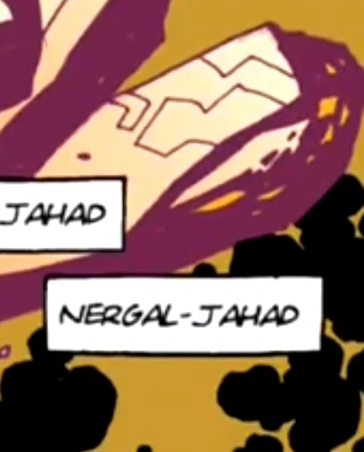

**奥古·桀哈（Ogdru Jahad）**，有时也称 Ogdru eb Jurhad[1]，是迈克·米格诺拉《地狱男爵》漫画系列中的巨型超自然存在，也是主要反派。它们便是《启示录》中的那头巨龙，注定要引发[诸神黄昏](/entry/Ragna_Rok_%28event%29)，即世界末日。

与格里高利·拉斯普廷（Grigori Rasputin）一道，它们及其子嗣可以说是地狱男爵（Hellboy）的头号死敌。地球诞生后不久，它们便被[毁灭之右手](/entry/Right_Hand_of_Doom)囚禁在金色茧壳之中，但在此之前它们已经产下了 369 个子嗣，即[奥格德鲁·赫姆](/entry/Ogdru_Hem)。它们是《地狱男爵》系列的主要反派。

## 概述

奥古·桀哈的创作主要取材于[旧日支配者](/entry/%3Awikipedia%3AGreat_Old_One)——出自[H.P.洛夫克拉夫特](/entry/%3Awikipedia%3AH._P._Lovecraft)的[克苏鲁神话](/entry/%3Awikipedia%3ACthulhu_Mythos)（同时带有明显的古埃及和巴比伦影响），是曾居于地球的远古巨龙般的泰坦级存在。七位成员分别是：

- *[Adad-Jahad](/entry/Adad-Jahad)*
- *[Amon-Jahad](/entry/%E5%A5%A5%E5%8F%A4%C2%B7%E6%A1%80%E5%93%88))*
- *[Beuu-Jahad](/entry/Beuu-Jahad)*
- *[Irra-Jahad](/entry/Irra-Jahad)*
- *[Namrat-Jahad](/entry/Namrat-Jahad)*
- *[Nergal-Jahad](/entry/Nergal-Jahad)*
- *[Nunn-Jahad](/entry/Nunn-Jahad)*

尽管在[《毁灭之芽》](/entry/Seed_of_Destruction)中就已登场，奥古·桀哈的真容却一直被隐去，只展示它们那不透明的水晶囚笼漂浮在深空虚空之中。因此，许多供奉它们的崇拜偶像都使用蛇或龙的原型纹章，且常常长着七个头。直到[《岛屿》](/entry/The_Island)，它们的造型才被揭示出来。

这七头巨龙体型、形状相近：无翼、粗壮，身体形似恐龙，前肢纤细、近乎发育不全。它们最显著的特征是各自独特的头部形状和冠饰（角、鳍等）。一团诡异的绿色火焰王冠悬浮在它们头顶。奥古·桀哈身高堪比山脉，远超它们的子嗣奥格德鲁·赫姆，是系列中出现过的最庞大的生物。

## 性格

关于巨龙的性格，已知的少许信息来自它与地狱男爵的那场决战。在那里，巨龙以单一整体的身份对地狱男爵说话，并因为他选择挺身迎战而对他怀有几分敬意——鉴于地狱男爵选择以人的身份度过一生，奥古·桀哈曾担心他会做出另一种选择。除了对这位命定对手的尊重，奥古·桀哈还傲慢地谈论自己作为毁灭者的角色，并承认这个角色只与地狱男爵共享。它声称对人类并无特别的恨意，而是将这个世界及世间万物视作尘埃，要将它们吹散进无尽的太空。

当 Nunn-Jahad 独自降临地球时，它身上毫无个性可言，对周围世界的绝大部分都视而不见。可以推测，这是它与其余六位分离所致，因为它们似乎以一个意识构成的集体运作。它唯一关心的就是繁殖更多的奥格德鲁·赫姆。

拉斯普廷作为龙的化身时保留了自己的人格，这很可能是因为他主动接受并渴望这份力量，血皇后则不然。

## 历史

奥古·桀哈那茧状的囚笼。

太初之时，[上帝](/entry/God)创造了一批灵体。其中许多高等灵体被送往新生的地球，以守望者的身份看护它。这些灵体之一[阿努姆](/entry/Anum)大胆地从空中取走[火](/entry/Vril)，用泥土造出了奥古·桀哈。其他灵体随即在巨龙四周布下咒语与结界，甚至再次将火注入其体内，但这个存在依然毫无生气。然而，当夜幕降临，奥古·桀哈苏醒过来，被黑暗赋予了目的与机能，并生下了[奥格德鲁·赫姆](/entry/Ogdru_Hem)，它们成为地球上最早的生命形态（奥古·桀哈在与地狱男爵交战时的独白暗示，*它*其实就是黑暗本身，通常被称为奥古·桀哈的七头巨龙不过是它寄身的肉体）。守望的灵体们见到这些可憎之物被造出，便向它们开战。奥格德鲁·赫姆最终被尽数清除，其中许多只能以某种方式勉强维系存在，而奥古·桀哈被其创造者封入水晶监狱，置于深渊的中心。然而，其余守望者不再信任阿努姆，于是将他击倒，毁掉了他的一切残留，只留下一样：[他的右手](/entry/Right_Hand_of_Doom)。上帝俯视所发生的一切，怒而惩罚了办砸差事的守望者：一些被掷入深坑，另一些则被弃在地上，只能与怪物繁衍。

在最初的灵体中，许多低等灵体此时被上帝赐予实体，作为[Hyperboreans](/entry/Hyperboreans)定居地球，他们是先于人类的第一纪元人类。他们找到阿努姆的手，把它带到 Hyperborea 之地，这只手在那里成为圣物，并在国王[托特](/entry/Thoth)的要求下被安装到一座巨大的雕像上。雕像矗立了一万年，直到 Hyperborea 最终因[赫卡特](/entry/Hecate)揭露了托特向人民隐瞒的秘密而堕落腐化。由此产生了多个崇拜赫卡特的邪教，这些教派的可怖行径促使雕像离开托特花园中的位置，屠戮民众，最后纵身跃下悬崖。Hyperborean 一族很快在冰期中淡入传说，其中一部分人把知识传给了后来出现的第二纪元人类（即人类）。

尽管失去了阿努姆的右手，奥古·桀哈仍不断向任何能听见它们声音的敏感心灵伸出触角，无论对方是人、灵体还是恶魔。史前人类开始建立崇拜者邪教，举行各种献祭仪式，妄图用灵魂喂养巨龙以助它逃脱，但他们被掌握第一纪元人类所传知识的萨满击败。某些古代文明，如埃及人和阿兹特克人，也在某种程度上沦为奥古·桀哈的崇拜者，在他们的神话传说中把它们诠释为龙或神。它们网罗到的最重要的爪牙之一是女巫[血皇后](/entry/Nimue)。她引诱并背叛了巫师[梅林](/entry/Merlin)、套取他全部的秘传知识后发了疯，听见了巨龙的声音。连其他女巫都开始畏惧她的疯狂，于是杀死她，把她切成碎块装进箱子，深埋地下。

阿努姆之手后来更名为"**毁灭之右手**"，因为它是把奥古·桀哈从囚笼中释放、进而引发末日的关键；这只手最终落入地狱，恶魔[阿撒艾尔](/entry/Azzael)将它接到自己刚出生的儿子[Anung Un Rama](/entry/Hellboy_%28character%29)的手臂上。然而，他也因此被囚禁于寒冰之中。

随后在 1916 年，奥古·桀哈在[格里高利·拉斯普廷](/entry/Grigori_Rasputin)身上找到了最新的代理人。他遇刺后被扔进涅瓦河，在河中听见了巨龙的声音，并被复活以协助解救它们。纳粹发现了他并将其招纳，相信他的神秘学能够帮助扭转战局。1944 年，他最终将 Anung Un Rama 召唤到地球；尽管他并不完全清楚这位末日先兆究竟降临在何处，却确信自己已经启动了将永远改变世界的一连串事件。第二次世界大战结束后，这个疯僧和他的追随者隐匿起来，直到 1994 年才重启计划。此时那个恶魔之子——如今被称为地狱男爵——已经长大成人，拉斯普廷在[《毁灭之芽》](/entry/Seed_of_Destruction)事件中试图释放奥古·桀哈。虽然尝试失败，他却成功震裂了巨龙监狱的墙壁。这一事件让地狱男爵了解了自己的右手，并使他意识到必须留住这只手，因为试图摆脱它反而更加危险。此前已经有人为了保护世界、也为了加速世界毁灭而试图把地狱男爵与这条手臂分离。地狱男爵相信，自己就是这条手臂最好的守护者。

尽管一些事件已经清楚表明毁灭之右手是释放奥古·桀哈的关键，且屡屡有人失败，但[赫尔曼·冯·卡朗普特](/entry/Herman_von_Klempt)召唤[征服者蠕虫](/entry/Conqueror_Worm)，以及[青蛙怪物](/entry/frog_monster)们召唤[卡塔-赫姆](/entry/Katha-Hem)的行动表明，奥古·桀哈的回归还需要满足其他条件。

在[《狂怒》](/entry/The_Fury)事件中，奥古·桀哈得以通过拉斯普廷在监狱上震出的裂缝伸出触角，附身在血皇后——如今自封[鲜血女王](/entry/Queen_of_Blood)——的躯体上，打算借这个女人为宿主提前回归。鲜血女王化身为一头巨龙，在不列颠岛上空掀起可怕的风暴，数百道闪电蹂躏大地。巨龙与地狱男爵单挑，最终其宿主战死。尽管遭受重创，整个不列颠还是免于注定的毁灭。但这一事件后来被揭示为世界末日将如何开端，而地狱男爵的胜利也仅仅让奥古·桀哈受了伤而已。

在[《末日》](/entry/End_of_Days)中，一头奥古·桀哈（后被确认为[Nunn-Jahad](/entry/Nunn-Jahad)）先于其余六位被从水晶监狱中释放，坠落在堪萨斯州阿真特，将周围数英里地区化为焦土。特殊科学局（SSS）和超自然调查防御署（B.P.R.D.）双双动员起来，Nunn-Jahad 立刻繁殖出一批奥格德鲁·赫姆。[丽兹·舍曼](/entry/Elizabeth_Sherman)和[约翰·克劳斯](/entry/Johann_Kraus)消灭了这些奥格德鲁·赫姆，却无法伤及巨龙本身，被迫撤退。巨龙的降临还把它与召唤它的存在——[黑焰](/entry/The_Black_Flame_%28character%29)——所驱动的灵能网络连接起来。黑焰被击败后，Nunn-Jahad 开始移动，随身带来火焰与闪电的风暴。它每小时都吐出数十只奥格德鲁·赫姆，丽兹和约翰阻挡这股大潮的努力被压垮。在[《时刻降临》](/entry/Cometh_the_Hour)中，军队向它发射了所有可用的核弹头，它却毫发无伤。它最终经过 B.P.R.D. 总部，用一个火球将其摧毁，[凯特·考瑞根](/entry/%E5%87%AF%E7%89%B9%C2%B7%E8%80%83%E7%91%9E%E6%A0%B9)和[潘雅](/entry/Panya_%28character%29)丧生。之后，几位来自地狱的守望者现身拦阻它，他们是被恶魔[瓦尔瓦拉](/entry/Yomyael)召唤来的。尽管守望者们合力攻击，Nunn-Jahad 还是将他们尽数杀死。最终，约翰接引[Vril](/entry/Vril)的无限力量击碎巨龙、将其残骸放逐入虚空，并在此过程中牺牲了自己的灵魂，巨龙这才被毁灭。随着它的死亡，全球的奥格德鲁·赫姆都停止活动、不再显示任何生命迹象，给世界带来短暂的喘息。

Nunn-Jahad 的灵魂以及其他六位的灵魂，后来附身在复活的拉斯普廷身上，导致每一只尚存的奥格德鲁·赫姆重新活动。然而，拉斯普廷在决战中被地狱男爵彻底杀死。

剩余的奥古·桀哈最终被消灭：奥西里斯俱乐部（Osiris Club）利用毁灭之右手的力量，将它们的水晶监狱从深渊中拖出，像掷小行星一样把它掷向地球。随之而来的撞击消灭了当时统治着地球的奥格德鲁·赫姆。它们的生命力被那只手吸尽，奥西里斯俱乐部计划利用这股力量封神，但地狱男爵的幽灵赶来收回那只手，消灭了他们。

在千年之后的未来、一片洪荒般的地球上，奥古·桀哈被记作 Ughdra-Hesh，即播种世界、孕育[Bonji](/entry/Bonji)的仁慈神明。

地球上的 Nunn-Jahad

## 奥古·桀哈的计划

作为一个不朽且力量浩瀚的存在，奥古·桀哈的真实本质无法用言语描述，甚至连它究竟是单一存在还是多个存在都模糊不清，因此它的动机或许无法用人类的概念来表达。正因如此，地狱男爵宇宙中的人类与类人居民，对奥古·桀哈在自由之外还想要什么，提出了各式各样的看法，而自由是它高于一切的渴望。

从[拉斯普廷](/entry/Rasputin)和[诸神黄昏计划](/entry/Project_Ragna_Rok)为释放奥古·桀哈所做的种种尝试来看，它们的获释显然与人类的覆灭紧密相连。但人类如何覆灭则众说纷纭：[赫尔曼·冯·卡朗普特](/entry/Herman_von_Klempt)认为，一旦人类被毁灭，获释的奥格德鲁·赫姆就会释放奥古·桀哈。所有人的幻象都有一个共同点：奥古·桀哈会做出类似"把地球烧成灰烬"的事，因此他们可能都看到了巨龙获释的某个共同幻象，只是在猜测预言将以何种方式应验。

除此之外，关于奥古·桀哈获释后究竟会做什么，存在很大分歧。监视着奥古·桀哈宇宙监狱的外星种族显然把地球视为维持监狱所必需的焦点。一旦奥古·桀哈获释，它们将毁灭地球，继而毁灭整个宇宙。拉斯普廷得到的看法是：奥古·桀哈渴望在旧世界的灰烬上创造一个完美的新世界，供最终纪元的人类居住。赫卡特——她预见自己在世界终结时陪伴在地狱男爵身边——与[Daoine Sidhe](/entry/Daoine_Sidhe)都认为人类将被一个新种族取代。奥古·桀哈借奥格德鲁·赫姆之手，试图以[青蛙怪物](/entry/Frog_monster)的形态创造这个新种族，不过与[亚伯·塞皮恩](/entry/Abraham_Sapien)相比，它们是有缺陷的形态。

## 外貌

奥古·桀哈的外形类似兽脚类恐龙，同时也带有一些两栖动物的特征。

## 奥古·桀哈祷文

以下祷文曾由[格里高利·拉斯普廷](/entry/Grigori_Rasputin)和[血皇后](/entry/Nimue)念诵，拉斯普廷在与丽兹和萨杜-赫姆举行仪式时还加入了其他段落（以**粗体**标出）：

*"它们被锁链锁在天上。七是它们的数目。它们孕育于大洋深处，非男亦非女。它们如同呼啸的风，不知慈悲，不知怜悯。**Nunn-Jahad！** 祈祷与恳求它们充耳不闻。它们就是那古蛇。它们就是暴怒的兽。风暴。**Adad-Jahad！** 它们是邪风。是预示恶兆风暴的邪恶气息。它们是强大的子嗣。瘟疫的使者。Ereshigal 的王座抬举者，**她是世界之间伟大黑暗的女王与主宰。Amon-Jahad！** 它们是席卷大地的洪水。七位力量之神。七只压迫之魔。其七在天，其七在地。**Irra-Jahad！** 它们有巨人的力量与步伐。它们毫无顾惜，把大地像谷物一样碾碎。**Beuu-Jahad！** 它们毫无怜悯，向人类肆虐，要让血如雨下、吞食血肉。**Nergal-Jahad！** 让七位现在从深渊升起。所有锁链尽数抛开。自由属于它们。力量属于它们。**Namrat-Jahad！** 巨蛇，屠杀无情，七头巨龙鳞片闪耀。风暴中的怪物。它们是升起的风，把黑暗投在受诅咒的大地上。**"*

## 名号

*注：单个的 Ogdru-Jahad 似乎以美索不达米亚和埃及神祇命名，说明如下。*

### Adad-Jahad

 Adad-Jahad 很可能得名于阿达德（Adad，𒀭𒅎），美索不达米亚的风暴、毁灭、丰产与占卜之神。在古代美索不达米亚，他因给田野带来风雨而受赞颂，也因能以风暴造成巨大破坏而受畏惧。阿达德也有更具灵性的一面：他与占卜和神谕相关，是驱魔仪式中与恩基、马尔杜克、尼努尔塔等神一同被呼求的神祇之一。他有时与迦南神祇巴力-哈达德相联系；有趣的是，奥塔·本加在《[B.P.R.D.：1947](/entry/1947)》的一场驱魔中把巴力-哈达德称为善灵。

Adad-Jahad 是被奥西里斯俱乐部杀死的六位之一。

### Amon-Jahad

 Amon-Jahad 很可能得名于埃及神阿蒙，太阳与创造之神。对他的崇拜在底比斯城最为盛行，到公元前 21 世纪时已在那里取代了对鹰首战神蒙图的崇拜。此后他的崇拜传遍埃及；在底比斯反抗喜克索斯人、雅赫摩斯一世统治之后，阿蒙与[拉](/entry/Ra)融合，成为阿蒙-拉，成为重要神祇，常被视为创世神，并拥有"不可见者"的称号。[Heliopic Brotherhood of Ra](/entry/Heliopic_Brotherhood_of_Ra)的成员在仪式典礼中也常呼求阿蒙-拉的形象。

Amon-Jahad 是被奥西里斯俱乐部杀死的六位之一。

### Beuu-Jahad/Belili-Jahad（名字有时不明确）

贝丽丽（Belili）是美索不达米亚神话中的女神，可能与格什提南娜女神或宁孙女神有关。据一些资料，她有时也被称为阿努的守门人、Gizzida/Gishzida 的配偶。

Beuu 目前没有已知的神话关联。

Beuu-Jahad/Belili-Jahad 是被奥西里斯俱乐部杀死的六位之一。

### Irra-Jahad

伊拉（Irra）是美索不达米亚的冥界与瘟疫之神，可能只是神祇涅伽尔的另一个名字，但也有人称他是涅伽尔的仆从。

他的名字有时也拼作"Erra"。

Irra-Jahad 是被奥西里斯俱乐部杀死的六位之一。

### Namrat-Jahad

娜姆拉特（Namrat，意为闪耀者）是美索不达米亚神努穆什达的配偶；努穆什达是卡扎鲁城的守护神，也是更为著名的月神辛之子。

Namrat-Jahad 是被奥西里斯俱乐部杀死的六位之一。

### Nergal-Jahad

涅伽尔（Nergal）是美索不达米亚的战争、瘟疫、死亡与疾病之神，也与太阳有关，后来又与冥界相关，是女神埃列什基伽勒的配偶。

《[黑焰崛起](/entry/Rise_of_the_Black_Flame)》中提到了一位名叫涅伽尔的神。他是[埃列什基伽勒](/entry/Ereshkigal)的配偶；埃列什基伽勒被暗示为[Shakti](/entry/Shakti)女神，代表一种与[Vril](/entry/Vril)对等而相反的力量。这构成了各种理论的基础：谁腐化了奥古·桀哈，以及[上帝](/entry/God)是否存在一个邪恶的对立面。

在地狱男爵的[2004 年改编电影](/entry/Hellboy_%282004_film%29)中，他也被设定为[萨麦尔](/entry/Sammael)的父辈，由[亚伯·塞皮恩](/entry/Abe_Sapien)提及。

Nergal-Jahad 是被奥西里斯俱乐部杀死的六位之一。

## 语录

> Obdith Yug Jahood.

> Anung Jahood Un Rama.

> Ogdru Sug Abal. Ogdru Rama.

## 其他媒体

### 电影

在 2004 年电影[《地狱男爵》](/entry/Hellboy_%282004_film%29)中，奥古·桀哈是贯穿全片的幕后敌人，只被点名提到寥寥数次。它们的造型略带头足类动物的特征，更接近洛夫克拉夫特式的渊源。它们被封在外太空某处的水晶外壳中。[拉斯普廷](/entry/Rasputin)、[克焰人](/entry/Karl_Ruprect_Kroenen)和[伊尔莎·豪普斯坦](/entry/Ilsa_Haupstein)挟持丽兹·舍曼，迫使[地狱男爵](/entry/Hellboy_%282004%E2%80%932008_film_character%29)用毁灭之右手启动末日。[约翰·迈尔斯](/entry/John_Myers)探员最终让地狱男爵恢复理智，他在打开最后一道锁之前选择停手。混沌七神再次被封印，但它们的一个子嗣[Behemoth](/entry/Behemoth)成功进入人间，不过地狱男爵也把它杀掉了。

这些生物由[Wayne Barlowe](/entry/Wayne_Barlowe)与迈克·米格诺拉共同设计。这是在漫画揭示奥古·桀哈真容之前，第一次为水晶内的生物赋予具体造型。

### 动画

在[《地狱男爵：风暴之剑》](/entry/Hellboy__Sword_of_Storms)中，奥古·桀哈（或可能是奥格德鲁·赫姆）作为[雷神](/entry/Thunder)和[电神](/entry/Lightning)的兄弟短暂客串。虽然没有被点名，但它们被称作"巨龙"。

## 画廊

## 链接

- [Ogdru Jahad](https://villains.fandom.com/wiki/Ogdru-Jahad_(Hellboy)) - [Villians Wiki](https://villains.fandom.com/)
- [Ogdru Jahad](https://moviecomicswhoswho.wordpress.com/2019/06/17/adad-jahad-amon-jahad-belili-jahad-irra-jahad-namrat-jahad-nergal-jahad-nunn-jahad-ogdru-jahad/) - Who's Who
- [Ogdru Jahad](https://lovecraft.fandom.com/wiki/Ogdru_Jahad) - [The H.P. Lovecraft Wiki](https://lovecraft.fandom.com/)
- [Ogdru Jahad](https://comiccrossroads.fandom.com/wiki/Ogdru_Jahad_(Earth-5180)) - Comic Crossroads Wiki

## 注释

[1] *[《第三个愿望》（The Third Wish）](/entry/The_Third_Wish)* #2
