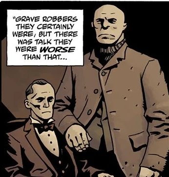

**妖兽与血骨（Rawhead and Bloody Bones）**——生前分别叫 **Tolliver 医生**和 **Stump 先生**——是一对在英格兰约克郡作祟的掘墓盗尸贼。

## 背景

 Tolliver 医生和 Stump 先生是 19 世纪末在约克郡出没的一对盗尸贼。由于他们声名狼藉，两人成了镇上的标志性人物，孩子们编了关于他们的歌谣，把他们叫做"妖兽与血骨"。1892 年 6 月 11 日，一群暴民撞见他们带着一具刚挖出的女孩尸体，把他们殴打致死，尸体深埋在树林里。

## 历史

### [《妖兽与血骨》](/entry/Rawhead_and_Bloody_Bones)

1953 年 3 月，妖兽与血骨的鬼魂开始在"哨猪酒馆"（Whistling Pig）作祟——这是二人生前常去的酒馆。酒馆老板想招揽年轻人，决定用这两个恶名昭彰的食尸鬼的名字给酒馆改名。然而夜里开始发生怪事：怪声、爪痕等等。直到老板发现自家的狗被撕成碎片，他们才联系了[超自然调查防御署（B.P.R.D.）](/entry/B.P.R.D.)。

[特雷佛·布鲁姆](/entry/Trevor_Bruttenholm)教授和[地狱男爵](/entry/Hellboy)查清了这两个食尸鬼的血腥过往，并对鬼魂现身的方式感到不解——仅仅改了他们心爱的酒馆的名字就能招来鬼魂，这是闻所未闻的事。

探员们决定，最好先把招牌烧掉作为象征性的举动，等天亮再联系神父。一行人正要烧招牌时，妖兽与血骨现身，质问他们在做什么。众鬼魂的突然出现令人震惊，一根意外掉落的火柴点燃了招牌，大火熊熊燃起，鬼魂也在烈焰中被烧尽。
