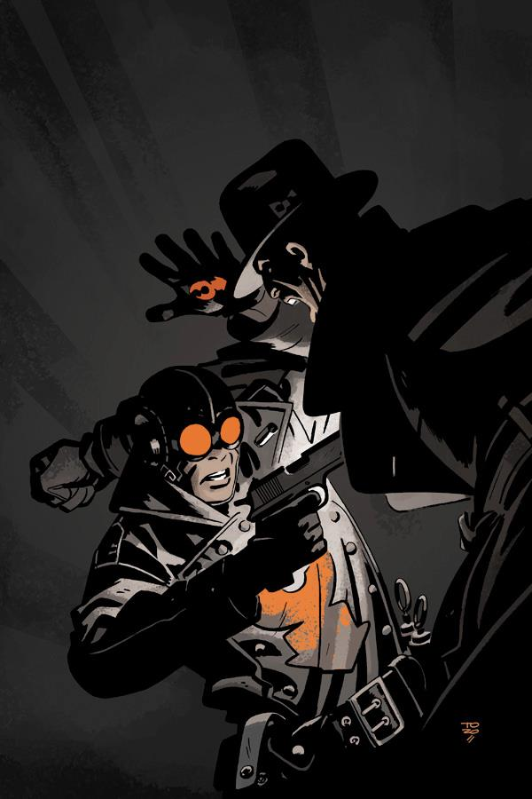

《**尼斐鲁的祷告**》（The Prayer of Neferu）发生在20世纪30年代[龙虾人](/entry/The_Lobster)作为犯罪斗士生涯的早期。

## 出版历史

这部单刊于2012年8月出版，封面由 Tonči Zonjić 绘制。

## 剧情简介

[拉的赫利奥皮克兄弟会](/entry/Heliopic_Brotherhood_of_Ra)举办了一场维多利亚时代主题的派对，连展开一具木乃伊的环节都一应俱全，结果却完全出人意料——其中包括一名枪口喷火、誓言伸张正义的义警！

## 画廊

