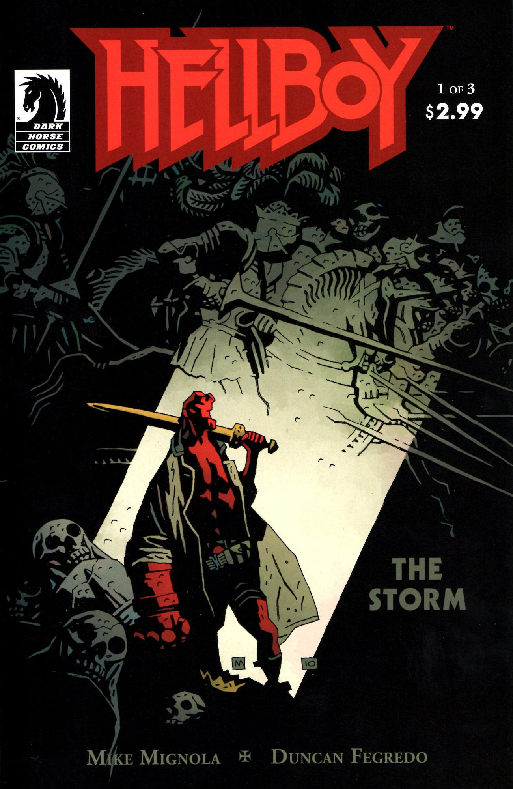
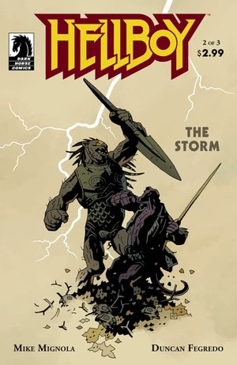
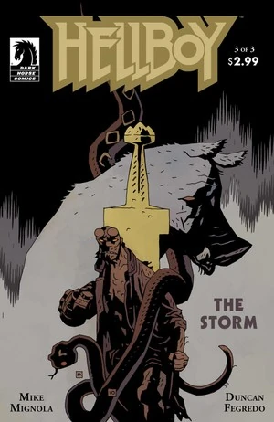
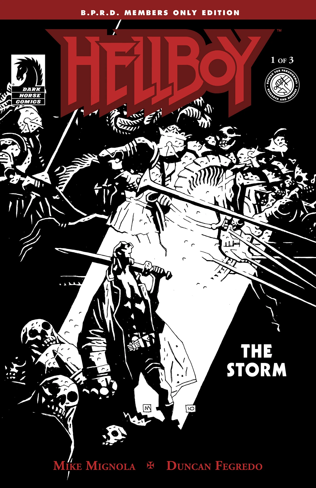

《**山雨欲来**》（The Storm）中，[地狱男爵](/entry/Hellboy_%28character%29)直面他作为圣剑[王者之剑](/entry/Excalibur)持有者的命运。[格鲁阿加赫](/entry/Gruagach)得知了自己的宿命，而[妮穆艾](/entry/Nimue)则继续积蓄力量。

## 出版历史

《山雨欲来》（与《[狂怒](/entry/The_Fury)》一起）是"狂野狩猎三部曲"的第三幕，这三部《[地狱男爵](/entry/Hellboy_%28series%29)》故事（画师为[邓肯·费格雷多](/entry/Duncan_Fegredo)）。《[黑暗召唤](/entry/Darkness_Calls)》和《[狂野狩猎](/entry/The_Wild_Hunt)》构成了前两部分。由于粉丝对《[狂野狩猎](/entry/The_Wild_Hunt)》连载中途延期的反应，三部曲的最后一部分被拆分为两个各三期的系列；《山雨欲来》作为这最终篇章的前半部分，而《[狂怒](/entry/The_Fury)》则作为后半部分。

《山雨欲来》于2010年7月至9月作为三期迷你系列出版。目前它与迈克·米格诺拉创作的一段短篇尾声一起收录在平装合订本[《地狱男爵：山雨欲来与狂怒》](/entry/Trade_Collections)中。

《山雨欲来》第1期的一个特别黑白封面版本，在2010年圣迭戈漫展7月22日星期四的聚会上提供给了B.P.R.D.粉丝俱乐部的成员。

## 剧情简介

### 第一部

[地狱男爵](/entry/Hellboy)和[爱丽丝·莫纳汉](/entry/Alice_Monaghan)前往英格兰的一座教堂，却发现英格兰的贵族亡者实际上正从坟墓中升起。地狱男爵向爱丽丝简要讲述了他离开[B.P.R.D.](/entry/Bureau_for_Paranormal_Research_and_Defense)后的游历。他们驾车离开，却在路上被一个身披铠甲的生物拦住。地狱男爵与该生物搏斗。生物说他侍奉[血之女王](/entry/Queen_of_Blood)，战争即将开始。

与此同时，[格鲁阿加赫](/entry/Gruagach)独自走在树林中。他跌跌撞撞地来到一个身穿长袍的男人面前，男人说格鲁阿加赫此刻正站在他的坟墓上。格鲁阿加赫鞠躬，称这个男人为主人。他请求男人的宽恕，但男人拒绝了。

### 第二部

男人与[格鲁阿加赫](/entry/Gruagach)交谈，向他讲述了[血之女王](/entry/Queen_of_Blood)的故事。[妮穆艾](/entry/Nimue)哄骗[梅林](/entry/Merlin)把他所有的秘密都教给了她，随后利用这些秘密将他活埋。这力量使她发疯，其他女巫杀死了她。

这个看起来与闪回中的梅林一模一样的男人，指责格鲁阿加赫释放了她、导致战争发生。男人向他展示，她的怪物大军已经在集结。他指责格鲁阿加赫害死了[达格达](/entry/Dagda)，并透露[玛布](/entry/Mab)也已被杀。妮穆艾把玛布的血涂在会说话的刺猬身上，将他变成自己的勇士。她派他去杀[地狱男爵](/entry/Hellboy)。

男人诅咒[格鲁阿加赫](/entry/Gruagach)，让他活着亲眼看到他所招致的未来降临——一个被摧毁、由[奥格德鲁·海姆](/entry/Ogdru_Hem)栖息的世界。

一个身披铠甲、头戴王冠的男人，极有可能是[亚瑟王](/entry/King_Arthur)，出现在英格兰的教堂中。他说既然战争将至，叛徒将承受最深重的苦难。

与此同时，[地狱男爵](/entry/Hellboy)仍在与妮穆艾的勇士搏斗。[爱丽丝](/entry/Alice)把[王者之剑](/entry/Excalibur)扔给他。尽管地狱男爵被生物的长矛刺穿，他仍设法杀死了勇士。生物临死时告诉地狱男爵，无论如何妮穆艾都将获胜。她曾是[血之女王](/entry/Queen_of_Blood)，如今是战争女神，但她正在变成别的东西。就连妮穆艾自己也不知道这一点，但生物从玛布的血中得知了真相。他还没来得及说出秘密就死了。

[地狱男爵](/entry/Hellboy)和[爱丽丝](/entry/Alice)找到一家客栈休息。地狱男爵在电视上看到了加利福尼亚州索尔顿湖的那个生物（见[《B.P.R.D.：恐惧之王》第5期](/entry/King_of_Fear_%28story%29)）。他回忆起童年时与[特雷弗·布鲁滕霍尔姆](/entry/Trevor_Bruttenholm)谈论自己长大后将如何与怪物战斗。地狱男爵和爱丽丝望向窗外，看到英格兰的王室亡者聚集在客栈周围。

### 第三部

[地狱男爵](/entry/Hellboy)决定他不率领王室亡者的军队。他告诉[爱丽丝](/entry/Alice)，他的直觉是必须独自面对[妮穆艾](/entry/Nimue)，尽管他不知道该怎么做。他还让她处理掉[王者之剑](/entry/Excalibur)这把剑。地狱男爵与她吻别，走进了树林。

地狱男爵发现[格鲁阿加赫](/entry/Gruagach)被脖子吊在一棵树上。这个生物求地狱男爵杀了他。地狱男爵朝他开了许多枪，但正如[梅林](/entry/Merlin)所说，格鲁阿加赫不会死。

接着地狱男爵遇到了恶魔[阿斯塔罗斯](/entry/Astaroth)，他起初伪装成一个穷人的模样。他向地狱男爵展示[妮穆艾](/entry/Nimue)的大军，并告诉他穿过她大军的唯一办法是释放地狱的军队。地狱男爵再次拒绝率领这支军队。

最后地狱男爵来到[芭芭·雅加](/entry/Baba_Yaga_%28character%29)面前。她提出带地狱男爵绕过[妮穆艾](/entry/Nimue)的大军。但地狱男爵必须把自己的眼睛给她，以偿还他从她眼中射掉的那只眼睛（见《[芭芭·雅加](/entry/The_Baba_Yaga)》）。权衡了自己的选择之后，地狱男爵任由芭芭·雅加取走了他的左眼。

在她的塔中，妮穆艾向[奥格德鲁·贾哈德](/entry/Ogdru_Jahad)祈祷，所用言辞与[拉斯普廷](/entry/Rasputin)在《[毁灭之种](/entry/Seed_of_Destruction)》中所用相同。一个女巫开口接完了她的话。妮穆艾勃然大怒，对女巫大吼。女巫说，在所有被奥格德鲁·贾哈德选中的人之中，妮穆艾蒙受的尊荣最高；因为它们将从她的身体中重生。妮穆艾开始变形，她攻击女巫，叫她停止耍把戏，但最终她明白这并非把戏。七个被囚禁的生物的形体破塔而出，下方集结的大军欢呼起来。

## 内容

### 角色

#### 一般

- [地狱男爵](/entry/Hellboy_%28character%29)
- [爱丽丝·莫纳汉](/entry/Alice_Monaghan)
- 警官
- 比尔（牧师）
- 不列颠的贵族亡者
- [奥格德鲁·海姆](/entry/Ogdru_Hem)
  - [索尔顿湖怪物](/entry/Salton_Sea_Monster)（电视屏幕）
  - 其他奥格德鲁·海姆（幻象）
- [B.P.R.D.](/entry/Bureau_for_Paranormal_Research_and_Defense)
  - [凯特·考瑞根](/entry/%E5%87%AF%E7%89%B9%C2%B7%E8%80%83%E7%91%9E%E6%A0%B9)（电视屏幕）
  - 麦克斯（狗）
  - [特雷弗·布鲁滕霍尔姆](/entry/Trevor_Bruttenholm)（闪回）
- [弗兰肯斯坦的怪物](/entry/Frankenstein%27s_Monster)（被提及）
- [龙虾人](/entry/The_Lobster)（被提及）
- [恶魔](/entry/Demon)
  - [阿斯塔罗斯](/entry/Astaroth)
- 俄罗斯式的死神形象[1]
- [奥格德鲁·贾哈德](/entry/Ogdru_Jahad)

#### 地狱男爵故事闪回

- [莫赫洛米](/entry/Mohlomi)
- [博格·鲁什](/entry/Bog_Roosh)的孙女们（[人鱼](/entry/Merfolk)）
- 骷髅水手
- [赫卡忒](/entry/Hecate)
- [哈里·米德尔顿](/entry/Harry_Middleton)（被提及）
- 来自《[黑暗召唤](/entry/Darkness_Calls)》的女巫
- 狂野狩猎成员

#### [女巫与巫师](/entry/Witches)

- [梅林](/entry/Merlin)
- [妮穆艾](/entry/Nimue)
- [摩根勒菲](/entry/Morgan_Le_Fay)
- [芭芭·雅加](/entry/Baba_Yaga_%28character%29)
  - [科库](/entry/Koku)
- 其他女巫

#### [达因·西迪](/entry/Daoine_Sidhe)与其他[仙灵](/entry/Fairies)

- 刺猬
- [格鲁阿加赫](/entry/Gruagach)
- [玛布女王](/entry/Queen_Mab)（闪回）
- 未具名、叼着烟斗的哥布林（闪回）
- [达格达](/entry/Dagda)（闪回）
- 其他达因·西迪

#### [奥格德鲁·贾哈德](/entry/Ogdru_Jahad)的仆从

- [姆姆南·萨](/entry/Memnan_Saa)
- [拉斯普廷](/entry/Rasputin)
- 亨伯特·T·琼斯
- [兰迪斯·波普](/entry/Landis_Pope)（[黑焰](/entry/The_Black_Flame_%28character%29)）
- 其他祭司与仆从

### 地点

- 英格兰
  - 比尔的教堂
  - 乔治·沃什布鲁克的客栈
  - [妮穆艾](/entry/Nimue)的城堡
- 美国（电视屏幕）
  - 索尔顿湖（加利福尼亚州）（电视屏幕）
- 三又十之国
- 地狱男爵故事闪回
  - 非洲
  - 大西洋
    - 葡萄牙海岸外的岛屿
    - [丽贝卡号](/entry/Into_the_Silent_Sea)（船）
  - [哈里·米德尔顿](/entry/Harry_Middleton)的宅邸（英格兰）
  - 卡波比安科姐妹的宅邸（意大利）
  - [摩根勒菲](/entry/Morgan_Le_Fay)的城堡

### 值得注意的物品

- [王者之剑](/entry/Excalibur)
- 描绘《圣经》中亚当、夏娃与蛇的壁画（闪回）
- [妮穆艾](/entry/Nimue)的头盔

## 画廊

所有封面均由[迈克·米格诺拉](/entry/Mike_Mignola)绘制。

\#1 B.P.R.D.会员封面

[1] *据邓肯·费格雷多所述（Hellboy Book Club 第21集 - Hellboy: Darkness Calls 1:48:05）*
