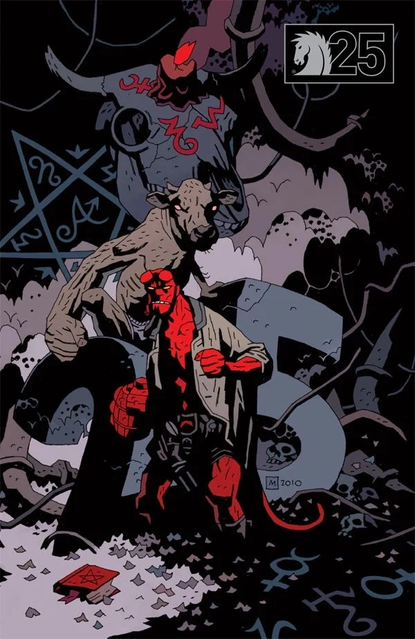

《**巴斯特·奥克莱得偿所愿**》（Buster Oakley Gets His Wish）是一个《[地狱男爵](/entry/Hellboy_%28series%29)》单刊故事，由 [Mike Mignola](/entry/Mike_Mignola) 撰写，[Kevin Nowlan](/entry/Kevin_Nowlan) 作画。

## 剧情简介

十几岁的少年巴斯特·奥克莱呼唤[恶魔](/entry/Demon)来拜访他和他的朋友们。一道耀眼的闪光吞没了他们，他们在闪光中消失。一个农夫抱怨自己的牛失踪，[地狱男爵](/entry/Hellboy_%28character%29)顺路过来查看情况。在农场里游荡时，地狱男爵被吸进一艘装满变异牲畜的巨型宇宙飞船。在被外星人又戳又捅了一番之后，地狱男爵开始挥拳反击。一头穿着内裤、用两条腿站立的牛加入了他。他们与外星人战斗，外星人最终被拖垮，把他们释放在内布拉斯加州。

## 故事年表

故事于 [1985](/entry/Hellboy_Universe_timeline) 年发生在堪萨斯州鲁克斯县。

## 画廊

|Dark Horse 25th anniversary variant by Mike Mignola
## 注释

- 这个故事大量套用了关于外星人的刻板套路，包括[飞碟](https://tvtropes.org/pmwiki/pmwiki.php/Main/FlyingSaucer)、长着大脑袋的[灰人](https://tvtropes.org/pmwiki/pmwiki.php/Main/TheGreys)、外星人[绑架人类](https://tvtropes.org/pmwiki/pmwiki.php/Main/AlienAbduction)，以及在其他家畜之中[偷牛](https://tvtropes.org/pmwiki/pmwiki.php/Main/AliensStealCattle)、恐怖的实验，当然还有[肛门探针](https://tvtropes.org/pmwiki/pmwiki.php/Main/AnalProbing)。
- 一个舱里的外星人似乎[属于同一种族](/entry/Aliens)，与[访客](/entry/The_Visitor_%28character%29)同源。
