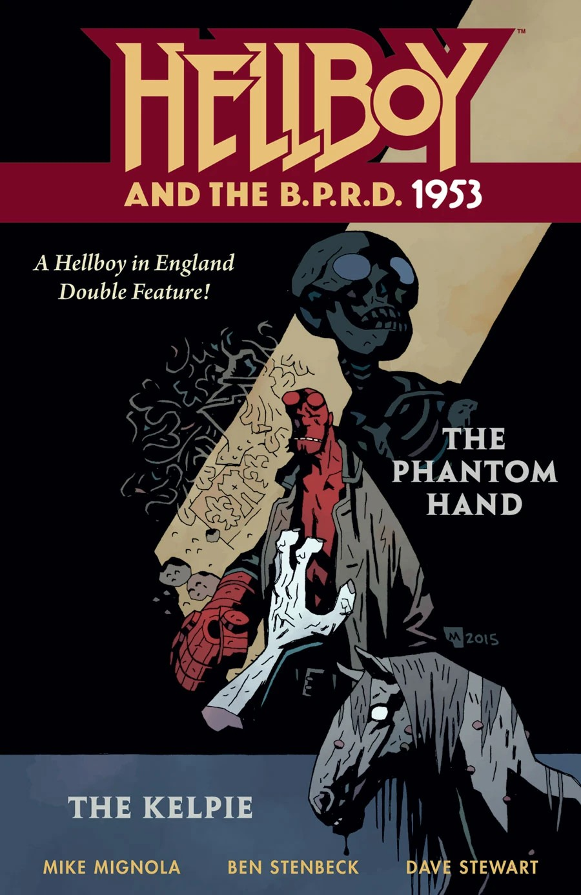

《**幽灵手**》（*The Phantom Hand*）是一个短篇故事，由 Mike Mignola 编剧，Ben Stenbeck 作画。它是组成 *[Hellboy and the B.P.R.D.](/entry/Hellboy_and_the_B.P.R.D.): 1953* 的数个故事之一。

## 剧情梗概

1953 年 2 月，[地狱男爵](/entry/Hellboy_%28character%29)随[特雷佛·布鲁姆](/entry/Trevor_Bruttenholm)前往英格兰，拜访[哈里·米德尔顿](/entry/Harry_Middleton)，并调查一只在某栋宅子里作祟的幽灵之手。哈里向两人讲述了往事：1748 年有数名儿童报失踪，阿尔伯特勋爵（Lord Albert）追查到凶手并砍断了他的手。阿尔伯特勋爵一直住在这栋宅子里，直到 1782 年去世。哈里讲完之后，幽灵手便现身了；地狱男爵把它扔进壁炉，引发了一场爆炸，那只手也化作一头巨大的恶魔般的生物。那生物撞碎窗户把地狱男爵扑倒在屋外，地狱男爵一路追着它来到孩子们的坟前。地狱男爵抓起一块墓碑砸向那生物，它便变回了一只手。事后，哈里和特雷佛趁地狱男爵熟睡，谈论起他的未来。

## 画廊

|*1953* \#1

|1953 #1
