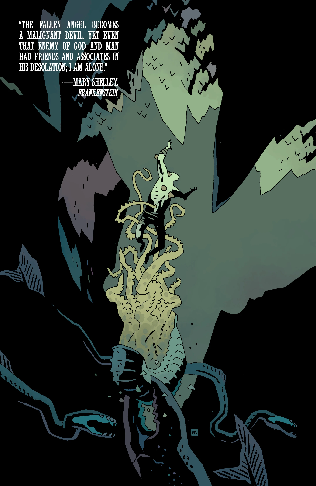
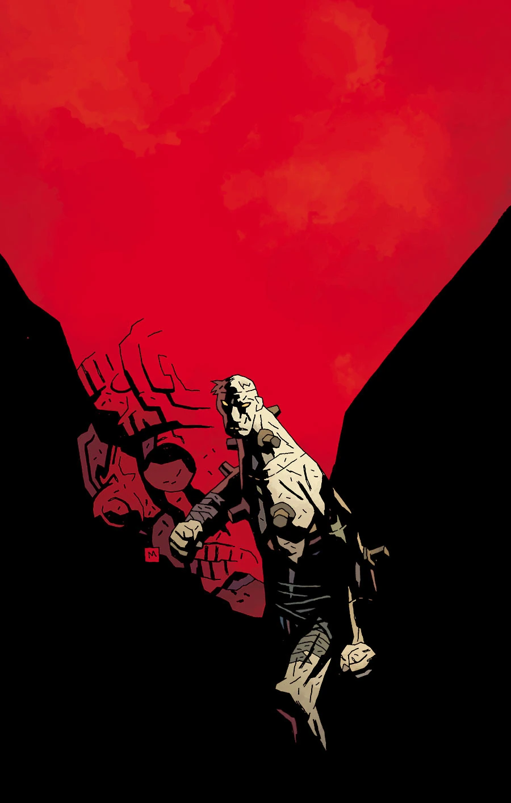
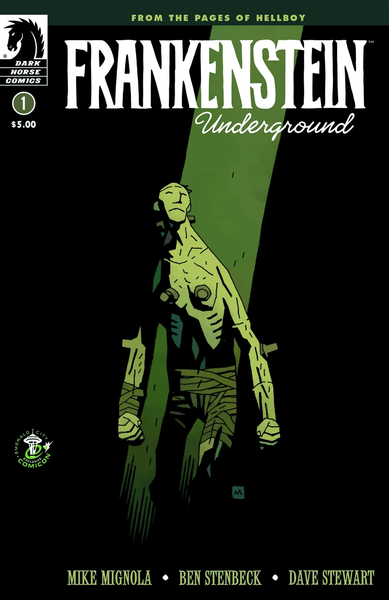
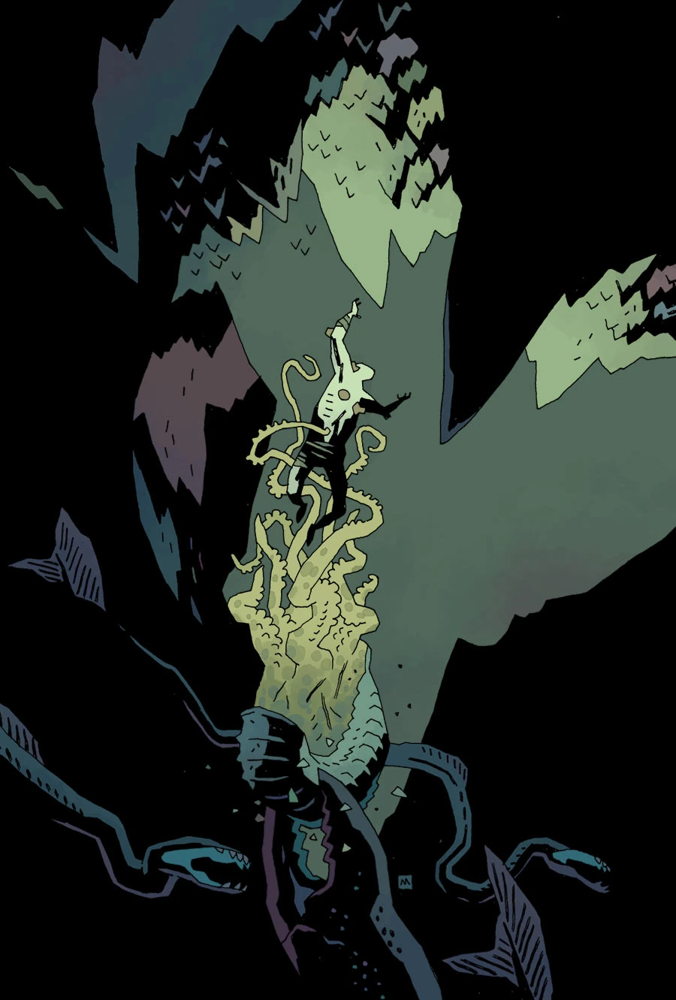
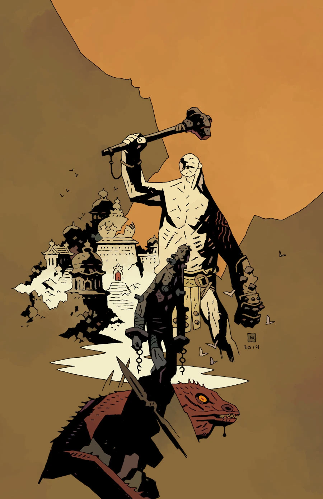
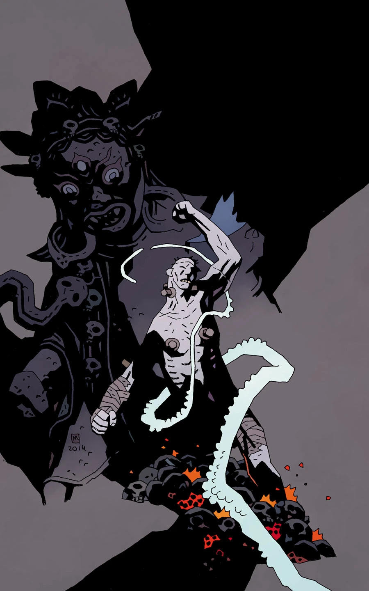
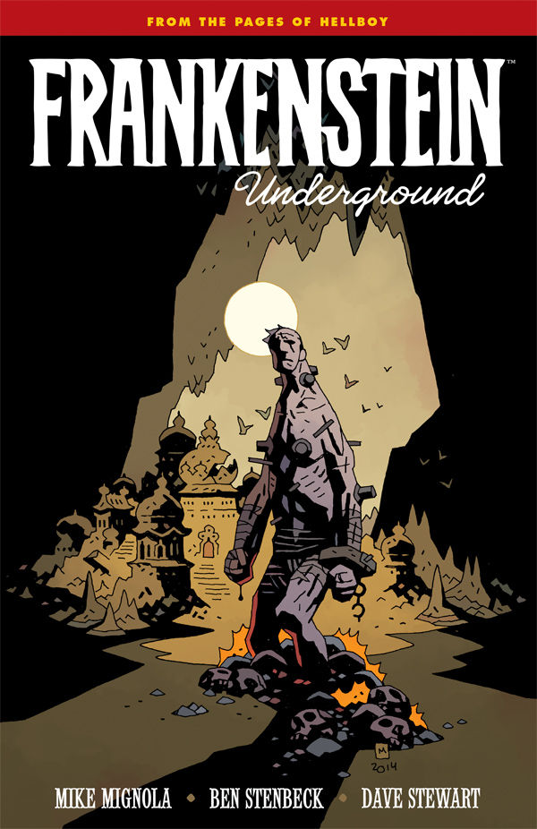

***《弗兰肯斯坦：地心之旅》*（Frankenstein Underground）**是一部五期限定迷你系列，于 2015 年 3 月至 7 月发行。

## 出版历史

*Frankenstein Underground* 于 2015 年 3 月首次推出，是一部独立的五期限定迷你系列。Bleeding Cool 于 2014 年 10 月首次发布了该系列的一张预告图。2014 年 12 月，《Hellboy and the B.P.R.D.: 1952》的第一期中还刊登了三页预览。

## 剧情梗概

### 第一部分

[弗兰肯斯坦造物](/entry/Frankenstein%27s_Monster)孤身一人、遭人遗弃，在地下游荡，在那里他将发现其他奇异的生物——以及宇宙的黑暗秘密。

### 第二部分

被折磨他的人追赶到地心，弗兰肯斯坦的怪物成了另一种生物的猎物。

### 第三部分

弗兰肯斯坦的怪物被一个地下人类种族俘获——但他们的主人并没有拿怪物做实验，而是向他讲述了他们民族的隐秘历史，以及赫利俄皮克拉神兄弟会（Heliopic Brotherhood of Ra）的来历。

### 第四部分

在地下深处，弗兰肯斯坦的怪物被赫利俄皮克拉神兄弟会囚禁。但在他们的主人讲述自己的故事时，怪物发现了这座失落之城的真实历史以及栖居其中的力量。

### 第五部分

弗兰肯斯坦的怪物直面潜伏在地下之城中的危险。他能拯救这座城市的灵魂吗，还是会迎来自己的末日？

## 画廊

 库尔（Cool）的预告图

 \#1

 \#1
翡翠城动漫展（Emerald City Comic Con）限定版

 \#2

 \#3

 \#4

 \#5

 合订本

## 平装合订本（Trade Paperback）

*另见 [弗兰肯斯坦平装合订本合集](/entry/Trade_Collections)* 

*Frankenstein Underground* 被收录进一本无卷号的平装合订本。
