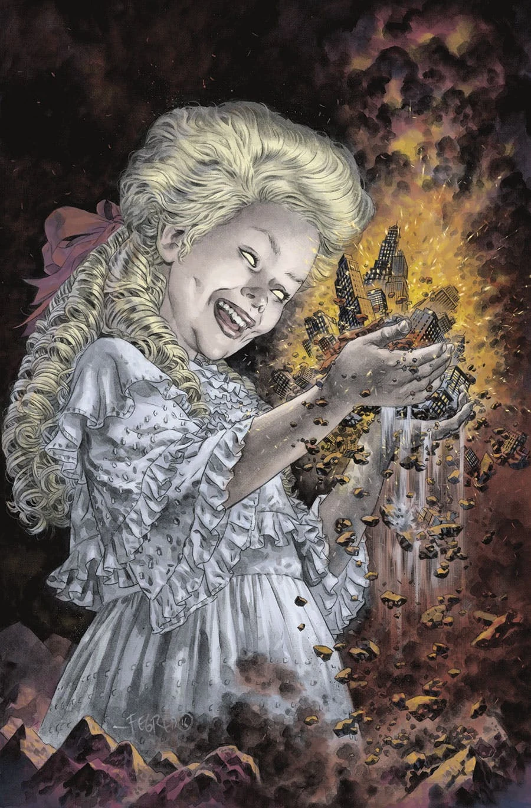
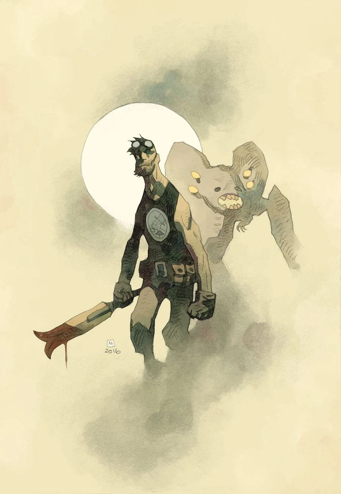
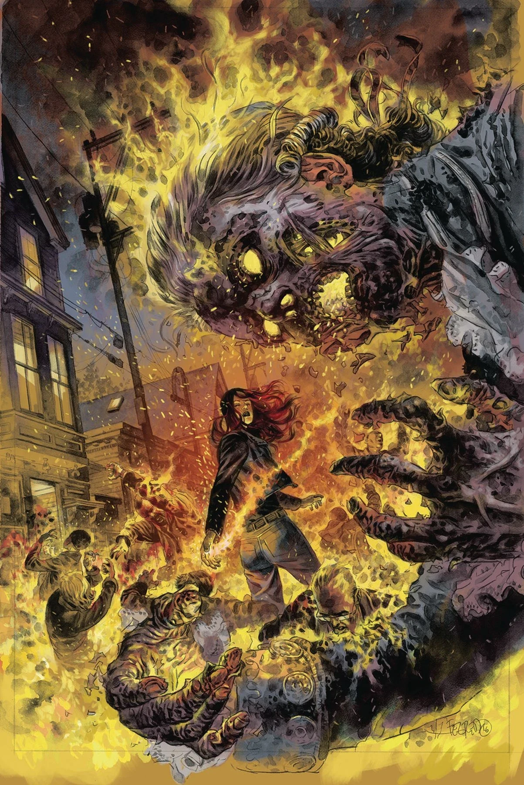
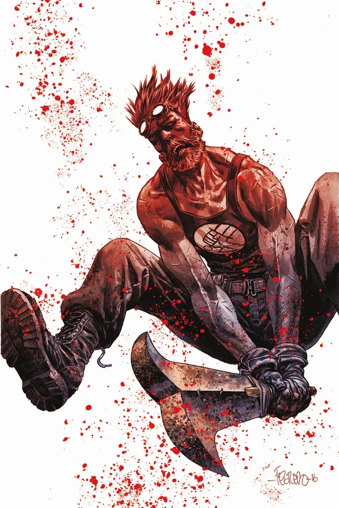
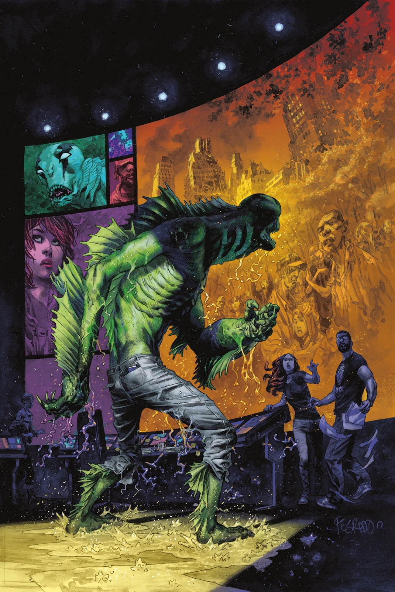
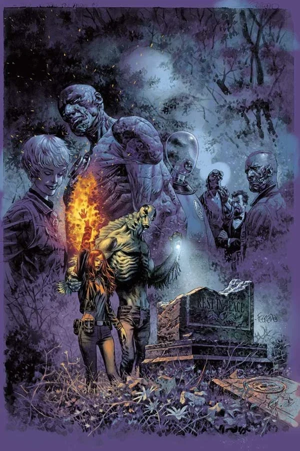

《**弥赛亚**》（Messiah）是[魔鬼旧相识故事环](/entry/The_Devil_You_Know_%28story_cycle%29)的第一个故事弧。

## 出版历史

这个五期故事弧于 2017 年 7 月开始连载。最后一期包含一个重大揭秘，解释了最后一个 [B.P.R.D.](/entry/B.P.R.D._%28series%29)故事环为何取名 *The Devil You Know*（你所认识的魔鬼）。

## 剧情简介

### 第一部

洛夫克拉夫特式的怪物被 B.P.R.D. 击败之前，曾在人间造出一片地狱。如今，丽兹·舍曼率领一支小队穿行于怪物横行的废墟中，执行她一生中最重要的营救任务。社会试图重建之际，形形色色的诡异教派争相扩张势力，而一个恶魔现身出来，为他们指引方向……

### 第二部

末日之灾侥幸得以避免，那些在全球危机中应运而生的教派顿时闲得无所事事。

### 第三部

一个远古之灵被束缚在一件史前武器上，与妄图毁灭世界的造物及其人类仆从进行着永无休止的战争。

### 第四部

驱魔人 Ashley Strode 指引 B.P.R.D. 追缉一名致命的教派领袖，菲尼克斯则力主重返凯特殒命之地。

### 第五部

重返已成废墟的总部——凯特的殒命之地——让老队员们重聚；亚伯紧追一个恶魔，瓦尔瓦拉则揭露了她可怕的计划。

在本期结尾，超自然调查防御署的探员们在去年《终结时刻》系列中被毁的旧总部遗址有了一个着实出人意料的发现：一具棺材，里面装着的似乎不是别人，正是地狱男爵的遗体——而他仿佛正在睁开眼睛……

## 《无尽之谜：Howard 探员简史》

这篇二页后备短篇由 [Matt Strackbein](/entry/Matt_Strackbein)自编自绘，刊载于 *B.P.R.D.: The Devil You Know—Messiah* \#3，回顾了[泰德·霍华德](/entry/Ted_Howards)/[加尔·丹纳尔](/entry/Gall_Dennar)的历史。本短篇未被收录进任何合订本。

## 画廊

除特别注明外，封面均由 [Duncan Fegredo](/entry/Duncan_Fegredo) 绘制。

 \#1

 \#1 变体封面
by [Mike Mignola](/entry/Mike_Mignola)

 \#2

 \#3

 \#4

 \#5
